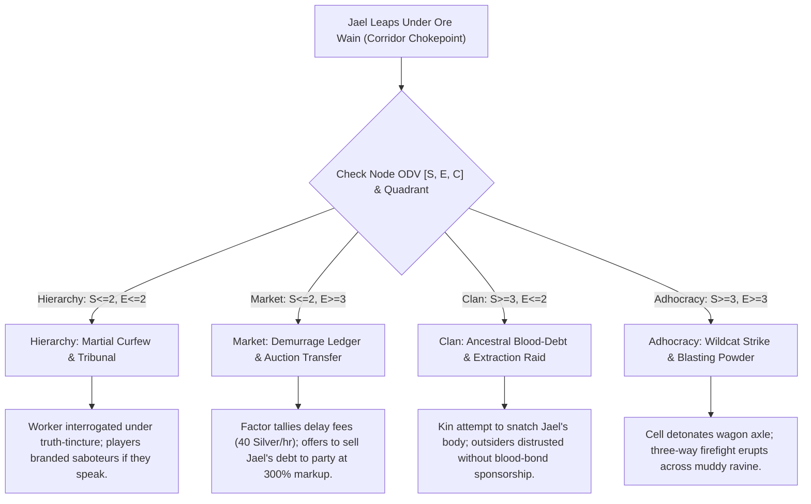
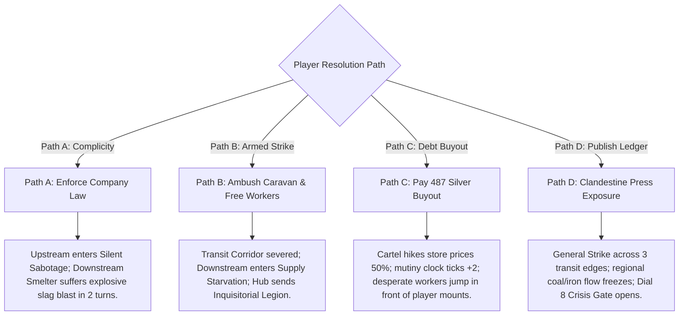

# MODULE HOOK-01: THE INDENTURED CARAVAN DESPERATION LEAP AND TRUCK-SYSTEM FRACTURE
*Pipeline Tier: Tier 4 (Dynamic Narrative Sparks & Regional Dilemmas) | Set: Modular Region Hooks | Topology Role: Transit Edge Chokepoint Catalyst*

---

## 1. Executive Summary & Mechanical Architecture

**HOOK-01** is a plug-and-play regional incident engineered to slot directly onto any **Physical Transit Corridor ($E_{adj}$)** carrying raw inputs (cinnabar, quicksilver, coking coal, sulfur, iron ore, or timber) from an upstream extraction enclave to a downstream sovereign hub or processing facility.

The module models the sudden, violent rupture of an exploitative **Truck System (Company Store Monopsony)**: an economic chokehold where laborers are paid exclusively in non-convertible company scrip, while monopolized food, tools, and housing are billed at extortionate rates that guarantee multi-generational debt bondage.

```text
┌────────────────────────────────────────────────────────────────────────┐
│               THE CARAVAN CHOKEPOINT & TRUCK SYSTEM CRISIS             │
├──────────────────────────┬──────────────────────────┬──────────────────┤
│    UPSTREAM EXTRACTION   │   PHYSICAL CORRIDOR      │  DOWNSTREAM HUB  │
│  • Indentured Pit Slaves │   • 6-Ox Heavy Ore Wain  │  • Blast Furnace │
│  • Truck-Store Monopsony │   • Maimed Worker Jael   │  • Smelter Grid  │
│  • Compounded Debt Liens │   • Bloodstained Ledger  │  • Supply Hunger │
└──────────────────────────┴──────────────────────────┴──────────────────┘
```

### 1.1 The Physical Anchor: The Sunken Sluice Wagon Rut
The incident detonates along a narrow switchback cutting through a muddy limestone ravine or slag-strewn defile. Traveling along this corridor is a convoy of heavy, iron-banded freight wains—each hauled by six lumbering draft oxen and loaded with eight tons of unrefined, high-density ore. Flanking the caravan are mounted corporate drovers armed with leaded bullwhips and foot-guards carrying heavy repeating arbalests.

### 1.2 The Incident: The Maimed Martyr
In the blinding limestone dust and icy mountain drizzle, an inebriated, hollow-cheeked pit worker named **Jael Moros** (42 years old, shivering with cheap potato-brandy tremors and acute silicosis) screams a choked curse and hurls his body directly beneath the iron-shod wheels of the lead freight wain. 

His desperate suicide attempt fails:
* The lead ox-team veers violently in panic; the massive six-foot iron wheel does not crush his skull, but rolls across his left hip and thigh, shattering the pelvis and femur with a sickening crack.
* Trapped and bleeding profusely in the deep wagon ruts, Jael is dragged screaming through the mud as the wain jacks to an abrupt halt.
* Company overseers immediately dismount with iron clubs and leather gags, attempting to suppress the spectacle before the following transport wagons pile up or the adjacent quarry shift notices the commotion.

### 1.3 The Smuggled Relic: The Company Store Ledger Note
Tucked into the lining of Jael's grease-soaked boot is a folded, wax-sealed oilcloth containing his official **Consolidated Cartel Truck-Shop & Commissary Ledger Sheet** (reproduced in full in Section 4). 

The itemized record mathematically documents the impossibility of freedom: after 26 years of continuous deep-shaft labor, Jael owes the company **487 Silver Links**—a debt compounded by fines for coughing during inspections, candle wax deductions, and exorbitant interest. Scribbled on the back in charcoal is a suicide note explaining that he believed throwing himself under the wheels would legally terminate his contract and spare his eight-year-old daughter from inheriting his indenture.

---

## 2. Dynamic Behavioral Vectors by Node & Party Disposition

The systemic fallout of this encounter is directly governed by the host node's **Organizational Disposition Vector $\mathbf{ODV} = [S, E, C]$** and Competing Values Framework (CVF) Quadrant:

```text
                 [S] STABILITY                          [E] FOCUS
        S <= 2: Rigid Protocol / SOPs           E <= 2: Inward Sovereignty / Clan
        S >= 3: Flexible / Opportunistic        E >= 3: Outward Commerce / Extraction
```



### 2.1 Hierarchy Node Reaction ($S \le 2, E \le 2$ — Control / Sovereign Bureaucracy)
* **Institutional Logic:** Protocol is sacred; individual human life is state property. Jael's act is treated not as a tragedy, but as **Aggravated Obstruction of Sovereign Freight and Willful Destruction of State Collateral**.
* **Overseer Procedure:** Bailiff Kaelen orders the road cleared within 3 minutes. Jael is dragged into the wayside guardhouse, strapped to an iron chair, and administered caustic veritas-brine (DC 14 Constitution check or 2d8 acid/internal damage) to extract the names of fellow conspirators.
* **Party Friction:** Any party member attempting to render medical aid or question the bailiff is formally charged with *Impeding Sovereign Logistics* (Light DC 10 test to de-escalate; failure marks the party with an official regional arrest warrant).

### 2.2 Market Node Reaction ($S \le 2, E \ge 3$ — Compete / Extractive Cartel)
* **Institutional Logic:** Everything is an entry on the balance sheet. Jael's broken body is simply a depreciated capital asset that has incurred unbudgeted demurrage.
* **Overseer Procedure:** Factor Vance calmly opens his brass-bound tally book. He calculates the 40-minute road blockage at **50 Silver Links per hour**, adds the cost of an injured draft ox, and tethers the debt to Jael's account. Since Jael's remaining physical labor capacity is zero, Vance marks him for **Liquidated Resale**—transferring his living carcass to an offshore sulfur-leaching basin or medical vivisection guild for 15 Silver Links salvage value.
* **Party Friction:** If the players intervene, Vance offers to sell Jael's complete indenture contract to them on the spot for **550 Silver Links** (the debt plus a 15% "administrative nuisance fee"). If the players refuse or negotiate aggressively, Vance threatens to hire passing mercenaries to confiscate the party's mounts as collateral.

### 2.3 Clan Node Reaction ($S \ge 3, E \le 2$ — Collaborate / Kinship Syndicate)
* **Institutional Logic:** Blood and hearth precede corporate contracts. Jael is not an isolated drifter; he is an uncle, cousin, or sworn guild-brother to the sixty miners watching from the rim of the quarry.
* **Overseer Procedure:** The guards know they are surrounded by kinfolk and draw weapons defensively, forming a turtle-shield wall around the wagon while sending a rider for reinforcements.
* **Party Friction:** Clan elders do not trust outside adventurers. If the party sides with the guards, the clan marks them as blood-enemies across the entire mountain range. If the party protects Jael, the clan offers subterranean sanctuary, revealing hidden smuggler tunnels that bypass the canyon tolls.

### 2.4 Adhocracy Node Reaction ($S \ge 3, E \ge 3$ — Create / Wildcat Frontier)
* **Institutional Logic:** Anarchic volatility and opportunism. Jael's suicide was intended as a distraction for an armed clandestine strike cell (*The Red Sieve*) waiting to hijack the payroll wagon behind the ore wain.
* **Overseer Procedure:** Utter chaos. Jael's premature jump botched the timing; the insurgent cell detonates improvised mining powder charges along the cliff face, showering the road in jagged limestone scree.
* **Party Friction:** The party is caught directly in the kill-zone between desperate insurgents firing hunting bows and panicked guards blind-firing heavy arbalests.

---

## 3. The 4-Corner Dramatic Opposition Web

```text
                     [1. FACTOR VANCE CALLOW]
                   (Establishment / Ledger Law)
                                ▲
                                │
             COLLISION 1        │        COLLISION 2
      Legalism vs. Dynamite     │   Extortion vs. Watered Gin
                                │
                                ▼
[2. MARA "RED-SIEVE" THORNE] ◄─────► [3. "GIMLET" JOCK]
(Insurgent / Striker Cell)              (Thematic Shadow / Scrip Usurer)
                                ▲
                                │
                           COLLISION 3
                     Martyrdom vs. Survival
                                │
                                ▼
                        [4. JAEL MOROS]
                 (Tertiary Outcast / Maimed Victim)
```

### Corner 1: The Establishment — Factor Vance Callow (The Iron Tally)
* **Worldview:** Contracts are the bedrock of civilization. Without debt peonage, the raw ore stays in the mud, the blast furnaces freeze, and barbarian hordes overrun the province.
* **Leverage:** Legal warrants signed by Sovereign Magistrates, an ironbound contract chest, 12 heavy crossbowmen in plate jacks.
* **Blind Spot:** Incapable of seeing systemic human boiling points; believes every rebellion can be solved with higher compound interest or harsher flogging.

### Corner 2: The Challenger — Mara "Red-Sieve" Thorne (The Clandestine Hammer)
* **Worldview:** The company store is a slaughterhouse that consumes human marrow; the only language the cartel understands is fire in the coal chutes and severed axles on the highway.
* **Leverage:** Clandestine network of 80 radicalized miners, stolen blasting oil, intimate knowledge of mine ventilation flues.
* **Blind Spot:** Complete disregard for collateral damage. Willing to starve an entire downstream city of coal if it breaks the cartel's grip.

### Corner 3: The Thematic Shadow — "Gimlet" Jock (The Scrip Usurer & Barkeep)
* **Worldview:** The world is rigged, so you might as well take your cut. The cartel skins the miners; Jock sells them the gin that lets them forget the skinning.
* **Leverage:** Operates the only shanty-tavern (*The Broken Pick*) outside the gates; buys company scrip from desperate miners at 25% face value in exchange for watered grain alcohol; acts as a paid informant for Factor Vance.
* **Blind Spot:** Cowardice. When violence erupts, he hides under his floorboards, terrified that both sides will realize he played them against each other.

### Corner 4: The Tertiary Outcast — Jael Moros (The Crushed Collateral)
* **Worldview:** Total despair. He gave thirty years of sweat, breath, and blood to the rock, only to watch his daughter's name written into the company debt book.
* **Leverage:** Moral authority of a sacrificial victim; his broken body and bloodstained ledger are absolute proof of corporate tyranny that can ignite a regional general strike.
* **Blind Spot:** Brain-fogged by cheap liquor, physical trauma, and agonizing bone fractures; incapable of surviving without immediate medical intervention.

---

## 4. Primary In-Game Artifact: The Company Store Debt Ledger

Below is the verbatim text of the bloodstained parchment recovered from Jael's boot. Game Masters running physical or virtual tabletops can present this transcript directly to players as tangible evidence:

```text
================================================================================
       CONSOLIDATED ORE & MINERAL EXTRACTION CARTEL — COMMISSARY DIVISION
                 OFFICIAL TRUCK-STORE DEBT & LEDGER BALANCE SHEET
================================================================================
LABORER IDENTIFIER: Jael Moros (Drifter #1,409)
ASSIGNED POSTING:   Lower Flume 3, Drift Bedrock B
FAMILY LIEN HOLDER: Marta Moros (Daughter, Age 8 — Registered Dependent)
CONTRACT TERMS:     Indenture Standard 9B (Non-Severable / Hereditary Transfer)
--------------------------------------------------------------------------------
PERIOD: CYCLE 312 (MONTH 39 OF 60 BASELINE CONTRACT)

[CREDITS / ACCRUED WAGE]
  • 28 Shifts Heavy Drift Pick-Labor @ 1.0 Tin Chit / Shift ......... +28.0 Chits
  • Bonus: Overtime Sump Clearing (Acid Infiltration) ...............  +2.0 Chits
  TOTAL GROSS ACCRUED EARNINGS (Company Scrip Only) ................  +30.0 Chits

[DEBITS / COMPULSORY COMMISSARY CHARGES]
  • Bunkhouse Straw-Tick Rental (Tier 4, Damp Sump Tier) ........... -12.0 Chits
  • Tool Rental: 1 Cast-Iron Pickaxe & Replacement Handle ...........  -6.0 Chits
  • Illumination Tax: 14 Tallow Dips @ 0.5 Chits each ..............  -7.0 Chits
  • Commissary Staple: 1 Tub Salted Mutton Scrap & Moldy Meal ...... -14.0 Chits
  • Medical Assessment: 1 Tin Camphor Rub & Silicosis Lard .........  -4.0 Chits
  • Purity Levy: Drainage Sump Pumping Contribution ................  -5.0 Chits
  TOTAL COMPULSORY SUBSISTENCE DEDUCTIONS .......................... -48.0 Chits

[PENALTIES & LIEN CHARGES]
  • Fine: Unsanctioned Coughing Fit During Overseer Muster ..........  -3.0 Chits
  • Fine: Dull Drill-Bit Wear & Tear Assessment ....................  -5.0 Chits
  • Commissary Surcharge: 1 Flagon Cheap Potato Spirits ............  -4.0 Chits
  TOTAL DISCIPLINARY FINES ......................................... -12.0 Chits
--------------------------------------------------------------------------------
NET MONTHLY BALANCE:                                                -30.0 Chits
(Converted to Sovereign Debt at Fixed Cartel Ratio: 1 Chit = 2 Silver Links)

PREVIOUS OUTSTANDING HEREDITARY DEBT:                              427.0 Silver
CURRENT CYCLE DEFICIT:                                             +60.0 Silver
--------------------------------------------------------------------------------
TOTAL CURRENT CONTRACT OBLIGATION:                                 487.0 Silver
(Estimated Labor Cycles Remaining at Current Net Deficit: IN PERPETUITY)
================================================================================
CLAUSE 9B: In the event of physical incapacity, total debits accrue directly
to primary and secondary kin. Dependent Marta Moros (Age 8) is hereby mortgaged
to the Upper Sorting Flume starting Cycle 314 to satisfy interest accrual.
================================================================================

[SCRAWLED IN CHARCOAL ON REVERSE SIDE IN TREMBLING HANDWRITING]:
"My knees are white bone. The air in drift 3 tastes of rot. Vance told me Marta 
starts at the flume when the thaw comes. She is eight years old. I bought three 
flagons of Jock's gin with my last scrap. If the iron wheel takes my neck on the 
turn, the clerk cannot bill a corpse. The law says dead men have no debt. 
Marta, little bird, run to the coast before they read this paper."
================================================================================
```

---

## 5. Regional Pointcrawl Network Impacts & Systemic Ripple Effects

In accordance with the **Universal Adventure Framework SRD (Section 5: Logistical Supply Line Severance)** and **Campaign Authoring Engine SRD (Section 2: Graph Topology)**, player choices in this encounter produce quantified structural shifts across the network:



### 5.1 Path A: Complicity (Backing Company Law & Clearing the Road)
* **Tabletop Action:** The party helps overseers drag Jael out of the ruts, binds his wounds with rough burlap, or looks the other way while he is thrown into the guardhouse. The oxen are whipped into motion; the caravan departs within 10 minutes.
* **Immediate Local Result:** Factor Vance grants the party a **Cartel Toll Pass** (free transit along this edge for 1 Campaign Turn) and 20 Silver Links.
* **Regional Network Fallout:**
  * *Upstream Node ($u$):* The 200 pit workers witness Jael's public ruin and enter a state of **Silent Sabotage**. Laborers intentionally mix shale, slate, and pyrites into the refined ore hoppers. Upstream output dial drops from Level 2 to Level 1.
  * *Downstream Hub ($v$):* Two Campaign Turns later, the contaminated ore is dumped into the Downstream Sovereign Hub's blast furnace. The hidden pyrites cause a catastrophic steam explosion, cracking the refractory brick lining (Severe Tier Hazard, DC 16 / 4d10 damage to the foundry; metals output halved for 3 weeks).
  * *Hegemonic Vector ($E_{inf}$):* The Cartel tightens its grip, deploying 10 additional mercenaries per node.

### 5.2 Path B: Direct Armed Intervention (Rescuing Jael & Overturning the Caravan)
* **Tabletop Action:** The players engage the company guards in open combat, killing or driving off Factor Vance and his enforcers, securing Jael, and unhitching the oxen.
* **Immediate Local Result:** Jael is rescued (requires a DC 13 Medicine check and 10 silver in bandages to stabilize). The party gains 8 tons of crude ore and the ox-team.
* **Regional Network Fallout:**
  * *Transit Edge ($E_{adj}$ Severed):* Overturned wains and scattered boulders completely block the ravine. The physical corridor is impassable to freight wagons for $1\text{d}4$ campaign weeks.
  * *Downstream Hub ($v$):* **Supply Starvation Protocol Activated** (SRD Section 5.2). The downstream smelter node enters starvation. In Campaign Turn 2, furnace fires are damped; in Campaign Turn 4, weapons forging ceases; hub defense rating drops by -2; refined tool prices across the island triple (+300%).
  * *Hegemonic Retaliation ($E_{inf}$):* The Sovereign Hub's High Council views the disruption as an act of war. They dispatch a **Punitive Inquisitorial Dragoon Unit** (24 mounted heavy lancers, Severe Tier DC 16) up the edge to execute every tenth miner and hang the responsible adventurers.

### 5.3 Path C: Legal & Financial Redemption (Buying Out the Contract)
* **Tabletop Action:** The players present 487 Silver Links (or equivalent high-tier salvage/gems) to Factor Vance, legally purchasing Jael's indenture contract and his daughter's freedom.
* **Immediate Local Result:** Vance accepts the silver with a mocking bow, hands over the official cancellation seal, and allows the party to transport Jael to safety. Jael weeps uncontrollably, pledging lifelong service or ancestral lore to the party.
* **Regional Network Fallout:**
  * *The Monopsony Reaction:* Factor Vance realizes that wealthy outside do-gooders are travelling the highways. To capitalize on this new revenue stream, the Cartel immediately **raises commissary prices by 50% across all extraction satellites**, intentionally driving hundreds of other miners deeper into debt to bait additional ransom buyouts.
  * *The Desperation Contagion:* Word spreads that "wealthy lords are buying out miners who leap under wheels." Over the next two travel cycles, whenever the players traverse an industrial or mining node, **desperate indentured workers repeatedly throw themselves in front of the party's horses**, clutching debt chits and begging for salvation. The party cannot move through mining settlements without being mobbed.
  * *Labor Threat Clock:* Advances the island-wide `Labor Mutiny Clock` by **+2 Ticks**, as workers who were not bought out riot in fury against the arbitrary favoritism.

### 5.4 Path D: Weaponized Exposure & The General Strike (Distributing the Ledger)
* **Tabletop Action:** The players take Jael's debt ledger to an underground printing press (synergizing with `ESOT-01: Yellow Press & Print Media Forgery`) or read it aloud to the assembled night-shift at the pit head, rallying the miners with Mara Thorne.
* **Immediate Local Result:** A general wildcat strike erupts instantly. 200 miners drop their picks, seize the company magazine, arm themselves with black-powder kegs, and barricade the canyon gates.
* **Regional Network Fallout:**
  * *Systemic Multi-Edge Freeze:* The strike spreads along physical transit corridors to two adjacent resource nodes (e.g., the timber logging camps and charcoal kilns). All industrial freight halts across the western quadrant of the pointcrawl graph.
  * *Crisis Gate Window (SRD Section 8.4):* The Sovereign Hub's energy grid maxes out its threat clock, opening a **Mandatory 1-Session Heroic Crisis Gate**. The players must negotiate a regional labor treaty between the Sovereign Council and the Striker Soviet, or the entire province devolves into scorched-earth civil war.

---

## 6. Tabletop Encounter Sparks & Scene Calculus

### Encounter Spark 1: The Wet Snap Under the Rim (Arrival Collision)
* **The Scene:** Cold drizzle mixes with limestone dust, turning the road into slick gray grease. The party rounds a hairpin bend behind an 8-ton ore wain. Suddenly, a ragged figure screams from the ditch, staggering into the churning six-foot iron wheel. The oxen bellow; wood splinters; a sickening crunch echoes off the ravine walls.
* **The Immediate Collision ($><$):**
  * *Overseer Kaelen's Goal:* Clear the road in 120 seconds. Use iron crowbars to lever the wheel off Jael's crushed leg, haul him into the underbrush, and keep the caravan rolling.
  * *Jael's Goal:* Die quickly, or press his bloody ledger into someone's hands before the overseer burns it.
* **Polarity Shift ($+ \to -$):**
  * The party shifts from *routine overland transit* to *active moral complicity in corporate manslaughter*. Every second they hesitate advances the `Caravan Stoppage Clock`.
* **Bifocal Subtext:**
  * *Spoken Aloud by Overseer:* "Stand back, travelers! Routine road accident. The company medical orderly is en route. Do not obstruct trade."
  * *Unspoken Reality:* Guards are quietly surrounding the party with loaded arbalests while an orderly searches Jael's pockets for strike pamphlets.

### Encounter Spark 2: The Weigh-Scale Interrogation (The Moral Crucible)
* **The Scene:** Inside the wayside weigh-station, rain drips through corrugated tin sheets. Jael lies on a flour sack, face gray with shock, bleeding into the floorboards. Factor Vance sits at a mahogany desk, slowly counting silver coins into velvet pouches while a clerk records Jael's dying breaths.
* **The Immediate Collision ($><$):**
  * *Factor Vance's Goal:* Close the ledger balance. Intimidate the party into paying for the wagon's broken axle (80 Silver) or sign an affidavit that Jael's act was suicide, allowing the cartel to seize his daughter immediately.
  * *The Party's Goal:* Save Jael's life, extract the full truth of the truck system, and prevent the child's seizure without triggering an immediate garrison shootout.
* **Tactical Test Binding:**
  * *DC 13 Medicine (Moderate):* Apply a tourniquet and set the splintered pelvis before hemorrhagic shock sets in (failure inflicts 2d8 damage; Jael lapses into coma).
  * *DC 16 Persuasion / Intimidation (Severe):* Force Vance to halt the punitive clauses by citing higher sovereign charter violations (failure advances `Caravan Stoppage Clock` to 4/4, triggering mercenary cavalry attack).
  * *DC 13 Sleight of Hand (Moderate):* Pocket the second half of the Cartel Master Ledger from Vance's desk while he is distracted.

---

## 7. GM Socketing, Topological Integration & Synergies

### 7.1 Recommended Network Placement
* **Generic Starter Preset (*Tutorial Isle*):**
  * Best slotted onto **Transit Edge (2 $\to$ 14)** or **Edge (3 $\to$ 1)**: The primary road carrying raw clay, peat, or bog-iron from the frontier pits into the main harbor or watermill hub.
* **Opal Island Preset:**
  * Best slotted onto **EDGE-01 (Canyon Road Fatal Funnel)**, **EDGE-03 (Walter's Wiggles)**, or adjacent to **ESOT-05 (Reformation Penal System)** and **INFRA-02 (Arc-Furnace Smelter)**.

### 7.2 Supply Chain Interlocks
* **Feeds Downstream:**
  * `Material: Refined-Ingots` to Foundry / Armory Hubs.
  * `Power: Hydro-Pelton-Coal-Fuel` to Industrial Dynamo Grids.
* **Starvation Fallout:**
  * If this edge is severed for more than 2 Campaign Turns, downstream bastions lose the ability to repair armor or cast ballista bolts, increasing all encounter hazards in the hub by **+1 Severity Tier**.

---

## Authoritative Specifications & Cross-References
* **Authoring Engine Standard**: Governed by [Campaign Authoring Engine SRD (Section 2: Topology & Section 6: Module Architecture)](file:///c:/Users/Milo/Documents/Antigravity/Creator_Full_Standalone/docs/srd/authoring_engine_srd.md).
* **Tabletop Runtime Mechanics**: Governed by [Universal Adventure Framework SRD (Section 2: Threat Clocks, Section 3: Hazard Severity Tiers & Section 5: Supply Line Severance)](file:///c:/Users/Milo/Documents/Antigravity/Creator_Full_Standalone/docs/srd/adventure_framework_srd.md).
* **Sociological Alignment**: Mapped to 64-Cell Disposition Matrix in [Tarot Decision Framework](file:///c:/Users/Milo/Documents/Antigravity/Creator_Full_Standalone/sociology/06_Disposition_Matrix_and_Tarot_Decision_Framework.md).
* **Creative Writing Standards**: Engineered per [Creative Writing Backlog Operating Manual](file:///c:/Users/Milo/Documents/Antigravity/Creator_Full_Standalone/tickets/creative/README.md).
