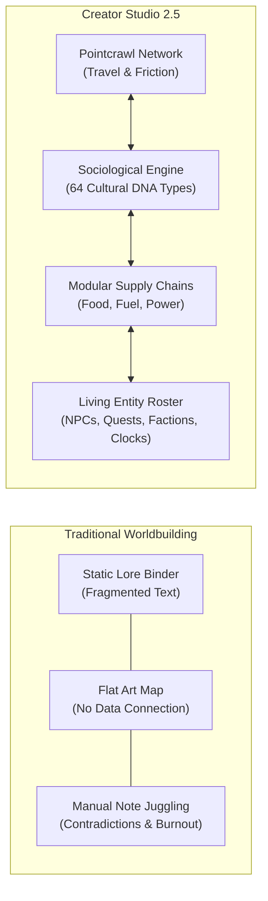
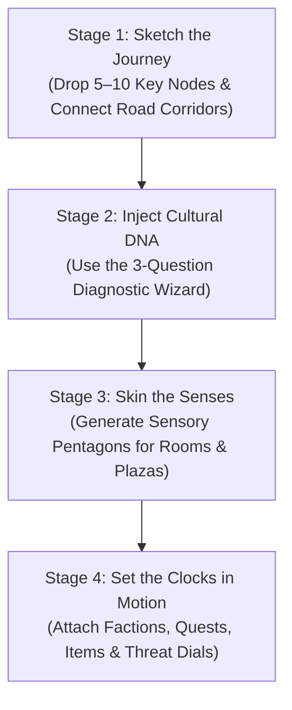
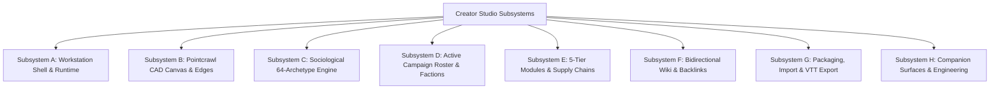
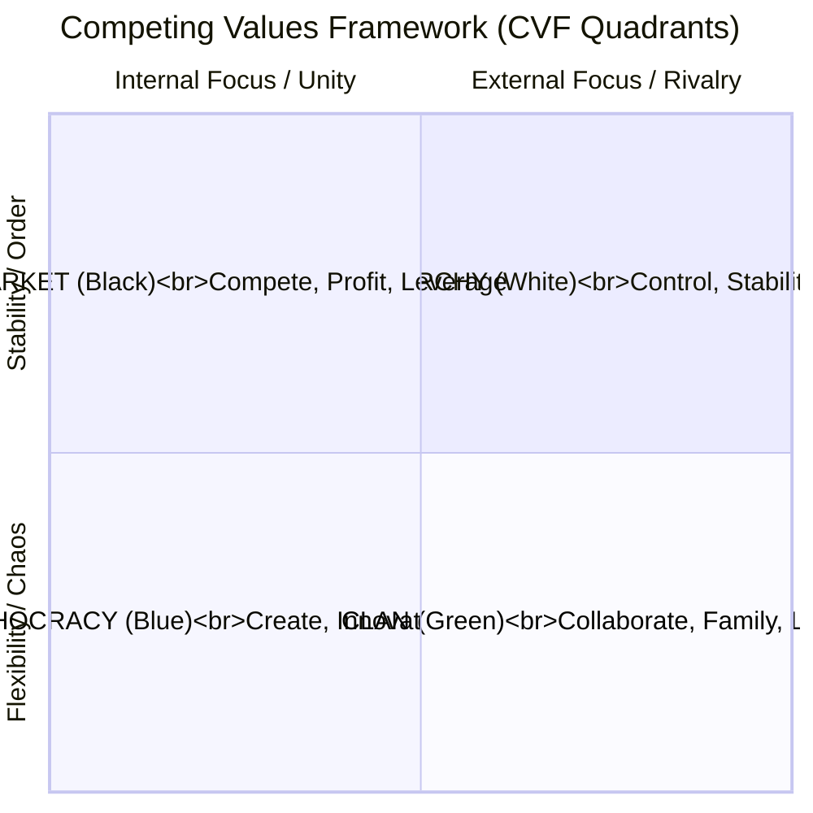
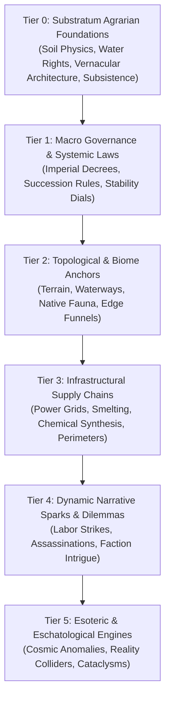
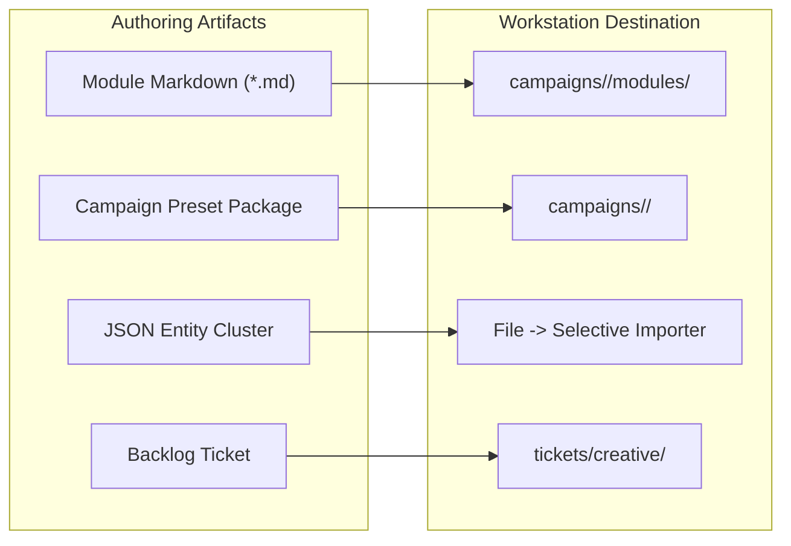

# CREATOR STUDIO (WORKSTATION 2.5)
## Authoritative Explanation, Operational Playbook & Comprehensive Feature Reference Manual

---

# CHAPTER 1: Low-Tech Executive Overview

## 1.1 The Core Mental Model: What is Creator Studio?

> **The One-Sentence Definition:**  
> **Creator Studio** is a visual workstation that combines the spatial precision of **Computer-Aided Design (CAD)**, the narrative organization of **Scrivener**, and the dynamic economic simulation of **Civilization** to author living, interconnected fictional worlds.

To understand Creator Studio, think about how traditional worldbuilding works:
* A writer or Game Master fills a notebook, a Google Doc, or a wiki with hundreds of pages of lore.
* They draw a static map with mountains, rivers, and dotted borders.
* When characters travel or the story unfolds, the author must juggle dozens of disconnected notes: *Which faction controls this bridge? What do people eat here? What happens if the mine shuts down? How do the locals dress and react to outsiders?*

Within a few chapters or game sessions, the lore contradicts itself, travel feels empty, and the author experiences **prep burnout**.

**Creator Studio replaces the binder of static notes with a living visual network.** 

Instead of treating a world as a flat drawing or an encyclopedia, Creator Studio treats a world as an interconnected web of places, travel routes, cultures, factions, and supply lines. When you place a town, the system helps you determine where its food comes from, what hazards lurk along the road to the capital, how its cultural values shape daily life, and what political crises are ticking down in the background.



---

## 1.2 Five Plain-English Building Blocks

You do not need an engineering or math degree to understand how Creator Studio works. The entire system is built on five intuitive principles:

### 1. Pointcrawls Over Empty Grids: Travel is About Choices, Not Miles
In fantasy and sci-fi maps, authors often use hex grids or ruler measurements. But in compelling storytelling, characters do not care about raw mileage; they care about **destinations** and **the friction of getting there**.
* A **Node** is a destination: a mountain pass, a fortified gatehouse, a bustling harbor tavern, or a hidden shrine.
* A **Transit Corridor** is the physical route connecting two destinations: a paved imperial highway, a swamp trail infested with giant leeches, or a subterranean canal.
* Along every corridor, Creator Studio tracks **distance, travel hazards, tolls, and cultural friction**, answering the storyteller's most important question: *What makes this journey dangerous or interesting?*

### 2. Cultural DNA `[S, E, C]` Over Simplistic Good vs. Evil
Real cultures and organizations are rarely purely "Lawful Good" or "Chaotic Evil." They are shaped by structural realities across three 1-to-4 axes:
* **Social / Structural Fluidity (S: 1–4)**: Does this society enforce immutable stasis and totalitarian protocol (`S = 1`), codified charters (`S = 2`), pragmatic adaptation (`S = 3`), or radical individual autonomy (`S = 4`)?
* **Economic / External Openness (E: 1–4)**: Are their borders hermetically sealed (`E = 1`), regulated by customs checkpoints (`E = 2`), open to commercial ports (`E = 3`), or a dissolved wild frontier (`E = 4`)?
* **Coercive / Command Decentralization (C: 1–4)**: Does power freeze if a single autocrat dies (`C = 1`), rest in an oligarchic council (`C = 2`), balance across federal wards (`C = 3`), or operate as a decapitation-proof mosaic of autonomous cells (`C = 4`)?

By scoring these three traits from 1 to 4, Creator Studio generates **64 distinct sociological archetypes**—ranging from `[1, 1, 1]` (*"The Sealed Monolith"*) to `[4, 4, 4]` (*"The Entropic Vortex"*). A monastery, a mercenary guild, a pirate enclave, and an alchemical factory each get a distinct, logical personality that dictates how their people speak, trade, fight, and negotiate.

### 3. Infinite Zoom: Scale-Fluid Portal Nodes
Worldbuilding often breaks down when switching between the macro scale (the empire) and the micro scale (a single room). 
In Creator Studio, any node on a continental map can become a **Portal Node** (marked with a glowing cyan ring). Double-clicking that node zooms you seamlessly into a sub-map:
$$\text{Cosmic Web} \longrightarrow \text{Continent} \longrightarrow \text{Region} \longrightarrow \text{Settlement} \longrightarrow \text{District} \longrightarrow \text{Building} \longrightarrow \text{Dungeon Room}$$
Every sub-map preserves its own nodes, corridors, and inhabitants, while automatically bubbling up its population, threat levels, and quest hooks to the parent map above.

### 4. Supply-Chain Realism: The World Has Plumbing
Settlements do not exist in a vacuum. A fortress cannot field an army if its grain shipments are cut off; an alchemical laboratory cannot distill potions if the sulfur wagons are ambushed.
Creator Studio allows you to attach **5-Tier Worldbuilding Modules** to locations. Each module declares what it **provides** (e.g., `clean_water`, `grain`, `smelted_iron`) and what it **requires**. The workstation's built-in simulator traces resources along the roads. If a bridge collapses or bandits blockade a pass, the downstream fortress immediately enters a **Severance State**, triggering unrest, food riots, and narrative drama.

### 5. Local Sovereignty: Zero-CORS, Zero-Install Offline Operation
Creator Studio requires no cloud subscriptions, accounts, servers, or external internet connections. It is a single, self-contained desktop workstation that can open directly from a thumb drive or local hard drive in any standard web browser (`file:///start.html`) or through a secure one-click local desktop launcher (`Launch-Workstation.bat`). Your creative property, private campaign lore, and novel drafts remain 100% on your machine, forever.

---

## 1.3 The Fundamental Problem in Narrative Design & Worldbuilding

Every author, game master, and narrative designer encounters the **Triple Trap of Worldbuilding**:

```text
       [ The Triple Trap of Worldbuilding ]
                       |
     +-----------------+-----------------+
     |                                   |
[ Encyclopedia Paralysis ]      [ Brittle Lore Syndrome ]
Over-writing static lore       One creative change dominoes
that never affects the plot.   into unseen plot holes.
                       |
               [ Prep Burnout ]
       Spending 80% of creative energy
       on bookkeeping rather than drama.
```

1. **Encyclopedia Paralysis**: Writers spend hundreds of hours detailing the history of a forgotten dynasty that players or readers will never experience, while the immediate tavern where the protagonists meet lacks sensory texture, tension, and stakes.
2. **Brittle Lore Syndrome**: When the story takes an unexpected turn—an NPC is killed, a town is burned, or an alliance shifts—the author must manually update dozens of disconnected notes. Inevitably, contradictions slip through.
3. **Prep Burnout**: The sheer cognitive overhead of tracking dates, inventories, NPC motivations, travel days, and faction politics exhausts creative momentum before the story is even told.

### How Creator Studio Solves the Problem
Creator Studio automates the bookkeeping so creators can focus on storytelling:
* **The Contradiction Detector** warns you when two neighboring settlements have irreconcilable cultural or economic friction.
* **The Sensory Pentagon** procedurally generates the sights, sounds, social taboos, and physical textures of any room or plaza in seconds based on its cultural DNA.
* **Threat Clocks & Escalation Dials** track ticking political crises, sieges, and mysteries in real time on the canvas.
* **Selective Submap Merging** allows writing teams or AI assistants to draft individual districts or quests and merge them into the master project without overwriting each other's work.

---

# CHAPTER 2: Audience-Specific Playbooks

Creator Studio serves three distinct groups of creators. The following playbooks translate the application's capabilities into the specific language, workflows, and deliverables of each audience.

---

## 2.1 The Marketer's Playbook

### The Elevator Pitches
* **The 10-Second Hook**: *"Creator Studio is an offline visual CAD workstation that lets tabletop authors and worldbuilders design living, reactive campaign worlds where geography, culture, and supply chains connect seamlessly."*
* **The 1-Minute Pitch**: *"For decades, worldbuilders and Game Masters have been forced to choose between pretty map-drawing software that has no narrative brain, and wiki tools that are just giant, disconnected text dumps. Creator Studio bridges that divide. It treats a fictional world as a living, interconnected network: every road carries travel hazards, every town has distinct cultural DNA, factions wage diplomatic cold wars, and supply lines simulate real logistical shortages. Best of all, it runs completely offline with zero installation, giving creators 100% ownership of their intellectual property."*
* **The Executive Summary**:  
  Creator Studio addresses the rapidly growing market for tabletop roleplaying games (TTRPGs), indie video game development, and transmedia worldbuilding. By decoupling world design from specific game rulebooks (supporting D&D, Pathfinder, Call of Cthulhu, Cairn, Knave, Mothership, FitD, PbtA, and original fiction alike), it establishes a universal, system-agnostic standard for narrative architecture. Its visual-first, Windows 95/VB6 aesthetic combines nostalgic tactile software design with high-performance modern web standards, providing professional-grade pointcrawl CAD, procedural sociology, and multi-format export capabilities (Markdown, HTML, VTT, and JSON).

### Target Audiences & Use Cases
1. **Independent TTRPG Authors & Publishers**: Publishing modular, high-reusability adventure modules and campaign settings on Kickstarter, DriveThruRPG, or itch.io.
2. **Tabletop Game Masters (GMs)**: Running low-prep, high-agency sandbox campaigns with living factions and emergent events.
3. **Novelists, Screenwriters & Worldbuilders**: Drafting massive, internally consistent fictional settings where trade, geopolitics, and cultural friction drive realistic character conflict.
4. **Indie Game Narrative Designers**: Prototyping game world topologies, quest spanning trees, and faction relationship webs before writing code.
5. **AI Content Producers & Prompt Engineers**: Generating structured, highly coherent fictional universes using AI agents that adhere to rigorous architectural constraints.

### The 7 Killer Differentiators
| Differentiator | Creator Studio 2.5 | Traditional Map Tools (Inkarnate, Wonderdraft) | Traditional Wiki Tools (World Anvil, Notion) |
| :--- | :--- | :--- | :--- |
| **Data-Driven Network** | Yes. Nodes and roads carry mathematical, economic, and cultural data. | No. Pure graphical art layers with no narrative logic. | No. Text pages with hyperlinks, but no spatial network physics. |
| **Organizational Sociology Engine** | Yes. 64-archetype `[S, E, C]` matrix models realistic culture, friction, and crisis collapse. | None. | Manual text tags with no behavioral simulation. |
| **Scale-Fluid Infinite Zoom** | Yes. Portal nodes nest maps infinitely from galaxy to room level. | No. Separate flat canvas files with no data aggregation. | Manual cross-page links with no spatial canvas continuity. |
| **Supply-Chain Physics** | Yes. Built-in BFS simulator audits resource inputs/outputs along roads. | None. | None. |
| **Zero-CORS Offline Sovereignty** | Yes. 100% offline, zero install, runs from `file:///` or local loopback. | No. Cloud-hosted subscription lock-in. | No. Cloud-hosted subscription lock-in. |
| **Tactile Win95 Desktop Shell** | Yes. High-density MDI multi-window CAD interface with zero modal bloat. | Modern web UI; often sluggish with heavy canvas objects. | Web form-heavy document trees; high cognitive switching. |
| **AI Agent Ingestion Pipeline** | Yes. Standardized JSON and Markdown schemas designed for LLM generation. | None. | Partial API, but lacks pointcrawl topology validation. |

---

## 2.2 The Creative Writer & Game Master's Playbook

For writers and GMs, Creator Studio is not a math test—it is an **inspiration engine** and a **consistency safety net**. Here is the recommended four-stage creative workflow:



### Stage 1: Sketch the Journey (Macro Geography)
1. Open the CAD Canvas (`start.html`).
2. Click **[Add Node]** to drop your major story locations onto the canvas: the coastal capital, the border fortress, the ancient forest gateway, and the mining town.
3. Click **[Transit Road]** to link them. Instantly, you have a traversable road network.
4. Set the terrain type and hazard level along each corridor. The workstation immediately calculates travel times, toll requirements, and potential ambush environments.

### Stage 2: Inject Cultural DNA via the 3-Question Wizard (SOC-06)
Instead of struggling to describe what makes the border fortress unique, run the **3-Question Diagnostic Calibration Wizard (SOC-06)** inside the 64-Cell ODV Matrix window (`Ctrl+Shift+O`) or directly from the Node Property Grid:
* **Question 1 (Internal Deviance & Operational Error — `S`)**: *When a citizen or subordinate violates standard protocol, what happens?*
  * `1`: Totalitarian Purge (Immutable Stasis) $\rightarrow$ `2`: Judicial Castigation (Codified SOPs) $\rightarrow$ `3`: Pragmatic Restitution (Flexible Adaptation) $\rightarrow$ `4`: Total Indifference (Radical Autonomy).
* **Question 2 (Foreign Boundary Openness & Trade — `E`)**: *How does the settlement react when an unannounced foreign caravan arrives at the perimeter?*
  * `1`: Shoot on Sight (Hermetic Autarky) $\rightarrow$ `2`: Customs Inspection (Regulated Checkpoints) $\rightarrow$ `3`: Commercial Welcome (Open Port) $\rightarrow$ `4`: Wild Frontier (Boundary Dissolution).
* **Question 3 (Command Centralization & Decapitation — `C`)**: *If an assassin eliminates the supreme leadership tonight, what happens tomorrow?*
  * `1`: System Freezes Completely (Monolithic Autocracy) $\rightarrow$ `2`: Council Deadlock (Oligarchic Directorate) $\rightarrow$ `3`: Checks & Balances Hold (Federal Polyarchy) $\rightarrow$ `4`: Zero Disruption (Decapitation-Proof Mosaic).

The wizard outputs an exact coordinate—for example, `[S:2, E:2, C:3]` (**"The Constitutional Citadel"**). The system instantly informs you:
* **Cultural Quadrant**: Hierarchy (`S <= 2, E <= 2`).
* **Operational Profile**: Deliver (`S <= 2, C >= 3`).
* **Negotiation Levers**: Provide authentic official manifests, transit seals, or requisition vouchers.
* **Fatal Errors**: Bypassing checkpoint protocols or entering without signed transit papers.

### Stage 3: Skin the Senses with the Sensory Pentagon (SOC-04)
When your protagonists or players walk into a tavern or council hall at that fortress, click **[🎲 Roll & Append 5D Sensory Skin]** in the Node Property Grid (or inside the 64-Cell ODV Matrix dossier) to generate and insert immediate descriptive prose across 5 dimensions:
1. **Behaviors**: Rigid salutes, synchronized shift changes, quiet dining halls where speaking over officers is forbidden.
2. **Relationships**: Senior sergeants acting as paternal guardians; harsh ostracization of rule-breakers.
3. **Attitudes**: Resigned stoicism; cynical distrust of roving adventurers and unregulated merchants.
4. **Values**: Duty, spotless armor, structural integrity, logbooks with unbroken seals.
5. **Physical Environment**: Damp cut-granite blocks smelling of linseed oil, soot, and mutton stew; high narrow slit windows; ticking pendulum clocks on the stone mantel.

### Stage 4: Set the Clocks in Motion
Populate the world with active stakes:
* Station an **NPC** (the aging garrison captain) at the fortress.
* Attach a **Threat Clock** (e.g., *Winter Food Depletion*, a 6-tick countdown).
* Link a **Quest** to find a forgotten granary in the nearby hills. Whenever the protagonists complete a quest step or take too long travelling, advance the clock. The canvas callout visibly ticks from `2/6` to `3/6`, making tension palpable.

---

## 2.3 The AI Agent & Automation Playbook

For LLMs and autonomous coding/authoring agents (Claude, Gemini, GPT, DeepSeek, local models), Creator Studio represents a **deterministic, structured world model**. 

Unlike unstructured narrative prompts that drift into hallucination and loose continuity, Creator Studio provides strict syntactic contracts. An AI agent can ingest an entire campaign state, analyze its gaps, author new submaps or modules, and feed them back with 100% mechanical compatibility.

### System Prompt Directive for Content Agents
When acting as a content-generation subagent for Creator Studio, adopt the following operational rules:

```text
[SYSTEM DIRECTIVE: CREATOR STUDIO CONTENT AGENT]
1. SYSTEM-AGNOSTIC PRIMACY: Never assume a proprietary RPG ruleset (no 5e spell slots, no Pathfinder DC formulas). Use system-agnostic dice, narrative clocks (4/6/8-tick dials), 4-level output severity dials (Light, Moderate, Severe, Lethal), and descriptive fiction.
2. GRAPH INTEGRITY: Always anchor new content to pointcrawl nodes and transit edges. Specify node coordinates (x, y), connected adjacencies (adj), and directional influence links (infBy).
3. SOCIOLOGICAL REPUTATION: Every authored location, faction, and major NPC must declare a valid [S, E, C] vector (integers 1 to 4) and Competing Values Framework (CVF) quadrant (Clan, Adhocracy, Market, Hierarchy).
4. RESOURCE CONSERVATION: Worldbuilding modules must declare typed 'provides' and 'requires' arrays. Every required resource must have an upstream provider or an explicit 'standalone_fallback' survival clause.
5. STRICT OUTPUT FORMATTING: Output content only in validated JSON packages or Markdown modules with standardized YAML frontmatter conforming to Creator Studio specifications.
```

---

# CHAPTER 3: The Worldbuilder's Rosetta Stone

To bridge the gap between creative writers, marketers, software engineers, and AI agents, the following dictionary translates Creator Studio's technical domain vocabulary into plain-language narrative concepts, marketing hooks, and concrete data schemas.

| # | Formal Technical Term | Plain Creative Meaning | Marketer's Hook | Underlying Data Model |
| :---: | :--- | :--- | :--- | :--- |
| **1** | **Pointcrawl Graph** | A story map where only destinations and travel routes matter. | "Ditch the hex grid—map meaningful choices, not empty miles." | Topological network of `nodes` and `edges` in JSON. |
| **2** | **Node** | A location, settlement, dungeon room, or landmark. | "Every point of interest is a living stage for drama." | `{ id, name, x, y, tier, odv, faction, demographics }` |
| **3** | **Transit Road (`road` / `E_adj`)** | A physical road, trail, river, or tunnel between two places. | "Travel is dangerous—every road carries hazards and weather." | Bidirectional array in `u.adj` and `v.adj`. |
| **4** | **Hegemonic Vector (`hegemony` / `E_inf`)** | Political pressure, military garrisons, or economic tribute. | "Visualize who really controls the empire at a glance." | Directed arrow in target node's `v.infBy` array. |
| **5** | **Conduit & Logistical Flow** | Aqueducts, power lines, trade convoys, or ley lines along a road. | "Supply lines matter—simulate blockades and resource wars." | Keyed record in `topo.edgeData[edgeKey].conduitType`. |
| **6** | **Granular Disposition `[S, E, C]`** | A culture's 3-number personality: Fluidity (S), Openness (E), Decentralization (C). | "64 distinct cultural personalities—no more lazy 'good vs. evil'." | 3-element coordinate `[1..4, 1..4, 1..4]` (`{ s, e, c }` on entities). |
| **7** | **CVF Cultural Quadrant** | The broad cultural style: Hierarchy (`S<=2, E<=2`), Market (`S<=2, E>=3`), Clan (`S>=3, E<=2`), or Adhocracy (`S>=3, E>=3`). | "Academic organizational psychology applied to worldbuilding." | Enum string: `"Clan"`, `"Adhocracy"`, `"Market"`, `"Hierarchy"`. |
| **8** | **Operational Profile** | How a society gets work done: Produce (`S<=2, C<=2`), Deliver (`S<=2, C>=3`), Design (`S>=3, C<=2`), or Service (`S>=3, C>=3`). | "Know exactly what a faction values—and what will insult them." | String derived from `[S, C]` (`deriveOperationalMode`). |
| **9** | **Corridor Disposition (Edge ODV)** | The cultural friction and border-guard attitude along a road. | "Crossing borders feels real—guards, tolls, and cultural tension." | Centroid midpoint vector `edge.odv` between endpoints. |
| **10** | **Contradiction Matrix** | A tool and canvas overlay ($\Delta \ge 5$) that detects high ideological friction between neighboring settlements. | "The plot-hole and border-tension detector for your game world." | Cross-cell tension index calculated in `sociology_data.js` and rendered on canvas roads. |
| **11** | **Sensory Pentagon** | A 5-sense description generator for rooms, plazas, and taverns with 1-click node insertion. | "Instantly describe sights, sounds, smells, and social taboos." | Procedural generator across 5 dimensions (SOC-04). |
| **12** | **Crisis Metamorphism** | How a society panics and changes when disaster strikes. | "Watch peaceful towns turn into paranoid fortresses under siege." | 4-stage failure state clock (SOC-03). |
| **13** | **Portal Node (`childMapId`)** | A doorway node that opens into a detailed sub-map. | "Infinite zoom—from continental empire down to a tavern cellar." | Node attribute `node.childMapId = "submap_uuid"`. |
| **14** | **Scale-Fluidity** | The ability to start building from a single room or an entire galaxy. | "Build top-down or bottom-up—the system adapts to your flow." | Architectural tree model supporting arbitrary reparenting. |
| **15** | **First-Class Faction** | A major power group with headquarters, lands, and allies/enemies. | "Living political factions with active diplomatic cold wars." | Array in `topo.factions` with diplomatic stance matrix. |
| **16** | **Active Campaign Roster** | The characters, quests, items, and countdowns active in your story. | "Every hero, villain, and artifact stationed right on the map." | Root arrays in `topo.npcs`, `topo.quests`, `topo.items`. |
| **17** | **Threat Clock / Dial (`tracker`)** | A ticking countdown wheel tracking impending doom or deadlines. | "Visual countdowns that keep players on the edge of their seats." | `{ id, name, currentTicks, maxTicks, scopeTier, triggerRefs }` |
| **18** | **Quest Spanning Network** | The footprint of an adventure showing all related NPCs and items. | "See the physical path of an epic quest line across the realm." | Geographic span computed from `nodeId`, `npcIds`, `itemIds`, and `trackerIds`. |
| **19** | **5-Tier Worldbuilding Module** | A plug-and-play story booklet with hazards, yields, and dilemmas. | "Lego blocks for worldbuilding—mix, match, and snap into place." | Markdown file in `modules/*.md` with YAML frontmatter. |
| **20** | **Supply-Chain Contract** | A module's list of what it produces (`provides`) and needs (`requires`). | "Realistic economies—cut the coal road and the forge goes cold." | Frontmatter arrays `provides: []` and `requires: []`. |
| **21** | **Standalone Fallback Mode** | How a location survives if its external trade is completely severed. | "No broken dependencies—locations have built-in survival lore." | Markdown clause defining emergency self-sufficiency. |
| **22** | **Bidirectional Wiki Token** | A clickable link (`[[Node:Castle]]`) that opens preview cards on hover. | "Obsidian-style live wiki links embedded directly in your canvas." | Lexer regex parsing `[[Type:Target]]` and `@Mentions`. |
| **23** | **Selective Map Importer & CLI Slice Merge** | Tools to asynchronously merge an author's or AI agent's sub-map and entity package into the master campaign. | "Branch-and-merge worldbuilding for writing teams and AI pipelines without overwriting files." | Diff/reconciliation engine in `selective_importer.js` & headless `Import-CampaignSlice.ps1`. |
| **24** | **Sterile Slate (`resetWorkstationSlate`)** | Clean memory teardown when switching campaigns. | "Zero memory leaks, zero cross-campaign contamination." | State purger clearing SVG canvas, undo stacks, and caches. |
| **25** | **Zero-CORS Desktop Shell** | Runs from local disk without servers or cloud subscriptions. | "Your world is your property—100% private, 100% offline." | Vanilla HTML5/JS running via `file:///` or loopback `.NET`. |

---

# CHAPTER 4: Authoritative Feature Reference Catalog

This chapter documents all eight primary subsystems of Creator Studio 2.5 in comprehensive detail, including operational logic, user interface surfaces, keyboard shortcuts, and architectural constraints.



---

## Subsystem A: Workstation Shell & Dual-Runtime Architecture (`start.html`)

The workstation shell serves as the primary desktop application environment, consolidating map authoring, sociological inspection, roster management, and campaign settings into a unified interface.

### 1. Windows 95 / Visual Basic 6 Desktop Environment
* **MDI Window Manager (`MDIWindowManager`)**: A multi-document interface permitting users to open, drag, resize, maximize, minimize, and tile specialized tool dialogs across the desktop canvas. Minimized windows dock neatly to the bottom taskbar with instant restore buttons.
* **Menu Bar & Global Hotkeys**: Classic desktop menu bar (`File`, `Edit`, `View`, `Tools`, `Help`) bound to standard system shortcuts:
  * `Ctrl+Z` / `Ctrl+Y`: Undo / Redo with deep history state restitution.
  * `Ctrl+F5`: Universal Campaign NPC Manager.
  * `Ctrl+F6`: Universal Campaign Quest Tracker.
  * `Ctrl+F7`: Campaign Item & Relic Catalog.
  * `Ctrl+F8`: Faction Roster & Diplomatic Matrix.
  * `Ctrl+F9`: Threat Clocks & Escalation Dials.
  * `Ctrl+F10`: Scale-Fluid Node Explorer.
  * `Ctrl+F11`: Scale-Fluid Edge Explorer & Conduit Catalog.

### 2. Tabbed Right Dock (`#properties-dock`)
The right docking bay houses three synchronized panels that react dynamically to canvas selection:
* **VB6 Property Grid**: An 18-category attribute inspector reflecting selected nodes, transit corridors, or map settings. When multiple entities are selected, it displays their **Shared Property Intersection**, marking differing values with `*VARIES*` while allowing batch edits to shared properties (color, layer, opacity, party stance).
* **Waves & Dials**: The progression balancer for adjusting systemic dials, wave sequences, and campaign pacing.
* **Factions Dock**: A live view of territorial control, showing which faction controls the active node, faction presence badges, and local party rapport.

### 3. Dual-Runtime Execution
Creator Studio executes cleanly under two runtime configurations:
* **Zero-CORS Offline File Mode**: Opening `file:///start.html` directly in any modern browser requires zero web servers, zero external CDNs, and zero dependencies. State is persisted locally using browser `IndexedDB` (`CreatorStudioMapDB`) and `localStorage`.
* **Zero-Install Secure Loopback Server**: Double-clicking `Launch-Workstation.bat` (or running `Launch-Workstation.ps1`) spins up an instant local server on `http://127.0.0.1:8080/start.html` via Node.js (`server.js`) or native Windows `.NET HttpListener` (`server.ps1`). This loopback unlocks browser **Secure Context APIs**, enabling direct disk synchronization (`showDirectoryPicker()`) so changes save directly into your campaign directory with zero download prompts.
* **Desktop App Mode**: Double-clicking `Launch-AppMode.bat` launches the workstation in a dedicated, borderless Chromium/Edge application window without browser URL bars or tab clutter.

### 4. Sterile Slate Campaign Lifecycle (`resetWorkstationSlate`)
Creator Studio maintains strict **Campaign Isolation Boundaries**. When switching or creating campaigns, `resetWorkstationSlate` executes an authoritative memory sterilization sequence:
* Purges active topologies, child map registries, entity clusters, and undo/redo history stacks.
* Clears dynamic SVG canvas layers, selection sets, and temporary cache dictionaries.
* Prevents data bleed so entities, images, or notes from one campaign never leak into another.
* Authors can edit project title, slug, author, description, and climax triggers in-place via the **Campaign Settings Dialog** (`File -> Campaign Settings`).

### 5. Client-Side Modding Engine (`window.CreatorStudio.registerMod()`)
External creators can extend the workstation without modifying core files:
* Self-contained extensions reside in `mods/<mod_name>/mod.js`.
* Mods hook into campaign lifecycle events: `onCampaignLoad`, `onCampaignUnload`, `onCampaignRenamed`.
* Mods can register custom property grid inspectors, canvas overlay renderers, and custom wiki token prefixes.

---

## Subsystem B: Multi-Scale Pointcrawl CAD Canvas & Edge Conduits

The spatial canvas provides CAD-level precision for laying out narrative networks, transport corridors, and architectural floorplans.

### 1. Dual Topological Pointcrawl Primitives
Creator Studio strictly preserves two mathematical graph primitives:
* **Transit Road Edge (`road` / `E_adj`)**: Undirected, bidirectional traversal corridors connecting adjacent nodes (`u.adj` and `v.adj`). Carries physical distance, terrain types, travel hazards, customs checkpoints, tolls, and Edge ODV cultural friction.
* **Hegemonic Vector (`hegemony` / `E_inf`)**: Directed pressure arrows (`u -> v`) stored in target node's `v.infBy` array. Represents political domination, garrison projection, economic exploitation, or cultural hegemony, mathematically identifying **Hegemonic Hubs** (sources of influence) and **Satellite Nodes** (subordinated recipients).
* **Conduits as Logistical Attributes (`topo.edgeData`)**: Rather than contaminating pure graph topology with arbitrary "resource lines," aqueducts, fuel pipelines, mana lines, trade routes, and communication wires are modeled as rich attributes attached to transit edges (`conduitType`, `dedicatedFlows`, `capacity`, `hazardLevel`).

### 2. Hierarchical Cartography & Scale-Fluidity
* **Portal Nodes (`childMapId`)**: Any node can be designated as a Portal Node, marked on the canvas by a concentric cyan portal ring and scale-tier glyph. Double-clicking drills down into an independent sub-pointcrawl map.
* **Arbitrary Hierarchy**: Supports nesting across arbitrary scale tiers:
  $$\text{Cosmic} \longrightarrow \text{Continental} \longrightarrow \text{Regional} \longrightarrow \text{Settlement} \longrightarrow \text{District} \longrightarrow \text{Building} \longrightarrow \text{Floorplan}$$
* **Scale-Fluid Reparenting**: Maps can be authored top-down or bottom-up. A standalone district map can be attached as a submap to a city node, or detached and promoted to a root map at any time.
* **Scale-Fluid Node Explorer (`Ctrl+F10`) & Edge Explorer (`Ctrl+F11`)**: Unified multi-scale browsers that aggregate nodes and deduplicated corridors across the entire nested hierarchy. Features instant search, one-click canvas centering (`jumpToMap`), and corridor hazard rolling.

### 3. AutoCAD-Style Cartographic Controls
* **AutoCAD Standard Palette (ACI 1–9)**: Standardized 9-color chromatic grammar (Red, Yellow, Green, Cyan, Blue, Magenta, White, Dark Gray, Light Gray) for immediate structural categorization of nodes.
* **CAD Canvas Layers (`CanvasLayer`)**: Full visual plane management (`id`, `name`, `zIndex`, `visible`, `locked`, `opacity`) governing nodes, edges, and vector annotations.
* **Drawn Vector Shapes (`DrawingEntity`)**: Non-topological geometric markup (Rectangles, Ellipses, Lines, Arrows) for sketching regional borders, topography zones, and tactical floorplans directly behind pointcrawl networks.
* **Precision Selection**:
  * *Marquee Bounding Box*: Drag-select supporting Window (enclosed) and Crossing (intersecting) selection.
  * *Shift+Click*: Multi-entity additive selection.
  * *Ctrl+Click (Type-Select)*: Instant selection of all canvas entities of the same primitive type (e.g., select all roads).
* **Dual-Mode Fog of War**:
  * *GM Vision*: Displays concealed elements with semi-transparent dashed lines and `[Hidden]` badges for authoring.
  * *Player Presentation View*: Completely suppresses hidden nodes and incident edges for projection or live table play while keeping underlying network math intact.

---

## Subsystem C: Sociological Algebra & The 64-Archetype Hermeneutic Engine

The workstation incorporates rigorous organizational sociology based on the Competing Values Framework (Cameron & Quinn) and Cultural Dimensions (Groysberg et al.) to govern cultural behaviors and friction.



### 1. Granular Disposition `[S, E, C]` (64 Archetypes)
Every settlement, faction, and major organization is assigned a 3D coordinate vector across three 1-to-4 axes:
* **Social / Structural Fluidity (`S: 1–4`)**: `1` = Immutable Stasis (Totalitarian Purge) $\rightarrow$ `2` = Codified SOPs $\rightarrow$ `3` = Flexible Adaptation $\rightarrow$ `4` = Radical Autonomy.
* **Economic / External Openness (`E: 1–4`)**: `1` = Hermetic Autarky (Closed Gates) $\rightarrow$ `2` = Regulated Checkpoints $\rightarrow$ `3` = Commercial Open Port $\rightarrow$ `4` = Boundary Dissolution (Open Frontier).
* **Coercive / Command Decentralization (`C: 1–4`)**: `1` = Monolithic Autocracy (Single Leader) $\rightarrow$ `2` = Oligarchic Directorate $\rightarrow$ `3` = Federal Polyarchy $\rightarrow$ `4` = Decapitation-Proof Mosaic (Autonomous Cells).
$4 \times 4 \times 4 = 64$ discrete cultural archetypes, ranging from `[1, 1, 1]` (*"The Sealed Monolith"* — `Hierarchy` / `Produce`) to `[4, 4, 4]` (*"The Entropic Vortex"* — `Adhocracy` / `Service`).

### 2. Operational Profiles & Institutional Levers (SOC-02)
Derived from `[S, C]` coordinates (`deriveOperationalMode(s, c)`), organizations operate under four primary power modes:
* **Produce (`S <= 2, C <= 2`)**: Power stems from physical coercion, quotas, and bulk extraction monopolies. *Lever*: Bribe underpaid middle management or exploit tool shortages. *Fatal Error*: Demanding ethical working conditions or appealing to common decency.
* **Deliver (`S <= 2, C >= 3`)**: Power stems from institutional legitimacy, fortified perimeters, and strategic redundancy. *Lever*: Provide authentic official manifests, forged transit seals, or requisition vouchers. *Fatal Error*: Bypassing checkpoint protocols or entering without signed transit papers.
* **Design (`S >= 3, C <= 2`)**: Power stems from monopoly on technical insight and experimental prototypes. *Lever*: Offer rare/exotic components, lost blueprints, or ancient tomes. *Fatal Error*: Threatening them with legal bureaucracy or jurisdictional injunctions.
* **Service (`S >= 3, C >= 3`)**: Power stems from reputational debt, mutual aid, and moral authority. *Lever*: Appeal to shared suffering or perform selfless physical aid. *Fatal Error*: Attempting to buy off leaders with raw gold or mercenary bribes.

### 3. The 3-Question Diagnostic Calibration Wizard (SOC-06)
Available both inside the **64-Cell ODV Matrix (`Ctrl+Shift+O`)** and via the Node Property Grid, this calibration wizard maps observed faction behaviors directly onto `[S, E, C]`:
* **Q1 (Internal Deviance & Operational Error — `S`)**: Totalitarian Purge (`1`) $\rightarrow$ Judicial Castigation (`2`) $\rightarrow$ Pragmatic Restitution (`3`) $\rightarrow$ Total Indifference (`4`).
* **Q2 (Foreign Boundary Openness & Trade — `E`)**: Shoot on Sight (`1`) $\rightarrow$ Customs Inspection (`2`) $\rightarrow$ Commercial Welcome (`3`) $\rightarrow$ Wild Frontier (`4`).
* **Q3 (Command Centralization & Decapitation — `C`)**: System Freezes Completely (`1`) $\rightarrow$ Council Deadlock (`2`) $\rightarrow$ Checks & Balances Hold (`3`) $\rightarrow$ Zero Disruption (`4`).

### 4. The Sensory Pentagon Generator (SOC-04)
Procedurally translates any `[S, E, C]` coordinate into rich descriptive text across 5 sensory dimensions (with one-click insertion into a node's notes from the Property Grid or ODV Matrix):
1. **Behaviors**: Greeting rituals, daily cadence, public order, and disciplinary actions.
2. **Relationships**: Family structures, worker-leader rapport, outsider tolerance.
3. **Attitudes**: Perspective on law, death, magic/technology, and commerce.
4. **Values**: Core virtues (courage, wealth, purity, efficiency) and unforgivable sins.
5. **Physical Environment**: Architecture styles, street layout, lighting, cleanliness, ambient scents, and acoustic textures.

### 5. Crisis Metamorphism (SOC-03)
When disaster strikes (plague, invasion, economic collapse), organizations do not act randomly; their culture mutates along a 4-stage failure clock:
$$\text{Stage 1: Defensive Rigidity} \longrightarrow \text{Stage 2: Factional Schism} \longrightarrow \text{Stage 3: Survival Nihilism} \longrightarrow \text{Stage 4: Structural Collapse}$$
The workstation computes an archetype's emergency posture (`SOC_CRISIS_METAMORPHISM`), showing GMs how a `Clan` shifts into *Emergency Despotism* (`Hierarchy`) or `Hierarchy` splinters into *Scavenger Cells* (`Adhocracy`).

### 6. Corridor Contradiction Overlay & Standalone ODV Explorer
* **Proactive Canvas Contradiction Overlay (`⚠️ Δ ≥ 5`)**: When a transit road connects two culturally divergent nodes with an Ideological Friction Index $\Delta = |S_u - S_v| + |E_u - E_v| + |C_u - C_v| \ge 5$, the CAD canvas highlights the corridor with a high-friction badge (`⚠️Δ:N`, toggleable via the `Friction` HUD button), signaling border-guard scrutiny, smuggled goods, and tariff disputes.
* **In-Workstation & Standalone ODV Matrix (`Ctrl+Shift+O` & `network/odv_archetype_matrix.html`)**: Interactive visualizer mapping all 64 archetypes, displaying live campaign occupancy badges (`N / E`), the 3-Question Calibration Wizard, and 1-click Sensory Pentagon application.

---

## Subsystem D: Active Campaign Roster, First-Class Factions & Social Graphs

Creator Studio maintains a dedicated narrative layer populated by living characters, factions, quests, items, and dynamic countdowns.

### 1. First-Class Factions (`Ctrl+F8` / Factions Dock)
Factions are authoritative campaign entities with formal properties:
* **Identity & Culture**: Name, CVF cultural quadrant, MtG color identity, and `[S, E, C]` vector.
* **Territory & Leadership**: Headquarters Node (`headquartersNodeId`), array of controlled nodes (`controlledNodeIds`), and Leader NPC pointer (`leaderNpcId`).
* **Inter-Faction Diplomatic Matrix**: Tracks explicit bilateral stances toward all other factions (`Allied`, `Neutral`, `Hostile`, `Vassal`, `Rival`).

### 2. Campaign Entity Architecture
* **Non-Player Characters (NPCs, `Ctrl+F5`)**: Role, species/ancestry, faction affiliation, node stationing (`nodeId`, `mapId`), disposition to party (`-2` Hostile to `+2` Allied), carried items, and motivations.
* **Quests & Quest Spanning Networks (`Ctrl+F6`)**: Status (`active`, `completed`, `failed`), quest giver/target NPCs, reward items, and ordered **Quest Steps**. Each step can declare an automated trigger (`triggerTrackerId`, `tickDelta`) that advances a threat clock when completed. The CAD canvas highlights the quest's geographical footprint across all involved nodes.
* **Items & Artifacts (`Ctrl+F7`)**: Physical relics, trade goods, and technology anchors stationed at nodes or carried in NPC inventories.
* **Threat Clocks / Escalation Dials (`trackers`, `Ctrl+F9`)**: Multi-tick countdown timers (4, 6, 8, 10, or 12 segments) representing impending crises, sieges, or environmental hazards. Features four operational scope tiers:
  * `quest`: Tactical encounter or immediate mystery clock.
  * `settlement`: Local urban unrest, famine, or structural decay.
  * `faction`: Geopolitical troop movement or faction war readiness.
  * `world`: Cosmic anomaly, cataclysm, or eschatological countdown.
* **Node Census Demographics (SYS-RACE-02)**: Structured census object tracking species distributions (`primary` group percentage, `minorities` with cultural traits, `social_friction_notes`, and demographic tags).
* **2D Relational Social Graph Visualizer (`social_graph_renderer.js`)**: Interactive force-directed graph displaying the live web of connections between characters, factions, locations, and relics.
* **Relational Cascade Deletion (`entity_cascade_delete.js`)**: Deleting a node cleanly decouples stationed NPCs, unbinds faction headquarters, updates quest anchors, and prevents dangling foreign-key references.

---

## Subsystem E: 5-Tier Worldbuilding Modules & Resource Supply Chains

Worldbuilding in Creator Studio is organized into a modular 5-tier pipeline, supported by Tier 0 agrarian substratum foundations.



### 1. The 5-Tier Worldbuilding Pipeline
* **Tier 0 (Substratum Agrarian Foundations)**: Documented in the [Tier 0 SRD](file:///c:/Users/Milo/Documents/Antigravity/Workstation%202.5/docs/srd/tier_0_substratum_srd.md) and explored via `tickets/tier_0/tier_0_project_visualizer.html`. Models the base layer of human survival across 8 domains (`T0-DOM-01` to `08`): irrigation, crop calendars, soil replenishment, draft animals, grain storage, timber management, seasonal flooding, and vernacular cottage building.
* **Tier 1 (Macro Governance)**: Continental legal systems, taxation rights, military mandates, and succession rules.
* **Tier 2 (Topological & Biome Anchors)**: Physical geology, river systems, microclimates, predator ecologies, and natural edge corridors.
* **Tier 3 (Infrastructural Supply Chains)**: Heavy industrial synthesis, pelton water turbines, deep-pit mining, smelting, and food distribution.
* **Tier 4 (Dynamic Sparks & Dilemmas)**: Boiling social conflicts, labor strikes, succession crises, and arrival events.
* **Tier 5 (Esoteric & Eschatological Engines)**: Planar colliders, high-concept magical anomalies, reality collapse engines, and campaign climax triggers.

### 2. Supply-Chain BFS Simulator & Turn Engine (`supply_chain_simulator.js`)
* **Typed Resource Contracts**: Every slotted module declares outgoing yields (`provides: ['grain', 'smelted_iron']`) and incoming prerequisites (`requires: ['clean_water', 'coal']`).
* **Graph Traversal**: The simulator runs Breadth-First Search (BFS) along traversable transit corridors to confirm if consumer nodes can reach supplier nodes.
* **Severance, Turn Progression & Automatic Riot Spawning**: If a bridge is destroyed or an intermediate node is captured by hostile factions, downstream modules enter a **Severance State** and activate built-in **Standalone Fallback** survival rules. Clicking **[⏭️ Advance Supply Turn]** advances all severed module clocks (`0..4`), automatically spawns or ticks a Settlement Unrest Threat Clock on affected nodes, and triggers a **Supply Riot & Crisis Metamorphism** shift when a severance clock hits `4/4`.
* **Module Explorer (`module_explorer.js`)**: Full-featured MDI dialog for filtering, reading complete sourcebook text, checking recommendation compatibility scores, live-reloading disk `.md` modules via loopback (`/api/modules`), and one-click promoting **Module Entity Prototypes** into the active campaign roster.
* **Platform Explorer (`network/platform_audit_dashboard.html`)**: Multi-axis catalog auditor mapping module coverage and supply chain gaps across all enabled campaign packages.

---

## Subsystem F: In-App Bidirectional Wiki & Transitive Backlinks (`wiki_engine.js`)

Creator Studio provides a native, zero-CORS documentation engine that turns all descriptions, notes, and dossier fields into an interconnected knowledge web.

### 1. Reactive Offline Token Lexer
Text fields automatically parse bracketed tokens and render interactive wiki links:
* `[[Node:NodeName]]`: Links to a pointcrawl destination.
* `[[Map:MapName]]`: Links to an independent or nested child map.
* `[[Mod:ModuleId]]`: Links to an authoritative worldbuilding module.
* `[[Faction:FactionName]]`: Links to a political faction dossier.
* `[[NPC:CharacterName]]`: Links to a campaign character.
* `[[Item:ItemName]]`: Links to an item or relic.
* `@Mention`: Shorthand for fast character or location tagging.

### 2. Live Hover Cards & Canvas Navigation
* **Preview Cards**: Hovering over any `[[Token]]` displays a floating card rendering the entity's status, image, cultural quadrant, and summary notes.
* **Cross-Scale Viewport Jump**: Clicking a token centers the CAD canvas directly on that entity—even if the entity resides inside a nested child submap, automatically loading the correct map.

### 3. Transitive Backlink Propagation
When a node contains an attached child submap, citations do not get lost in the hierarchy. The parent portal node automatically aggregates all inbound links targeting its nested submap nodes, stationed NPCs, or local quests, displaying a breadcrumbed counter (`+3 via Submap > Node > NPC`).

---

## Subsystem G: Packaging, Collaborative Import/Export & VTT Output

Campaign data is 100% portable, supporting diverse export and multi-author asynchronous branch-and-merge workflows.

### 1. Packaging Formats
* **Portable Campaign Package (`.creator.json`)**: A single-file, zero-dependency JSON snapshot encoding all multi-scale map topologies, active entities, global dials, and base64-encoded background map art.
* **Campaign Archive (`.zip` via `zip_engine.js`)**: A multi-file archive that decouples JSON data schemas from raw raster image assets (`assets/*.png`, `assets/*.jpg`) for easy image manipulation.
* **Modular Content Packs (`.csmod` via `pack_engine.js`)**: Shareable plugin packs containing custom modules, submap clusters, and pre-configured entity rosters.

### 2. Selective Map Importer (`selective_importer.js`) & Headless CLI Merge (`Import-CampaignSlice.ps1`)
Enables asynchronous branch-and-merge collaboration for writing teams and multi-agent AI pipelines:
* Authors or AI agents can author an individual submap and entity slice independently and merge it into the master campaign via the GUI (`File -> Selective Map Importer`) or headlessly via `Import-CampaignSlice.ps1`.
* **Entity Conflict Resolution & Schema Normalization**: Automatically normalizes shorthand AI schemas and identifies duplicate NPCs, quests, items, or clocks between the active project and incoming package, offering granular choices: *Keep Existing*, *Overwrite*, or *Clone as New*.

### 3. Campaign Dossier & VTT Exporter (`campaign_exporter.js`)
* **Printable GM Dossier (`.md` & Styled `.html`)**: Generates complete, print-ready HTML5 or Markdown sourcebooks compiling all pointcrawl networks, sensory profiles, corridor friction tables, faction matrices, quests, and threat clocks.
* **Obsidian Markdown Vault (`.zip`)**: Exports interconnected Markdown notes with YAML frontmatter and `[[WikiLinks]]` across `Nodes/`, `Characters/`, `Factions/`, `Quests/`, and `Items/`.
* **Virtual Tabletop (VTT) Bundles**: Exports full FoundryVTT Scene/Actor/Item/Journal bundles (`generateFoundryVTTJSON`) and Universal VTT / Roll20 packages (`.dd2vtt` via `generateUniversalVTTJSON`).

---

## Subsystem H: Companion Surfaces & Engineering Tooling

Creator Studio includes dedicated standalone companion tools designed for specific authoring tasks:
* **Regional Visual Asset Browser (`regions/regional_image_browser.html` & `Find-RegionalImage.ps1`)**: A visual recommendation engine indexing 344 curated environmental and architectural illustrations categorized by biome, building type, and atmosphere tags.
* **Unified Ticket Command Center (`tickets/unified_ticket_tracker.html` & `ticket_center.js`)**: Master interactive backlog tracking creative writing tasks (`CWT-*`), Tier 0 agrarian modules, and in-campaign authoring tasks bound to specific nodes or characters via `targetRef`.
* **8-Volume Technical Wiki (`wiki/index.html`) & CLI Graph Inspector (`Find-CodebaseNode.ps1`)**: A 350+ page bidirectional codebase documentation manual backed by an AST dependency graph query CLI tool.

---

# CHAPTER 5: AI & Writer Content Feed-Back Specifications

This chapter defines the **four official pathways** creative writers and AI agents use to feed content back into Creator Studio, complete with copy-pasteable schemas and formatting rules.



---

## Pathway 1: Authoring Standalone 5-Tier Worldbuilding Modules (`.md`)

* **Best For**: Creative writers and AI agents creating new adventure locations, industrial complexes, environmental hazards, or narrative dilemmas.
* **File Location**: `campaigns/<campaign_id>/modules/<module_id>.md`

### Standard Module Template
```markdown
---
id: "INFRA-09"
title: "The Sluice-Gate Bastion"
pipeline_tier: 3
culture_quadrant: "Hierarchy"
mtg_color: "White"
provides:
  - "regulated_water"
  - "downstream_flood_control"
requires:
  - "smelted_iron"
  - "lubricating_tallow"
standalone_fallback: "Emergency manual counterweights can operate the sluice gates at 25% efficiency, risking mechanical fatigue."
tarot_affinity:
  - "Justice"
  - "The Tower"
---

# INFRA-09: The Sluice-Gate Bastion

## 1. Overview & Sensory Pentagon
The Sluice-Gate Bastion controls the high-pressure water flow from the glacial reservoir into the lowland farming districts.

* **Behaviors**: Engineers conduct hourly pressure soundings; speaking above a whisper in the gatehouse is punishable by docking pay.
* **Relationships**: Rigid hierarchy between the Senior Gate-Master and the grease apprentices; high distrust of travelling river merchants.
* **Attitudes**: The floodgates are sacred; human convenience is secondary to hydrological balance.
* **Values**: Precision, iron discipline, unbroken logbooks.
* **Physical Environment**: Roaring reverberations of pressurized water vibrating cut-granite vaults; damp iron smell; cold mist hanging in the torches.

## 2. Mechanical Yields & 4-Level Output Dial
* **Light (Nominal Flow)**: Downstream mills operate smoothly; canals provide +1 travel pace to transit barges.
* **Moderate (High Meltwater)**: Spillways opened; minor shoreline flooding; crossing the river road requires a Hazard Roll.
* **Severe (Silt Jam)**: Gate #2 jammed by timber; pressure builds; downstream mills lose power; water supply severed.
* **Lethal (Catastrophic Breach)**: Main valve failure; tidal surge tears through lower valley destroying transit corridors.

## 3. Severance & Standalone Fallback
If upstream iron deliveries cease, gate gaskets begin leaking within 30 days. The garrison enters **Standalone Fallback Mode**, locking the gates in a fixed neutral position and imposing martial law on river traffic.

## 4. Segmented Threat Clocks
* **Reservoir Pressure Spike**: [ ] [ ] [ ] [ ] (4-tick clock. Advances every storm or sabotage action. At 4 ticks, the spillway collapses).
* **Worker Strike**: [ ] [ ] [ ] [ ] [ ] [ ] (6-tick clock. Advances when rations are cut or overtime is mandated).

## 5. Latent Roster Entity Prototypes
* **NPC Prototype**: Gate-Master Varek (Rigid veteran engineer, CVF Hierarchy, disposition `[4, 2, 3]`).
* **Item Prototype**: Hydro-Chronometer (Precision alchemical pressure gauge; acts as a quest relic).
* **Quest Hook Prototype**: "The Silt Saboteurs" (Investigate deliberate timber obstructions wedged in the lower conduits).

## 6. Truby 4-Corner Opposition Web
* **Protagonist / Order**: Gate-Master Varek (Demands total lockdown and military curfew).
* **Antagonist**: Sluice-Cutter Jorgan (Smuggler wanting gates raised to pass contraband).
* **Rival (Internal)**: Inspector Liora (Bureaucrat threatening to replace the engineers with cheaper laborers).
* **Underdog / Foil**: The Lowland Tenant Farmers (Whose fields drown if the gates open and dry up if they close).
```

---

## Pathway 2: Generating a Complete Campaign Preset Package (`campaigns/<slug>/`)

* **Best For**: AI agents (using the 7-stage `campaign-preset-builder` pipeline) or lead worldbuilders creating an entirely new setting from scratch.
* **Required Files**:
  ```text
  campaigns/<slug>/
  ├── campaign.json            # Campaign identity and metadata
  ├── preset.json              # Scale-fluid pointcrawl preset, dynamic waves, arrival table, color wheel
  ├── modules_manifest.json    # JSON array catalog of setting modules
  └── modules/                 # Authoritative 5-Tier module Markdown files (*.md)
  ```

### 1. `campaign.json` Specification
```json
{
  "id": "iron_reach",
  "name": "The Iron Reach",
  "enabled": true,
  "author": "Creative Writing Syndicate",
  "description": "A wind-scoured frontier archipelago dominated by steam extraction barons and subterranean fungal cults.",
  "presetFile": "preset.json",
  "manifestFile": "modules_manifest.json"
}
```

### 2. `preset.json` Specification (Key Excerpt)
```json
{
  "nodes": {
    "1": {
      "name": "Cape Tempest Anchorage",
      "x": 120,
      "y": 480,
      "eligible": true,
      "hubEligibility": "candidate",
      "adj": [2, 6],
      "infBy": [6],
      "cat": "Outer Perimeter Bastion",
      "culture": "Clan",
      "tier": 1,
      "odv": [2, 3, 4]
    },
    "22": {
      "name": "The Subterranean Core Equilibrium",
      "x": 500,
      "y": 500,
      "eligible": false,
      "hubEligibility": "never",
      "adj": [4, 9, 14],
      "infBy": [],
      "cat": "Core Key",
      "culture": "Hierarchy",
      "tier": 3,
      "odv": [4, 1, 4]
    }
  },
  "waves": [
    { "waveIndex": 1, "nodeIds": [1, 6, 20], "label": "Perimeter Disembarkation" }
  ],
  "disembarkTable": [
    {
      "card": "The Fool",
      "upEvent": "A fair tailwind delivers unexpected merchant caravels with surplus grain.",
      "revEvent": "Reef navigation failure shatters an escort ship; survivors wash ashore amidst coastal scavengers.",
      "upGain": "+1 Resource Stockpile at Anchorage",
      "revDebt": "Coastal road is blocked by wreckage; travel takes double time."
    }
  ],
  "colorWheel": {
    "White": { "culture": "Hierarchy", "opsProfile": "Deliver", "theme": "Imperial Fortresses" },
    "Blue": { "culture": "Adhocracy", "opsProfile": "Design", "theme": "Alchemical Academies" },
    "Black": { "culture": "Market", "opsProfile": "Produce", "theme": "Extraction Syndicates" },
    "Red": { "culture": "Clan", "opsProfile": "Service", "theme": "Insurgent Clans" },
    "Green": { "culture": "Clan", "opsProfile": "Produce", "theme": "Communal Farming Enclaves" }
  }
}
```

---

## Pathway 3: Collaborative Submap & Entity Injection (`.creator.json` / `.csmod`)

* **Best For**: Writing teams and AI agents generating individual submaps or narrative entity clusters (NPCs, quests, factions) for one-click import into a master campaign via **File $\rightarrow$ Selective Map Importer**.

### 1. Pointcrawl Node Schema
```json
{
  "id": "node_timber_quay",
  "name": "Timber Quay",
  "x": 340,
  "y": 220,
  "tier": 1,
  "odv": [2, 3, 2],
  "faction": "mercenary_syndicate",
  "factionPresence": ["mercenary_syndicate", "dockworkers_union"],
  "partyRapport": { "stance": 1, "notes": "Friendly due to rescuing the dock-master's daughter." },
  "demographics": {
    "primary": { "name": "Human", "percentage": 70 },
    "minorities": [
      { "name": "Deep Goblin", "percentage": 25, "traits": "Tolerated for lumber handling" },
      { "name": "Other", "percentage": 5, "traits": "Transient sailors" }
    ],
    "social_friction_notes": "Tensions flare over evening tavern curfews.",
    "tags": ["Human", "Goblinoid", "Seafaring"]
  },
  "childMapId": "map_timber_warehouses",
  "notes": "A bustling freshwater log-sorting harbor smelling of pine sap and marsh fog."
}
```

### 2. Edge / Corridor Record Schema (`topo.edgeData[edgeKey]`)
```json
{
  "edgeKey": "node_timber_quay-node_sluice_bastion",
  "conduitType": "river_flume",
  "dedicatedFlows": ["timber_rafts", "freshwater"],
  "capacity": "heavy",
  "hazardLevel": 2,
  "odv": [3, 2, 2],
  "tolls": "1 silver coin per raft",
  "notes": "Log-driving flume; rapid current makes upstream travel impossible without draft beasts."
}
```

### 3. First-Class Faction Entity Schema
```json
{
  "id": "dockworkers_union",
  "name": "The Consolidated Dockworkers Guild",
  "isCustom": true,
  "status": "active",
  "cvfQuadrant": "Clan",
  "colorIdentity": "Green",
  "odv": { "s": 3, "e": 2, "c": 4 },
  "headquartersNodeId": "node_timber_quay",
  "controlledNodeIds": ["node_timber_quay", "node_canal_lock"],
  "leaderNpcId": "npc_sorcha_kane",
  "diplomaticStances": {
    "mercenary_syndicate": "Hostile",
    "crown_magistracy": "Neutral"
  }
}
```

### 4. Non-Player Character (NPC) Entity Schema
```json
{
  "id": "npc_sorcha_kane",
  "name": "Sorcha Kane",
  "role": "Union Speaker & Veteran Timber-Jack",
  "ancestry": "Human",
  "faction": "dockworkers_union",
  "nodeId": "node_timber_quay",
  "mapId": "map_root",
  "disposition": 1,
  "odv": { "s": 3, "e": 2, "c": 4 },
  "motivation": "Protect union timber-jacks from syndicate extortion.",
  "secret": "Hiding the injured lock-keeper in the guildhall cellar.",
  "leverage": "Provide proof of syndicate arson to win full river-pilot support.",
  "notes": "Calloused hands, speaks in calm rhythmic tones, fiercely protective of injured workers."
}
```

### 5. Item / Relic Entity Schema
```json
{
  "id": "item_union_seal_ring",
  "name": "Signet Ring of the Flume Guild",
  "category": "Relic / Credential",
  "possessionMode": "carried",
  "ownerNpcId": "npc_sorcha_kane",
  "nodeId": "node_timber_quay",
  "specs": "Grants toll-free passage through all union-operated canal locks.",
  "notes": "Stamped in heavy river-bronze."
}
```

### 6. Quest Entity Schema (with Automated Threat Clock Triggers)
```json
{
  "id": "quest_canal_sabotage",
  "title": "Sabotage on the Flume",
  "status": "active",
  "nodeId": "node_timber_quay",
  "npcIds": ["npc_sorcha_kane"],
  "itemIds": ["item_union_seal_ring"],
  "trackerIds": ["tracker_warehouse_fire"],
  "steps": [
    {
      "id": "step_1",
      "title": "Inspect the jammed flume gates at the Canal Lock.",
      "completed": false,
      "triggerTrackerId": null,
      "tickDelta": 0
    },
    {
      "id": "step_2",
      "title": "Confront the syndicate arsonists before they fire the warehouse.",
      "completed": false,
      "triggerTrackerId": "tracker_warehouse_fire",
      "tickDelta": 2
    }
  ],
  "notes": "Resolving this without bloodshed secures permanent alliance with the Dockworkers Guild."
}
```

### 7. Threat Clock / Tracker Entity Schema
```json
{
  "id": "tracker_warehouse_fire",
  "name": "Warehouse Arson Countdown",
  "type": "threat",
  "currentTicks": 1,
  "maxTicks": 6,
  "scopeTier": "settlement",
  "nodeId": "node_timber_quay",
  "triggerRefs": [
    { "entityType": "quest", "entityId": "quest_canal_sabotage" }
  ],
  "notes": "The central lumber stockpile burns to ash, severing downstream timber supply and driving the guild into riot."
}
```

---

## Pathway 4: Backlog Ticket-Driven Generation (`CWT-*` & `T0-DOM-*`)

* **Best For**: Distributing tasks to human writers or dispatching parallel AI coding/writing subagents using Creator Studio's structured backlogs.
* **Manifests**:
  * Creative Worldbuilding Tasks: `tickets/creative/creative_backlog_manifest.json`
  * Tier 0 Substratum Agrarian Tasks: `tickets/tier_0/tier_0_manifest.json`
* **In-App Authoring Tickets**: Writers can drop authoring tickets directly onto canvas nodes or bind them to any entity (`targetType`, `targetId`) in `ticket_center.js`, flagging narrative inconsistencies or requesting additional NPC dialogue.

---

# CHAPTER 6: Verification, Build & Quality Assurance Commands

Whenever creative writing groups or AI agents contribute content, the package must be verified using Creator Studio's automated test suite before merging into the main repository.

### 1. Headless CLI Merge of an AI / Writer Campaign Slice
To merge a JSON submap or entity cluster directly into an existing campaign package from the terminal without opening the browser:
```powershell
powershell -ExecutionPolicy Bypass -File .\Import-CampaignSlice.ps1 -Campaign <campaign_id> -SlicePath .\my_slice.json -ConflictPolicy overwrite
```

### 2. Validate a Campaign Package
To verify that all node IDs, adjacencies, 7-wave balancing sequences, and module frontmatter are 100% syntactically correct:
```powershell
powershell -ExecutionPolicy Bypass -File .\campaigns\Test-CampaignPackage.ps1 -Campaign <campaign_id>
```

### 3. Trace Codebase Dependencies & Supply Chains (Zero Tokens)
To check inbound citations, entity backlinks, or module supply chains without reading massive files:
```powershell
# Inspect backlink graph and supply chain of a module or file
powershell -ExecutionPolicy Bypass -File .\Find-CodebaseNode.ps1 -File "campaigns/Peridot/modules/INFRA-01.md"

# Search for a symbol or token definition
powershell -ExecutionPolicy Bypass -File .\Find-CodebaseNode.ps1 -Symbol "resetWorkstationSlate"
```

### 4. Compile the Workstation Suite
When updating templates or scripts, compile the standalone `start.html` and documentation wiki:
```powershell
powershell -ExecutionPolicy Bypass -File .\Build-Suite.ps1
```

### 5. Run the Master Quality Assurance Gate
Runs all automated unit tests, JavaScript syntax verification, zero-CORS compliance checks, and campaign validation in under 15 seconds:
```powershell
powershell -ExecutionPolicy Bypass -File .\Test-Suite.ps1
```

---
*(End of Authoritative Reference Manual)*
