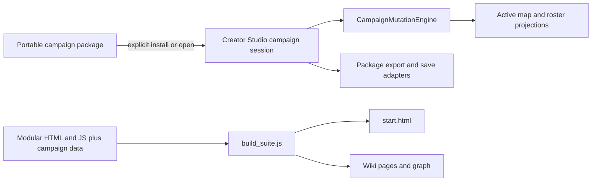

# Architecture routes

This reference locates implementation owners and deeper documentation; read the row relevant to the task. Paths in the source column are relative to AdventureCAD.

## Data flow and ownership

This is a navigation diagram; consult the implementation for exact call order and mutation semantics.

## Task routes

| Route | First source owners | Contract / rationale | Deeper wiki |
|---|---|---|---|
| `mutation`: edit nodes, rosters, links, validation, undo | `src/workstation/scripts/campaign_mutation_engine.js`; `scripts/campaign_cli.js`; `campaign_changelog_ui.js` beside the engine | [ADR 0022](../adr/0022-coauthoring-architecture-and-rejected-patterns.md); [entity ADR 0005](../adr/0005-campaign-entity-architecture-npcs-quests-items.md) | Query the specific engine symbol and callers |
| `session`: campaign switch, teardown, active state, map persistence | `src/workstation/scripts/workstation_state.js`, `state_adapter.js`, `map_store.js` | [Developer guide](../AI_DEVELOPER_GUIDE.md), [findings](ONBOARDING_FINDINGS.md) for older names | [Series B](../../wiki/src/series/series_b_scale_fluid_nested_cartography.md) |
| `roster`: navigation, CRUD, deletion, selection | `src/workstation/scripts/entity_core.js`, `entity_manager_ui.js`, `entity_crud_dialogs.js`, `entity_cascade_delete.js`, `selection_engine.js` | [ADR 0005](../adr/0005-campaign-entity-architecture-npcs-quests-items.md); [factions ADR 0021](../adr/0021-first-class-factions-and-inter-entity-relational-social-graphs.md) | Query `entity_manager_ui.js` before tracing navigation callers |
| `canvas`: rendering, interaction, nodes, corridors | `src/workstation/scripts/cad_canvas_renderer.js`, `cad_interaction.js`, `canvas_hud.js`, `property_grid_inspector.js`, `layer_manager.js`, `map_navigator.js` | [node explorer ADR 0017](../adr/0017-scale-fluid-node-exploration-dynamic-svg-stacking-and-desktop-shell-assimilation.md); [edge explorer ADR 0020](../adr/0020-scale-fluid-edge-explorer-and-conduit-catalog.md) | [Series B](../../wiki/src/series/series_b_scale_fluid_nested_cartography.md) |
| `package`: open/import/export, ZIP, directory, mods, assets | `src/workstation/scripts/pack_engine.js`, `selective_importer.js`, `campaign_exporter.js`, `zip_engine.js`, `map_store.js` | [campaign package SRD](../srd/campaign_preset_specification_srd.md); [ADR 0022](../adr/0022-coauthoring-architecture-and-rejected-patterns.md) | [Series F](../../wiki/src/series/series_f_campaign_authoring_and_ip_conversion.md) |
| `modules`: worldbuilding content, slotting, resources | `campaigns/`; `src/workstation/scripts/module_explorer.js`, `supply_chain_simulator.js`, `industry_chain_importer.js` | [IP module SRD](../srd/ip_module_framework_srd.md); [scenario primitives](../srd/scenario_primitives_srd.md); [module catalog](../MODULES_CATALOG.md) | [Series D](../../wiki/src/series/series_d_module_supply_chains_and_contracts.md) |
| `sociology`: disposition, archetypes, overrides, balancing | `src/workstation/scripts/sociology_data.js`, `campaign_override_slots.js`; `sociology/`; query graph for balancing symbols | [CONTEXT.md](../../CONTEXT.md); [authoring engine SRD](../srd/authoring_engine_srd.md) | [Series A](../../wiki/src/series/series_a_balancing_and_smothering_math.md), [Series C](../../wiki/src/series/series_c_sociology_and_tarot_hermeneutics.md) |
| `shell`: desktop windows, menus, template | `src/workstation/template.html`; `src/workstation/scripts/mdi_window_manager.js`, `workstation_state.js` | [desktop ADR 0004](../adr/0004-desktop-workstation-start-html.md); [unification ADR 0007](../adr/0007-unified-workstation-consolidating-index-and-campaign-studio.md) | Query the template and owning UI symbol |
| `build`: routing, compilation, wiki, test harness | `build_suite.js`, `docs/navigation_manifest.json`, `wiki/build_wiki.js`, `scripts/find_codebase_node.js`, `scripts/test_suite.js`, `test/run_tests.js` | [token economy ADR 0019](../adr/0019-git-integrated-token-optimization-and-diff-driven-agent-workflows.md); [wiki ADR 0003](../adr/0003-bidirectional-wiki-and-scale-fluid-nested-maps.md) | [Series E](../../wiki/src/series/series_e_zero_cors_compiler_and_agent_router.md), [Series G](../../wiki/src/series/series_g_duplicate_and_orphan_audit.md) |

Where a cell lists sibling filenames, they share the directory of its first full path. The machine-readable [context index](context-index.json) supplies exact paths to the route helper.

## Package boundary

The portable package format, workstation loader and mutation engine define accepted inputs. Package creation tools are independent producers; this project's source, docs, test commands and onboarding index must not require or inspect their directories.

## Recent ownership changes to preserve

The last four committed sprints observed on 2026-11-09 are `e4030d8` (mutation invariant owner), `edb2298` (session projection / sterile teardown), `9748ad5` (roster navigator), and `2251668` (portable packages / dual adapters). Use `git show --stat <hash>` and a path-scoped patch to recover rationale; these commits do not describe all uncommitted work.

- Keep campaign mutation invariants in `CampaignMutationEngine`; avoid adding UI-only versions of the same rule.
- Campaign identity changes must clear/project session state coherently. Trace `createSterileTopology`, campaign loading, map swapping, catalog baselines, and active file handles when diagnosing cross-campaign leakage.
- Portable packages cross ZIP, directory, and runtime-state boundaries. Preserve unknown/custom attributes and verify assets, creatures, evidence, changelog, and relational references on the adapters affected by a change.
- Roster navigation crosses active map state, selection, canvas focus, and inspector state. Check these together when a row opens the wrong place or stale entity.

## Wiki and graph maintenance

The AST/backlink graph (`wiki/wiki_graph.json`) and Technical Manual (`wiki/index.html`, `wiki/pages/series/*.html`) are regenerated automatically by `Build-Suite.ps1` without per-file prose stubs. Update `wiki/src/series/*.md` or `docs/adr/*.md` only when cross-cutting architecture or subsystem contracts change. See [operations](OPERATIONS.md) for build and graph checks.
