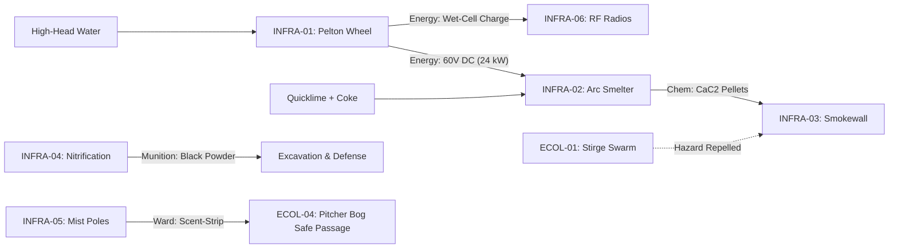
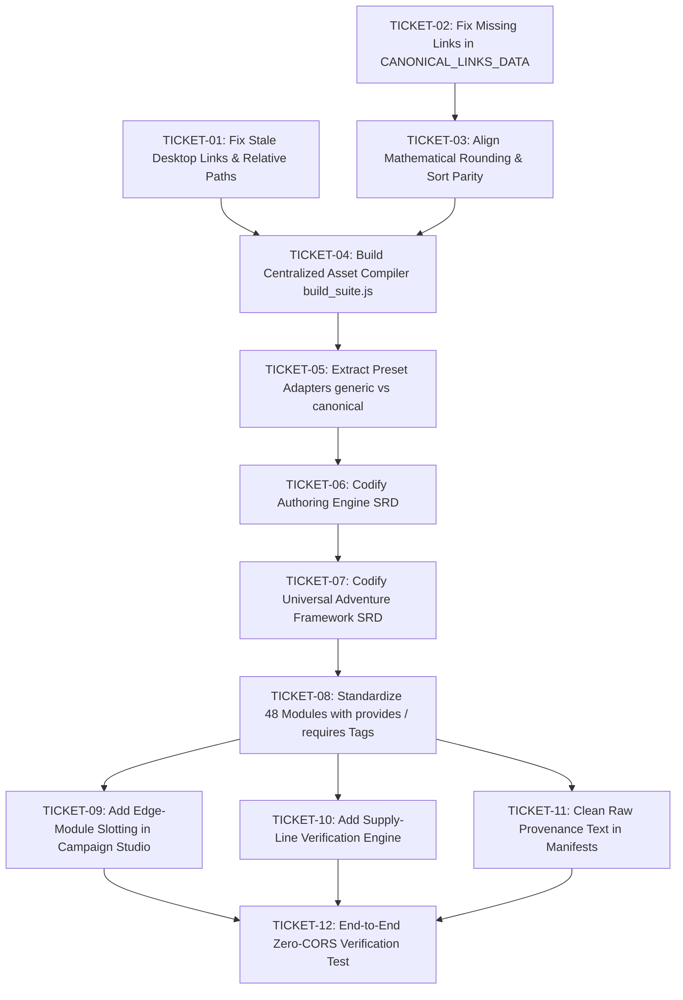

# CREATOR STUDIO &bull; COMPREHENSIVE SYSTEM AUDIT & ASSESSMENT DOSSIER
**Authority**: ADR-0001, ADR-0002, CONTEXT.md  
**Audit Date**: October 2026  
**Auditor**: DeepMind Antigravity Advanced Agentic Team  
**Target Repository**: `Creator/`

---

## 1. Executive Summary & Audit Scorecard

The **Creator Studio** is a tabletop campaign authoring workstation designed to generate procedural pointcrawl networks, sociological faction profiles, and modular worldbuilding components. 

Our audit evaluated the prototype across five architectural dimensions:

| Dimension | Status | Grade | Summary Finding |
| :--- | :---: | :---: | :--- |
| **1. Runtime Seams & Zero-CORS** | ⚠️ Needs Remediation | **B-** | HTML tools run offline, but datasets are copy-pasted across files (`campaign_studio.html`, `network_visualizer.html`, `Run-NetworkEngine.ps1`, `generic_network_topology.json`), causing data drift. |
| **2. Algorithmic Parity** | ❌ Discrepancies Detected | **C+** | Client JS has only 26 links hardcoded while topology JSON has 52 links; adjacency smothering in JS ignores half the graph's connections, creating divergent hub election compared to PowerShell. |
| **3. Module Taxonomy & Dependencies** | ⚠️ Architectural Mismatch | **C** | 48 modules are treated as a flat node catalog. Macro network rules (`FACT-01..04`) and edge transit funnels (`EDGE-01..05`) are improperly slotted into nodes. Industrial supply chains (`INFRA-01 -> 02 -> 03`) lack formal resource contracts. |
| **4. Portability & Setting Agnosticism** | ⚠️ Partial Bleed | **B** | Lingering absolute paths pointing to `file:///c:/Users/Milo/Documents/Antigravity/...`. Raw prompt provenance (`*MyActivity.html*`) remains in inlined manifests. Presets are viable but need clean adapter extraction. |
| **5. Specifications & SRD Structure** | 🔄 Modernized | **A-** | Formally partitioned into Dual SRD (Authoring Engine SRD vs Adventure Framework SRD) and 5-Tier Worldbuilding Pipeline via ADR-0001 and ADR-0002. |

---

## 2. Stage 1: Runtime Seams, Data Authority & Zero-CORS

### 1.1 The Multiple Source of Truth Hazard
The fundamental data structures of the suite—the 22 nodes, their coordinates, and their 52 influence edges—are hardcoded in **four separate locations**:
1. [`network/generic_network_topology.json`](file:///c:/Users/Milo/Documents/Antigravity/Creator/network/generic_network_topology.json): The authoritative JSON specification (52 links).
2. [`network/Run-NetworkEngine.ps1`](file:///c:/Users/Milo/Documents/Antigravity/Creator/network/Run-NetworkEngine.ps1): Inlined PowerShell hashtables `$GenericNodes` and `$CanonicalNodes`.
3. [`network/campaign_studio.html`](file:///c:/Users/Milo/Documents/Antigravity/Creator/network/campaign_studio.html): Inlined JavaScript objects `GENERIC_NODES_DATA`, `CANONICAL_NODES_DATA`, and `CANONICAL_LINKS_DATA`.
4. [`network/network_visualizer.html`](file:///c:/Users/Milo/Documents/Antigravity/Creator/network/network_visualizer.html): Inlined JavaScript objects `GENERIC_NODES`, `NODE_COORDS`, and `WAVES`.

### 1.2 Manifest Drift & Provenance Artifacts
- **Module Count Drift**: `campaign_studio.html` line 515 and line 612 contain comments reading `<!-- 45 Modules Catalog Grid -->` and `// --- 45-MODULE MANIFEST INJECTED ---`, despite containing 48 modules.
- **Summary Discrepancy**: In `modules_manifest.json`, module `ESOT-04` has summary `"1. Architectural Splendor"`. In `campaign_studio.html` line 1344, the same module has `"Harvested from the user's specific worldbuilding vision in *MyActivity.html*..."`.
- **File Extension Smell**: [`modules_manifest.json`](file:///c:/Users/Milo/Documents/Antigravity/Creator/network/modules_manifest.json) begins with `const MODULES_MANIFEST = [`. It is JavaScript code stored with a `.json` extension. Standard JSON parsers fail on this file.

### 1.3 Recommended Seam Architecture (Centralized Compiler)
Extend the existing pattern in [`tarot/generate_tarot_matrix.js`](file:///c:/Users/Milo/Documents/Antigravity/Creator/tarot/generate_tarot_matrix.js) to establish a root build runner (`build_suite.js` or `Build-CreatorStudio.ps1`):
```text
Authoritative Sources:
  ├── modules/*.md (Frontmatter + Markdown)
  ├── network/topologies/*.json (Pure JSON)
  └── tarot/decks/*.json (Pure JSON)
          │
          ▼ [build_suite.js]
Injects manifests into single-file HTML distributions:
  ├── network/campaign_studio.html
  ├── network/network_visualizer.html
  └── tarot/tarot_matrix_browser.html
```

---

## 3. Stage 2: Algorithmic & Mathematical Parity

### 2.1 Critical Adjacency Smothering Divergence
- In [`Run-NetworkEngine.ps1`](file:///c:/Users/Milo/Documents/Antigravity/Creator/network/Run-NetworkEngine.ps1), Node 1 has:
  ```powershell
  Adj = @(2, 6, 20, 21); InfBy = @(21)
  ```
- In [`campaign_studio.html`](file:///c:/Users/Milo/Documents/Antigravity/Creator/network/campaign_studio.html), `CANONICAL_LINKS_DATA` only defines:
  ```javascript
  { from: 21, to: 1, type: "oneway" },
  { from: 1, to: 21, type: "twoway" }
  ```
  Links between Node 1 and Nodes 2, 6, and 20 are completely missing from `CANONICAL_LINKS_DATA`.
- **Impact**: Because the web client derives adjacency dynamically via `getNodeAdjacents()`, Node 1 in the web browser does **not** recognize Nodes 2, 6, or 20 as adjacent. If Node 1 is elected Sovereign Hub in the browser, Nodes 2, 6, and 20 remain eligible to become Sovereign Hubs. In the PowerShell engine, they are correctly smothered.

### 2.2 Mathematical Formula Parity
| Formula / Parameter | PowerShell (`Run-NetworkEngine.ps1`) | Browser (`campaign_studio.html`) | Parity Status |
| :--- | :--- | :--- | :---: |
| **Card Weight** | `if ($isRev) { -($cIdx + 1) } else { ($cIdx + 1) }` | `isRev ? -(cIdx + 1) : (cIdx + 1)` | ✅ Matched |
| **Incoming Influence** | `srcWeight * 0.5` | `srcWeight * 0.5` | ✅ Matched |
| **Amalgam Rounding** | `[Math]::Round(..., 2)` (2 decimal places) | `Math.round(... * 10) / 10` (1 decimal place) | ⚠️ Minor Divergence |
| **Candidate Sorting** | Stable sort by `TotalScore` descending | `b.score - a.score` (arbitrary tie-break) | ⚠️ Tie-break Risk |
| **Inversion Trigger** | Key 22 reversed flips polarity | Key 22 reversed toggles lockdown | ✅ Matched |

---

## 4. Stage 3: Exhaustive 48-Module Dependency & Typology Audit

In accordance with ADR-0002, all 48 modules have been audited against the **5-Tier Worldbuilding Pipeline**:
* **Tier 1 (Macro Network & Governance)**: Network-wide systemic rules, stability indices, tension matrices.
* **Tier 2 (Topological & Biome Anchors)**: Physical terrain, biomes, and edge transit chokepoints.
* **Tier 3 (Infrastructural Supply Chains)**: Industrial production, energy, chemical synthesis, perimeter defense.
* **Tier 4 (Dynamic Narrative Sparks & Clocks)**: Faction crises, social dilemmas, and arrival events.
* **Tier 5 (Esoteric & Eschatological Engines)**: Reality anomalies, time loops, and campaign climax triggers.

### 4.1 Master 48-Module Diagnostic Matrix

| Module ID | Current Set | Recommended Tier | True Type | Explicit `provides` | Explicit `requires` | Fallback Viability | Setting Bleed / Flaws |
| :--- | :---: | :---: | :--- | :--- | :--- | :---: | :--- |
| **INFRA-01** | Set A | **Tier 3** | Power Generation | `[Power: 60V-DC-24kW]` | `[Topo: High-Head-Water]` | ✅ Tidal / mule fallback | Pure agnostic. |
| **INFRA-02** | Set A | **Tier 3** | Chemical Smelting | `[Chem: CaC2, Mat: Silver]` | `[Power: High-DC, Coke, Lime]`| ✅ Coal cupola fallback | Pure agnostic. |
| **INFRA-03** | Set A | **Tier 3** | Fortification Defense| `[Ward: Stirge-Immunity]`| `[Fuel: CaC2-Pellets]` | ✅ Sulfur smudge pots | Hardcoded "Argent-Fume". |
| **INFRA-04** | Set A | **Tier 3** | Munitions Synthesis | `[Chem: Saltpeter, Gunpowder]`| `[Bio: Midden-Urine, Lime]` | ✅ Low-yield cave saltpeter | "Operation White-Bloom". |
| **INFRA-05** | Set A | **Tier 3** | Alchemy / Defense | `[Ward: Scent-Strip, Drug: Wash]`| `[Bio: Pitcher-Plant-Sap]` | ✅ Crushed bog charcoal | Hardcoded "Zim-Sharr" torch. |
| **INFRA-06** | Set A | **Tier 3** | Telecommunications | `[Comm: RF-3-14MHz, Triangulate]`| `[Power: Wet-Cell, Tubes]` | ✅ Heliograph mirrors | References "Gnomish". |
| **INFRA-07** | Set A | **Tier 3** | Arcane Relay | `[Comm: RF-Signal-Boost]` | `[Geo: Resonant-Menhir]` | ✅ Acoustic horn towers | Pure agnostic. |
| **INFRA-08** | Set A | **Tier 3** | Cryogenics / Stasis | `[Zone: 300yd-Permafrost, Stasis]`| `[Power: High-Head-or-Core]`| ✅ Salted ice lockers | Pure agnostic. |
| **INFRA-09** | Set A | **Tier 3** | Perimeter Defense | `[Ward: Sonic-Pylon, Sulfur-Flame]`| `[Fuel: Sulfur-or-Carbide]` | ✅ Hardwood pitch fires | "Zim-Sharr" branding. |
| **ECOL-01** | Set B | **Tier 2** | Pest Swarm / Hazard | `[Mat: Silicon-Wings, Meat]` | `[Hazard: Stirge-Swarm]` | ✅ Normal bat swarms | Mentions Stirges (D&D cue). |
| **ECOL-02** | Set B | **Tier 2** | Flora Hazard / Drug | `[Drug: Narcotic-Opium]` | `[Hazard: Razor-Sedge-Bleed]` | ✅ Ordinary tall sawgrass | Pure agnostic. |
| **ECOL-03** | Set B | **Tier 2** | Living Barrier | `[Ward: Sentient-Bramble]` | `[Geo: Humid-Basin]` | ✅ Normal thorny deadfall | Pure agnostic. |
| **ECOL-04** | Set B | **Tier 2** | Wetland Hazard | `[Mat: Acid, Slug-Slime]` | `[Hazard: Digestion-Bog]` | ✅ Quicksand mudflat | Pure agnostic. |
| **ECOL-05** | Set B | **Tier 2** | Hydrology / Healing | `[Water: Sterile-Quartz, Crystal]`| `[Geo: Glacial-Meltwater]` | ✅ Boiled sediment well | Pure agnostic. |
| **ECOL-06** | Set B | **Tier 2** | Forestry / Aviation | `[Mat: Amber-Pitch, Gliders]` | `[Bio: Mega-Canopy]` | ✅ Standard timber pine | "Iron-Blight" mention. |
| **ECOL-07** | Set B | **Tier 2** | Marine Hazard | `[Mat: Volcanic-Pumice, Crabs]` | `[Hazard: Siren-Song]` | ✅ Treacherous rip-tide | Pure agnostic. |
| **FACT-01** | Set C | **Tier 1** | **Macro Network Rule**| `[Rule: 5-Sovereign-Hubs]` | `[Input: Pointcrawl-Graph]` | ❌ N/A (System Rule) | Incorrectly in node tray! |
| **FACT-02** | Set C | **Tier 1** | **Macro Network Rule**| `[Rule: 2-Axis-Tension]` | `[Input: Hub-Alignments]` | ❌ N/A (System Rule) | Incorrectly in node tray! |
| **FACT-03** | Set C | **Tier 1** | Governance Model | `[Gov: Subsidiarity-Mosaic]` | `[Org: Parallel-Militaries]` | ✅ Standard oligarchic council | Pure agnostic. |
| **FACT-04** | Set C | **Tier 1** | **Global Clock Dial** | `[Metric: 0-100-Stability]` | `[Input: Oracle-Check]` | ❌ N/A (System Dial) | Incorrectly in node tray! |
| **FACT-05** | Set C | **Tier 4** | Covert Syndicate | `[Intel: Cipher-Network]` | `[Social: Subversive-Cells]`| ✅ Local criminal cartel | Pure agnostic. |
| **FACT-06** | Set C | **Tier 3** | Node Fortification | `[Def: Rank-1-4-Bastion]` | `[Mat: Masonry, Garrisons]` | ✅ Earthwork redoubt | Pure agnostic. |
| **FACT-07** | Set C | **Preset** | **Canonical Preset** | `[Preset: Canonical-22-Nodes]` | `[Core: Generic-Topology]` | ❌ N/A (Setting Preset) | Belongs in `presets/`. |
| **CONF-01** | Set D | **Tier 4** | Ideological Dilemma| `[Dilemma: Divine-Bureaucracy]`| `[Culture: White-Blue]` | ✅ Corrupt municipal clerk | Pure agnostic. |
| **CONF-02** | Set D | **Tier 4** | Ideological Dilemma| `[Dilemma: Wild-Rage-Wrath]` | `[Culture: Green-Red]` | ✅ Radical eco-insurgents | Pure agnostic. |
| **CONF-03** | Set D | **Tier 4** | Ideological Dilemma| `[Dilemma: Ancestral-Stagnation]`| `[Culture: Green-Blue]` | ✅ Luddite guild strike | Pure agnostic. |
| **CONF-04** | Set D | **Tier 4** | Disinformation Tool| `[Warfare: Framed-Proxies]` | `[Intel: Covert-Agents]` | ✅ Gossip & whisper ring | Pure agnostic. |
| **CONF-05** | Set D | **Tier 3** | Surveillance Hardware| `[Intel: Tracking-Bracelets]` | `[Power: Low-Signal]` | ✅ Marked physical tokens | Pure agnostic. |
| **CONF-06** | Set D | **Tier 4** | Social Mob Clock | `[Clock: Lynch-Mob-Hysteria]` | `[Social: High-Stress]` | ✅ Barroom brawl escalation | Pure agnostic. |
| **EDGE-01** | Set E | **Tier 2** | **Edge Corridor** | `[Transit: Fatal-Funnel-Canyon]`| `[Geo: 50mi-Chasm]` | ✅ High ridge trail | Incorrectly in node tray! |
| **EDGE-02** | Set E | **Tier 2** | **Edge Corridor** | `[Transit: Coastal-Highway]` | `[Mat: Paving-Stone]` | ✅ Unpaved rutted track | Incorrectly in node tray! |
| **EDGE-03** | Set E | **Tier 2** | **Edge Corridor** | `[Transit: Vertical-Switchback]`| `[Geo: Sheer-Cliff]` | ✅ Primitive rope hoist | "Walters Wiggles" name. |
| **EDGE-04** | Set E | **Tier 2** | **Edge Corridor** | `[Transit: Canopy-Bridges]` | `[Bio: Mega-Canopy]` | ✅ Ground forest path | Incorrectly in node tray! |
| **EDGE-05** | Set E | **Tier 2** | **Edge Corridor** | `[Transit: Tidal-Sea-Arches]` | `[Hydro: 4hr-Tide-Window]` | ✅ Overland portage | Incorrectly in node tray! |
| **SPARK-01** | Set F | **Tier 4** | Crisis Event Clock | `[Event: Salt-Warehouse-Riot]`| `[Supply: Starvation-State]` | ✅ Merchant price gouging | Pure agnostic. |
| **SPARK-02** | Set F | **Tier 4** | Medical Crisis Clock | `[Hazard: Blue-Rot-Horror]` | `[Disease: Crystal-Spore]` | ✅ Standard swamp leprosy | Pure agnostic. |
| **SPARK-03** | Set F | **Tier 4** | Supernatural Border | `[Tithe: Memory-Surrender]` | `[Arcana: Fey-Crossing]` | ✅ Standard silver coin toll | Pure agnostic. |
| **SPARK-04** | Set F | **Tier 4** | Environmental Decay| `[Clock: Iron-Blight-Rust]` | `[Climate: Reactive-Air]` | ✅ Normal ocean spray rust | Pure agnostic. |
| **SPARK-05** | Set F | **Tier 5** | Overarching BBEG | `[Threat: Reality-Parasites]` | `[Plot: Foreclosure-Cosmology]`| ✅ Mortal corrupt cabal | Pure agnostic. |
| **SPARK-06** | Set F | **Tier 5** | Magocratic BBEG | `[Threat: Escapist-Lodge]` | `[Device: Planar-Collider]` | ✅ Renegade alchemists guild | Pure agnostic. |
| **SPARK-07** | Set F | **Tier 4** | Moral Dilemma | `[Dilemma: Hero-vs-Bureaucrat]`| `[Social: Post-Battle]` | ✅ Mercenary vs town mayor | Pure agnostic. |
| **SPARK-08** | Set F | **Tier 4** | **Dock Arrival Table**| `[Table: 22-Disembark-Gambits]` | `[Node: Entry-Harbor]` | ❌ N/A (Port Arrival Table) | Incorrectly in general tray!|
| **ESOT-01** | Set G | **Tier 4** | Propaganda Engine | `[Warfare: Yellow-Press-Lies]`| `[Media: Movable-Type]` | ✅ Town crier rumors | Pure agnostic. |
| **ESOT-02** | Set G | **Tier 5** | Deep Cosmology | `[Cosmo: Pantheon-Sysadmins]` | `[Theology: Divine-Council]` | ✅ Standard polytheism | Theological allusions. |
| **ESOT-03** | Set G | **Tier 5** | Temporal Anomaly | `[Anomaly: Saturnine-Time-Loop]`| `[Relic: Black-Cube]` | ✅ Ancient stasis rune | High-concept cosmic. |
| **ESOT-04** | Set G | **Tier 2** | Exotic Settlement | `[Settle: Hanging-Cliff-City]` | `[Geo: Sheer-Gorge]` | ✅ Canyon cliff outpost | Raw provenance text. |
| **ESOT-05** | Set G | **Tier 3** | Penal Trade Circuit | `[Circuit: Convict-Labor-Barter]`| `[Facility: Frontier-Jail]`| ✅ Private work gang hire | Raw provenance text. |
| **ESOT-06** | Set G | **Tier 5** | Climax Engine | `[Climax: Planar-Breach-Rift]` | `[Hardware: Arcane-Collider]`| ✅ Unstable wild magic vortex| Raw provenance text. |

### 4.2 Core Supply Chain Graph Discovered
Our analysis reveals an interconnected **Industrial Defense Ecosystem**:


---

## 5. Stage 4: Portability, Setting Agnosticism & Authoring UX

### 5.1 Hardcoded Stale Paths
Both master documentation files contain dead desktop links:
- In [`README.md`](file:///c:/Users/Milo/Documents/Antigravity/Creator/README.md) lines 74–76, 82–83, 91–97, 100: Links point to `file:///c:/Users/Milo/Documents/Antigravity/Creator/...`.
- In [`modules/README.md`](file:///c:/Users/Milo/Documents/Antigravity/Creator/modules/README.md) lines 70–153: All 48 module links point to `file:///c:/Users/Milo/Documents/Antigravity/Creator/modules/...`.
- **Remediation**: All links must be updated to clean relative paths (e.g. `[INFRA-01](Set_A_Infrastructure_and_Engineering/INFRA-01_Hydro_Pelton_Wheel_and_DC_Dynamo.md)`).

### 5.2 3-Step Authoring Pipeline Friction
The designated creation loop (Step 0 Builder $\to$ Step 1 Studio $\to$ Step 2 Visualizer) experiences three interface hitches:
1. **Link Missing in Step 0 Export**: Step 0 (`network_builder.html`) exports JSON with `x, y` pixel coordinates, but when loaded in Step 1, the canvas resets unless the user manually toggles presets.
2. **Edge Module Slotting Gap**: Step 1 has no UI affordance to attach transit modules (`EDGE-01..05`) to graph edges; they can only be assigned to nodes.
3. **Macro Rule Misplacement**: System rules (`FACT-01`, `FACT-02`, `FACT-04`) clutter the catalog search when filtering for node features.

---

## 6. Stage 5: Remediation Specification & Ticket Decomposition

Following [`to-tickets/SKILL.md`](file:///c:/Users/Milo/Documents/Antigravity/Skills/.agents/skills/to-tickets/SKILL.md), the remediation work is split into **12 tracer-bullet tickets** with explicit blocking dependencies:



### Ticket Queue Breakdown

#### [TICKET-01] Path Sanitation: Fix Stale Desktop Links in README Files
- **Surface**: `Creator/README.md`, `Creator/modules/README.md`.
- **Blockers**: None.
- **Scope**: Replace all instances of `file:///c:/Users/Milo/Documents/Antigravity/Creator/...` with proper portable relative Markdown links.

#### [TICKET-02] Core Parity: Restore 52 Canonical Links in `campaign_studio.html`
- **Surface**: `Creator/network/campaign_studio.html`.
- **Blockers**: None.
- **Scope**: Replace truncated 26-link `CANONICAL_LINKS_DATA` array with the complete 52-link graph matching `generic_network_topology.json` so adjacency smothering functions accurately.

#### [TICKET-03] Algorithm Parity: Align Amalgamation Rounding & Sort Order
- **Surface**: `Creator/network/campaign_studio.html`, `Creator/network/Run-NetworkEngine.ps1`.
- **Blockers**: TICKET-02.
- **Scope**: Ensure identical 2-decimal-place rounding (`Math.round(val * 100) / 100`) and deterministic candidate tie-breaking across both JS and PowerShell.

#### [TICKET-04] Build Architecture: Create Centralized `build_suite.js` Compiler
- **Surface**: `Creator/build_suite.js`, `Creator/package.json`.
- **Blockers**: TICKET-01, TICKET-03.
- **Scope**: Build single-source compiler that reads authoritative JSON/Markdown and dynamically generates/injects offline datasets into HTML files, resolving file-type mismatches (`modules_manifest.json` $\to$ pure JSON).

#### [TICKET-05] Preset Architecture: Extract Canonical Preset as Pure Preset Adapter
- **Surface**: `Creator/network/presets/`, `Creator/network/generic_network_topology.json`.
- **Blockers**: TICKET-04.
- **Scope**: Fully isolate Canonical Preset node names, coordinates, and canonical card tables into an external `presets/canonical_preset.json` file loaded via the preset selector.

#### [TICKET-06] Engine Specification: Codify Authoring Engine SRD
- **Surface**: `Creator/docs/srd/authoring_engine_srd.md`.
- **Blockers**: TICKET-05.
- **Scope**: Draft formal mathematical specification of pointcrawl topology, wave progression, amalgamation formula, adjacency smothering algorithm, and 22nd card inversion.

#### [TICKET-07] Tabletop Specification: Codify Universal Adventure Framework SRD
- **Surface**: `Creator/docs/srd/adventure_framework_srd.md`.
- **Blockers**: TICKET-06.
- **Scope**: Draft system-agnostic, rules-lite runtime SRD explaining 4-tick threat clocks, DC saving throw tiers, damage dice equivalents, and resource consumption.

#### [TICKET-08] Content Schema: Refactor 48 Modules into 5-Tier Schema with Resource Tags
- **Surface**: `Creator/modules/` (All Sets A–G).
- **Blockers**: TICKET-07.
- **Scope**: Update YAML frontmatter across all 48 modules to include `pipeline_tier: 1..5`, typed `provides: [...]`, and typed `requires: [...]` Resource Tags.

#### [TICKET-09] UI Expansion: Implement Edge-Module Slotting in Campaign Studio
- **Surface**: `Creator/network/campaign_studio.html`.
- **Blockers**: TICKET-08.
- **Scope**: Update Stage 5 in Campaign Studio to allow selecting and slotting Tier 2 Edge Modules (`EDGE-01..05`) onto graph edges between nodes.

#### [TICKET-10] Simulation Feature: Supply Line Integrity & Severance Checker
- **Surface**: `Creator/network/campaign_studio.html`.
- **Blockers**: TICKET-08.
- **Scope**: Add real-time UI indicator checking whether downstream modules (e.g. `INFRA-02`, `INFRA-03`) have valid graph paths to their upstream suppliers (e.g. `INFRA-01`), triggering Standalone Fallback warnings when severed.

#### [TICKET-11] Content Hygiene: Clean Raw Prompt Provenance Text
- **Surface**: `Creator/modules/Set_G_Esoterica_and_Information_Warfare/`, `Creator/network/modules_manifest.json`.
- **Blockers**: TICKET-08.
- **Scope**: Scrub all mentions of `*MyActivity.html*` and raw extraction chat artifacts from module summaries.

#### [TICKET-12] Quality Assurance: Zero-CORS Offline Suite Verification
- **Surface**: All HTML tools (`index.html`, `network/*.html`, `tarot/*.html`, `regions/*.html`).
- **Blockers**: TICKET-09, TICKET-10, TICKET-11.
- **Scope**: Verify that all tools open and execute flawlessly under native `file://` URLs in air-gapped / offline browser environments.

---

## 6. Post-Audit Implementation Addendum: Multi-Campaign Decoupling (October 2026)

### 6.1 Architectural Evolution: Decoupling "2 Settings and a System"
Following the remediation of Tickets 01–12, Creator Studio successfully decoupled its core authoring workstation from setting-bound artifacts into a pure, multi-campaign architecture:

1. **`campaigns/` Directory Architecture**:
   - [`campaigns/generic_starter/`](file:///c:/Users/Milo/Documents/Antigravity/Creator/campaigns/generic_starter/): 22-node tutorial island sandbox (Levels 1–6) inspired by *Might & Magic 3: Isles of Terra*, *Keep on the Borderlands*, and *The Isle of Dread*. Houses system-level governance modules (`FACT-01..04`, `FACT-06`, `SPARK-08`) and starter adventure sites (`STARTER-01..06`).
   - [`campaigns/opal_island/`](file:///c:/Users/Milo/Documents/Antigravity/Creator/campaigns/opal_island/): Fully isolates all 48 canonical Opal Island modules (`Set A` through `Set G`) and the 22-node high-head hydro-electric preset, preserving the entire historical setting without polluting system-wide balance.

2. **Zero-CORS Multi-Campaign Pipeline**:
   - `build_suite.js` automatically scans `campaigns/`, respecting `"enabled": false` flags and ignoring `_` or `.` directory prefixes for archived/draft sandboxes.
   - Authoritative manifests and enriched module datasets (with valid `file:///` URLs and full raw markdown text) are inlined into both [`network/campaign_studio.html`](file:///c:/Users/Milo/Documents/Antigravity/Creator/network/campaign_studio.html) and [`network/platform_audit_dashboard.html`](file:///c:/Users/Milo/Documents/Antigravity/Creator/network/platform_audit_dashboard.html).
   - Dynamic campaign switching with state persistence (`localStorage: cs_audit_campaign`) enables instant switching between All Campaigns (60 modules), Tutorial Isle (12 modules), and Opal Island (48 modules).

3. **Creative Writing Backlog Expansion (`tickets/creative/`)**:
   - Expanded to **25 tracer-bullet tickets** across 5 structured waves, adding **Wave 5: Campaign Presets & Sandboxes**:
     - `CWT-050`: The 22-Node 'Tutorial Isle' Generic Campaign Setting (Levels 1–6 starter sandbox).
     - `CWT-051`: Opal Island Module Deconstruction & Scenario Primitives Extraction (extracting decoupled dilemmas and threat clocks from the 48 modules).

4. **Master Audit Dashboard Synchronization**:
   - [`network/platform_audit_dashboard.html`](file:///c:/Users/Milo/Documents/Antigravity/Creator/network/platform_audit_dashboard.html) and its mirror [`tickets/creative/platform_audit_visualizer.html`](file:///c:/Users/Milo/Documents/Antigravity/Creator/tickets/creative/platform_audit_visualizer.html) now feature:
     - Real-time campaign filtering selector.
     - Dynamic recomputation of all 4 deficit alert cards based on active campaign selection.
     - Interactive Wave 1 through Wave 5 creative backlog board rendering all 25 tickets with full Truby 4-corner opposition and Egri syllogism inspectors.
     - Complete in-browser offline Markdown reader rendering raw module content with working relative/absolute file launchers.

