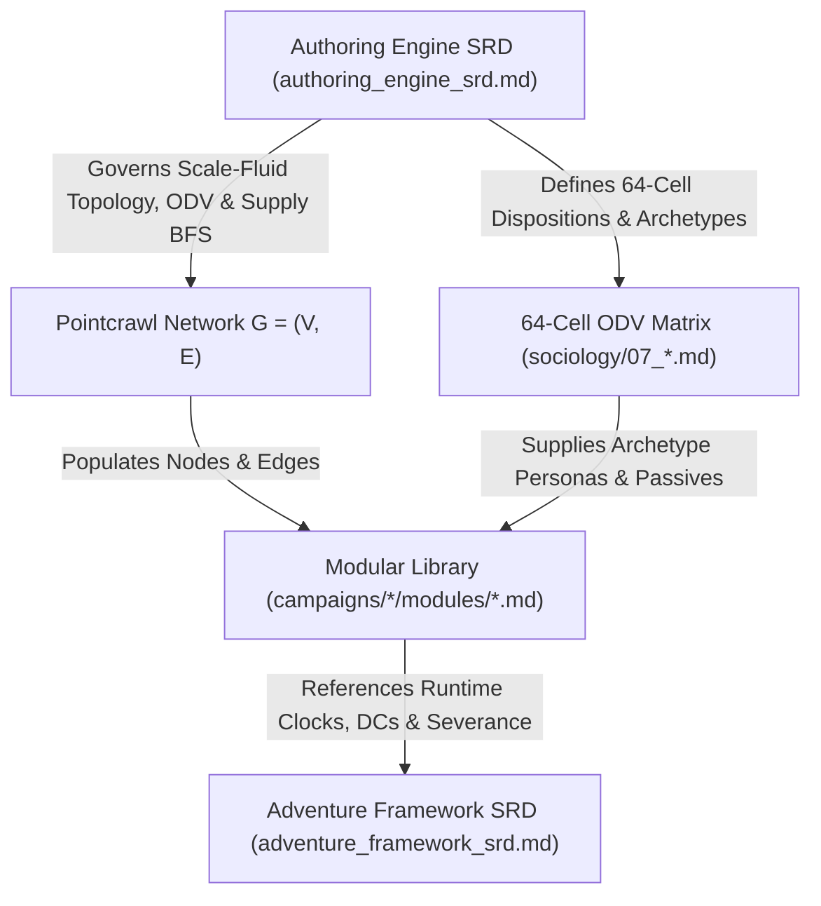

# Campaign Authoring Engine SRD

Version: 2.0.0  
Status: Authoritative Standard  
Authority: ADR-0001, ADR-0002, ADR-0003, ADR-0007, ADR-0011, CONTEXT.md  

---

## 1. Scope & Architectural Purpose

The **Campaign Authoring Engine SRD** defines the formal mathematics, scale-fluid graph theory, sociological algebra, and supply-chain reachability algorithms required to generate, balance, and stress-test pointcrawl campaign networks in [`start.html`](../../start.html).

This specification is system-agnostic and setting-agnostic. It does not contain player character stats, spell slots, or combat rules. Tabletop runtime procedures are governed separately in the [Universal Adventure Framework SRD](adventure_framework_srd.md).

---

## 2. Scale-Fluid Pointcrawl Graph Topology

A pointcrawl campaign network is formalized as a multi-scale hierarchy of hybrid graphs $G_m = (V_m, E_{\text{adj}}, E_{\text{inf}})$ consisting of spatial nodes, undirected physical transit corridors, and directed hegemonic influence vectors.

### 2.1 Node Set ($V_m$) & Scale-Fluid Portal Trees
Each map $m$ in the campaign registry contains a finite set of discrete nodes $V_m = \{v_1, v_2, \dots, v_N\}$ of arbitrary cardinality $N \ge 1$.

Each node $v_i \in V_m$ possesses the following structural properties:
* **Identifier (`id`)**: Unique node identifier within map $m$.
* **Scale Tier (`scaleTier`)**: Descriptive cartographic scale (`world`, `continent`, `region`, `subregion`, `settlement`, `district`, `site`).
* **Portal Child Link (`childMapId`)**: Optional reference to a nested child map $G_{\text{child}}$, forming a recursive scale-fluid tree across arbitrary depths.
* **Structural Tier (`tier`)**:
  * `Tier 2 (Standard Settlement / Operational Node)`: Primary operational settlements, waystations, and civic hubs.
  * `Tier 3 (Apex / Hazard Enclave)`: Restricted, isolated, or volatile enclaves and dungeons.
  * `Tier 0 (Universal / Substratum)`: Agrarian commons, vernacular infrastructure, or meta-anchors.
* **Coordinates ($x, y$)**: Canvas coordinates on the active CAD viewport.

### 2.2 Physical Adjacency Edges ($E_{\text{adj}}$)
Physical adjacencies represent traversable overland, maritime, or subterranean corridors between nodes. Adjacency is bidirectional:
$$(u, v) \in E_{\text{adj}} \iff (v, u) \in E_{\text{adj}}$$

Physical adjacency governs player movement, corridor hazard conditions (`clear`, `guarded`, `hazardous`, `severed`), and **Supply-Flow BFS Reachability** (Section 8.2).

### 2.3 Influence Vectors ($E_{\text{inf}}$)
Influence vectors represent directional downstream pressure (economic leverage, hydrological drainage, religious hegemony, or military projection).
$$E_{\text{inf}} = \{ (s, t) \mid \text{Node } s \text{ exerts downstream influence on Node } t \}$$

Each node defines an upstream influence set $\text{InfBy}(t) = \{ s \mid (s, t) \in E_{\text{inf}} \}$.

### 2.4 Dual-Layer Edge Classification
Authored links carry a `layer` field that routes them into the two edge sets above:

| `layer` | Edge Set | Meaning | Governs |
| :--- | :--- | :--- | :--- |
| `transit` | $E_{\text{adj}}$ only | Physical corridor: road, pass, waterway, tunnel, trail. | Player movement, supply-flow BFS (Section 8.2), corridor severance. |
| `hegemony` | $E_{\text{inf}}$ only | Conceptual pressure: martial, feudal, religious, mercantile, arcane. No physical traversal. | Hegemonic centrality and upstream influence projection (Section 4). |
| `both` / absent | $E_{\text{adj}}$ and $E_{\text{inf}}$ | Dual-purpose corridor and influence conduit. | Both physical transit and directional influence. |

Rules:
* Severing a corridor (`condition: "severed"`) removes it from physical supply-flow reachability ($E_{\text{adj}}$) without erasing conceptual hegemony ($E_{\text{inf}}$).

---

## 3. Sociological Algebra & Disposition Vectors

Each node's cultural, institutional, and operational behavior is parameterized by an Organizational Disposition Vector (ODV) denoted `[S, E, C]`.

### 3.1 The Three Dials
Each dial is an integer scalar in the range $[1, 4]$:

1. **Dial S (Structure / Stability vs. Entropy)**:
   * `1`: Immutable Order / Totalitarian Conformity (zero procedural variance; strict orthodoxy).
   * `2`: Codified Protocol (written charters, formal hierarchy, standardized procedures).
   * `3`: Adaptive Heuristics (pluralistic guilds, flexible task forces, situational policies).
   * `4`: Hyper-Entropy / Fluid Autonomy (complete decentralization; informal compacts).

2. **Dial E (Energy / External Boundary Focus)**:
   * `1`: Hermetic Autarky / Fortress Isolationism (quarantined perimeter, sealed borders).
   * `2`: Protective Cohesion / Regulated Checkpoints (visas, tariffs, vouched hospitality).
   * `3`: Transactional Exchange / Open Port (free trade, contract diplomacy, commercial flow).
   * `4`: Predatory Conquest / Total Boundary Dissolution (aggressive expansion or unmonitored frontier).

3. **Dial C (Cohesion / Systemic Coupling)**:
   * `1`: Atomized Silo (self-contained cells or autarkic rulers).
   * `2`: Loose Confederation (decoupled guilds or oligarchic directorates with voluntary treaties).
   * `3`: Integrated Network (federated regional mesh sharing infrastructure and checks/balances).
   * `4`: Monolithic Matrix / Hive (hardwired logistical interdependence across nodes).

### 3.2 The 64-Cell Matrix
The Cartesian product $\{1, 2, 3, 4\}^3$ yields 64 distinct sociological archetypes (`src/workstation/scripts/sociology_data.js` and `sociology/07_Granular_64_Disposition_Matrix.md`). Each cell defines:
* Archetype Title and Core Boon.
* Core Systemic Burden.
* Micro-level Encounter Passive (individual tactical scale).
* Macro-level Strategic Passive (pointcrawl logistical scale).
* Exemplar NPC Persona.

### 3.3 Competing Values Framework (CVF) Mapping
Dispositions map deterministically onto the four quadrants of the Cameron & Quinn Competing Values Framework:
* **Clan (Collaborate)**: Internal focus with high flexibility; kinship networks and mutualist commons.
* **Adhocracy (Create)**: External focus with high flexibility; opportunistic innovators and rebel guilds.
* **Market (Compete)**: External focus with high stability; aggressive extraction and commercial syndicates.
* **Hierarchy (Control)**: Internal focus with strict stability; bureaucratic garrisons and theocracies.

---

## 4. Topological Centrality & Hegemonic Tension Mathematics

Creator Studio evaluates network balance and geopolitical friction across arbitrary pointcrawl graphs using three structural metrics:

### 4.1 Degree & Hegemonic Centrality
For any node $v \in V_m$:
* **Transit Degree ($\deg_{\text{adj}}(v)$)**: Number of incident physical corridors $(u, v) \in E_{\text{adj}}$, measuring logistical crossroads importance and choke-point vulnerability.
* **Hegemonic Out-Degree ($\deg_{\text{inf}}^+(v)$)**: Number of downstream nodes influenced by $v$, identifying primary **Hegemonic Hubs**.
* **Hegemonic In-Degree ($\deg_{\text{inf}}^-(v)$)**: Number of upstream powers projecting pressure into $v$, identifying contested **Satellite Nodes** or buffer zones.

### 4.2 Corridor Contradiction & Tension Score
For any connected node pair $(u, v)$ with disposition vectors $\text{ODV}(u) = [S_u, E_u, C_u]$ and $\text{ODV}(v) = [S_v, E_v, C_v]$, structural friction along the corridor is measured by the Manhattan disposition distance:
$$\Delta_{\text{ODV}}(u, v) = |S_u - S_v| + |E_u - E_v| + |C_u - C_v| \in [0, 9]$$
High-divergence corridors ($\Delta_{\text{ODV}} \ge 5$, visualized in `network/contradiction_matrix_dashboard.html`) represent ideological fault lines prone to trade embargoes, border skirmishes, and social conflation sparks.

### 4.3 Multi-Vector Corridor Gradients
Edges may carry optional directional vector weights (`trade`, `military`, `culture`, `esoteric`) quantifying asymmetric flow between connected settlements.

---

## 5. Fog-of-War & Node Visibility

Each node $v \in V_m$ carries a boolean visibility flag (`visible: true | false`):
* **Revealed (`visible !== false`)**: Node is known to players and participates in active player-facing map views.
* **Hidden Fog (`visible === false`)**: Node remains shrouded on player exports until discovered during play, while remaining inspectable and editable on the GM CAD canvas.

---

## 6. 5-Tier Worldbuilding Module Architecture & Socket Model

The authoring engine attaches concrete worldbuilding assets to pointcrawl graphs via a structured 5-Tier modular pipeline (`src/workstation/scripts/stage_5_slotting.js`). Modules are decoupled from fixed coordinates and slotted into nodes or edges based on topological role, cultural affinity, and resource contracts.

### 6.1 The 5-Tier Worldbuilding Pipeline
Each module declares a canonical `pipeline_tier` $\in \{0, 1, 2, 3, 4, 5\}$:

0. **Tier 0 (Agrarian & Vernacular Substratum)**:
   * Subsistence agriculture, communal granaries, vernacular shelter, ditch irrigation, and wayside inns (`T0-DOM-01` to `T0-DOM-08`).
1. **Tier 1 (Macro Network & Governance)**:
   * Systemic network-wide rules, tension matrices, macro-conspiracies, and global equilibrium engines (`FACT-01` to `FACT-05`, `FACT-07`).
2. **Tier 2 (Topological & Biome Anchors)**:
   * Node physical ecology, terrain features, native apex species, entry ports, and edge transit corridors (`ECOL-01` to `ECOL-07`, `EDGE-01` to `EDGE-05`).
3. **Tier 3 (Infrastructural Supply Chains)**:
   * Industrial production, electrical dynamos, chemical synthesis, smelters, signal relays, and life-support infrastructure (`INFRA-01` to `INFRA-09`).
4. **Tier 4 (Dynamic Narrative Sparks & Social Conflation)**:
   * Faction dilemmas, ideological conflation warfare, labor strikes, famine riots, and institutional crises (`CONF-01` to `CONF-06`, `SPARK-01` to `SPARK-07`).
5. **Tier 5 (Esoteric & Eschatological Engines)**:
   * Campaign-climax colliders, weaponized disinformation engines, planar breaches, and reality anomalies (`ESOT-01`, `ESOT-06`).

### 6.2 Topological Slotting Profiles
| Topological Role | Node / Edge Definition | Recommended Slotting Profile |
| :--- | :--- | :--- |
| **Hegemonic Hub** | High-influence primary settlement | Infrastructure (Tier 3), Biome (Tier 2), Governance (Tier 1/4), Catalyst/Esoteric (Tier 4/5) |
| **Standard / Satellite Node** | Secondary settlement (`tier: 2`) | Substratum/Infrastructure (Tier 0/3), Biome (Tier 2), Social/Catalyst (Tier 4) |
| **Apex / Hazard Enclave** | Structural Tier 3 node (`tier: 3`) | Biome / Hazard (Tier 2), Anomaly / Catalyst (Tier 4/5) |
| **Transit Edge Corridor** | Bidirectional corridor $(u, v) \in E_{\text{adj}}$ | Transit / Chokepoint (Tier 2: `EDGE-01`..`05`), optional Patrol/Ambush (Tier 4) |

---

## 7. Procedural Module Recommendation & Scoring Engine

To guide campaign authors without sacrificing emergence, `calculateRecommendationScore(nodeId, mod)` in `src/workstation/scripts/stage_5_slotting.js` calculates a multi-factor **Recommendation Score** $RS(m, v)$ for candidate module $m$ on node $v$:

$$RS(m, v) = w_{\text{SupplyIn}} \cdot \mathbb{I}_{\text{SupplyIn}}(m, v) + w_{\text{SupplyOut}} \cdot \mathbb{I}_{\text{SupplyOut}}(m, v) + w_{\text{Culture}} \cdot \mathbb{I}_{\text{Culture}}(m, v) + w_{\text{Color}} \cdot \mathbb{I}_{\text{Color}}(m, v) - w_{\text{Slotted}} \cdot \mathbb{I}_{\text{Slotted}}(m, v)$$

Where:
* $\mathbb{I}_{\text{SupplyIn}}(m, v) = 1$ ($+8$ pts) if module $m$ provides a material resource currently required by node $v$ (`node.requires`) or its slotted modules.
* $\mathbb{I}_{\text{SupplyOut}}(m, v) = 1$ ($+6$ pts) if material prerequisites of $m$ are actively supplied by node $v$ (`node.provides`), incident edge flows (`dedicatedFlows`), or the reachable pointcrawl network.
* $\mathbb{I}_{\text{Culture}}(m, v) = 1$ if node $v$'s CVF cultural quadrant matches $m.\text{culture}$.
* $\mathbb{I}_{\text{Color}}(m, v) = 1$ if node $v$'s ideological color shares an affinity with $m.\text{mtg\_color}$.
* $\mathbb{I}_{\text{Slotted}}(m, v) = 1$ if module $m$ is already slotted into node $v$.

---

## 8. Resource Tag Taxonomy & Pointcrawl Supply Flow Algebra

Modules and nodes declare inputs and outputs through standardized, typed **Resource Tags**:
$$\text{Tag} = \langle\text{Domain}\rangle : \langle\text{Identifier}\rangle$$

### 8.1 Domain Taxonomy
Resource tags are partitioned into two operational classes:

1. **Topological & Conceptual Prerequisites** (Inherent to graph position, terrain, or governance):
   * `Geography:`, `Ecology:`, `Environment:`, `Topology:`, `Sociology:`, `Authority:`, `Governance:`, `System:`, `Facility:`, `Military:`, `Perimeter:`, `Trigger:`, `Relics:`, `Physics:`, `Cosmology:`, `Factions:`, `Statecraft:`, `Resilience:`, `Doctrine:`, `Diagnostics:`, `Strategy:`.

2. **Material Supply Inputs & Yields** (Produced and consumed through physical logistics):
   * `Power:`, `Chem:`, `Material:` / `Mat:`, `Fuel:`, `Water:`, `Cal:`, `Civic:`, `Defense:`, `Signal:`, `Bio:`, `Ore:`, `Timber:`, `Luxury:`, `Labor:`.

### 8.2 Supply Flow & Reachability Algebra
Material supplies flow along unblocked traversable graph edges $(u, v) \in E_{\text{adj}}$.

Let $\text{Supplied}(v)$ denote the set of all material resources available at node $v$:
$$\text{Supplied}(v) = \text{LocalYields}(v) \cup \text{EdgeFlows}(v) \cup \bigcup_{u \in \text{Reachable}(v, k)} \text{LocalYields}(u)$$

Where:
* $\text{LocalYields}(u)$ is the union of intrinsic `u.provides` and `m.provides` for all modules $m$ slotted on node $u$.
* $\text{EdgeFlows}(v)$ is the union of `dedicatedFlows` on unblocked edges incident to $v$.
* $\text{Reachable}(v, k)$ is the set of nodes connected to $v$ by an unblocked path (`condition !== "severed"`) of length $\le k$ traversable edges.

### 8.3 Severance & Fallback Mode Activation
When an edge $(u, v) \in E_{\text{adj}}$ is severed (blockade, rockslide, bridge collapse):
1. **Reachability Recomputation**: The BFS reachability graph (`auditAllSupplyLines()` / `checkNodeAdHocSupplyLine(nid)`) is dynamically updated.
2. **Deficit Detection**: Any node $v$ or slotted module $m$ whose material `requires` tag is no longer in $\text{Supplied}(v)$ enters **Severed Supply Status**.
3. **Standalone Fallback Activation**: Affected modules degrade to their codified `standalone_fallback` profile without crashing the campaign state.

---

## 9. Cross-Specification Architecture

---

## 10. Conformance Requirements

Any implementation claiming compliance with the Campaign Authoring Engine SRD must satisfy:
1. Scale-fluid multi-map graph persistence and portal linkage (`childMapId`).
2. 64-cell `[S, E, C]` disposition vector and CVF cultural quadrant mapping.
3. Adherence to the 5-Tier Worldbuilding Module taxonomy and typed Resource Tag contracts.
4. Exact BFS supply-line deficit detection and fallback mode activation upon corridor severance.
5. 100% offline zero-CORS execution (`file:///`) without remote server dependencies.

---

## Appendix A: Legacy 22-Node Archetype Protocol (Historical Reference)

> [!NOTE]
> In first-generation builds of Creator Studio (retired in [ADR-0011](../adr/0011-retirement-of-vestigial-tarot-balancing-engine.md)), the default starter topology was constrained to a fixed 22-node island network paired with a 7-wave Major Arcana draw (`BaseWeight` $=\pm(K+1)$, upstream `Amalgamation` $= W_n + \sum 0.5 W_u$, top-5 `Sovereign Hub` election, `Adjacency Smothering` of neighboring candidates into satellites, and `Card 22 Inversion`).
>
> While these concepts remain preserved as optional narrative lore inside specific Emerald Isle governance modules (`FACT-01`, `FACT-04`, `CWT-050`, `SPARK-08`) and static sociology reference tables (`sociology/08_Tarot_Sociology_Matrix.md`, `sociology/09_Minor_Arcana_Edge_Matrix.md`), they are no longer hardcoded or required by the Creator Studio runtime engine.
