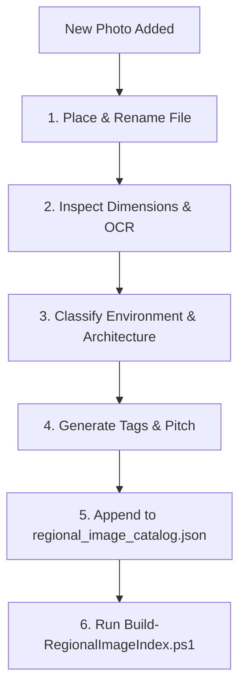

# REGIONAL VISUAL ASSET DATABASE & INGESTION PIPELINE SPECIFICATION
## Master Architecture, JSON Data Schema, Classification Heuristics & Future AI Integration Guide

*Directory: `regions/` | Canonical Authority: [ADR-01](file:///c:/Users/Milo/Documents/Antigravity/Creator/docs/adr/0001-dual-mode-preset-architecture.md), [ADR-07](file:///c:/Users/Milo/Documents/Antigravity/Creator/docs/adr/0007-system-agnostic-dials.md)*  
*Primary Database: [`regions/regional_image_catalog.json`](file:///c:/Users/Milo/Documents/Antigravity/Creator/regions/regional_image_catalog.json)*  
*Master Visual Index: [`regions/REGIONAL_IMAGE_INDEX.md`](file:///c:/Users/Milo/Documents/Antigravity/Creator/regions/REGIONAL_IMAGE_INDEX.md)*  
*Interactive Studio: [`regions/regional_image_browser.html`](file:///c:/Users/Milo/Documents/Antigravity/Creator/regions/regional_image_browser.html)*  
*CLI Query Tool: [`regions/Find-RegionalImage.ps1`](file:///c:/Users/Milo/Documents/Antigravity/Creator/regions/Find-RegionalImage.ps1)*  
*Ingestion Engine: [`regions/Update-RegionalImageCatalog.ps1`](file:///c:/Users/Milo/Documents/Antigravity/Creator/regions/Update-RegionalImageCatalog.ps1)*  

---

## 1. System Philosophy & Executive Overview

The **Campaign Setting Regional Visual Asset Engine** solves a core challenge in AI-assisted tabletop RPG and sandbox generation: **providing instant, high-fidelity, tone-consistent visual scene recommendations without generative AI image generation delays, hallucinations, or token expense.**

### Core Tenets

1. **System-Agnostic & Zone-Decoupled:** Images do **not** have hardcoded zone or node numbers baked into filenames, folder paths, or tags. Nodes on Campaign Setting are assigned dynamically by the campaign engine (e.g. 7-wave Tarot distributions). Instead, images are tagged with rich environmental, hydrological, architectural, and structural tags so an agent can recommend and pin them to any node at runtime.
2. **Human-Navigable Directory Structure:** Anyone can browse the raw image files in Windows Explorer or macOS Finder under intuitive, descriptive folder hierarchies (`regions/images/<category>/<subcategory>/`).
3. **Separation of Scenery vs. Campaign Cartography:**
   - **Local Scene Images (344 assets):** Reside strictly under [`regions/images/`](file:///c:/Users/Milo/Documents/Antigravity/Creator/regions/images/) and power the recommendation engine.
   - **Island Macro & Cartography (28 assets):** Reside one level up at [`regions/island_macro_and_aerials/`](file:///c:/Users/Milo/Documents/Antigravity/Creator/regions/island_macro_and_aerials/) and represent high-altitude calderas, 3D Tinkercad elevation planes, and numbered campaign maps.

---

## 2. Directory Hierarchy

```text
c:\Users\Milo\Documents\Antigravity\Creator\regions\
  ├── images\                                  <-- 344 Local Scene Assets
  │     ├── mountains_and_highlands\
  │     │     ├── glaciated_peaks\             (16 images - glaciated horns, cirques, snowfields)
  │     │     ├── alpine_foothills_and_scree\  (30 images - scree terraces, mountain trails)
  │     │     └── granite_domes\               (3 images  - bald granite monoliths, basalt columns)
  │     ├── valleys_and_canyons\
  │     │     ├── river_gorges_and_canyons\    (3 images  - sheer limestone canyons, defiles)
  │     │     ├── cliffs_and_escarpments\      (12 images - interior escarpments, switchback ledges)
  │     │     └── valley_roads_and_bridges\    (2 images  - arched bridges, gorge roads)
  │     ├── waters_and_wetlands\
  │     │     ├── streams_and_creeks\          (6 images  - meltwater streams, woodland brooks)
  │     │     ├── rivers_and_rapids\           (26 images - whitewater torrents, boulder runs)
  │     │     ├── waterfalls_and_cascades\     (25 images - 200-ft cascades, gorge falls)
  │     │     ├── lakes_and_tarns\             (10 images - high mountain tarns, reservoirs)
  │     │     └── swamps_and_mangroves\        (16 images - mangrove boardwalks, pitcher mires)
  │     ├── forests_and_woodlands\
  │     │     ├── redwoods_and_tall_canopy\    (3 images  - 500-ft sequoias, canopy ways)
  │     │     ├── ancient_fey_woods\           (2 images  - iron-thorn thickets, moss glades)
  │     │     └── temperate_forests\           (13 images - backslope hardwoods, reserves)
  │     ├── plains_and_grasslands\
  │     │     └── savanna_and_plains\          (6 images  - razor-sedge plains, savannas)
  │     ├── coasts_and_islands\
  │     │     ├── beaches_and_bluffs\          (39 images - chalk bluffs, white sands)
  │     │     ├── rocky_surf_and_headlands\    (1 image   - black-water crags, wave benches)
  │     │     ├── sea_caves_and_coves\         (9 images  - sea arches, corsair grottos)
  │     │     └── islands_and_lagoons\         (2 images  - offshore skerries, tidal pools)
  │     ├── settlements_and_bastions\
  │     │     ├── castles_and_fortresses\      (32 images - moated water castles, keeps, forts)
  │     │     ├── walled_towns_and_citadels\   (28 images - citadels, coastal walled towns)
  │     │     ├── harbors_and_lighthouses\     (4 images  - granite breakwaters, beacons)
  │     │     └── temples_monasteries_and_shrines\ (32 images - cliff monasteries, shrines)
  │     └── ancient_ruins_and_vaults\
  │           ├── overgrown_ruins_and_pyramids\(18 images - cryo-pyramids, stepwells, circles)
  │           └── subterranean_vaults_and_caves\(6 images - flooded cisterns, crypts, caves)
  │
  ├── island_macro_and_aerials\                <-- 28 Campaign Macro & Cartography Assets
  │     ├── calderas_and_aerial_overviews\     (14 images - high-altitude satellite views)
  │     └── annotated_cartography\             (14 images - Tinkercad workplanes, map keys)
  │
  ├── regional_image_catalog.json              <-- Authoritative Machine-Readable Database
  ├── REGIONAL_IMAGE_INDEX.md                  <-- Master Human-Readable Markdown Catalog
  ├── regional_image_browser.html              <-- Interactive Filtering & Pinning Studio
  ├── Find-RegionalImage.ps1                   <-- Scene Recommendation Search & Pin CLI
  ├── Update-RegionalImageCatalog.ps1          <-- Incremental Ingestion & OCR Synchronizer
  └── Build-RegionalImageIndex.ps1             <-- Markdown Index Generator
```

---

## 3. Database Schema (`regional_image_catalog.json`)

The database is an array of JSON objects matching the schema below:

### JSON Object Specification

```typescript
interface RegionalVisualAsset {
  /** Unique sequential identifier formatted as IMG-XXXX */
  id: string;

  /** Relative path from regions/ directory using forward slashes */
  relative_path: string;

  /** Clean, descriptive snake_case filename without zone numbers */
  filename: string;

  /** Historical original filename for legacy provenance */
  legacy_filename: string;

  /** Primary environment category (1 of 8) */
  environment_category:
    | "mountains_and_highlands"
    | "valleys_and_canyons"
    | "waters_and_wetlands"
    | "forests_and_woodlands"
    | "plains_and_grasslands"
    | "coasts_and_islands"
    | "settlements_and_bastions"
    | "ancient_ruins_and_vaults";

  /** Specific environmental subcategory (1 of 26) */
  environment_subcategory: string;

  /** Folder path relative to regions/ directory */
  folder: string;

  /** Real-world geographical location extracted via OCR or curated metadata */
  real_world_location: string;

  /** High-level architectural density classification */
  building_category:
    | "none_wilderness"       // 0 buildings: pristine natural landscape
    | "isolated_structure"    // 1 standalone building (castle, bothy, watchtower, chapel)
    | "civil_infrastructure"  // Bridges, boardwalks, switchbacks, lighthouses, mills
    | "dense_settlement"      // Populated enclaves (walled towns, citadels, coastal ports)
    | "ancient_ruins"         // Overgrown pyramids, stepwells, neolithic ruins, tombs
    | "subterranean_vault";   // Cisterns, crypts, carved cliff caves, underground halls

  /** Building count estimate: "0", "1", "2-5", or "many" */
  building_count: "0" | "1" | "2-5" | "many";

  /** Array of architectural type tags */
  building_types: string[];

  /** Biome classification tag */
  biome: string;

  /** Hydrological classification tag */
  hydrology:
    | "none"
    | "stream"
    | "river"
    | "waterfall"
    | "lake"
    | "swamp"
    | "ocean_surf"
    | "harbor";

  /** Specific landscape and tactical features */
  features: string[];

  /** Atmosphere and mood tags */
  mood_atmosphere: string[];

  /** Search tags (strictly lowercase, no zone numbers) */
  tags: string[];

  /** D&D narrative hook / pitch for GM scene narration */
  scene_pitch: string;

  /** Image resolution */
  dimensions: {
    width: number;
    height: number;
  };

  /** Raw file size in bytes */
  file_size_bytes: number;

  /** Formatted file size string (e.g. "1.2 MB", "450.0 KB") */
  file_size_formatted: string;

  /** Image file extension ("png", "jpg", "jpeg", "webp") */
  format: string;

  /** Whether the image has been pinned to any node */
  is_pinned: boolean;

  /** Dynamic campaign node assignments (e.g. ["7"], ["1", "21"]) */
  pinned_to_nodes: string[];
}
```

### Complete Building Types Controlled Vocabulary

| Classification | Controlled Type Identifiers |
| :--- | :--- |
| `none_wilderness` | `none` |
| `isolated_structure` | `castle_fortress`, `watchtower`, `defensive_moat`, `mountain_monastery_shrine`, `isolated_dwelling` |
| `civil_infrastructure` | `stone_arch_bridge`, `wooden_boardwalk`, `cliff_switchback_stairs`, `harbor_lighthouse`, `granite_breakwater`, `watermill` |
| `dense_settlement` | `walled_citadel`, `settlement_buildings` |
| `ancient_ruins` | `cyclopean_pyramid`, `carved_stepwell`, `neolithic_stone_dwellings`, `rock_cut_tombs`, `monumental_stone_heads`, `stone_colonnades`, `ancient_ruin` |
| `subterranean_vault` | `pillared_cistern`, `subterranean_vault`, `carved_cliff_caves`, `underground_chamber` |

---

## 4. How to Process & Ingest New Photos (AI Protocol)

When a human user or external agent adds new photos to Campaign Setting, follow this exact 6-step protocol:



### Step 1: File Placement & Standardized Naming
1. Determine the appropriate subcategory folder under [`regions/images/<category>/<subcategory>/`](file:///c:/Users/Milo/Documents/Antigravity/Creator/regions/images/).
2. Rename the file into clean snake_case:
   - **Pattern:** `<subcategory_feature>_<real_location_or_subject>_<discriminator>.<ext>`
   - **Rule:** Never include zone numbers (e.g. `node07`, `zone-3`).
   - **Examples:**
     - `stream_yosemite_valley_01.png`
     - `castle_branik_hilltop_01.png`
     - `swamp_boardwalk_torres_del_paine_01.png`
     - `waterfall_panther_creek_02.jpg`

### Step 2: Metadata Extraction
1. Measure width, height, format, and file size in bytes.
2. If running on Windows, execute OCR on the image to detect any embedded Windows Spotlight, Bing, or photographer credits to extract real-world subjects.

### Step 3: Architectural & Building Classification Heuristics
Apply the following heuristic pattern matches (or prompt an LLM classifier with the combined image caption and visual analysis):

```powershell
function Classify-Building($text) {
    if ($text -match 'cistern|basilica cistern|underground lake|crypt|vaulted_arches|cave_dwellings|cappadocia|troglodyte') {
        return @{ Category = "subterranean_vault"; Count = "1"; Types = @("pillared_cistern") }
    }
    if ($text -match 'pyramid|amphitheater|skara brae|adalaj|stepwell|nemrut|ruins|dalyan|tomb') {
        return @{ Category = "ancient_ruins"; Count = "1"; Types = @("ancient_ruin") }
    }
    if ($text -match 'castle|fort|bastion|fortress|keep|rocca|zafra|urquhart|bobolice|branik|tioram|dunluce') {
        return @{ Category = "isolated_structure"; Count = "1"; Types = @("castle_fortress") }
    }
    if ($text -match 'town|settlement|carcassonne|st malo|mont-saint-michel|le castella|city walls|citadel') {
        return @{ Category = "dense_settlement"; Count = "many"; Types = @("walled_citadel") }
    }
    if ($text -match 'bridge|viaduct|boardwalk|switchback|stairs|lighthouse|breakwater|pier|watermill') {
        return @{ Category = "civil_infrastructure"; Count = "1"; Types = @("stone_arch_bridge") }
    }
    if ($text -match 'monastery|temple|church|cathedral|shrine|pagoda|abbey|chapel|bothy|refugio|meteora') {
        return @{ Category = "isolated_structure"; Count = "1"; Types = @("mountain_monastery_shrine") }
    }
    return @{ Category = "none_wilderness"; Count = "0"; Types = @("none") }
}
```

### Step 4: Tag & Narrative Pitch Generation
1. Tokenize filename and real-world subject into lowercase tokens ($>2$ chars).
2. Append environment tokens (e.g. `waters`, `streams`, `creeks`).
3. Append building metadata tags:
   - `building_category:<category>`
   - `building_count:<count>`
   - `building:<type>`
   - `no_buildings` & `wilderness` (if `none_wilderness`) OR `has_buildings` (otherwise).
4. Compose a 1-sentence atmospheric D&D scene pitch highlighting how the visual can be narrated by a Game Master.

### Step 5: ID Allocation & Catalog Append
1. Find the highest existing ID number in [`regional_image_catalog.json`](file:///c:/Users/Milo/Documents/Antigravity/Creator/regions/regional_image_catalog.json) (e.g. `IMG-0346`).
2. Allocate the next sequential ID: `IMG-0347`.
3. Append the record to `regional_image_catalog.json` and save with UTF-8 encoding.

### Step 6: Automated Synchronization
Run the existing automated synchronizer script:
```powershell
powershell -ExecutionPolicy Bypass -File "regions\Update-RegionalImageCatalog.ps1"
```
Or rebuild the markdown index directly:
```powershell
powershell -ExecutionPolicy Bypass -File "regions\Build-RegionalImageIndex.ps1"
```

---

## 5. Scene Recommendation & Query Engine

### Algorithm & Scoring Weights

When an AI agent or user searches for an image, [`Find-RegionalImage.ps1`](file:///c:/Users/Milo/Documents/Antigravity/Creator/regions/Find-RegionalImage.ps1) calculates a composite match score:

$$\text{Score} = S_{\text{pinned}} + S_{\text{env}} + S_{\text{bldg\_cat}} + S_{\text{bldg\_type}} + S_{\text{hydro}} + S_{\text{tags}} + S_{\text{text}}$$

| Factor | Condition | Score Delta |
| :--- | :--- | :---: |
| **Node Pinning** | Image `pinned_to_nodes` matches requested Node ID | $+35$ |
| **Environment Match** | Image `environment_category` matches requested category | $+25$ ($-30$ if mismatched) |
| **Building Category** | Image `building_category` matches requested category | $+25$ ($-30$ if mismatched) |
| **Subcategory Match** | Image `environment_subcategory` matches | $+20$ |
| **Building Type Match**| Image `building_types` contains requested structure | $+20$ |
| **Hydrology Match** | Image `hydrology` matches requested water feature | $+15$ |
| **Building Count** | Image `building_count` matches | $+15$ |
| **Exact Tag Match** | User search token exists in `tags` array | $+10$ per token |
| **Filename Match** | User token in `filename` | $+8$ |
| **Location Match** | User token in `real_world_location` | $+6$ |
| **Partial Tag Match** | Substring match in `tags` | $+5$ |

### CLI Query Examples

```powershell
# 1. Foothills stream with zero buildings:
.\regions\Find-RegionalImage.ps1 -Environment waters -Tags stream -BuildingCategory none_wilderness

# 2. Lone fortified castle for an isolated bastion:
.\regions\Find-RegionalImage.ps1 -BuildingType castle -BuildingCategory isolated_structure

# 3. Dense coastal port or harbor town:
.\regions\Find-RegionalImage.ps1 -Environment settlements -BuildingCategory dense_settlement -Tags harbor

# 4. Overgrown cyclopean ruin or pyramid:
.\regions\Find-RegionalImage.ps1 -BuildingType pyramid -BuildingCategory ancient_ruins

# 5. Dynamically pin an image to Node 7:
.\regions\Find-RegionalImage.ps1 -PinImageId "IMG-0028" -PinToNode 7

# 6. Retrieve images currently pinned to Node 7:
.\regions\Find-RegionalImage.ps1 -Node 7
```

---

## 6. Integration Guide for Larger AI & Software Systems

Any future AI system (e.g. autonomous DM agent, VTT campaign studio, web dashboard) can interact with this engine via several clean interfaces:

### A. Python Integration Snippet

```python
import json
from pathlib import Path

REGIONS_DIR = Path("c:/Users/Milo/Documents/Antigravity/Creator/regions")
CATALOG_PATH = REGIONS_DIR / "regional_image_catalog.json"

def load_catalog():
    with open(CATALOG_PATH, "r", encoding="utf-8") as f:
        return json.load(f)

def query_images(catalog, env=None, building_cat=None, tags=None, limit=5):
    results = []
    tags = [t.lower() for t in (tags or [])]
    for item in catalog:
        score = 0
        if env and item.get("environment_category") == env:
            score += 25
        if building_cat and item.get("building_category") == building_cat:
            score += 25
        for t in tags:
            if t in item.get("tags", []):
                score += 10
        if score > 0:
            results.append((score, item))
    results.sort(key=lambda x: x[0], reverse=True)
    return [item for _, item in results[:limit]]

# Example: Get streams without buildings
catalog = load_catalog()
matches = query_images(catalog, env="waters_and_wetlands", building_cat="none_wilderness", tags=["stream"])
for img in matches:
    abs_path = REGIONS_DIR / img["relative_path"]
    print(f"[{img['id']}] {img['filename']} -> file:///{abs_path.as_posix()}")
```

### B. JavaScript / Node.js Integration Snippet

```javascript
import fs from 'fs';
import path from 'path';

const REGIONS_DIR = 'c:/Users/Milo/Documents/Antigravity/Creator/regions';
const catalog = JSON.parse(fs.readFileSync(path.join(REGIONS_DIR, 'regional_image_catalog.json'), 'utf-8'));

export function findImages({ environment, buildingCategory, tags = [], limit = 5 }) {
  return catalog
    .map(item => {
      let score = 0;
      if (environment && item.environment_category === environment) score += 25;
      if (buildingCategory && item.building_category === buildingCategory) score += 25;
      tags.forEach(t => {
        if (item.tags.includes(t.toLowerCase())) score += 10;
      });
      return { item, score };
    })
    .filter(res => res.score > 0)
    .sort((a, b) => b.score - a.score)
    .slice(0, limit)
    .map(res => ({
      ...res.item,
      fileUrl: `file:///${path.join(REGIONS_DIR, res.item.relative_path).replace(/\\/g, '/')}`,
      markdownEmbed: `.replace(/\\/g, '/')})`
    }));
}
```

### C. Narrative AI Agent Prompting Guideline

When directing an autonomous GM agent to generate scene descriptions, include this steering instruction:

> **Visual Asset Grounding Instruction:**  
> When the party arrives at or investigates a pointcrawl node, query `regions/regional_image_catalog.json` using the local node's biome, hydrology, and established structure level. Select the highest-scoring matching visual asset and embed it into your narrative description using GitHub-style Markdown:  
> ``  
> Refer directly to the visible features (e.g. water turbidity, masonry style, vegetation density) from `scene_pitch` to ground the players in the setting.
