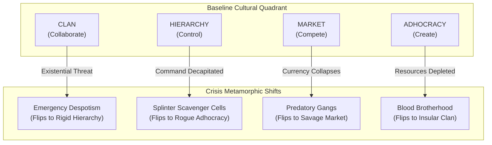

# MODULE SOC-03: ENVIRONMENTAL UNCERTAINTY & CRISIS METAMORPHISM
## Biome Ecology Fit & Disaster-Driven Cultural Mutation
*Theoretical Root: Environmental Uncertainty Framework (Duncan, Daft) | Associated Diagrams: `1520159723101.png`, `Culture-and-organization-design.png`*

---

### 1. The Environmental Uncertainty Matrix

No settlement or culture exists in a vacuum. On the pointcrawl setting, the visceral cruelty of the biomes (*Blood Meridian* micro-climates, stirge swarms, caustic rain) dictates organizational survival. 

Duncan’s Environmental Uncertainty model maps how the complexity and volatility of the surrounding wilderness force organizations into specific cultural survival postures:

```text
                  ENVIRONMENTAL CHANGE (Rate of Volatility)
                                      ▲
                                      │
           HIGH / MODERATE            │               HIGH
             UNCERTAINTY              │           UNCERTAINTY
                                      │
          [Simple + Unstable]         │       [Complex + Unstable]
          Frontier Boomtowns,         │       Titanwood Trekkers,
        Coastal Salvage Flotillas     │      Rift Arcane Explorers
          -> Cultivates MARKET        │      -> Cultivates ADHOCRACY
                                      │
   SIMPLE ────────────────────────────┼──────────────────────────── COMPLEX
   (Few external elements;            │            (Layered magical hazards;
    monolithic threats)               │             predatory ecology; rivalries)
                                      │
                 LOW                  │          LOW / MODERATE
             UNCERTAINTY              │           UNCERTAINTY
                                      │
           [Simple + Stable]          │        [Complex + Stable]
         Interior Farmlands,          │       Cathedral Archives,
          Walled Strongholds          │      Deep Mountain Monasteries
        -> Cultivates HIERARCHY       │         -> Cultivates CLAN
                                      │
                                      ▼
                                STABLE / STATIC
```

---

### 2. Biome Ecology & Cultural Emergence

| Biome Zone | Environmental Profile | Uncertainty Tier | Dominant Culture Bred | Why This Culture Survives Here |
| :--- | :--- | :--- | :--- | :--- |
| **Interior Bastion / Cleared Plains** | Simple + Stable | **Low** | **Hierarchy** *(Control)* | Predictable weather and secure walls permit rigid shift-work, agricultural schedules, and bureaucratic census tracking. |
| **The Coastlines & Salt Shallows** | Simple + Unstable | **Moderate** | **Market** *(Compete)* | Shifting tides, sudden pirate raids, and erratic cargo arrivals reward agile haggling, rapid asset flipping, and competitive opportunism. |
| **The Ancient Deep Caves & Monasteries** | Complex + Stable | **Low/Moderate** | **Clan** *(Collaborate)* | Complex fungal biologies and zero light demand generational knowledge, total team trust, and mutual life-support discipline. |
| **The Titanwood & Slaughter-Gorge** | Complex + Unstable | **High** | **Adhocracy** *(Create)* | Bus-sized falling acorns, mirage mists, and parabolic sun-traps kill rigid formations; only nimble, inventive strike-cells survive. |

---

### 3. The Crisis Metamorphism Engine

When a catastrophic environmental event occurs (e.g. an aerial stirge breach, acetylene fuel exhaustion, or a Soul Siphon vitiation wave), settlements cannot maintain their baseline culture. They are forced into **Cultural Metamorphism**.

#### The Crisis Clock (Tension 1 to 4)
* **Clock 1 (Alarm):** Resources strained. Internal rationing begins.
* **Clock 2 (Breach):** Perimeter compromised or major loss of life.
* **Clock 3 (Failure):** Official leadership fails to solve the threat.
* **Clock 4 (Metamorphism):** Baseline culture shatters and mutates into a desperate survival posture.



#### The Four Metamorphic Fates

1. **Clan Collapse -> Emergency Despotism (Flips to HIERARCHY):**
   * *Trigger:* Communal consensus takes too long; dozens die during a stirge assault.
   * *Result:* A ruthless war-chief declares martial law. Free speech is banned, dissenters are locked in root cellars, and every member is conscripted into mandatory fortification labor.

2. **Hierarchy Paralysis -> Cell Splintering (Flips to ADHOCRACY):**
   * *Trigger:* High command dies or issues absurd, suicidal manual orders during an unprecedented horror.
   * *Result:* Mid-tier field sergeants tear off their insignias, loot the armory, and form independent, highly inventive commando units focused solely on immediate tactical survival.

3. **Market Panic -> Feral Scavenger Warlords (Flips to predatory MARKET):**
   * *Trigger:* Trade caravans are slaughtered; silver coin loses all value compared to water and acetylene fuel.
   * *Result:* Merchants transform into armed raider gangs. Contracts are replaced with hostage-taking, and raw caloric food becomes the only currency.

4. **Adhocracy Exhaustion -> Blood Commune (Flips to insular CLAN):**
   * *Trigger:* Experimental tools backfire; constant risk-taking bleeds the camp dry of engineers and scouts.
   * *Result:* The survivors abandon ambition, seal themselves in subterranean vaults, and swear solemn blood-oaths never to innovate or interact with outsiders again.
