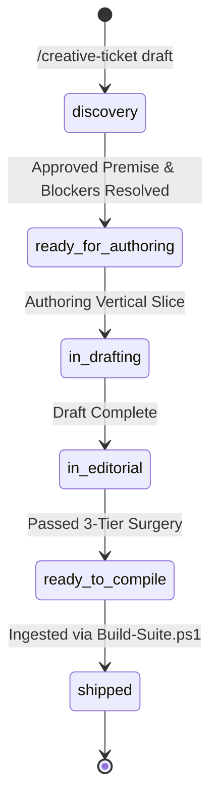

# Creator Studio: Creative Writing & Worldbuilding Ticketing System
*Authority: Skills Folder (`to-tickets`, `writing-discovery`, `writing-beats`, `writing-generation`, `writing-editing`)*
*Location: `tickets/creative/`*

---

## 1. Executive Purpose

The **Creative Writing Ticketing System** adapts tracer-bullet software engineering disciplines to narrative worldbuilding, tabletop module design, and campaign architecture.

Unlike generic engineering tickets (which track code diffs and API bug fixes), a **Creative Writing Ticket** tracks a **vertical slice of playable fiction**:
* A complete, self-contained dramatic unit (module, narrative dilemma, transit corridor, or climax engine).
* Cuts through all four platform layers: **Thematic Premise $\to$ Faction Sociology $\to$ Tabletop Mechanics $\to$ Resource Flow Contract**.
* Sized to be fully authored, diagnosed, edited, and integrated within a single fresh context window.

---

## 2. Theoretical Foundations from `Skills/`

The ticket system synthesizes five core disciplines from the `Skills/` engine:

```text
  [1. TO-TICKETS]               [2. WRITING-DISCOVERY]          [3. WRITING-BEATS]
  Tracer-Bullet Vertical Slice  Central Dramatic Argument       Concept Grounding &
  Strict Blocking Edges         Egri Syllogism & 4-Corner       Prerequisite Trees
              │                             │                            │
              └─────────────────────────────┼────────────────────────────┘
                                            ▼
                               [CREATIVE WRITING TICKET]
                                            ▲
              ┌─────────────────────────────┴────────────────────────────┐
              │                                                          │
  [4. WRITING-GENERATION]                                       [5. WRITING-EDITING]
  Scene Calculus (Collision ><)                                 3-Tier Revision Triage
  Polarity Shifts (+ / -)                                       10% Rule & Micro-Tension
  Bifocal Dialogue Subtext                                      Dillard's Sledgehammer
```

1. **Tracer-Bullet Vertical Slices (`to-tickets`)**:
   Every ticket delivers end-to-end functionality from the user/GM perspective: lore fiction, 4-level dials, threat clocks, hazard severity DCs, and resource tags. No horizontal layers (e.g. no "just write a list of names").
2. **Central Dramatic Argument & Syllogism (`writing-discovery`)**:
   Every module or narrative spark is grounded in Mazin's dramatic syllogism:
   $$\text{Flawed Stasis / Lie} + \text{Crucible Conflict} = \text{Thematic Truth}$$
   Characters and factions engage in Truby's 4-corner moral opposition rather than shallow good-vs-evil binaries.
3. **Concept Grounding & Dependency Trees (`writing-beats`)**:
   Concepts and resources must be **grounded** before downstream elements lean on them. Tickets declare `grounded_prerequisites` (what the player/GM must know or have supplied) and `grounded_yields` (what this ticket establishes for subsequent tickets).
4. **Scene Calculus & Polarity Shifts (`writing-generation`)**:
   Every encounter hook and spark declares an active **Collision ($><$)** over immediate stakes and a **Polarity Shift ($+ \to -$ or $- \to +$)**. Neutral, low-stakes exposition is prohibited.
5. **3-Tier Editorial Surgery (`writing-editing`)**:
   Completed drafts undergo Tier 1 (Structural Spine), Tier 2 (Tension/Calculus), and Tier 3 (Line Pruning, removing adverbs and AI clichés, applying the 10% formula).

---

## 3. Ticket Lifecycle & State Machine



* **`discovery`**: High-concept premise, thematic syllogism, and blocking dependencies being defined.
* **`ready_for_authoring`**: All blocking tickets are shipped; concept prerequisites are grounded; ready for agent or author pickup.
* **`in_drafting`**: Active composition of module text, 4-level dials, threat clocks, and mechanics.
* **`in_editorial`**: Undergoing developmental tension audit, scene calculus verification, and 10% word prune.
* **`ready_to_compile`**: Approved markdown added to `modules/Set_X/` and registered in `modules_manifest.json`.
* **`shipped`**: Recompiled via `Build-Suite.ps1`; AST validated; zero CORS errors; live in Campaign Studio.

---

## 4. Ticket Directory Organization

Tickets are organized into atomic files under `tickets/creative/`:

```text
tickets/creative/
├── README.md                          # This operating specification
├── TEMPLATE.md                        # Master creative ticket template
├── active/                            # In-progress & ready-for-authoring tickets
│   ├── CWT-001-deep-silt-aquaponics.md
│   └── CWT-002-lovers-chasm-pact.md
├── backlog/                           # Prioritized ideas & gap remediation tickets
│   ├── 01_tier_5_climax_engines/
│   ├── 02_tarot_underrepresented/
│   ├── 03_transit_edge_corridors/
│   └── 04_life_support_supply/
└── shipped/                           # Completed, compiled & integrated tickets
```

---

## 5. Definition of Done (DoD) for a Creative Ticket

A ticket is only marked `shipped` when:
1. **Vertical Slice Completeness**: Contains full narrative description, GM socket synergy, 4-level dial, threat clocks (with segment counts), and hazard severity binding.
2. **Universal SRD Conformance**:
   * Uses Universal Hazard Tiers (Light, Moderate, Severe, Lethal with d20 DC, 2d6, and damage dice).
   * Declares typed Resource Tags (`provides` / `requires`).
   * Contains a robust **Standalone Fallback Mode** if upstream logistics are severed.
3. **Cross-Reference Block**: Appends authoritative cross-references linking to `authoring_engine_srd.md` and `adventure_framework_srd.md`.
4. **Compilation Verification**:
   * Registered in `network/modules_manifest.json`.
   * Passes `Build-Suite.ps1` with 0 warnings.
   * Node AST validation on `campaign_studio.html` returns 0 syntax errors.
