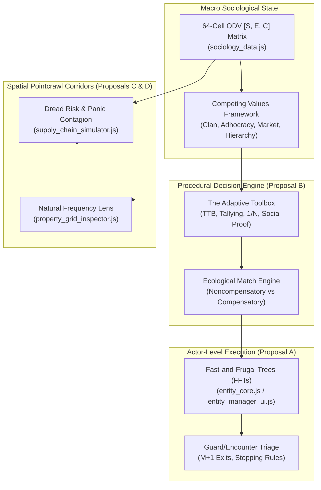
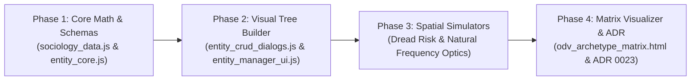

# Engineering Plan: Ecological Rationality & Behavioral Heuristics Suite (Gerd Gigerenzer Integration)

## Executive Summary & Architectural Invariants

This plan operationalizes the decision-science models from Gerd Gigerenzer's *Rationality for Mortals: How People Cope with Uncertainty* (Oxford University Press, 2008) into Creator Studio's pointcrawl CAD workstation. It bridges the gap between the macro-sociological models (the 64-cell Organizational Disposition Vector `[S, E, C]` and Competing Values Framework) and granular, procedural in-game behavior for NPCs, factions, settlements, and hazard conduits.

## Revision 2 (review corrections — these override conflicting text below)

Verified against the repo on 2026-11-06:

1. **Quadrant mapping must reuse `deriveCvfQuadrant(s, e)`** (`sociology_data.js:815`). It already partitions all 64 cells by S and E only: Clan = S≥3,E≤2; Adhocracy = S≥3,E≥3; Hierarchy = S≤2,E≤2; Market = S≤2,E≥3. S, E, C each range 1–4. The Proposal B table below used different thresholds (and C) and contradicts this. Corrected rule: **quadrant (from S,E) picks the primary heuristic; C only modulates it** (C≥3 = strict/codified variant, C≤2 = loose/improvised variant; `searchPatience = C`). This gives a total, non-overlapping mapping. Derive profiles in a function; store only per-cell overrides in `ODV_MATRIX_64`, not 64 copies of the same fields.
2. **Corrected quadrant→heuristic table:** Clan → Social Proof (imitate majority); Hierarchy → FFT / threshold rules; Adhocracy → Take-the-Best; Market → Tallying + 1/N. Treat this as a Creator Studio design mapping, not a claim from Gigerenzer's book.
3. **ADR number:** 0023 is taken (`0023-campaign-independent-workstation-module-packs-and-v2-schema.md`). Use the next free number (0024+; check for duplicates first).
4. **Proposal D data fields:** edges currently carry only integer `hazardLevel` 0–3 (with `hazardInfo.dc`). `hazardProbability`, `scoutDetectionRate` and `scoutFalseAlarmRate` do not exist. Add them as optional fields, with a documented default derived from `hazardLevel` (e.g. L0=0, L1=0.05, L2=0.15, L3=0.30), so legacy campaigns render without edits.
5. **FFT `testType` list is closed:** `boolean_query`, `faction_standing`, `item_check`, `disposition_threshold`, `gold_threshold`. Reject unknown types at validation.
6. **Proposal C is deferred and reduced** to an opt-in what-if overlay that never writes `hazardLevel`. Guard S=0 (S is ≥1 in the data, but clamp anyway), cap diverted flow by detour capacity, and keep mass conservation (entering = direct + diverted + unserved).
7. **Revised order:** Phase 1 (heuristic derivation + `evaluateFastAndFrugalTree` + `natural_frequency_engine.js` with tests) → Phase 2 (list-based FFT editor, then SVG tree view) → Phase 3 (natural-frequency inspector section, ODV matrix heuristics view) → Phase 4 (ADR, wiki notes) → Phase 5 (optional Proposal C overlay).
8. **Process:** add wiki notes and `Build-Suite.ps1 --stamp-reviewed` for every touched file; register the new test in `test/run_tests.js` (the only file in `test/` today); run `campaigns/Test-CampaignPackage.ps1` to confirm optional fields pass; work on a branch/worktree (source only, no compiled bundles) because the main tree has uncommitted campaign changes.

### Ground Rules & System Constraints
1. **Zero-CORS Offline Execution**: 100% pure client-side JavaScript. No external dependencies, CDNs, or network APIs. All visualizations run via local SVG, Canvas 2D, and vanilla DOM.
2. **Schema Non-Disruption**: All new entity properties (`fft`, `heuristicProfile`, `dreadRiskParams`, `naturalFrequencyOptics`) are strictly additive and optional with default fallbacks, preserving backwards compatibility with legacy campaigns.
3. **MDI & Win95 Aesthetic Parity**: All dialogs, builders, and inspectors conform to the established Windows 95 / VB6 workstation skin.
4. **Source of Truth Invariant**: Edits target modular files in `src/workstation/scripts/` and source HTML tools; monolithic outputs (`start.html`, `network/odv_archetype_matrix.html`) are compiled via `Build-Suite.ps1`.

---



---

## Proposal A: Fast-and-Frugal Trees (FFTs) for NPC & Faction Triage

### 1. Architectural Purpose
Current NPCs and Faction guards have static text descriptions or basic disposition numbers, but lack procedural behavioral resolution. In high-stakes tabletop play (guard checkpoints, parleys, contagion quarantine, surrender demands), GMs require rapid, deterministic resolution. An FFT provides a decision tree with $M$ sequential binary cues and $M+1$ exits, where *every split point has at least one immediate exit condition*, halting information search immediately upon finding a discriminating cue.

### 2. Data Schema Extension
Extend the campaign entity schema (`npc` and `faction`) in `src/workstation/scripts/entity_core.js`:

```javascript
/**
 * Fast-and-Frugal Tree (FFT) Model
 * Represents a strictly noncompensatory sequential decision algorithm.
 */
{
  "fft": {
    "id": "fft_guard_checkpoint",
    "name": "Border Gate Watch Triage",
    "purpose": "Detain, attack, or pass travelers approaching the perimeter",
    "cues": [
      {
        "id": "cue_weapons_drawn",
        "label": "Party is carrying drawn weapons or active war magic?",
        "testType": "boolean_query",     // 'boolean_query', 'faction_standing', 'item_check', 'disposition_threshold'
        "targetValue": true,
        "exitDirection": "yes",          // If true, exit immediately
        "exitAction": "ATTACK_HOSTILE",  // Terminal action
        "exitLabel": "Sound Alarm & Engage",
        "badgeStyle": "background:#fee2e2; color:#b91c1c;"
      },
      {
        "id": "cue_allied_seal",
        "label": "Possesses official writ or signet ring of the Iron Phalanx?",
        "testType": "item_check",
        "targetValue": "item_iron_seal",
        "exitDirection": "yes",
        "exitAction": "GRANT_PASSAGE",
        "exitLabel": "Salute & Open Gate",
        "badgeStyle": "background:#dcfce7; color:#166534;"
      },
      {
        "id": "cue_bribe_toll",
        "label": "Can party pay the 50 sp quarantine levy?",
        "testType": "gold_threshold",
        "targetValue": 50,
        "exitDirection": "no",           // If false, exit immediately
        "exitAction": "REFUSE_ENTRY",    // Terminal action
        "exitLabel": "Turn Away at Pike-Point",
        "badgeStyle": "background:#fef3c7; color:#92400e;"
      }
    ],
    "defaultExit": {
      "action": "GRANT_PASSAGE_WITH_ESCORT",
      "label": "Allow Entry with Armed Shadow Guard",
      "badgeStyle": "background:#e0f2fe; color:#0369a1;"
    }
  }
}
```

### 3. Procedural Evaluation Engine (`src/workstation/scripts/entity_core.js`)
Implement `evaluateFastAndFrugalTree(fft, context)`:
- Pure evaluation function operating on a game-state context object (`{ partyItems: [], factionStandings: {}, partyGold: 0, queryAnswers: {} }`).
- Evaluates cues $1 \dots M$ in strict priority order.
- As soon as a cue's condition matches `exitDirection`, returns `{ resolved: true, cueTriggered: cue, action: cue.exitAction, stepIndex: i }`.
- If no early exit triggered after $M$ cues, executes `fft.defaultExit`.
- Computes **Frugality Score**: $\text{Frugality} = 1 - \frac{\text{Cues Inspected}}{\text{Total Available Cues}}$.

### 4. Interactive Win95 Visual Builder & Dossier Viewer (`src/workstation/scripts/entity_crud_dialogs.js` & `entity_manager_ui.js`)
- **FFT Dossier Component**: In the NPC and Faction detail view inside the Universal Campaign Entity Manager (`#modal-entity-manager`), mount an interactive SVG/HTML vertical diagram of the tree.
- **Tree Visualizer Layout**:
  - Top root node $\rightarrow$ Downward branching pill showing the Question.
  - Left branch: Red/Green Terminal Exit Card (with one-click "Trigger Action" button for GM notes).
  - Right branch: Continuation connector to next sequential cue.
  - Terminal leaf: Default fallback action.
- **FFT CRUD Modal (`openFftBuilderModal(entityType, entityId)`)**:
  - Dialog allowing authors to reorder cues via Up/Down buttons, select cue evaluation types, pick exit directions, and test the tree against a mock party profile.
  - Includes a library of Gigerenzer-derived archetypal presets:
    - *Emergency Sentry Triage (Fight / Detain / Pass)*
    - *Bail / Ransom Determination (Release / Indefinite Dungeon)*
    - *Trade Parley Protocol (Accredit / Tariff / Seize)*
    - *Contagion / Infiltration Inspection (Burn / Quarantine / Cleanse)*

---

## Proposal B: Faction & Settlement Heuristic Profile Engine

### 1. Architectural Purpose
Sociological profiles in Creator Studio are currently static hermeneutic descriptions. Proposal B maps each of the 64 ODV archetypes and 4 CVF quadrants to an **Adaptive Toolbox Heuristic Profile**, specifying how institutions gather intelligence, stop searching, and allocate resources.

### 2. The Heuristic Mapping Matrix

| CVF Quadrant | Primary ODV Vector Driver | Gigerenzer Heuristic Strategy | Algorithmic Rules (Search, Stopping, Decision) |
| :--- | :--- | :--- | :--- |
| **Clan** (Internal Focus, Flexibility) | High Social ($S \ge 3$), Low Control ($C \le 2$) | **Social Heuristics** (*Imitate the Majority* / *Social Proof*) | **Search**: Sample actions of in-group peers.<br>**Stopping**: Stop once $k$ elders or $51\%$ of kin agree.<br>**Decision**: Adopt majority consensus; ostracize deviants. |
| **Hierarchy** (Internal Focus, Stability) | High Control ($C \ge 3$), Low Economic ($E \le 2$) | **Fast-and-Frugal Triage (FFT)** & **Threshold Rules** | **Search**: Query codified legal/scriptural cues in fixed hierarchical order.<br>**Stopping**: Stop at first broken protocol or matched rule.<br>**Decision**: Immediate noncompensatory enforcement. |
| **Adhocracy** (External Focus, Flexibility) | High Economic ($E \ge 3$), Low Control ($C \le 2$) | **Take-the-Best (TTB)** (*One-Reason Decision Making*) | **Search**: Rank cues by empirical validity (e.g., Immediate Profit, Tactical Advantage).<br>**Stopping**: Stop at the single cue that discriminates between options.<br>**Decision**: Choose option favored by that single cue; ignore all other data. |
| **Market** (External Focus, Stability) | High Economic ($E \ge 3$), High Control ($C \ge 3$) | **Tallying (Unit Weights)** & **$1/N$ Equality Allocation** | **Search**: Collect $N$ known benchmark indicators (no weights, unit $+1/-1$).<br>**Stopping**: Count positive vs. negative cues.<br>**Decision**: Option with highest tally wins. Budget split evenly ($1/N$) across ventures. |

### 3. Implementation in `src/workstation/scripts/sociology_data.js`
- Enrich `ODV_MATRIX_64` entries with a typed `heuristicProfile`:
  ```javascript
  "heuristicProfile": {
    "primary": "TAKE_THE_BEST",
    "socialRule": "IMITATE_SUCCESSFUL",
    "allocationRule": "EQUALITY_ONE_OVER_N",
    "searchPatience": 2, // Number of cues inspected before satisficing
    "cueValidityHierarchy": ["immediate_threat", "treaty_obligation", "economic_profit"],
    "ecologicalFitness": "Dominates in turbulent, noncompensatory border regions with high information decay."
  }
  ```
- Export helper methods:
  - `getHeuristicProfile(odv)`: Returns the operational heuristics for an entity or node.
  - `diagnoseEcologicalMatch(node, problemType)`: Analyzes whether the node's heuristic profile fits the node's environmental stability:
    - *Warning Trigger*: If an Adhocracy/TTB settlement operates in a highly redundant, noisy trade guild (where Tallying is optimal), flag an **Ecological Mismatch Warning: Overfitting / Reckless One-Reason Bias**.
    - *Warning Trigger*: If a Hierarchy/FFT settlement faces sudden asymmetrical warfare, flag **Ecological Mismatch Warning: Procedural Paralysis**.

### 4. Workstation Visualizer Updates
- **`network/odv_archetype_matrix.html`**:
  - Add a **"Heuristics & Decision Mechanics"** view mode toggle alongside the existing 64-Cell Matrix, CVF Quadrant Map, and Sensory Pentagon.
  - Color-code the 64 cells by their Gigerenzer decision strategy: Take-the-Best (Adhocracy Amber), Tallying (Market Blue), Social Proof (Clan Green), Fast-and-Frugal Tree (Hierarchy Crimson).
- **`src/workstation/scripts/social_graph_renderer.js`**:
  - In inter-faction diplomatic links, annotate tension lines with heuristic friction (e.g., a *Take-The-Best* faction negotiating with a *Tallying* faction produces diplomatic impatience and negotiation breakdown).

---

## Proposal C: Dread Risk & Mediated Panic Spillover Simulator

### 1. Architectural Purpose
When a disaster, monster attack, or catastrophic raid hits a node, Creator Studio currently modifies that node's stats in isolation. In reality (as demonstrated by Gigerenzer's post-9/11 driving analysis), low-probability high-fatality events induce **Dread Risk**: populations systematically avoid the dread conduit, fleeing to alternative, unmaintained, and more lethal secondary corridors.

### 2. Mathematical Formulation
Let a catastrophic event $E$ occur at Node $A$ affecting Conduit $C_{AB}$.
1. **Dread Index ($\mathcal{D}$)**:
   $$\mathcal{D} = \text{Severity} \times (1 + \text{Novelty}) \times \frac{C_{\text{host}}}{S_{\text{host}}}$$
   Where $C_{\text{host}}$ is the node's Control vector and $S_{\text{host}}$ is Social cohesion. High Control, low Social societies experience maximum institutional secrecy and public paranoia.
2. **Traffic Diversion Rate ($\Phi_{\text{avoid}}$)**:
   $$\Phi_{\text{avoid}} = \min\left(1.0, \frac{\mathcal{D}}{10}\right)$$
   Direct traffic through $C_{AB}$ drops by $\Phi_{\text{avoid}}$.
3. **Secondary Spillover Hazard ($\Delta H_{\text{detour}}$)**:
   The diverted traffic $\Phi_{\text{avoid}} \times \text{Volume}$ is forced onto alternate secondary pointcrawl paths. Because secondary paths lack infrastructure capacity, secondary attrition escalates:
   $$\text{Casualties}_{\text{secondary}} = \text{Traffic}_{\text{detour}} \times \text{HazardLevel}_{\text{detour}} \times \text{CongestionMultiplier}$$
   Often, $\text{Casualties}_{\text{secondary}} > \text{Casualties}_{\text{primary}}$.

### 3. Implementation in `src/workstation/scripts/supply_chain_simulator.js`
- Add `simulateDreadRiskCascade(sourceNodeId, disasterSeverity, incidentType)`:
  - Scans all incident nodes flagged with active disaster dials or threat clocks.
  - Identifies all primary arterial conduits connected to the incident node.
  - Calculates flow diversion using the network graph adjacency lists (`u.adj`, `v.infBy`).
  - Automatically identifies bottleneck secondary corridors and elevates their `hazardLevel` and `wearClock`.
  - Flags settlements receiving displaced traffic with the `Famine Risk` or `Refugee Strain` status tag.
- **CAD Canvas Integration**:
  - When the Dread Risk simulator is active, render pulsating amber/red hazard auras around the detour conduits in `cad_canvas_renderer.js`.
  - Display a telemetry badge in the status bar: `Dread Cascade: Primary Losses: 45 | Secondary Detour Losses: 182 (304% amplification)`.

---

## Proposal D: Natural Frequency Lens for Conduit & Encounter Hazards

### 1. Architectural Purpose
Gigerenzer’s most celebrated real-world intervention is replacing conditional probabilities and percentage risks with **Natural Frequencies**. In game authoring, GMs and players fail to grasp what "15% ambush chance per 4-hour watch" means in concrete logistics. Expressing hazards as natural frequencies (*"Out of 20 travel watches, 3 will encounter ambushes, 2 of which occur in fog"*) eliminates cognitive illusions and enables direct resource budgeting.

### 2. Natural Frequency Engine & 2x2 Signal Detection Matrix
Add a dedicated module `natural_frequency_engine.js` in `src/workstation/scripts/`:

```javascript
/**
 * Transforms conditional risk probabilities into transparent natural frequency trees.
 */
function computeConduitNaturalFrequency(conduitData, sampleSize = 100) {
  const baseRate = conduitData.hazardProbability || 0.10; // e.g. 10%
  const scoutSensitivity = conduitData.scoutDetectionRate || 0.80; // 80% detection if danger present
  const scoutFalseAlarm = conduitData.scoutFalseAlarmRate || 0.10; // 10% false alarm if safe

  const totalThreatWatches = Math.round(sampleSize * baseRate);
  const totalSafeWatches = sampleSize - totalThreatWatches;

  const hits = Math.round(totalThreatWatches * scoutSensitivity);
  const misses = totalThreatWatches - hits;
  const falseAlarms = Math.round(totalSafeWatches * scoutFalseAlarm);
  const correctRejections = totalSafeWatches - falseAlarms;

  return {
    sampleSize,
    totalThreatWatches,
    totalSafeWatches,
    matrix: { hits, misses, falseAlarms, correctRejections },
    readableSummary: `Out of ${sampleSize} expeditions across this pass, ${totalThreatWatches} encounter lethal hazards. Scouts correctly sound the alarm on ${hits} of them, but miss ${misses}, and cause panic on ${falseAlarms} safe trips.`
  };
}
```

### 3. UI Integration in the Workstation
- **Property Grid Inspector (`property_grid_inspector.js`)**:
  - When inspecting an Edge / Conduit, add a new section: **Hazard Optics (Natural Frequencies)**.
  - Includes a quick-toggle: `[ % Percentage Mode ]` vs `[ Natural Frequency Mode ]`.
  - In Natural Frequency mode, displays a 2x2 visual contingency table:
    - **Hit (Scout alerts, Danger strikes)**: Green badge.
    - **False Alarm (Scout alerts, Corridor safe)**: Yellow badge (wastes rations/spells).
    - **Miss (Scout silent, Danger strikes)**: Red critical badge (ambush/disaster).
    - **Correct Rejection (Scout silent, Corridor safe)**: Neutral gray badge.
- **Corridor Hazard Dialog (`openCorridorHazardDialog` in `entity_manager_ui.js`)**:
  - Provide a one-click "Generate Encounter Odds Sheet" formatted as a transparent natural frequency tree for GM session prep.

---

## Detailed File-by-File Implementation Matrix

| File Target | Action | Key Functions / Modifications to Implement |
| :--- | :--- | :--- |
| `src/workstation/scripts/sociology_data.js` | Update | 1. Add `heuristicProfile` schema to `ODV_MATRIX_64`.<br>2. Add `deriveHeuristicStrategy(s, e, c)` and `getHeuristicDetails(key)`.<br>3. Add `diagnoseEcologicalMatch(node, challengeContext)`.<br>4. Export new methods on `window` and `module.exports`. |
| `src/workstation/scripts/entity_core.js` | Update | 1. Extend NPC and Faction prototypes with optional `fft` property.<br>2. Implement `evaluateFastAndFrugalTree(fft, context)`.<br>3. Add `createDefaultFft(templateType)` with standard archetypes.<br>4. Extend entity cascade deletion and cloning routines for `fft`. |
| `src/workstation/scripts/entity_crud_dialogs.js` | Update | 1. Build `renderFftBuilderDialog(entityType, entityId)`.<br>2. Cue addition, reordering, condition toggling, and exit direction handlers.<br>3. Instant preview evaluation simulator against test party attributes. |
| `src/workstation/scripts/entity_manager_ui.js` | Update | 1. Mount SVG/DOM Fast-and-Frugal Tree visualizer in the NPC and Faction detail cards.<br>2. Add "Heuristic Operational Style" badge row in Faction Dossier.<br>3. Add Natural Frequency risk summary to the Edge Explorer Telemetry tab. |
| `src/workstation/scripts/supply_chain_simulator.js` | Update | 1. Implement `simulateDreadRiskCascade(sourceNodeId, severity)`.<br>2. Add flow diversion calculation diverting transit off primary conduits onto secondary detours.<br>3. Compute secondary attrition escalation and output audit report. |
| `src/workstation/scripts/property_grid_inspector.js` | Update | 1. Add `renderNaturalFrequencyHazardTable(edgeData, container)`.<br>2. Add toggle switch between percentage view and natural frequency matrix. |
| `network/odv_archetype_matrix.html` | Update | 1. Add fourth perspective button: `[Gigerenzer Heuristics]`.<br>2. Color-code matrix by heuristic strategy (TTB, Tallying, 1/N, Social Proof).<br>3. Add interactive inspector card explaining ecological rationality of selected cell. |
| `docs/adr/00NN-gigerenzer-ecological-rationality-and-fast-and-frugal-heuristics.md` (NN = next free number; 0023 is taken) | Create | Authoritative Architecture Decision Record documenting the theoretical model, Gigerenzer citations, schema invariants, and UI surfaces. |
| `test/test_gigerenzer_heuristics.js` | Create | Unit test suite covering FFT evaluation, cue order noncompensatory stops, dread cascade math, and natural frequency conversions. |

---

## Quality Assurance & Verification Protocol

1. **Unit Testing (`test/test_gigerenzer_heuristics.js`)**:
   - Verify FFT noncompensatory stopping rule: ensures evaluation terminates immediately on Step 1 when Cue 1 is satisfied, without evaluating Cues 2 or 3.
   - Verify 100% test coverage on `computeConduitNaturalFrequency` across boundary conditions (0% base rate, 100% false alarms, small sample sizes).
   - Test Dread Risk diversion preserves flow mass conservation (total entering traffic = direct traffic + diverted traffic).
2. **Offline Zero-CORS Verification**:
   - Execute all modified and compiled surfaces (`start.html`, `network/odv_archetype_matrix.html`) directly via `file:///` in Google Chrome and Mozilla Firefox.
   - Assert zero browser console errors, zero external asset requests, and zero font/script loading failures.
3. **Automated Suite Test & Build Verification**:
   - Run `powershell -ExecutionPolicy Bypass -File .\Build-Suite.ps1` to compile the monolithic distributions.
   - Run `powershell -ExecutionPolicy Bypass -File .\Test-Suite.ps1` to ensure all existing tests, syntax gates, and campaign schemas pass with zero regressions.

---

## Phased Rollout Roadmap



* **Phase 1: Foundation (Core Models & Evaluators)**:
  - Add heuristic taxonomy to `sociology_data.js`.
  - Add FFT schema and `evaluateFastAndFrugalTree` engine in `entity_core.js`.
  - Unit tests for decision rules and stopping mechanics.
* **Phase 2: Entity Workstation UI (FFT Builder & Dossiers)**:
  - Add the Win95 visual tree builder dialog in `entity_crud_dialogs.js`.
  - Mount visual tree cards in NPC and Faction dossiers in `entity_manager_ui.js`.
* **Phase 3: Pointcrawl Spillovers & Optics (Dread Risk & Natural Frequencies)**:
  - Implement `simulateDreadRiskCascade` in `supply_chain_simulator.js`.
  - Integrate natural frequency 2x2 contingency tables into `property_grid_inspector.js` and Edge Explorer.
* **Phase 4: Standalone Visualizer & Documentation**:
  - Add the Heuristics tab to `network/odv_archetype_matrix.html`.
  - Author `docs/adr/0023-gigerenzer-ecological-rationality-and-fast-and-frugal-heuristics.md`.
  - Run `Build-Suite.ps1` and run full regression test harness.
