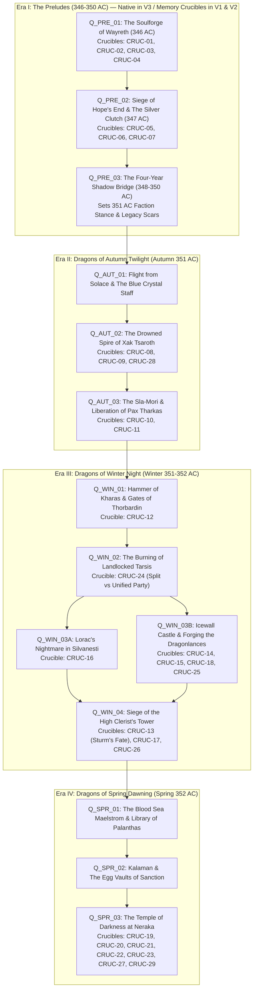

# Campaign Storyline & Branching Beat Specification: The Chronicles of Krynn (3-Edition Architecture)

**Status:** Approved via `/grill-with-docs` & `/writing-beats`  
**Target Workstation:** Creator Studio / Workstation 2.6 (`start.html`)  
**Authoritative Lore Vault:** [[00_MASTER_INDEX]] (`campaigns/Krynn_War_of_the_Lance/lore_wiki/`)  
**Crucible Engine Reference:** [[03_Master_Branching_Crucibles_and_Beat_Menu]]

---

## 1. Executive Architecture: Three Selectable Campaign Packages Sharing One Living World

Per the `/grill-with-docs` architectural alignment, the 6-book Dragonlance corpus (*The Soulforge*, *Brothers in Arms*, *Dragons of Autumn Twilight*, *Dragons of Winter Night*, *Dragons of Spring Dawning*, and *The Annotated Chronicles*) is compiled into **three distinct, selectable Workstation 2.6 Campaign Packages**.

All three packages share **~80% of their structural assets**—the Continental Ansalon Pointcrawl (`topology.json`), the 12 nested Tactical Submaps (`childMapId`), the 5-Tier Worldbuilding Module Library (`modules/*.md`), the 10 Major Factions, the 48 Dramatis Personae (`entities.npcs`), and the 30 Relics & Items (`entities.items`)—while shipping with **tailored starting eras, initial node control states, Quest Spanning Networks, and Threat Clock rosters (`entities.trackers`)**.

| Package Slug (`campaign.id`) | Display Name (`campaign.name`) | Starting Era & Entry Node (`entryMapId`) | Party Perspective & Companion Mode | How *Soulforge* & *Brothers in Arms* (346–347 AC) Are Experienced |
| :--- | :--- | :--- | :--- | :--- |
| **`krynn_v1_heroes_of_the_lance`** | **Krynn (V1): Heroes of the Lance (351 AC)** | **Autumn 351 AC** `N_SOLACE` (*Inn of the Last Home*) | **Mode A (Canonical Heroes):** Players step into the boots of the Core Eight Companions (Tanis, Sturm, Caramon, Raistlin, Goldmoon, Riverwind, Tasslehoff, Flint + Tika, Laurana, Gilthanas). | **Always-On World Lore + 2 Relic/Locus Memory Crucible Quests:** Touching the *Staff of Magius / Bloodstone* at Wayreth or the *Scorched Silver Clutch Vault* at Hope's End projects the 351 AC party into playable 1–2 quest echoes in 346–347 AC whose outcomes grant secret leverage in 351 AC. |
| **`krynn_v2_shadows_of_the_lance`** | **Krynn (V2): Shadows of the Lance (351 AC)** | **Autumn 351 AC** `N_SOLACE` / `N_HAVEN` | **Mode B (Non-Main Characters + Tri-Vector Allegiance):** Players control a custom cohort who cross paths with, hear rumors of, flank-assist, rival, or **actively hunt/oppose** the Autonomous Heroes of the Lance. | **Always-On World Lore + 2 Relic/Locus Memory Crucible Quests:** Same 2 playable 346–347 AC Memory Crucible projections at Wayreth and Hope's End, usable to uncover blackmail on Raistlin, Kitiara, or the Draconian egg oath. |
| **`krynn_v3_five_book_odyssey`** | **Krynn (V3): The Five-Book Odyssey (346–352 AC)** | **Spring 346 AC** `N_HAVEN` / `N_WAYRETH` | **Mode B (Non-Main Characters Across All 5 Books):** Players begin in 346 AC alongside young Raistlin, Caramon, and Kitiara through *The Soulforge* and *Brothers in Arms*, play a 1-quest 348–350 AC bridge, and enter the 351–352 AC War of the Lance with persistent history. | **Full Chronological Playthrough (Acts I & II):** Played directly in real time in 346–347 AC before bridging via *The Four-Year Shadow (348–350 AC)* into Acts III–V (*Autumn Twilight* $\to$ *Winter Night* $\to$ *Spring Dawning*). |

---

## 2. Core Systemic Engines Across the Three Versions

### 2.1 The Relic & Locus Memory Crucible Engine (Versions 1 & 2 Flashback Transport)
In **Version 1** and **Version 2** (which begin in Autumn 351 AC), *The Soulforge* and *Brothers in Arms* history is permanently embedded in every node's description, NPC memory bank, and rumor matrix (e.g., the dragon-glass ruins of Hope's End, Fistandantilus's whisper in the Bloodstone, Kitiara's scar from Immolatus's valley, Horkin's bitter veteran tales).

In addition, Versions 1 & 2 include **two optional Temporal Memory Crucible Quests (`Q_ECHO_01` and `Q_ECHO_02`)** that transport the party back into 346–347 AC for a self-contained 1–2 quest arc:
1. **`Q_ECHO_01`: *The Soulforge Echo (346 AC Projection)* — Triggered at `N_WAYRETH` or via `ITM-STAFF-MAGIUS` / `ITM-BLOODSTONE`:**
   - **The Trigger:** When the 351 AC party rests within the shifting forest of Wayreth or attunes to the Bloodstone Pendant / Staff of Magius after Xak Tsaroth, the artifact's psychic residue pulls them into the **Chamber of the Test (346 AC)**.
   - **Playable Frame:** In V1, Raistlin relives the Crucible while his companions manifest as the living projections tested inside the Soul-Mirror chambers; in V2, the custom party's minds inhabit the parallel initiates/wardens inside the Tower of High Sorcery on the night Fistandantilus strikes his bargain (`CRUC-03`, `CRUC-04`).
   - **351 AC Reward / Consequence:** Completing the echo unlocks **Fistandantilus's True Command Word** (granting immunity to Cyan Bloodbane's nightmare aura in Silvanesti or severing Fistandantilus's parasitic hold in `CRUC-16`) and reveals the hidden vault beneath Wayreth.
2. **`Q_ECHO_02`: *Ashes of the Silver Clutch (347 AC Projection)* — Triggered at `N_HOPES_END` or `N_PAX_THARKAS` / `N_SANCTION`:**
   - **The Trigger:** Investigating the vitrified dragon-glass battlements of **Hope's End** (`N_HOPES_END`) or examining the first metallic-scaled Draconian armor markings at Pax Tharkas/Sanction resonates with a cracked **Silver Dragon Eggshell Shard (`ITM-SILVER-SHARD`)**.
   - **Playable Frame:** The party is projected into the final 48 hours of **Mad Baron Ivor's Siege of Hope's End (347 AC)** alongside young Caramon, Raistlin, Horkin, and Kitiara (`CRUC-05`, `CRUC-06`, `CRUC-07`) as the Red Dragon Immolatus descends and the buried clutch of Silver Dragon Eggs is betrayed.
   - **351 AC Reward / Consequence:** Uncovers the **Sanction Vault Seal & D'Argent's True Name**, allowing the 351 AC party to prove the Draconian egg corruption to Silvara (`NPC-SILVARA`) in Southern Ergoth ahead of schedule or blackmail Highlord Kitiara with her 347 AC pact with Immolatus.

---

### 2.2 The Autonomous Companion Odyssey Clock & Tri-Vector Allegiance Sandbox (Versions 2 & 3)
In **Version 2 (`krynn_v2_shadows_of_the_lance`)** and **Acts III–V of Version 3 (`krynn_v3_five_book_odyssey`)**, the Heroes of the Lance are not player-controlled; they operate as **Autonomous Moving NPCs (`Mode B`)** governed by a master 12-segment world tracker (`TRK_COMPANIONS_ODYSSEY`) with **Clock Threshold Consequences**:

| Tick | Canonical Location (`stationedNodeId`) | Canonical Event in the World | How a Non-Canon Party Interacts (`Shadow Ally` / `Freebooter Rival` / `Dragonarmy Operative`) |
| :---: | :--- | :--- | :--- |
| **1** | `N_SOLACE` (*Inn of the Last Home*) | Reunion interrupted by Hederick's theocratic incident; flight across Crystalmir Lake. | **Cross Paths at the Inn:** Aid their escape from Toede's goblins, steal the Blue Crystal Staff in the chaos, or tip off Fewmaster Toede. |
| **2** | `N_DARKEN_WOOD` $\to$ `N_XAK_TSAROTH` | Forestmaster's unicorn guides the Companions to the sunken ruin of Khisanth. | **Race to the Ruin:** Hold the swamp causeway against Baaz platoons, race Raistlin to Fistandantilus's grimoire (`CRUC-09`), or ambush them at the Great Lift (`CRUC-08`, `CRUC-28`). |
| **3** | `N_SOLACE` (*Captured Caravan*) $\to$ `N_QUALINOST` | Captured in Solace; rescued by Gilthanas at Nightlund border; Council in Qualinost. | **Prison Wagon Heist:** Spring the prison cage alongside Gilthanas, extract a high-value Seeker hostage, or command the Dragonarmy escort column. |
| **4** | `N_SLA_MORI` $\to$ `N_PAX_THARKAS` | Infiltration through the Sla-Mori; Flamestrike's nursery; Verminaard's fall. | **The Two-Front Siege:** Hold the Sla-Mori tunnels against Toede's reinforcements, sabotage the Great Chain mechanism, or defend Verminaard's citadel against the Heroes (`CRUC-10`, `CRUC-11`). |
| **5** | `N_HOPES_END` / `N_DERKIN_TOMB` $\to$ `N_THORBARDIN` | 800 refugees hide in the Kharolis foothills; Quest for the Hammer of Kharas; Skullcap falls. | **The Traitor Hunt:** Expose or assist Eben Shatterstone's betrayal (`CRUC-12`), delve into Derkin's Tomb ahead of Tanis, or broker the Hylar compact. |
| **6** | `N_TARSIS` (*Tarsis the Beautiful*) | Landlocked port ambush by Kitiara's Blue Wing and Bakaris; the Fellowship splits (`CRUC-24`). | **The Red Dragon Inn Riot:** Evacuate the Companions on griffons, rescue Alhana Starbreeze's guard, or lead the Blue Wing street sweep alongside Bakaris. |
| **7** | **Split Track:** `N_SILVANESTI` (Tanis/Raistlin) & `N_ICEWALL` (Laurana/Sturm) | Lorac's Nightmare (`CRUC-16`) in the east; Feal-Thas & the Icewall Dragon Orb (`CRUC-14`, `CRUC-25`) in the south. | **Choose Your Theater:** Sail south with the Ice Folk to contest Feal-Thas's Dragon Orb, or march east into Cyan Bloodbane's hallucination wood. |
| **8** | `N_SOUTHERN_ERGOTH` $\to$ `N_SANCRIST` | Foghaven Valley (Silvara & Theros forge the Dragonlances, `CRUC-18`); The Whitestone Council (`CRUC-15`). | **The Diplomatic Crucible:** Escort the newly forged Dragonlances to Mount Nevermind, sabotage the Solamnic-Elven vote for Kitiara, or blackmail Derek Crownguard. |
| **9** | `N_PALANTHAS` $\to$ `N_HIGH_CLERIST_TOWER` | Siege of the High Clerist's Tower; Laurana wields the Dragon Orb (`CRUC-17`); Sturm faces Kitiara on the parapet (`CRUC-13`). | **The Parapet of Destiny:** Reinforce the West Gate Dragon-Traps so **Sturm survives** (`CRUC-13`), shatter the Orb as a Blue Wing saboteur (`CRUC-26`), or capture Bakaris. |
| **10** | `N_FLOTSAM` $\to$ `N_BLOOD_SEA` | Blood Sea of Istar maelstrom; Raistlin dons the Black Robes and abandons the sinking *Perechon* for Palanthas. | **Corsair Boarding Action:** Crew the *Perechon* through the underwater ruins of Istar, or intercept Raistlin as he breaks his Red Robe vows at the Library of Palanthas. |
| **11** | `N_KALAMAN` $\to$ `N_SANCTION` | The Golden General's campaign; Gilthanas, Silvara, and Fizban infiltrate the Temple of Luerkhisis to reveal the corrupted Good Dragon Eggs. | **The Egg Vault Heist:** Infiltrate the smoking lava ducts of Mount Terk to free the metallic dragon hostages—or defend the draconian hatcheries for Ariakas. |
| **12** | `N_NERAKA` (*Temple of Darkness*) | Emperor Ariakas falls (`CRUC-19`); Berem the Everman reaches the Foundation Stone (`CRUC-22`); Raistlin turns on Takhisis (`CRUC-20`). | **The Five-Corner Endgame:** Fight beside the Companions in the Foundation Vaults, help Kitiara assassinate Ariakas (`CRUC-23`), claim the Crown of Power, or ensure Takhisis's entry. |

---

## 3. Master `/writing-beats` Storyline & Concept Grounding Ledger (`GROUNDING.md`)

Every beat in the campaign follows the strict **`GROUNDING.md` Prerequisite $\to$ Introduced Concept Chain**: no quest step asks players to care about an artifact, faction law, or betrayal until the sensory and dramatic prerequisites have been grounded on canvas.

---

### Act I & II: The Preludes Spine (346–350 AC)
*(Played chronologically as Acts I–II in **Version 3**; played as the 2 Relic & Locus Memory Crucible Quests `Q_ECHO_01` and `Q_ECHO_02` in **Versions 1 & 2**)*

| Beat / Quest ID | Primary Node & Submap | Grounded Prerequisites (`GROUNDING.md`) | Newly Grounded Concepts | Active Crucibles & Divergent Branches | Linked Workstation Clocks (`trackers`) & Modules |
| :--- | :--- | :--- | :--- | :--- | :--- |
| **`Q_PRE_01`** *(V1/V2: `Q_ECHO_01`)* **The Soulforge of Wayreth (346 AC)** | `N_HAVEN` $\to$ `N_WAYRETH` Submap: `SUB-WAYRETH` | Post-Cataclysm absence of True Clerics; False charlatan sects (Belzor/Seekers); Conclave Law of Age 21 Testing. | **1.** The Three Moons & Orders of High Sorcery (`Solinari`, `Lunitari`, `Nuitari`). **2.** Fistandantilus's life-consuming pact & the **Bloodstone Pendant (`ITM-BLOODSTONE`)**. **3.** The fratricidal scar between Raistlin and Caramon. | **`CRUC-02` (Haven Belzor Exposure)** **`CRUC-03` (Fistandantilus's Bargain):** Canon Blood-Pact (Red Robes, golden skin, hourglass eyes) vs. *Branch $\alpha$* (Rejecting Fistandantilus / White Robe Martyr's Grace). **`CRUC-04` (The Soul-Mirror Fracture):** Canon repression vs. *Branch $\alpha$* (Caramon discovers the truth of the burned illusion). | **Clock:** `TRK_SOULFORGE_STRAIN` (6 ticks, `quest` scope) **Modules:** `MOD_T2_WAYRETH_SHIFTING_GROVE`, `MOD_T5_SOULFORGE_CRUCIBLE` |
| **`Q_PRE_02`** *(V1/V2: `Q_ECHO_02`)* **Ashes of the Silver Clutch: Siege of Hope's End (347 AC)** | `N_LANGTREE` $\to$ `N_HOPES_END` Submap: `SUB-HOPES-END` | Raistlin's shattered constitution requiring mercenary coin; Kitiara's restless ambition; rumors of northern warlords. | **1.** The Ancient Red Dragon **Immolatus** operating in the Khalkist foothills. **2.** The stolen **Silver Dragon Eggs** hidden beneath Hope's End (`ITM-SILVER-SHARD`). **3.** Kitiara's seduction of Bakaris and recruitment toward Sanction. | **`CRUC-05` (The Mercenary Mutiny):** Canon mutiny saving the townsfolk vs. *Branch $\alpha$* (Breaching the walls for Baron Ivor's gold). **`CRUC-06` (Kitiara's Parley with Immolatus):** Canon recruitment to Sanction vs. *Branch $\alpha$* (Thwarting or injuring Kitiara's ascent). **`CRUC-07` (Forensic Secret of the Eggs):** Discovering why the Good Dragons refuse to enter the war. | **Clock:** `TRK_HOPES_END_SIEGE` (6 ticks, `settlement` scope) **Modules:** `MOD_T3_MERCENARY_SIEGE_LINES`, `MOD_T4_SILVER_CLUTCH_BETRAYAL` |
| **`Q_PRE_03`** *(V3 Exclusive)* **The Four-Year Shadow Bridge (348–350 AC)** | `N_SANCTION` / `N_SOLACE` / `N_PALANTHAS` | The fall of Hope's End; the vanished Silver Eggs; the 5-Year Oath sworn at the Inn of the Last Home. | **1.** How the Dragonarmies silently built five wings in Sanction while Abanasinia fell to Seeker bureaucracy. **2.** The party's chosen 4-year enterprise (**Shadow Resistance**, **Conclave/Mercenary Freebooters**, or **Blue/Red Dragonarmy Officer Cadre**). | **Tri-Vector Bridge Choice:** - *Vector 1 (Whitestone Scout):* Start 351 AC with `+2` Solace/Elven rapport & early knowledge of Sanction's fumaroles. - *Vector 2 (Guild/Conclave Broker):* Start 351 AC with smuggler caches in Haven, Tarsis, and Flotsam. - *Vector 3 (Dragonarmy Vanguard):* Start 351 AC commissioned under Highlord Kitiara or Verminaard. | **Clock:** `TRK_DRAGONARMY_MOBILIZATION` (8 ticks, `faction` scope) **Modules:** `MOD_T1_SEEKER_THEOCRACY_NETWORK`, `MOD_T3_SANCTION_EGG_FOUNDRIES` |

---

### Act III: Dragons of Autumn Twilight (Autumn 351 AC)
*(Opening Act of **Versions 1 & 2**; Act III of **Version 3**)*

| Beat / Quest ID | Primary Node & Submap | Grounded Prerequisites (`GROUNDING.md`) | Newly Grounded Concepts | Active Crucibles & Divergent Branches | Linked Workstation Clocks (`trackers`) & Modules |
| :--- | :--- | :--- | :--- | :--- | :--- |
| **`Q_AUT_01`** **Flight from Solace & The Blue Crystal Staff** | `N_SOLACE` $\to$ `N_CRYSTALMIR` $\to$ `N_DARKEN_WOOD` | The 5-Year Oath reunion; Seeker occupation of Solace under Hederick (`NPC-HEDERICK`) and Fewmaster Toede (`NPC-TOEDE`). | **1.** **Goldmoon (`NPC-GOLDMOON`)** and **Riverwind (`NPC-RIVERWIND`)** arriving with the **Blue Crystal Staff (`ITM-BLUE-STAFF`)**. **2.** True divine healing returning to Krynn after 300 years. **3.** Baaz and Kapak **Draconians** (and their death-throes petrification/acid mechanics) disguised as hooded monks. | **V1 (Heroes):** Defend Goldmoon at the Inn, cross Crystalmir Lake, parley with the Forestmaster. **V2/V3 (Shadows):** Cover the Heroes' escape at the boat dock, ambush Toede's goblin rear-guard, OR (Dragonarmy Vector) seize the Inn and track the Staff into Darken Wood. | **Clock:** `TRK_VERMINAARD_ABANASINIA` (8 ticks, `faction` scope) **Clock (V2/V3):** `TRK_COMPANIONS_ODYSSEY` (Ticks 1–2) **Modules:** `MOD_T2_VALLEY_TREES_SOLACE`, `MOD_T4_DRACONIAN_CHECKPOINTS` |
| **`Q_AUT_02`** **The Drowned Spire of Xak Tsaroth** | `N_XAK_TSAROTH` Submap: `SUB-XAK-TSAROTH` | The Blue Crystal Staff requires returning to its birthplace; the Cataclysm swallowed the eastern cities in 0 PC. | **1.** The Black Dragon **Khisanth (Onyx)** guarding the sunken ruin. **2.** The **Disks of Mishakal (`ITM-DISKS-MISHAKAL`)** containing the true clerical ordination liturgy. **3.** Gully Dwarf (`Aghar`) clan ecology (Highbulp Phudge, **Bupu**'s lift chain, and Fistandantilus's sunken spellbook). | **`CRUC-08` (Martyrdom at the Statue):** Canon resurrection of Goldmoon vs. *Branch $\alpha$* (Goldmoon consumed destroying Khisanth; party must carry the Disks without a healer). **`CRUC-09` (The Sunken Grimoire):** Canon secret recovery vs. *Branch $\alpha$* (Overt necromantic claim / V2 rival party seizing the spellbook first). **`CRUC-28` (The Great Lift Collapse):** Saving vs. losing the platinum Disks in the chasm. | **Clock:** `TRK_KHISANTH_LAIR_ALERT` (4 ticks, `quest` scope) **Modules:** `MOD_T2_DROWNED_RUIN_XAK_TSAROTH`, `MOD_T3_AGHAR_LIFT_HYDRAULICS` |
| **`Q_AUT_03`** **The Sla-Mori & Liberation of Pax Tharkas** | `N_QUALINOST` $\to$ `N_SLA_MORI` $\to$ `N_PAX_THARKAS` Submaps: `SUB-SLA-MORI`, `SUB-PAX-THARKAS` | Verminaard's Red Dragonarmy holds 800 Solace refugees in the iron mines of Pax Tharkas; Qualinesti Elves prepare to abandon their forest. | **1.** The secret royal crypt-tunnel (**Sla-Mori**) bypassed only via the giant bronze **Great Chain** over the molten ore chutes. **2.** The separation of the **250 Hostage Children** guarded by the senile red dragon **Flamestrike (Matafleur)**. **3.** **Elistan (`NPC-ELISTAN`)** converting via the Disks of Mishakal to lead the refugees. **4.** **Berem the Everman (`NPC-BEREM`)** escaping the dungeons with a green gemstone embedded in his chest. | **`CRUC-10` (The Nursery Infiltration):** Canon soothing of Flamestrike vs. *Branch $\alpha$* (Waking Flamestrike in terror). **`CRUC-11` (The Qualinesti Exodus):** Canon delay of Verminaard's wing vs. *Branch $\alpha$* (Red Wing intercepts the elven fleet). **V2/V3 Dragonarmy Vector:** Defend the Great Chain tower against the infiltrators or extract Verminaard's Nightbringer mace before the ceiling collapses. | **Clock:** `TRK_PAX_THARKAS_GARRISON` (6 ticks, `settlement` scope) **Modules:** `MOD_T3_PAX_THARKAS_SLAVE_MINES`, `MOD_T4_REFUGEE_EXODUS_COLUMN` |

---

### Act IV: Dragons of Winter Night (Winter 351–352 AC)
*(Act II of **Versions 1 & 2**; Act IV of **Version 3**)*

| Beat / Quest ID | Primary Node & Submap | Grounded Prerequisites (`GROUNDING.md`) | Newly Grounded Concepts | Active Crucibles & Divergent Branches | Linked Workstation Clocks (`trackers`) & Modules |
| :--- | :--- | :--- | :--- | :--- | :--- |
| **`Q_WIN_01`** **The Hammer of Kharas & Gates of Thorbardin** | `N_HOPES_END` $\to$ `N_DERKIN_TOMB` $\to$ `N_THORBARDIN` Submap: `SUB-DERKIN-SKULLCAP` | 800 starving refugees trapped in the winter passes; Thorbardin sealed since the Dwarfgate War (39 AC); traitor **Eben Shatterstone** in the camp. | **1.** Fistandantilus's nuclear-scale detonation at **Skullcap** and the **Helm of Grallen**. **2.** Recovering the **Hammer of Kharas (`ITM-HAMMER-KHARAS`)** to broker refugee sanctuary with the Hylar & Theiwar thanes. | **`CRUC-12` (Eben Shatterstone's Treason):** Canon exposure and death at the gates vs. *Branch $\alpha$* (Eben leads the Red Wing pincer into the refugee valley—or V2/V3 Dragonarmy party serves as Eben's strike team). | **Clock:** `TRK_REFUGEE_WINTER_ATTRITION` (6 ticks, `settlement` scope) **Modules:** `MOD_T2_KHAROLIS_WINTER_PASSES`, `MOD_T3_THORBARDIN_LIFE_TREE_SEAL` |
| **`Q_WIN_02`** **The Burning of Landlocked Tarsis** | `N_TARSIS` Submap: `SUB-TARSIS-SQUARE` | The refugees are safe in Thorbardin; the party travels south seeking ships at the fabled port of Tarsis. | **1.** **The Geographical Shock:** The Cataclysm receded the sea 40 miles—Tarsis's white-winged ships sit rotting in dry dust. **2.** **Highlord Kitiara (`NPC-KITIARA`)** and **Lord Bakaris (`NPC-BAKARIS`)** spring their Blue Dragonarmy ambush. **3.** **Alhana Starbreeze (`NPC-ALHANA`)** and her griffon riders provide an escape vector. | **`CRUC-24` (The Tarsis Split vs. Unified Stand):** - *Canon Split Path:* Fellowship splits into **Silvanesti Track** (Tanis, Raistlin, Caramon, Goldmoon, Riverwind, Tika) and **Icewall Track** (Laurana, Sturm, Flint, Tas, Gilthanas, Derek, Brian). - *Divergent Branch $\alpha$ (The Unified Stand):* Using tactical crowd-control and griffon extraction, the party keeps the entire company unified across both theaters! | **Clock:** `TRK_TARSIS_RIOT_HEAT` (4 ticks, `settlement` scope) **Modules:** `MOD_T2_LANDLOCKED_TARSIS_DUSTBOWL`, `MOD_T4_BLUE_WING_AERIAL_BLITZ` |
| **`Q_WIN_03A`** **The Nightmare Forest of Silvanesti** | `N_SILVANESTI` Submap: `SUB-SILVANESTI-DREAM` | King Lorac (`NPC-LORAC`) tried to defend Silvanost with a **Dragon Orb** and was enslaved by the Green Dragon **Cyan Bloodbane (`NPC-CYAN-BLOODBANE`)**. | **1.** Every acre of Silvanesti is warped by Lorac's dying guilt into physical hallucinations showing each companion's deepest fear. **2.** **Dragon Orbs (`ITM-DRAGON-ORB`)** contain ferocious ancient dragon essences that devour weak wills. **3.** Raistlin's psychic fusion with Fistandantilus allows him to walk unharmed through the dream. | **`CRUC-16` (Raistlin's Ego vs. Fistandantilus):** - *Canon Path:* Raistlin banishes Cyan Bloodbane, claims the Silvanesti Orb, and retains his ego. - *Divergent Branch $\alpha$:* Fistandantilus overwhelms Raistlin's mortal soul (or is permanently severed if the party completed `Q_ECHO_01` / `Q_PRE_01` *Branch $\alpha$*!). | **Clock:** `TRK_LORAC_NIGHTMARE_CORRUPTION` (6 ticks, `quest` scope) **Modules:** `MOD_T5_LORAC_DREAMSCAPE_MATRIX` |
| **`Q_WIN_03B`** **Icewall Castle & Forging the True Dragonlances** | `N_ICEWALL` $\to$ `N_SOUTHERN_ERGOTH` $\to$ `N_SANCRIST` Submap: `SUB-ICEWALL` | The southern party flees Tarsis to Icewall Glacier, crashes on Southern Ergoth, and discovers **Silvara (`NPC-SILVARA`)** and **Theros Ironfeld (`NPC-THEROS`)** with the **Silver Arm of Ergoth (`ITM-SILVER-ARM`)**. | **1.** Slaying White Highlord **Feal-Thas (`NPC-FEAL-THAS`)** at Icewall and recovering the second Dragon Orb. **2.** Combining the **Silver Arm of Ergoth** + **Hammer of Kharas** + **Dragonmetal** in Foghaven Valley to forge the first true **Dragonlances (`ITM-DRAGONLANCE-FOOT`, `ITM-DRAGONLANCE-MOUNTED`)**. **3.** Uniting the fractured **Whitestone Council** on Sancrist Isle. | **`CRUC-14` & `CRUC-25` (Icewall Ramparts):** Canon triumph of Laurana vs. *Branch $\alpha$* (Orb shattered in the crevasse or Laurana wounded). **`CRUC-18` (Foghaven Secret):** Protecting vs. betraying Silvara's silver dragon sanctuary. **`CRUC-15` (Whitestone Council):** Uniting Solamnia, Elves, and Dwarves vs. political fracture. | **Clock:** `TRK_WHITESTONE_COALITION_UNITY` (6 ticks, `faction` scope) **Modules:** `MOD_T2_ICEWALL_GLACIAL_SPIRE`, `MOD_T3_ERGOTH_DRAGONMETAL_FORGE`, `MOD_T1_WHITESTONE_COUNCIL_DIPLOMACY` |
| **`Q_WIN_04`** **Siege of the High Clerist's Tower** | `N_PALANTHAS` $\to$ `N_HIGH_CLERIST_TOWER` Submap: `SUB-HIGH-CLERIST-TOWER` | Lord Derek Crownguard (`NPC-DEREK`) marches the Knights into a suicidal charge outside the West Gate; only **Sturm (`NPC-STURM`)**, **Laurana (`NPC-LAURANA`)**, Flint, and Tas hold the under-garrisoned fortress against **Kitiara's Blue Wing**. | **1.** The architectural secret of the **High Clerist's Tower**: it was built as a giant **Dragon-Trap**—luring dragons via the cellar **Dragon Orb** into narrow stone kill-corridors lined with Dragonlances. **2.** Sturm standing alone on the battlement against Kitiara and **Skie (`NPC-SKIE`)** while Laurana masters the Orb below. | **`CRUC-13` (Sturm's Destiny on the Parapet):** - *Canon Martyrdom:* Sturm holds the parapet until Kitiara's lance pierces him; his noble sacrifice shatters Solamnic factionalism and elevates Laurana as the **Golden General**. - *Divergent Branch $\alpha$ (The Living Lord of the Rose):* If the party sabotaged Bakaris's flank, reinforced the West Gate, or intervened on the parapet, **Sturm parries Kitiara's dive and survives**, commanding the Solamnic armies alongside Laurana! **`CRUC-17` & `CRUC-26` (The Dragon Orb Contest):** Mastering the Orb vs. the Tower falling to Kitiara. | **Clock:** `TRK_TOWER_SIEGE_BREACH` (8 ticks, `settlement` scope) **Modules:** `MOD_T3_HIGH_CLERIST_DRAGON_TRAP`, `MOD_T4_SOLAMNIC_SCHISM_MEASURE` |

---

### Act V: Dragons of Spring Dawning (Spring 352 AC)
*(Act III of **Versions 1 & 2**; Act V of **Version 3**)*

| Beat / Quest ID | Primary Node & Submap | Grounded Prerequisites (`GROUNDING.md`) | Newly Grounded Concepts | Active Crucibles & Divergent Branches | Linked Workstation Clocks (`trackers`) & Modules |
| :--- | :--- | :--- | :--- | :--- | :--- |
| **`Q_SPR_01`** **The Blood Sea Maelstrom & Library of Palanthas** | `N_FLOTSAM` $\to$ `N_BLOOD_SEA` $\to$ `N_PALANTHAS` Submap: `SUB-BLOOD-SEA-ISTAR` | Tanis's company is trapped in occupied Flotsam; Kitiara boards the *Perechon* over the spinning red whirlpool of drowned Istar; **Berem the Everman** is aboard. | **1.** Beneath the Blood Sea lies the drowned **Temple of the Kingpriest** and the Sea Elves (`Dargonesti`) held by the green sea-dragon **Brimstone**. **2.** During the maelstrom, **Raistlin dons the Black Robes of Nuitari**, takes the Dragon Orb, and teleports to **Astinus (`NPC-ASTINUS`)** at the Great Library of Palanthas. | **Maelstrom Crucible:** - *Canon Path:* Raistlin abandons the sinking ship; Apoletta rescues the survivors from drowned Istar. - *V2/V3 Shadow/Dragonarmy Path:* Intercept Raistlin at the Library of Palanthas or capture Berem before he escapes into the Underwater Ruins (`CRUC-29`). | **Clock:** `TRK_MAELSTROM_DESCENT` (4 ticks, `quest` scope) **Modules:** `MOD_T2_BLOOD_SEA_VORTEX`, `MOD_T5_ASTINUS_CHRONICLE_VAULT` |
| **`Q_SPR_02`** **Kalaman, Dargaard Keep & The Egg Vaults of Sanction** | `N_KALAMAN` $\to$ `N_SANCTION` $\to$ `N_DARGAARD_KEEP` Submap: `SUB-SANCTION-LUERKHISIS` | Laurana (the Golden General) liberates Kalaman and captures Lord Bakaris; Kitiara uses Bakaris to lure Laurana into a trap conducted by **Lord Soth (`NPC-LORD-SOTH`)** of Dargaard Keep. | **1.** Inside Sanction's volcanic **Temple of Luerkhisis**, Gilthanas, Silvara, and Fizban prove to the Good Dragons that their eggs are being corrupted into Draconians—**bringing the Metallic Dragons into the war**! **2.** Kitiara offers Tanis an exchange at Neraka for the captured Laurana. | **`CRUC-18` Payoff & Sanction Vault Strike:** - If the party completed `Q_PRE_02` / `Q_ECHO_02` (*Ashes of the Silver Clutch*), they already possess the **Sanction Vault Seal**, accelerating the Metallic Dragon awakening by 2 clock ticks! - *V2/V3 Dragonarmy Vector:* Escort Lord Soth's skeletal cavaliers to capture Laurana or defend the Temple of Luerkhisis against the infiltrators. | **Clock:** `TRK_METALLIC_DRAGON_AWAKENING` (6 ticks, `world` scope) **Modules:** `MOD_T3_LUERKHISIS_CORRUPTION_VATS`, `MOD_T5_DARGAARD_DEATH_KNIGHT_PACT` |
| **`Q_SPR_03`** **The Five-Corner Climax at the Temple of Darkness (Neraka)** | `N_NERAKA` Submap: `SUB-NERAKA-TEMPLE` | All five Dragonarmies gather at the warped **Temple of Darkness in Neraka** for the **Night of the Eye**; **Emperor Ariakas (`NPC-ARIAKAS`)** wears the **Crown of Power (`ITM-CROWN-POWER`)** behind his impenetrable force-shield; **Takhisis (`NPC-TAKHISIS`)** prepares to step through the subterranean **Foundation Stone (`ITM-FOUNDATION-STONE`)**. | **1.** **Raistlin's Betrayal of Darkness:** Raistlin alone knows how to drop Ariakas's arcane shield so Tanis can strike him down. **2.** **The Everman's Redemption:** When **Berem (`NPC-BEREM`)** throws himself onto the broken Foundation Stone in the deep crypts, his sister **Jasla's spirit** is freed and the portal to the Abyss slams shut. **3.** **Kitiara's Cold Pragmatism:** Allowing Tanis and Laurana to escape while securing the Blue Wing's survival. | **The Ultimate Endgame Matrix (`CRUC-19` through `CRUC-23`, `CRUC-27`, `CRUC-29`):** 1. **Canonical Triumph (The Lance Prevails):** Ariakas is slain, Berem seals the Foundation Stone, the Temple collapses, Laurana and Tanis reunite, and Raistlin departs astride Cyan Bloodbane as Master of Past and Present. 2. **The Dragon Emperor (`CRUC-19` / `CRUC-27`):** Tanis (or a V2/V3 player warlord) claims the **Crown of Power** to rule Ansalon beside Kitiara. 3. **The Dragon Empress (`CRUC-23`):** Kitiara (aided by a V2/V3 Dragonarmy party) assassinates Ariakas and unites all five wings under her banner. 4. **The Black Godhead (`CRUC-20`):** Raistlin steps through the unsealed Foundation Gate to challenge Takhisis in 352 AC. 5. **Age of Darkness (`CRUC-21` / `CRUC-22`):** Soth claims Laurana and Dracart sacrifices Berem, bringing Takhisis physically onto Krynn. | **Clock:** `TRK_TAKHISIS_MANIFESTATION` (10 ticks, `world` scope) **Modules:** `MOD_T1_HIGHLORD_COUNCIL_CONCLAVE`, `MOD_T5_NERAKA_FOUNDATION_PORTAL` |

---

## 4. Workstation 2.6 Entity & Package Compilation Matrix (For Ticket 10)

To compile the three selectable packages cleanly into `campaigns/` and pass `Test-CampaignPackage.ps1` and `Build-Suite.ps1`, here is the exact structural manifest for **Ticket 10**:

### 4.1 Three Selectable Campaign Folders under `campaigns/`
1. **`campaigns/Krynn_V1_Heroes_of_the_Lance/`** (`campaign.id: "krynn_v1_heroes_of_the_lance"`)
   - **Starting Map / Node:** `rootMapId: "map_ansalon_continent"`, `entryMapId: "map_ansalon_continent"`, Starting Hero Hub: `N_SOLACE` (Autumn 351 AC).
   - **Active Roster Configuration:** Core Eight Heroes stationed at `N_SOLACE` with `Allied (+2)` party rapport; includes the 10 War of the Lance Quests (`Q_AUT_01`..`Q_SPR_03`) + the 2 Relic & Locus Memory Crucible Quests (`Q_ECHO_01` *The Soulforge Echo*, `Q_ECHO_02` *Ashes of the Silver Clutch*).
2. **`campaigns/Krynn_V2_Shadows_of_the_Lance/`** (`campaign.id: "krynn_v2_shadows_of_the_lance"`)
   - **Starting Map / Node:** `rootMapId: "map_ansalon_continent"`, `entryMapId: "map_ansalon_continent"`, Starting Hub: `N_SOLACE` / `N_HAVEN` (Autumn 351 AC).
   - **Active Roster Configuration:** Core Eight Heroes configured in **Autonomous Moving Mode (`Mode B`)** bound to **`TRK_COMPANIONS_ODYSSEY`** (12 ticks with `Clock Threshold Consequences` moving their `stationedNodeId` across Ansalon). Quests feature Tri-Vector Steps (`Shadow Ally`, `Freebooter Rival`, `Dragonarmy Vanguard`) + the 2 Relic & Locus Memory Crucible Quests (`Q_ECHO_01`, `Q_ECHO_02`).
3. **`campaigns/Krynn_V3_Five_Book_Odyssey/`** (`campaign.id: "krynn_v3_five_book_odyssey"`)
   - **Starting Map / Node:** `rootMapId: "map_ansalon_continent"`, `entryMapId: "map_ansalon_continent"`, Starting Hub: `N_HAVEN` / `N_WAYRETH` (Spring 346 AC).
   - **Active Roster Configuration:** Begins in 346 AC with `N_HOPES_END` intact as a living frontier fortress (`node.faction: "neutral"`) and young Raistlin, Caramon, and Kitiara stationed in their 346 AC prelude roles. Includes the full 13-Quest 5-Book Chain (`Q_PRE_01` *The Soulforge of Wayreth* $\to$ `Q_PRE_02` *Siege of Hope's End* $\to$ `Q_PRE_03` *The Four-Year Shadow Bridge (348–350 AC)* $\to$ `Q_AUT_01`..`Q_SPR_03`) + `TRK_COMPANIONS_ODYSSEY`.

### 4.2 Shared Continental Pointcrawl & 12 Tactical Submaps (`topology.json`)
All three packages include the complete multi-scale pointcrawl hierarchy:
- **Root Continent Map (`map_ansalon_continent`):** 24 Macro Nodes (`N_SOLACE`, `N_HAVEN`, `N_CRYSTALMIR`, `N_DARKEN_WOOD`, `N_XAK_TSAROTH`, `N_GATEWAY`, `N_QUALINOST`, `N_SLA_MORI`, `N_PAX_THARKAS`, `N_HOPES_END`, `N_DERKIN_TOMB`, `N_THORBARDIN`, `N_TARSIS`, `N_ICEWALL`, `N_SOUTHERN_ERGOTH`, `N_SANCRIST`, `N_SILVANESTI`, `N_PALANTHAS`, `N_HIGH_CLERIST_TOWER`, `N_KALAMAN`, `N_DARGAARD_KEEP`, `N_FLOTSAM`, `N_BLOOD_SEA`, `N_SANCTION`, `N_NERAKA`, `N_WAYRETH`, `N_LANGTREE`) and 38 typed Transit Corridors.
- **12 Attached Tactical Submaps (`childMapId`):**
  1. `map_sub_solace_inn` (attached to `N_SOLACE`)
  2. `map_sub_wayreth_tower` (attached to `N_WAYRETH`)
  3. `map_sub_hopes_end_siege` (attached to `N_HOPES_END`)
  4. `map_sub_xak_tsaroth` (attached to `N_XAK_TSAROTH`)
  5. `map_sub_sla_mori` (attached to `N_SLA_MORI`)
  6. `map_sub_pax_tharkas` (attached to `N_PAX_THARKAS`)
  7. `map_sub_derkin_skullcap` (attached to `N_DERKIN_TOMB`)
  8. `map_sub_tarsis_square` (attached to `N_TARSIS`)
  9. `map_sub_icewall_castle` (attached to `N_ICEWALL`)
  10. `map_sub_silvanesti_dream` (attached to `N_SILVANESTI`)
  11. `map_sub_high_clerist_tower` (attached to `N_HIGH_CLERIST_TOWER`)
  12. `map_sub_neraka_temple` (attached to `N_NERAKA`)
