# The Chronicles of Krynn: Master Interlinked Lore & D&D Campaign Vault
*Authoritative Campaign Bible, Sociological Compendium, Tactical Dungeon Atlas & Branching Narrative Engine for Workstation 2.6*

---

## 1. Executive Overview & Provenance

This vault synthesizes **six complete canonical Dragonlance volumes** (**706,964 source novel words** + **31,740 words of margin commentary** across **678 annotated pages**) into an interconnected, system-agnostic D&D and Workstation 2.6 Campaign Architecture:

1. ***The Soulforge*** (*The Raistlin Chronicles, Vol. 1* — Margaret Weis): Childhood in Solace, the Seeker fraud of Haven, and the Test of High Sorcery at the Tower of Wayreth (326–346 AC).
2. ***Brothers in Arms*** (*The Raistlin Chronicles, Vol. 2* — Margaret Weis & Don Perrin): The Mercenary Wars under Mad Baron Ivor, the Siege of Hope's End, Immolatus the Red Wyrm, Kitiara's recruitment into the Dragonarmies, and the stolen metallic dragon eggs (346–347 AC).
3. ***Dragons of Autumn Twilight*** (*Chronicles, Vol. 1* — Margaret Weis & Tracy Hickman): The reunion at the Inn of the Last Home, the Blue Crystal Staff, Darken Wood, the sunken ruins of Xak Tsaroth, Qualinost, the Sla-Mori, and the liberation of Pax Tharkas (Autumn 351 AC).
4. ***Dragons of Winter Night*** (*Chronicles, Vol. 2* — Margaret Weis & Tracy Hickman): Skullcap, Thorbardin & the Hammer of Kharas, Tarsis the landlocked port, King Lorac's nightmare in Silvanesti, Icewall Castle, the Tomb of Huma, the Whitestone Council, and Sturm's stand at the High Clerist's Tower (Winter 351–352 AC).
5. ***Dragons of Spring Dawning*** (*Chronicles, Vol. 3* — Margaret Weis & Tracy Hickman): Kalaman, Palanthas & Astinus, Lord Soth at Dargaard Keep, the Blood Sea of Istar, the Flying Citadels, Godshome, Berem the Everman, and the climax at the Temple of Darkness in Neraka (Spring 352 AC).
6. ***The Annotated Chronicles*** (Margaret Weis, Tracy Hickman, Jeff Grubb, Michael Williams, Douglas Niles, Harold Johnson, Roger Moore, Jean Blashfield Black): Full AD&D 1st Edition **DL1–DL14** tabletop module mechanics, Lake Geneva playtest history (Terry Phillips as Raistlin, Janet Pack as Tasslehoff, Michael Williams as Caramon), restored cut manuscript scenes, and author commentary.

---

## 2. Master Vault Architecture (`campaigns/Krynn_War_of_the_Lance/lore_wiki/`)

```mermaid
flowchart TD
    INDEX["00_MASTER_INDEX.md<br>(Central Vault Router)"]
    
    subgraph F1["01_Peoples_Factions_and_Councils"]
        F1A["01_Human_Realms_Seekers_and_Mercenaries.md"]
        F1B["02_Elven_Kingdoms_and_Dwarven_Clans.md"]
        F1C["03_Knights_of_Solamnia_and_Orders_of_High_Sorcery.md"]
        F1D["04_The_Five_Dragonarmies_and_Highlord_Council.md"]
    end

    subgraph F2["02_Dramatis_Personae_and_Companions"]
        F2A["01_Heroes_of_the_Lance_Core_Eight.md"]
        F2B["02_Secondary_Companions_and_Allies.md"]
        F2C["03_Dragon_Highlords_and_Dark_Commanders.md"]
        F2D["04_Archmages_Monarchs_and_Council_Leaders.md"]
        F2E["05_Truby_Four_Corner_Opposition_and_Relationship_Webs.md"]
    end

    subgraph F3["03_Atlas_Corridors_and_Tactical_Submaps"]
        F3A["01_Ansalon_Continental_Pointcrawl_and_Transit_Corridors.md"]
        F3B["02_Abanasinia_Solace_Haven_and_Tower_of_Wayreth.md"]
        F3C["03_Langtree_and_The_Siege_of_Hopes_End.md"]
        F3D["04_Darken_Wood_Xak_Tsaroth_Qualinost_and_Pax_Tharkas.md"]
        F3E["05_Skullcap_Thorbardin_Tarsis_Silvanesti_and_Icewall.md"]
        F3F["06_Ergoth_High_Clerists_Tower_Istar_and_Temple_of_Neraka.md"]
    end

    subgraph F4["04_Bestiary_and_Encounter_Ecology"]
        F4A["01_Draconians_Corruption_and_Death_Throes.md"]
        F4B["02_Dragons_of_Krynn_and_Aerial_Combat.md"]
        F4C["03_Undead_Monstrosities_and_Regional_Encounter_Tables.md"]
    end

    subgraph F5["05_Relics_Economy_and_Magic_Systems"]
        F5A["01_Cosmology_Gods_of_the_Balance_and_Divine_Restoration.md"]
        F5B["02_Arcane_Magic_Three_Moons_and_The_Test_of_High_Sorcery.md"]
        F5C["03_Legendary_Relics_Steel_Economy_and_Supply_Chains.md"]
    end

    subgraph F6["06_Clues_Rumors_and_Secrets_Matrix"]
        F6A["01_Master_Three_Clue_Rule_Forensic_Matrix.md"]
        F6B["02_Regional_Tavern_Rumors_and_Cut_Scene_Hooks.md"]
    end

    subgraph F7["07_Timelines_Clocks_and_Branching_Crucibles"]
        F7A["01_Master_Chronology_3000PC_to_352AC.md"]
        F7B["02_Master_Threat_Clocks_and_Villain_Agendas.md"]
        F7C["03_Master_Branching_Crucibles_and_Beat_Menu.md"]
    end

    INDEX --> F1 & F2 & F3 & F4 & F5 & F6 & F7
```

---

## 3. Directory & File Sitemap

### Folder 01: Peoples, Factions & Political Councils
*Sociological `[S, E, C]` 64-Matrix Coordinates, Competing Values Framework (CVF) Quadrants, Orders of Battle & Council Parley Voting Matrices*
- [`01_Peoples_Factions_and_Councils/01_Human_Realms_Seekers_and_Mercenaries.md`](01_Peoples_Factions_and_Councils/01_Human_Realms_Seekers_and_Mercenaries.md) — Solace (`[3,2,2]`), Seeker Theocracy of Haven (`[1,4,4]`), Que-Shu Plainsmen (`[1,1,1]`), Baron Ivor's Mercenary Army (`[3,3,2]`), Hope's End Revolutionary Council, Tarsis Merchant Oligarchy, Kalaman War Council, Palanthas Patricians, and the Ice Folk.
- [`01_Peoples_Factions_and_Councils/02_Elven_Kingdoms_and_Dwarven_Clans.md`](01_Peoples_Factions_and_Councils/02_Elven_Kingdoms_and_Dwarven_Clans.md) — Qualinesti Elves & Speaker of the Suns Council, Silvanesti Royalists, Kagonesti Wild Elves, Dimernesti Sea Elves, and the 7 Dwarven Clans of Thorbardin (Hylar, Daewar, Theiwar, Daergar, Klar, Neidar, Aghar/Gully Dwarves) with Council of the Thanes voting blocs.
- [`01_Peoples_Factions_and_Councils/03_Knights_of_Solamnia_and_Orders_of_High_Sorcery.md`](01_Peoples_Factions_and_Councils/03_Knights_of_Solamnia_and_Orders_of_High_Sorcery.md) — Orders of the Crown, Sword, and Rose, the Oath and the Measure, the Whitestone Council at Sancrist, and the Conclave of Wizards (White, Red, and Black Robes).
- [`01_Peoples_Factions_and_Councils/04_The_Five_Dragonarmies_and_Highlord_Council.md`](01_Peoples_Factions_and_Councils/04_The_Five_Dragonarmies_and_Highlord_Council.md) — Red Wing (Verminaard), Blue Wing (Kitiara), Green Wing (Salah-Khan), Black Wing (Lucien), White Wing (Feal-Thas / Toede), and Emperor Ariakas's Neraka Highlord Council.

### Folder 02: Dramatis Personae & Dual-Mode Companions
*Psychological Anatomy (`Wound / Lie / Want / Need`), Sol Stein Bifocal Dialogue (`Focal Voice vs. Subtext Agenda`), Social Leverage, Multi-Book Evolution & Dual-Mode (Playable PC vs. Autonomous NPC) Rules*
- [`02_Dramatis_Personae_and_Companions/01_Heroes_of_the_Lance_Core_Eight.md`](02_Dramatis_Personae_and_Companions/01_Heroes_of_the_Lance_Core_Eight.md) — Raistlin Majere, Caramon Majere, Tanis Half-Elven, Sturm Brightblade, Goldmoon, Riverwind, Tasslehoff Burrfoot, and Flint Fireforge.
- [`02_Dramatis_Personae_and_Companions/02_Secondary_Companions_and_Allies.md`](02_Dramatis_Personae_and_Companions/02_Secondary_Companions_and_Allies.md) — Laurana (The Golden General), Tika Waylan, Gilthanas, Silvara (D'Argent), Fizban the Fabulous (Paladine), Elistan, Alhana Starbreeze, Bupu Bulp, Theros Ironfeld, Otik Sandath, Sestun, Khirsah (Fireflash), and Berem the Everman & Jasla.
- [`02_Dramatis_Personae_and_Companions/03_Dragon_Highlords_and_Dark_Commanders.md`](02_Dramatis_Personae_and_Companions/03_Dragon_Highlords_and_Dark_Commanders.md) — Kitiara Uth Matar, Emperor Ariakas, Highlord Verminaard, Lord Soth (Knight of the Black Rose), Highlord Feal-Thas, Highlord Toede, Highlord Salah-Khan, Bakaris, Gakhan, Commander Kholos, and Eben Shatterstone.
- [`02_Dramatis_Personae_and_Companions/04_Archmages_Monarchs_and_Council_Leaders.md`](02_Dramatis_Personae_and_Companions/04_Archmages_Monarchs_and_Council_Leaders.md) — Fistandantilus, Par-Salian, Astinus of Palanthas, Antimodes, Master Horkin, Master Theobald, Speaker Solostaran, Porthios, King Lorac Caladon, Lord Gunthar Uth Wistan, Derek Crownguard, Lord Alfred MarKenin, Arman Kharas, Highbulp Phudge I, Baron Ivor, Zebulah, and Apoletta.
- [`02_Dramatis_Personae_and_Companions/05_Truby_Four_Corner_Opposition_and_Relationship_Webs.md`](02_Dramatis_Personae_and_Companions/05_Truby_Four_Corner_Opposition_and_Relationship_Webs.md) — Tracy Hickman's Triangle Model, Truby's 4-Corner Opposition Webs across all 5 books, and inter-party friction triggers.

### Folder 03: Atlas, Transit Corridors & Tactical Dungeon Submaps
*Continental Pointcrawl Network, James Wood Serious-Noticing 5D Sensory Pentagons & Room-by-Room Tactical Submaps (with AD&D DL1–DL14 Module Mechanics)*
- [`03_Atlas_Corridors_and_Tactical_Submaps/01_Ansalon_Continental_Pointcrawl_and_Transit_Corridors.md`](03_Atlas_Corridors_and_Tactical_Submaps/01_Ansalon_Continental_Pointcrawl_and_Transit_Corridors.md) — Master Continental Pointcrawl & Transit Corridor Hazard Matrix.
- [`03_Atlas_Corridors_and_Tactical_Submaps/02_Abanasinia_Solace_Haven_and_Tower_of_Wayreth.md`](03_Atlas_Corridors_and_Tactical_Submaps/02_Abanasinia_Solace_Haven_and_Tower_of_Wayreth.md) — Solace & Inn of the Last Home, Theobald's School, Haven & Temple of Belzor (7-room mechanical crypt submap), Forest of Wayreth, and **Tower of Wayreth & 7 Chambers of the Test**.
- [`03_Atlas_Corridors_and_Tactical_Submaps/03_Langtree_and_The_Siege_of_Hopes_End.md`](03_Atlas_Corridors_and_Tactical_Submaps/03_Langtree_and_The_Siege_of_Hopes_End.md) — Langtree on the Green, **Siege of Hope's End** street submap, **Temple of Paladine & Caverns of the Unborn** (Zones 1–6), and Immolatus's Mountain Lair.
- [`03_Atlas_Corridors_and_Tactical_Submaps/04_Darken_Wood_Xak_Tsaroth_Qualinost_and_Pax_Tharkas.md`](03_Atlas_Corridors_and_Tactical_Submaps/04_Darken_Wood_Xak_Tsaroth_Qualinost_and_Pax_Tharkas.md) — Crystalmir Lake, Darken Wood, **Xak Tsaroth** (5-level vertical lift dungeon submap), Qualinost, **Sla-Mori & Tomb of Kith-Kanan**, and **Fortress of Pax Tharkas** (6-level iron mine & tower submap).
- [`03_Atlas_Corridors_and_Tactical_Submaps/05_Skullcap_Thorbardin_Tarsis_Silvanesti_and_Icewall.md`](03_Atlas_Corridors_and_Tactical_Submaps/05_Skullcap_Thorbardin_Tarsis_Silvanesti_and_Icewall.md) — **Skullcap (Ruins of Zhaman)**, **Thorbardin** subterranean pointcrawl & Life-Tree, **Tarsis the Beautiful**, **Silvanesti Nightmare Forest & Tower of the Stars**, and **Icewall Castle**.
- [`03_Atlas_Corridors_and_Tactical_Submaps/06_Ergoth_High_Clerists_Tower_Istar_and_Temple_of_Neraka.md`](03_Atlas_Corridors_and_Tactical_Submaps/06_Ergoth_High_Clerists_Tower_Istar_and_Temple_of_Neraka.md) — Southern Ergoth & **Tomb of Huma**, Sancrist & Mount Nevermind, **High Clerist's Tower** (Solamnic dragon-trap funnel submap), Kalaman, Palanthas & **Shoikan Grove / Dargaard Keep**, **Sunken Istar**, **Flying Citadel** (4-deck submap), **Godshome**, and **Temple of Darkness at Neraka** (5-level climax dungeon submap).

### Folder 04: Bestiary, Dragon Tactics & Encounter Ecology
- [`04_Bestiary_and_Encounter_Ecology/01_Draconians_Corruption_and_Death_Throes.md`](04_Bestiary_and_Encounter_Ecology/01_Draconians_Corruption_and_Death_Throes.md) — Sanction egg-corruption ritual mechanics and full tactical profiles/death-throes for Baaz, Kapak, Bozak, Sivak, and Aurak Draconians.
- [`04_Bestiary_and_Encounter_Ecology/02_Dragons_of_Krynn_and_Aerial_Combat.md`](04_Bestiary_and_Encounter_Ecology/02_Dragons_of_Krynn_and_Aerial_Combat.md) — Named Chromatic & Metallic Dragons (Immolatus, Khisanth, Ember/Pyros, Flamestrike, Cyan Bloodbane, Sleet, Skie/Khellendros, Silvara/D'Argent, Khirsah/Fireflash), 3D aerial dogfight rules, and Dragon-Trap Funnel physics.
- [`04_Bestiary_and_Encounter_Ecology/03_Undead_Monstrosities_and_Regional_Encounter_Tables.md`](04_Bestiary_and_Encounter_Ecology/03_Undead_Monstrosities_and_Regional_Encounter_Tables.md) — Lord Soth & 13 Banshees, Spectral Minions, Giant Slugs, Thanoi, Blood Sea Silt Kraken, Test of High Sorcery phantasms, and all regional random encounter tables.

### Folder 05: Relics, Steel Economy, Supply Chains & Magic Systems
- [`05_Relics_Economy_and_Magic_Systems/01_Cosmology_Gods_of_the_Balance_and_Divine_Restoration.md`](05_Relics_Economy_and_Magic_Systems/01_Cosmology_Gods_of_the_Balance_and_Divine_Restoration.md) — The 21 Gods of Good, Neutrality, and Evil, the Cosmic Balance, the Cataclysm, and the mechanical restoration of True Clerical Healing.
- [`05_Relics_Economy_and_Magic_Systems/02_Arcane_Magic_Three_Moons_and_The_Test_of_High_Sorcery.md`](05_Relics_Economy_and_Magic_Systems/02_Arcane_Magic_Three_Moons_and_The_Test_of_High_Sorcery.md) — Solinari, Lunitari, and Nuitari lunar phase tracker, Night of the Eye, Fistandantilus's Soulforge pact, and the modular **Test of High Sorcery** D&D campaign subsystem.
- [`05_Relics_Economy_and_Magic_Systems/03_Legendary_Relics_Steel_Economy_and_Supply_Chains.md`](05_Relics_Economy_and_Magic_Systems/03_Legendary_Relics_Steel_Economy_and_Supply_Chains.md) — Complete mechanics for all 16+ Legendary Relics (*Blue Crystal Staff*, *Disks of Mishakal*, *Staff of Magius*, *Dragon Orbs*, *Hammer of Kharas*, *Silver Arm of Ergoth*, *Dragonlances*, *Wyrmslayer*, *Brightblade*, *Starjewel*, *Bloodstone*, *Crown of Power*, *Foundation Stone*, *Glasses of True Seeing*, *Flying Citadel Helms*), the Post-Cataclysm Steel Economy, and Workstation 2.6 Tier 3 Supply Chains.

### Folder 06: Clues, Rumors & Secrets (The 3-Clue Rule Matrix)
- [`06_Clues_Rumors_and_Secrets_Matrix/01_Master_Three_Clue_Rule_Forensic_Matrix.md`](06_Clues_Rumors_and_Secrets_Matrix/01_Master_Three_Clue_Rule_Forensic_Matrix.md) — Master 3-Clue Rule cross-reference matrix for 29 campaign mysteries from *The Soulforge* through *Spring Dawning*.
- [`06_Clues_Rumors_and_Secrets_Matrix/02_Regional_Tavern_Rumors_and_Cut_Scene_Hooks.md`](06_Clues_Rumors_and_Secrets_Matrix/02_Regional_Tavern_Rumors_and_Cut_Scene_Hooks.md) — Regional d20 tavern rumor tables, restored cut scenes from *The Annotated Chronicles*, and playtest Easter eggs.

### Folder 07: Master Timelines, Threat Clocks & Branching Crucibles
- [`07_Timelines_Clocks_and_Branching_Crucibles/01_Master_Chronology_3000PC_to_352AC.md`](07_Timelines_Clocks_and_Branching_Crucibles/01_Master_Chronology_3000PC_to_352AC.md) — Complete timeline from the Age of Dreams & Cataclysm through *The Soulforge*, *Brothers in Arms*, and day-by-day War of the Lance logs.
- [`07_Timelines_Clocks_and_Branching_Crucibles/02_Master_Threat_Clocks_and_Villain_Agendas.md`](07_Timelines_Clocks_and_Branching_Crucibles/02_Master_Threat_Clocks_and_Villain_Agendas.md) — All 4-tick tactical, 6-tick operational, and 8-tick strategic Threat Clocks with advancement triggers and severance states.
- [`07_Timelines_Clocks_and_Branching_Crucibles/03_Master_Branching_Crucibles_and_Beat_Menu.md`](07_Timelines_Clocks_and_Branching_Crucibles/03_Master_Branching_Crucibles_and_Beat_Menu.md) — **The Interactive Campaign Design Menu:** 25+ Candidate "What-If" Branching Crucibles with Egri syllogisms, Collisions (`><`), Polarity Shifts, and `GROUNDING.md` Prerequisite vs. Newly Grounded Concept chains.

---

## 4. Direct Links to Unabridged Per-Book Extraction Archives (`181,237 Words`)

For granular book-by-book lookup, all 40 unabridged extraction files remain preserved in [`Sources/extractions/`](../../../Sources/extractions/):
1. ***The Soulforge* (`18,325 words`)**: [`Sources/extractions/01_soulforge/`](../../../Sources/extractions/01_soulforge/)
2. ***Brothers in Arms* (`16,492 words`)**: [`Sources/extractions/02_brothers_in_arms/`](../../../Sources/extractions/02_brothers_in_arms/)
3. ***Dragons of Autumn Twilight* (`24,139 words`)**: [`Sources/extractions/03_autumn_twilight/`](../../../Sources/extractions/03_autumn_twilight/)
4. ***Dragons of Winter Night* (`20,781 words`)**: [`Sources/extractions/04_winter_night/`](../../../Sources/extractions/04_winter_night/)
5. ***Dragons of Spring Dawning* (`17,169 words`)**: [`Sources/extractions/05_spring_dawning/`](../../../Sources/extractions/05_spring_dawning/)
6. ***The Annotated Chronicles Commentary* (`84,331 words`)**: [`Sources/extractions/06_annotated_commentary/`](../../../Sources/extractions/06_annotated_commentary/)
