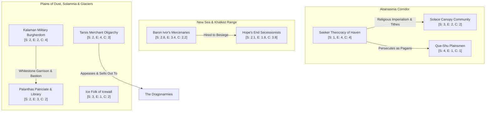

# Human Realms, Seekers, and Mercenary Companies of Ansalon
*The Chronicles of Krynn: Master Lore Vault — Volume 01: Peoples, Factions & Councils*

---

## 1. Master Sociological Overview: The Human Condition in the Age of Despair

For three centuries following the [[Cataclysm]] (0 AC)—when the fiery mountain shattered the ancient Empire of [[Istar]], hurled the oceans from their beds, and severed continental trade—the human civilizations of Ansalon have festered in spiritual amnesia, economic contraction, and profound socio-cultural trauma.

```
                     [HUMAN REALMS COMPETING VALUES MATRIX]
           FLEXIBILITY & DISCRETION (Organic / Responsive)
                               │
               CLAN            │          ADHOCRACY
         (Collaborative)       │         (Opportunistic)
    • Que-Shu Plainsmen        │  • Itinerant Carnivals & Smugglers
      [S: 4, E: 1, C: 1]       │    [S: 2, E: 4, C: 1]
    • Ice Folk of Icewall      │  • Hope's End Secessionists
      [S: 3, E: 1, C: 2]       │    [S: 2.1, E: 1.8, C: 3.8]
    • Solace Canopy Clan       │
      [S: 3, E: 2, C: 2]       │
───────────────────────────────┼───────────────────────────────
          HIERARCHY            │            MARKET
         (Control-Driven)      │          (Transactional)
    • Seeker Theocracy         │  • Tarsis Merchant Oligarchy
      [S: 1, E: 4, C: 4]       │    [S: 2, E: 4, C: 3]
    • Kalaman Burgher Council  │  • Baron Ivor's Mercenary Company
      [S: 2, E: 2, C: 4]       │    [S: 2.8, E: 3.4, C: 2.2]
    • Palanthas Patricians     │  • Palanthas Merchant Guilds
      [S: 2, E: 3, C: 2]       │    [S: 2, E: 3, C: 2]
                               │
             STABILITY & CONTROL (Mechanistic / Codified)
```

### The Three Drivers of Post-Cataclysmic Human Society

1. **The Vacuum of the True Gods & The Rise of False Faiths:**  
   Believing themselves abandoned by the ancient pantheon, human populations either turned to bitter secular fatalism, animistic ancestor worship, or fell victim to predatory pseudo-religions. The foremost among these is the [[Seeker Theocracy]], which commodified the search for "new gods" into an authoritarian taxation racket.
2. **The Steel Standard & Agrarian Autarky:**  
   Gold and silver lost their intrinsic value when the imperial infrastructure collapsed. In a dangerous, monster-haunted world, workable steel—measured in weapons, armor, tools, and [[Steel Pieces]]—became the sole hard currency. Municipalities unable to secure local iron deposits or smithing guilds slipped into feudal agrarian poverty.
3. **The Mercenary Transition:**  
   With the dissolution of the Solamnic peacekeeping legions and the fall of the Ergothian and Istarian empires, standing armies vanished. In their place arose professional mercenary free companies—such as [[Baron Ivor of Langtree]]'s army—hired by city-states, merchant syndicates, and petty despots to wage commercialized warfare.

---

## 2. Comprehensive Faction Dossiers



---

### 2.1 The Free Community of Solace

- **Domain:** Tree-dwelling refugee settlement in central [[Abanasinia]], built inside the titanic branches of ancient [[Vallenwood Trees]] between 40 and 80 feet above the forest floor.
- **Sociological Calibration:** `[S: 3, E: 2, C: 2]` | **CVF Quadrant:** `Clan` (Collaborative / Communal)
- **Ethos & Culture:** Founded by refugees fleeing post-Cataclysm cataclysms, Solace survived by taking to the boles of the vallenwoods. Communal life is governed by unspoken neighborly solidarity, quiet self-reliance, and mutual defense against wild predators and goblin raiding parties. Homes and businesses—epitomized by the legendary [[Inn of the Last Home]] operated by [[Otik Sandath]]—are suspended with woven wicker ropes, slotted timber cantilevers, and counterbalanced pulleys that flex organically with the living tree trunks.
- **Economic Base:** Timber harvesting, apple and peach orchard cultivation, artisanal ironwork and woodcarving (centered on the shop of [[Flint Fireforge]]), and hospitality revenue generated from transient caravans traveling the North-South highway between Haven and Qualinesti.
- **Internal Social Stratification:**
  - *Canopy Freeholders:* Established families dwelling high in the boles. Fiercely protective of canopy privacy, civic independence, and fire safety.
  - *Groundside Outcasts & Day Laborers:* Impoverished woodcutters, drifters, and transient laborers (such as [[Gilon Majere]]'s family) inhabiting mud-floor shacks beneath the trees. Tolerated but quietly patronized.
  - *Tavern Keepers & Artisans:* Commercial anchors whose taverns serve as civic moots, employment exchanges, and refuge centers.
- **Taboos & Prejudices:**
  - *Deadly Taboo:* Reckless open flame near living vallenwood limbs; bringing armed theocratic inquisitors into tree homes.
  - *Prejudice:* Deep post-Cataclysm fear of arcane spellcasting; mages are treated with nervous distance, and violent charlatans are driven out of town on a rail.

---

### 2.2 The Seeker Theocracy of Haven & The Cult of Belzor

- **Domain:** The great stone-walled city of [[Haven]], commercial and bureaucratic metropolis of Abanasinia, centered on the monolithic [[Temple of Belzor]].
- **Sociological Calibration:** `[S: 1, E: 4, C: 4]` | **CVF Quadrant:** `Hierarchy` (Degraded into Authoritarian Exploitation)
- **Ethos & Culture:** Emerging from the spiritual despair of the Cataclysm, the [[Seeker Movement]] began as an intellectual search for new gods. Over three centuries, it decayed into an extractive, hypocritical theocracy dominated by predatory magistrates, venal inquisitors, and theatrical demagogues. In Haven, the ascendant [[Cult of Belzor]]—spearheaded by zealots like [[Judith]]—promises salvation through manufactured "miracles" of the great fiery spider Belzor, while extracting crushing tithes from grieving widows and destitute farmers.
- **Economic Base:** Compulsory parish tithes, indulgence sales, licensing extortion levied on merchant caravans, confiscation of the estates of condemned "witches" and heretics, and lucrative bribes from municipal guilds.
- **Sub-Factions & Power Dynamics:**
  - *The High Priesthood (The Inner Circle):* Cynical clerical bureaucrats fully aware that Belzor's manifestations are produced via subterranean steam boilers, copper mirrors, and hallucinogenic incense.
  - *The Rural Inquisitors (Hederick’s Cadre):* Fanatical chapterheads—epitomized by High Theocrat [[Hederick]] in Solace—who rule frontier outposts through curfews, municipal garrisons, and violent witch trials.
  - *The Collaborative Council:* When the [[Red Dragonarmy]] arrives under [[Highlord Verminaard]], the Seeker Council in Haven immediately collaborates, proclaiming Draconians to be "messengers of the new pantheon" to protect their real estate and tax privileges.
- **Taboos & Vulnerabilities:**
  - *Fatal Taboo:* Displaying authentic divine miracles, exposing the mechanical levers behind Belzor’s altar, or performing unsanctioned arcane magic.
  - *Core Vulnerability:* Forensic revelation of mechanical fraud; when the copper pipes and bellows beneath the Temple of Belzor are revealed, the mob turns upon the priests with murderous fury.

---

### 2.3 The Que-Shu Plainsmen

- **Domain:** The rolling prairie grasslands between the [[Kharolis Mountains]] and the Eastwall, centered on the ancient ancestral village of [[Que-Shu]].
- **Sociological Calibration:** `[S: 4, E: 1, C: 1]` | **CVF Quadrant:** `Clan` (Familial / Pastoral Egalitarianism)
- **Ethos & Culture:** Semi-nomadic pastoralists and hunters who revere ancestral spirits, the living prairie, and the elemental forces of sky and wind. Rejecting urban stone cities, they view stone-dwellers as corrupt and physically soft. Social life is bound by bloodline honor, tribal storytelling, and the unforgiving laws of survival.
- **Religious Heritage & The Disgraced Heretics:**
  - The tribe maintains that the True Gods abandoned humanity due to mortal hubris.
  - A single impoverished bloodline—represented by [[Riverwind]] and his disgraced father—secretly preserved the oral memory of [[Paladine]] and [[Mishakal]].
  - When Riverwind completed the fatal quest demanded by [[Chief Arrowhead]] and returned bearing the [[Blue Crystal Staff]], the tribal council branded the divine relic "foul witchery" and condemned Riverwind to be stoned to death.
- **Tragic Destruction:**
  - After [[Goldmoon]] used the staff to miraculously transport Riverwind from the execution ring, the [[Red Dragonarmy]] under Verminaard descended upon Que-Shu.
  - The settlement was razed, herds slaughtered, and survivors chained into forced-labor columns for the iron mines of [[Pax Tharkas]].

---

### 2.4 Baron Ivor of Langtree’s Mercenary Company ("The Mad Baron")

- **Domain:** Headquartered at [[Langtree on the Green]] in the southern New Sea valley; operating across the contested borderlands of Blödehelm and the Khalkist foothills.
- **Sociological Calibration:** `[S: 2.8, E: 3.4, C: 2.2]` | **CVF Quadrant:** `Clan / Hierarchy Blend` (Chivalric Fraternity & Professional Mercenary Guild)
- **Ethos & Culture:** Commanded by Baron [[Ivor of Langtree]], a five-foot-two swarthy nobleman of Solamnic descent. Ivor rejects the pedantic 37 volumes of the Solamnic [[The Measure]], but lives fanatically by the living spirit of [[The Code]]: *"Est Sularus oth Mithas"* ("My Honor is My Life"). His neighbors call him "mad" because he rejects lucrative contracts from dishonorable warlords, fights on foot alongside common infantry, and openly worships [[Kiri-Jolith]] (God of Just Warfare) despite the lack of clerical miracles.
- **Order of Battle (1,200 Professional Veterans):**
  1. *Center Company (The Vanguard):* 300 heavily armored shock infantry wielding broadswords, battle-axes, and kite shields, commanded personally by Baron Ivor.
  2. *Line Companies (A & B Companies):* 500 heavy spearmen and sword-and-buckler footmen who form the shield wall and operate siege equipment.
  3. *Flank Company / Infiltrators (Company C):* 200 elite mountain skirmishers and scouts commanded by [[Master Senej]] and field disciplinarian [[Sergeant Nemiss]]. Trained in cliff scaling, forced night marches, and stealth combat.
  4. *Archer Company:* 150 marksmen, bolstered during the Hope's End campaign with 8 legendary [[Elven Longbows]] acquired through [[Scrounger]]'s barter networks.
  5. *Warmage & Field Hospital Corps:* Commanded by the Brown-Robed veteran [[Master Horkin]] and his assistant [[Raistlin Majere]] (Red Robe). Deploys herbal medicine (*daisy salve, poppy extract*) alongside surgical battle magic (*Fireball, Sleep, Feather Fall*).
  6. *Logistics & Smithy Train:* Armorers, wheelwrights, baggage wagons, and stubborn supply donkeys (*Jenny and Lillie*).
- **The Crucible of Hope's End:** Contracted by the royal forces of Vantal to besiege Hope's End, Ivor discovered his allied commander, [[Commander Kholos]], was an agent of the [[Red Dragonarmy]] plotting to butcher the citizenry. In a dramatic mid-battle pivot, Ivor threw his veterans into the city gates to defend the besieged burghers against Kholos's slaughter.

---

### 2.5 The Revolutionary Council & Citizens of Hope's End

- **Domain:** The fortified manufacturing town of [[Hope's End]] in the valley of Blödehelm, guarding the Hope River canyon.
- **Sociological Calibration:** `[S: 2.1, E: 1.8, C: 3.8]` | **CVF Quadrant:** `Market / Adhocracy Transition` (Besieged Guild Commercial Oligarchy)
- **Ethos & Culture:** Historically celebrated as the preeminent manufacturing and artisanal center of Blödehelm, where quality was measured by the regional standard: *"Good enough to be sold in Hope's End."* Governed by the Merchants Guild and the [[Lord Mayor of Hope's End]].
- **Catalyst of Secession:**
  - The legitimate monarch, "Good King Wilhelm of Blödehelm," was secretly deposed and imprisoned by Dragonarmy infiltrators in Vantal.
  - The puppet regime imposed a ruinous 25% Gate Tax on incoming raw iron and outgoing woolens, bankrupting the town.
  - When the royal court disemboweled a protesting mayoral envoy, the Guild declared secession, locked the Great Gates, and formed the Revolutionary Council.
- **Defensive Order of Battle:**
  - *Municipal Watch:* 300 chain-shirted spearmen and crossbowmen.
  - *Guild Citizen Levies:* 500 weavers, tanners, and apprentices armed with billhooks, hunting bows, and padded leather jacks.
  - *Wall Bastions:* Heavy mangonels mounted on stone redoubts launching granite boulders and boiling pitch casks into the river defile.
- **The Secret Objective:** Unbeknownst to the citizens, their rebellion was a diversion: beneath the mountain behind the town lay the ancient [[Temple of Paladine]] and the **Caverns of the Unborn**, containing a secret clutch of sleeping metallic dragon eggs sought by [[General Ariakas]] and [[Immolatus]].

---

### 2.6 The Merchant Oligarchy of Tarsis the Beautiful

- **Domain:** The ancient, landlocked seaport of [[Tarsis the Beautiful]], stranded forty miles inland on the [[Plains of Dust]].
- **Sociological Calibration:** `[S: 2, E: 4, C: 3]` | **CVF Quadrant:** `Market` (Purely Transactional / Mercantile Appeasement)
- **Ethos & Culture:** Once the premier maritime trading hub of the Southern Sea, Tarsis was permanently isolated when the Cataclysm raised the ocean bed and transformed the bay into a desolate expanse of red silt and dust. Its famed multi-decked galleons and caravels now sit mired in red sand, retrofitted with iron-rimmed wheels or converted into squalid tenement slums.
- **Commercial Nihilism & Dragonarmy Capitulation:**
  - Governed by the effete, corrupt [[Governor of Tarsis]] and a senate of shipping magnates, spice cartels, and slave brokers.
  - The oligarchs view war purely as a balance sheet. Operating under the fatal delusion that the Dragonarmies are merely another foreign merchant empire, the Governor signed a secret capitulation treaty with [[Dragon Highlord Kitiara uth Matar]].
  - In exchange for commercial trade monopolies in occupied territories, Tarsis agreed to outlaw the [[Knights of Solamnia]], admit disguised Draconian patrols into city alleys, and betray arriving northern refugees.
- **Taboos:** Displaying Solamnic knightly crests; publicly warning of dragon-attacks; attempting to spend gold or silver coins (soft, worthless decorative metal in post-Cataclysm Ansalon).

---

### 2.7 The Citizens of Kalaman & The Solamnic War Council

- **Domain:** The fortified walled port city of [[Kalaman]] on the northern coast of Solamnia, overlooking the Vingaard Bay.
- **Sociological Calibration:** `[S: 2, E: 2, C: 4]` | **CVF Quadrant:** `Hierarchy` (Military Control & Strategic Bastion)
- **Ethos & Culture:** Liberated during the winter counter-offensive of 352 AC, Kalaman serves as the forward staging ground for the [[Whitestone Army]]. Governed jointly by the civilian Governor Caleb and the Solamnic War Council under [[Laurana]] (The Golden General) and [[Lord Gunthar Uth Wistan]].
- **Societal Dynamic:** The city is split between relieved burghers desperate to resume maritime trade and austere Solamnic commanders preparing for the final offensive against [[Neraka]]. Tensions simmer between traditionalist knights who resent taking orders from an elven woman and pragmatic field officers who revere Laurana's tactical brilliance.
- **Order of Battle:**
  - *Whitestone Core:* 4,200 Solamnic heavy horsemen and dismounted knights.
  - *Kalaman Garrison:* 6,500 spearmen, crossbowmen, and marine watch.
  - *Metallic Dragon Air Wing:* 25 Silver, Gold, and Bronze dragons armed with true [[Dragonlances]].

---

### 2.8 The Palanthas Patriciate & The Aesthetic Chroniclers

- **Domain:** The sprawling white-marble city of [[Palanthas]], crescent jewel of the Bay of Branchala, miraculously preserved from the Cataclysm.
- **Sociological Calibration:**
  - *Palanthas Patriciate:* `[S: 2, E: 3, C: 2]` | **CVF:** `Market / Hierarchy` (Effete Isolationist Aristocracy)
  - *The Aesthetic Order of Gilean:* `[S: 1, E: 1, C: 1]` | **CVF:** `Hierarchy` (Hermetic Monastic Autarky)
- **Ethos & Culture:**
  - *The City:* Palanthians live in cultivated denial behind their pristine white walls and marble terraces. Dressing in lavish silk robes and frequenting grand operas, the Patrician Senate treats the War of the Lance as a vulgar provincial brawl in barbarian lands. The city maintains only a ceremonial guard in silver-gilt armor, relying on the impregnable fortress of the [[High Clerist's Tower]] to seal the Vingaard pass.
  - *The Great Library:* Monks sworn to [[Gilean]] (God of the Book), led by the ageless master [[Astinus of Palanthas]], record all history in absolute monastic silence, remaining completely detached from mortal morality or wartime survival.
  - *The Dark Omen:* At the city's heart looms the cursed [[Tower of High Sorcery of Palanthas]], shrouded by the terrifying phantasms of the [[Shoikan Grove]], awaiting the master foretold by ancient prophecy.

---

### 2.9 The Ice Folk of Icewall Glacier

- **Domain:** The frozen tundra and crystalline ice-sheets of [[Icewall Glacier]] in the far south of Ansalon.
- **Sociological Calibration:** `[S: 3, E: 1, C: 2]` | **CVF Quadrant:** `Clan` (Nomadic Survivalism & Tribal Hospitality)
- **Ethos & Culture:** Descendants of human barbarians driven south by the Cataclysm's sudden climatic shifts. Led by scarred chieftain [[Harald Haarfagre]], the Ice Folk hunt giant arctic bears, seals, and glacial thoi-walruses aboard swift, canvas-sailed **Ice-Boats** capable of skimming across frozen plains at 35 miles per hour.
- **Faith & Survival:**
  - They never abandoned the ancient gods, maintaining sacred bone-cairns dedicated to [[Habbakuk]] (The Fisher King) and [[Chislev]].
  - Locked in a war of total extermination against the White Dragonarmy under [[Highlord Feal-Thas]], his white dragon [[Sleet]], and savage tribes of walrus-folk ([[Thanoi]]).

---

## 3. Master Council Parley Matrices

These matrices detail the exact diplomatic protocols, required proofs, effective leverages, and instant-failure taboos when negotiating with human authorities across Ansalon.

### 3.1 The Solace Town Moot (Inn of the Last Home)
- **Presiding Voice:** [[Otik Sandath]], supported by respected craftsmen like [[Flint Fireforge]].
- **Composition:** Tree-dwelling freeholders, woodcutters, orchardists, visiting caravan drivers.

| Vector | Parameters & Requirements |
| :--- | :--- |
| **Initial Stance** | Cautious, insular hospitality. Eager for gossip, terrified of attracting the attention of Haven inquisitors or goblin patrols. |
| **Required Proofs / Leverage** | Honest manual labor; buying rounds of Otik's spiced potatoes and dark dwarven ale; demonstrating neighborly loyalty. |
| **Acceptable Bribes / Tokens** | Quality smithing iron, tempered woodcutting axes, genuine news from the coast, protection from road bandits. |
| **Fatal Taboos (Auto-Hostility)** | Bringing open fire near living vallenwood branches; casting flashy arcane spells in the tavern; inviting Seeker inquisitors into homes. |

---

### 3.2 The Seeker High Council of Haven (Bargate Hall of Justice)
- **Presiding Officer:** High Magistrate of Haven, accompanied by High Priestess [[Judith]] and the Watch Commander.

| Vector | Parameters & Requirements |
| :--- | :--- |
| **Initial Stance** | Arrogant, venal, predatory. Viewing out-of-town travelers as sources of fine revenue or scapegoats for civic unrest. |
| **Required Proofs / Leverage** | Heavy bags of imperial steel coin; formal affidavits acknowledging Belzor as the supreme deity; naming rival merchants as witches. |
| **Acceptable Bribes / Tokens** | Trade concessions, exemption certificates, shipments of rare vintage wines. |
| **Fatal Taboos (Auto-Hostility)** | Presenting evidence of mechanical fraud behind Belzor's altar; displaying true divine healing miracles; carrying unsanctioned grimoires. |

---

### 3.3 The Plains Elder Moot of Que-Shu
- **Presiding Officer:** [[Chief Arrowhead]], flanked by the Spirit Shamans and tribal war captains.

| Vector | Parameters & Requirements |
| :--- | :--- |
| **Initial Stance** | Extreme xenophobic suspicion. Ready to string bows at any non-plainsman approaching the horse herds. |
| **Required Proofs / Leverage** | Proof of slain predatory beasts (worg ears, wyvern talons); strictly invoking the ancient Blood Oath of Hospitality; saving a clan child. |
| **Acceptable Bribes / Tokens** | Tempered steel arrowheads, sturdy hunting bows, horses of pure northern breeding. |
| **Fatal Taboos (Auto-Hostility)** | Sneaking through prairie grass unannounced; commoners courting chieftain bloodlines; casting arcane illusions inside the sacred ring. |

---

### 3.4 The Midnight Parley of Hope's End (Lord Mayor's Chamber)
- **Presiding Officer:** [[Lord Mayor of Hope's End]], guarded by veteran militia captains.

| Vector | Parameters & Requirements |
| :--- | :--- |
| **Initial Stance** | Paralyzed siege terror. Suspecting every stranger of being an assassin sent by King Wilhelm or Commander Kholos. |
| **Required Proofs / Leverage** | Swearing by the Solamnic Oath; presenting physical evidence of royal atrocities; providing tactical plans to defend the Great Gates. |
| **Acceptable Bribes / Tokens** | Shipments of flour, salt pork, and medical linen; cancellation of municipal municipal debts. |
| **Fatal Taboos (Auto-Hostility)** | Demanding the 25% Gate Tax; displaying the black eagle crest of the Red Dragonarmy; threatening the Mayor's household. |

---

### 3.5 The Merchant Guild Council of Tarsis (Hall of Caravels)
- **Presiding Officer:** The [[Governor of Tarsis]], flanked by the Silk Merchant Guildmasters.

| Vector | Parameters & Requirements |
| :--- | :--- |
| **Initial Stance** | Decadent, condescending, calculating. Evaluating every visitor by their trade tariff potential. |
| **Required Proofs / Leverage** | Minted steel coin; rare Khur spices; ancient sea charts; lucrative trade monopoly guarantees. |
| **Acceptable Bribes / Tokens** | Rare silks, exotic jewelry, forged passes granting access to occupied Dragonarmy harbors. |
| **Fatal Taboos (Auto-Hostility)** | Wearing Solamnic knightly armor; declaring that dragons exist; paying in soft gold or silver; inciting civic resistance. |

---

### 3.6 The Palanthas Patrician Senate & Great Library
- **Presiding Officer:** [[Lord Amothus]] (City Senate) / Master [[Astinus]] (Great Library).

| Vector | Parameters & Requirements |
| :--- | :--- |
| **Initial Stance (Senate)** | Cultured denial. Dismissing the war as uncouth provincial barbarian melodrama. |
| **Initial Stance (Library)** | Absolute monastic silence. Indifferent to mortal survival, devoted strictly to historical truth. |
| **Required Proofs (Senate)** | Flattery of Palanthian cultural supremacy; diplomatic royal credentials; gifts of fine Southern Ergoth wines. |
| **Required Proofs (Library)** | Presenting novel, unrecorded historical manuscripts; speaking in hushed whispers; spotless scholarly credentials. |
| **Fatal Taboos (Senate)** | Wearing blood-soaked field armor into court; demanding municipal tax increases to fund defense. |
| **Fatal Taboos (Library)** | Spilling ink; raising one's voice; drawing weapons; demanding Astinus alter written history. |

---

## 4. Inter-Faction Friction & Supply-Chain Dependences

```
+---------------------------------------------------------------------------------------+
| HUMAN REALMS LOGISTICAL SUPPLY CHAINS & TRADE FLOWS                                   |
|                                                                                       |
|   [Solace Timber & Orchards] ---- Wagon Freights ----> [Haven Markets & Tanneries]    |
|            |                                                       |                  |
|       Charcoal / Ale                                      Tithes & Inquisitions       |
|            v                                                       v                  |
|   [Flint's Iron Forge] <===== Refugee Trade =====> [Que-Shu Buffalo Pelts & Beef]     |
|            |                                                                          |
|       Exported Blades                                                                 |
|            v                                                                          |
|   [Langtree Armorers] ===== Weapons Contracts =====> [Baron Ivor's Mercenary Army]    |
|            |                                                       |                  |
|     Steel Shipments                                       Contracted Siege            |
|            v                                                       v                  |
|   [Tarsis Silt Caravans] <== Spices & Cloth == [Hope's End Manufacturing Guilds]      |
|            |                                                       |                  |
|       Secret Tribute                                         Iron Slag Mines          |
|            v                                                       v                  |
|   [Blue Dragonarmy Port]                                  [Caverns of the Unborn]     |
+---------------------------------------------------------------------------------------+
```

1. **The Abanasinia Trade Triangle:** Solace provides structural vallenwood timber and agricultural staples to Haven in exchange for finished glass, iron ore, and textiles. The Seeker Theocracy levies oppressive 15% road tariffs at the Gateway toll-houses, creating simmering peasant resentment.
2. **The Blödehelm Steel Network:** Hope's End depends entirely on mountain iron brought down the Hope River canyon to produce its legendary tools. When royal puppet authorities imposed the 25% Gate Tax, raw iron shipments stalled, triggering instant economic collapse.
3. **The Tarsis Dust Roads:** Lacking an open port, Tarsis maintains wheeled sand-caravans connecting to the southern plains. Its entire economy is reliant on importing grain from the north; when the Red Dragonarmy sealed the mountain defiles, Tarsis was forced into total political capitulation to avert mass starvation.
