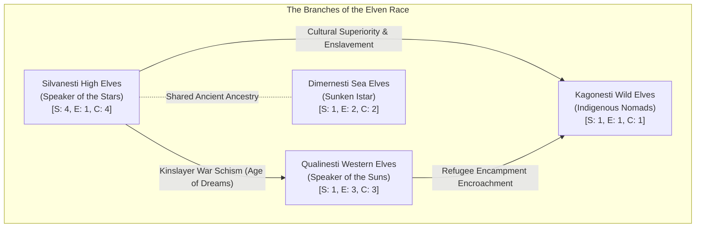

# Elven Kingdoms and Dwarven Clans of Krynn
*The Chronicles of Krynn: Master Lore Vault — Volume 01: Peoples, Factions & Councils*

---

## 1. Executive Sociological Overview: The Elder Races in Crisis

The non-human civilizations of Ansalon entered the Fourth Age burdened by millennia of entrenched racial isolationism, bitter historical civil wars, and rigid caste orthodoxy. Where humanity reacted to the [[Cataclysm]] with fractured panic, the Elves and Dwarves responded by withdrawing behind ancient barriers: the Qualinesti behind their sunlit aspens, the Silvanesti behind magical borders, and the Mountain Dwarves of [[Thorbardin]] behind sealed adamantine gates.

```
                    [ELVEN & DWARVEN SOCIOLOGICAL MATRIX]
           FLEXIBILITY & DISCRETION (Organic / Responsive)
                               │
               CLAN            │          ADHOCRACY
         (Collaborative)       │         (Opportunistic)
    • Kagonesti (Wild Elves)   │  • Aghar (Gully Dwarves)
      [S: 1, E: 1, C: 1]       │    [S: 1, E: 1, C: 1]
    • Neidar (Hill Dwarves)    │  • Kagonesti Guerrillas
      [S: 3, E: 2, C: 2]       │    [S: 1, E: 2, C: 1]
    • Dimernesti (Sea Elves)   │
      [S: 1, E: 2, C: 2]       │
    • Klar (Rim Dwarves)       │
      [S: 2, E: 1, C: 2]       │
───────────────────────────────┼───────────────────────────────
          HIERARCHY            │            MARKET
         (Control-Driven)      │          (Transactional)
    • Silvanesti High Elves    │  • Daewar Dwarven Traders
      [S: 4, E: 1, C: 4]       │    [S: 3, E: 3, C: 3]
    • Qualinesti Council       │  • Theiwar Savants & Smugglers
      [S: 1, E: 3, C: 3]       │    [S: 1, E: 4, C: 1]
    • Hylar Mountain Dwarves   │  • Qualinesti Royal Merchants
      [S: 4, E: 2, C: 4]       │    [S: 3, E: 2, C: 3]
    • Daergar Slave-Masters    │
      [S: 1, E: 3, C: 2]       │
                               │
             STABILITY & CONTROL (Mechanistic / Codified)
```

---

## 2. The Four Elven Civilizations



---

### 2.1 The Qualinesti Elves (The Western Branch)

- **Domain:** The forest city of [[Qualinost]] in southern Abanasinia; later, the sodden refugee tent-cities on the western shores of [[Southern Ergoth]].
- **Sociological Calibration:** `[S: 1, E: 3, C: 3]` | **CVF Quadrant:** `Hierarchy / Clan Hybrid`
- **Ethos & Culture:** Founded during the Age of Dreams by [[Kith-Kanan]] following the tragic Kinslayer War, the Qualinesti built a society designed to be more open and less dogmatic than ancient Silvanesti. Their capital, Qualinost, is an architectural marvel of gold-leafed aspens, twisting spires of white sunstone, and arched bridges of woven silver-wood that span rushing rivers without obstructing nature.
- **The Aristocratic Conceit & The Southern Exodus:**
  - Despite their refined veneer, the Qualinesti are deeply isolationist and condescending toward non-elves. Humans are viewed as reckless, disease-ridden instigators of the Cataclysm; half-elves (such as [[Tanis Half-Elven]]) are treated as tragic bastard reminders of human violence, tolerated only through royal charity by [[Speaker Solostaran]].
  - When [[Highlord Verminaard]]'s [[Red Dragonarmy]] surrounded southern Abanasinia in Autumn 351 AC, the Council of the Sun refused to fight for human neighbors. Instead, the entire nation was ordered to pack its royal tapestries and flee to [[Southern Ergoth]].
  - *The Cynical Diversion:* To ensure their evacuation fleet was not annihilated by red dragons, the Qualinesti council leveraged Tanis and the companions to infiltrate [[Pax Tharkas]] and spark a slave revolt, calculating that the burning fortress would distract Verminaard from their refugee ships.
- **Royal Lineage & Factional Blocs:**
  - *Speaker Solostaran:* Melancholic, dignified patriarch torn between dynastic duty and grief over the dying world.
  - *Crown Prince Porthios:* Arrogant, uncompromising martial hawk who demands absolute racial purity and despises Tanis.
  - *Prince Gilthanas:* Idealistic scout commander whose capture at Pax Tharkas exposed the vulnerability of elven pride.
  - *Princess Laurana (Lauralanthalasa):* Pampered royal maid who defies her caste to join the human resistance, eventually rising as the supreme "Golden General" of the Whitestone Alliance.

---

### 2.2 The Silvanesti Elves (The Bleeding Ancestral Kingdom)

- **Domain:** The ancient eastern elven realm of [[Silvanesti]], bordered by the Thon-Thalas River; later, the squalid refugee camp at Harkun Bay on Southern Ergoth.
- **Sociological Calibration:** `[S: 4, E: 1, C: 4]` | **CVF Quadrant:** `Hierarchy` (Extreme Ancestor Caste Autocracy)
- **The Four Houses of Silvanesti:**
  1. *House Royal:* Direct descendants of Silvanos. Unapproachable pride, tragic grace, and unquestioned authority. Represented by King [[Lorac Caladon]] (Speaker of the Stars) and Princess [[Alhana Starbreeze]].
  2. *House Protector:* The elite warrior caste, griffon-cavalry riders, and longbow wardens bound by blood-oaths to die before retreating.
  3. *House Mystic:* Arcane scholars and philosophical priests who hoard pre-Cataclysmic magical lore and disdain human wizards.
  4. *House Gardener & House Mason:* Hereditary craftsmen who shape living marble and sing stone into crystalline towers.
- **King Lorac’s Nightmare & Cyan Bloodbane:**
  - In late 351 AC, as the Red and Green Dragonarmies crossed the eastern border, King Lorac evacuated his entire population to Southern Ergoth, but chose to remain behind alone in the Tower of the Stars.
  - Desperate to save his beloved trees, Lorac gazed into an ancient [[Dragon Orb]] recovered from the Age of Might. Unprepared for its malevolent will, his mind was enslaved by the ancient green dragon [[Cyan Bloodbane]].
  - The dragon channeled Lorac's deepest terrors into the land: the Thon-Thalas turned into putrid black sludge, crystalline towers wept black oil, weeping trees grew barbed thorns and human mouths that shrieked in agony, and dead elven warriors rose as rotting dream-wraiths.

---

### 2.3 The Kagonesti (The Wild Elves of Southern Ergoth)

- **Domain:** The primeval temperate rainforests of central and eastern [[Southern Ergoth]].
- **Sociological Calibration:** `[S: 1, E: 1, C: 1]` | **CVF Quadrant:** `Clan / Adhocracy` (Animistic Nomads)
- **Ethos & Material Culture:**
  - The indigenous first-born elves who never joined the great migrations or built stone cities. They dwell in harmony with the wild land, revering nature spirits and the animal pantheon of [[Chislev]] and [[Habbakuk]].
  - *Appearance:* Muscular, weathered physiques dressed in soft fringed buckskins; bodies decorated with geometric charcoal, woad, and berry tattoos; raven hair braided with hawk feathers and bone beads.
  - *Combat Style:* Masters of forest ambush, utilizing silent tree-travel, poisoned throwing knives, and heavy recurve hunting bows.
- **The Refugee Crisis & Enslavement:**
  - When hundreds of thousands of civilized Qualinesti and Silvanesti refugees landed on Southern Ergoth, they claimed the ancestral forests of the Kagonesti by force.
  - Viewing their wild brethren as illiterate savages without property rights, the civilized elves logged sacred groves, established fortified stockades, and forced captured Kagonesti into domestic servitude. This sparked a bitter three-way guerrilla war between Kagonesti partisans, elven colonial guards, and invading Dragonarmy units.

---

### 2.4 The Dimernesti (The Sea Elves of the Blood Sea)

- **Domain:** The sunken ruins of pre-Cataclysmic [[Sunken Istar]], located thousands of feet beneath the roaring maelstrom of the [[Blood Sea of Istar]].
- **Sociological Calibration:** `[S: 1, E: 2, C: 2]` | **CVF Quadrant:** `Clan` (Pelagic Autarky)
- **Ethos & Culture:**
  - Coastal elves who were transformed into aquatic beings during the Cataclysm when the ocean engulfed eastern Ansalon.
  - Commanded by [[Speaker Apoletta]], they dwell among shattered marble arches, kelp gardens, and coral towers, riding giant seahorses, dolphins, and war-sharks.
- **The Law of the Deep & The Draught of Forgetting:**
  - Dimernesti possess deep compassion: they actively rescue drowning human, dwarven, and kender sailors whose ships are sucked into the Maelstrom.
  - *The Fatal Compromise:* To protect their undersea realm from terrestrial contamination or dragon discovery, rescued breathers must drink a magical seaweed draught that strips all memory of their underwater encounter before they are returned to shore.

---

## 3. The Seven Dwarven Clans of Thorbardin

Deep within the jagged granite bastions of the [[Kharolis Mountains]] lies [[Thorbardin]], an eight-thousand-foot subterranean cavern realm anchored by the titanic [[Life-Tree of Thorbardin]] (a colossal suspended stalactite carved into 28 concentric city tiers). 

```
                                [THORBARDIN LIFE-TREE]
                                          │
                         [UPPER TIERS: HYLAR ARISTOCRACY]
                          • High King's Palace (Vacant)
                          • Granite Spires & Great Council Hall
                                          │
                         [MIDDLE TIERS: DAEWAR & NEIDAR]
                          • Gold Vaults & Temple of Reorx (Daewar)
                          • Artisanal Quarries & Foundries
                                          │
                         [OUTER RIM & FUMAROLES: KLAR]
                          • Volcanic Steam Vents & Barracks
                                          │
                         [DEEP BASE & SHAFTS: THEIWAR & DAERGAR]
                          • Lightless Sulfur Mines & Dark Savant Dens
                          • Slave Pits & Under-Quarries
                                          │
                         [DRAINAGE SUMP & SEWERS: AGHAR]
                          • Refuse Warrens & Sump Ditches (Gully Dwarves)
```

---

### Clan Dossiers & Sociological Calibrations

| Clan | Habitat & Social Role | `[S, E, C]` | CVF | Cultural Profile & Political Agenda |
| :--- | :--- | :---: | :---: | :--- |
| **[[Hylar]]** | Upper Life-Tree tiers; hereditary architects, smith-lords, and rulers. | `[4, 2, 4]` | `Hierarchy` | **The High King Aspirants.** Stately, proud, conservative. Led by [[Thane Hornfel Kytur]]. They believe that only Hylar wisdom can govern Thorbardin. They favor offering conditional sanctuary to the 800 human refugees of Pax Tharkas, provided the humans do not settle permanently. |
| **[[Daewar]]** | Southern cavern districts; gold-vault guards, heavy infantry, and merchants. | `[3, 3, 3]` | `Market` | **Pragmatic Militarists.** Wealthy, fiercely religious devotion to [[Reorx]]. Allied with the Hylar against dark clan treachery, but demand extensive commercial and mining concessions before mobilizing their phalanxes. |
| **[[Theiwar]]** | Northern sulfur-caverns and lightless galleries. Pale, maggot-white skin, sun-blind bulging eyes. | `[1, 4, 1]` | `Hierarchy` (Shadow) | **Malevolent Savants.** Led by the cunning [[Thane Realgar]]. Practice degenerate alchemy, dark sorcery, and poisoncraft. Deeply xenophobic; signed a secret non-aggression pact with the Dragon Highlords to overthrow the Hylar. |
| **[[Daergar]]** | Deep granite shafts and subterranean slave-quarries. | `[1, 3, 2]` | `Hierarchy` | **Brutal Militarists.** Sullen, bloodthirsty, sadistic. Contemptuous of surface-dwellers and dismissive of Theiwar subtlety. They side with Realgar solely to secure fresh human and dwarven slaves. |
| **[[Klar]]** | Volcanic rim fumaroles and drafty outer rim caverns. Wild matted hair and rolling eyes. | `[2, 1, 2]` | `Clan` | **Paranoid Berserkers.** Driven mad by centuries of poverty, malnutrition, and quarantine in the rim vents. Led by [[Thane Hillmar]]. They suspect everyone of conspiracy, voting erratically based on sudden religious omens or gifts of tempered iron. |
| **[[Neidar]]** | Surface hill country around Pax Tharkas and the Kharolis foothills. | `[3, 2, 2]` | `Clan` | **The Vengeful Exiles.** Clan of [[Flint Fireforge]]. Exiled surface dwarves who bitterly despise the mountain clans for slamming the South Gate during the Cataclysm and starving their surface kin during the bloody Dwarfgate War (214 AC). |
| **[[Aghar]]** | Sump ditches, sewer sluices, and slag pits beneath the lower mines. | `[1, 1, 1]` | `Clan / Adhocracy` | **The Gully Dwarves.** Led by [[Highbulp Phudge I]]. Universal outcasts who survive by groveling, weeping, eating refuse, and knowing every drainage pipe and secret shaft in the mountain. |

---

## 4. Master Council Parley & Voting Matrices

### 4.1 The Council of the Sun (Qualinost — Hall of the Sky)
- **Presiding Officer:** [[Speaker Solostaran]], flanked by Prince [[Porthios]] and Royal Scribes.
- **Quorum & Voting:** Decisions require the unanimous assent of the Royal House and the Speaker’s seal.

| Delegated Seat | Core Agenda / Motivation | Effective Bribes & Leverages | Fatal Taboos & Auto-Fails |
| :--- | :--- | :--- | :--- |
| **Speaker Solostaran** | Preservation of elven bloodlines; bloodless maritime exodus to Ergoth. | Critical intelligence on Dragonarmy flight patrols; recovery of Prince Gilthanas; invoking debt to Tanis’s mother. | Demanding elven infantry march to defend human cities; public disrespect to the crown. |
| **Crown Prince Porthios** | Total racial purity; purging non-elves from Qualinesti; military honor. | Captured enemy battle-standards; Draconian officer kills; proof of frontline military sacrifice. | A half-elf or human touching royal regalia; speaking unbidden in the Hall of the Sky. |
| **Prince Gilthanas** | Redeeming personal martial shame; rescuing human captives at Pax Tharkas. | Frontline tactical support; acknowledging his tactical competence; defending his sister. | Mocking his capture by Verminaard; accusing him of cowardice during interrogation. |
| **Princess Laurana** | Stopping senseless slaughter; earning the respect and love of Tanis. | Emotional honesty; treating her as an equal warrior rather than a decorative child. | Patronizing her royal blood; comparing her unfavorably to [[Kitiara uth Matar]]. |

---

### 4.2 The Council of the Thanes (Thorbardin — Great Council Chamber)
- **Presiding Officer:** Thane [[Hornfel Kytur]] (Hylar), seated before the empty granite throne of the High King.
- **Quorum & Voting:** Motions require a **five-clan majority** out of the six voting thanes. In practice, this engineered deadlock paralyzes action unless the legendary [[Hammer of Kharas]] is recovered.

```
+--------------------------------------------------------------------------------------------------------------------+
| COUNCIL OF THE THANES PARLEY MATRIX                                                                                |
+-------------------+----------------------------+-----------------------------------+-------------------------------+
| Clan Thane        | Core Agenda / Voting Bloc  | Effective Bribes & Leverages      | Fatal Taboos & Auto-Fails     |
+-------------------+----------------------------+-----------------------------------+-------------------------------+
| Hylar             | Crown a High King; restore | The physical recovery of the      | Demanding permanent human     |
| (Hornfel Kytur)   | mountain law and order.    | [[Hammer of Kharas]]; formal oath | settlements inside the Life-  |
|                   | [Loyalist Bloc]            | to vacate via South Gate in 90 d. | Tree city.                    |
+-------------------+----------------------------+-----------------------------------+-------------------------------+
| Daewar            | Secure mercantile gold and | Large shipments of refined steel; | Demanding free passage        |
| (Merchant Thane)  | trade supremacy.           | exclusive commercial rights to    | through Daewar gold vaults;   |
|                   | [Loyalist Bloc]            | southern caravan trade.           | blasphemy against [[Reorx]].  |
+-------------------+----------------------------+-----------------------------------+-------------------------------+
| Theiwar           | Overthrow Hylar; surrender | Caches of dark arcane scrolls;    | Exposing their secret treaty  |
| (Realgar)         | surface refugees to foes.  | promises of absolute rule over    | with the Dragonarmies;        |
|                   | [Treason Bloc]             | the lower mineral caverns.        | mocking their pale skin.      |
+-------------------+----------------------------+-----------------------------------+-------------------------------+
| Daergar           | Acquire heavy slaves;      | Delivery of military slaves;      | Siding openly with the Hylar; |
| (Militant Thane)  | expand granite quarries.   | concessions of iron rights;       | threatening their warrior     |
|                   | [Treason Bloc]             | displays of ruthless strength.    | caste with foreign law.       |
+-------------------+----------------------------+-----------------------------------+-------------------------------+
| Klar              | Prevent starvation; secure | Casks of cured surface pork;      | Whispering in closed huddles; |
| (Hillmar)         | weapons and fresh air.     | bags of tempered iron tools;      | insinuating that the Klar     |
|                   | [Swing Vote]               | authentic divine omens of Reorx.  | have gone mad from fumaroles. |
+-------------------+----------------------------+-----------------------------------+-------------------------------+
| Neidar            | Vengeance for Dwarfgate;   | Formal apology from Hornfel for   | Demanding that Neidar kneel   |
| (Flint Fireforge) | protect hill dwarf clans.  | locking the gates in 214 AC;      | or swear fealty to the Hylar  |
|                   | [Swing Vote]               | equal share of reclaimed tools.   | High King.                    |
+-------------------+----------------------------+-----------------------------------+-------------------------------+
| Aghar             | Avoid execution; scavenge  | Shiny brass buttons, rotten swamp | Counting higher than two;     |
| (Highbulp Phudge) | tasty garbage.             | fruit, dead rats, two steel coins.| threatening their sewer       |
|                   | [Non-Voting Observer]      | Flattery ("Mighty Emperor!").     | Warrens with cleaning.        |
+-------------------+----------------------------+-----------------------------------+-------------------------------+
```

---

## 5. Architectural & Ecological Substratum

### 5.1 The Life-Tree of Thorbardin
- **Physical Dynamics:** An eight-thousand-foot stalactite suspended above an abyssal subterranean lake. Connected to the cavern walls by massive stone causeways and arched bridges.
- **Internal Transportation:** Massive water-counterweighted elevators and spiral ramps allow cargo transit across the 28 tiered residential and forge discs.
- **Subterranean Agriculture:**
  - *Mushroom Forests:* Thousands of acres of glowing bioluminescent fungi and edible lichen beds cultivated in warm humid chambers.
  - *Subterranean Aquifers:* Mountain runoff filtered through limestone aquifers provides ice-cold water, powering grain mills and quenching master forge-vats.

### 5.2 The Living Architecture of Qualinost
- **Tree-Shaping:** Qualinesti homes are not carved from felled timber; they are guided over centuries by elven tree-singers who coax living branches of golden aspens to braid into roofs, balconies, and spiral stairs.
- **Sunstone Spires:** White granite quarried from the Kharolis peaks, treated with alchemical quartz glazes that store natural sunlight during the day and radiate a soft golden aura throughout the night, rendering lanterns obsolete.
