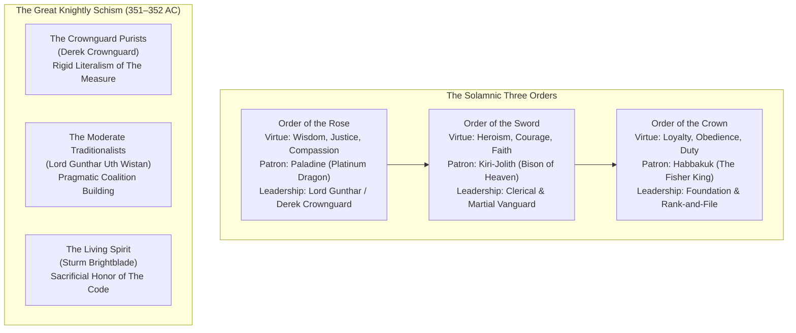
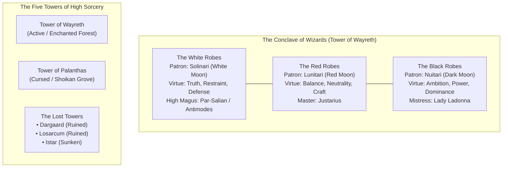

# The Knights of Solamnia and The Orders of High Sorcery
*The Chronicles of Krynn: Master Lore Vault — Volume 01: Peoples, Factions & Councils*

---

## 1. Executive Overview: The Twin Bastions of Law and Mystery

Throughout the recorded history of Krynn, two ancient institutions have stood as pillars against cosmic chaos: the chivalric brotherhood of the [[Knights of Solamnia]] and the arcane covenant of the [[Orders of High Sorcery]]. Both predate the [[Cataclysm]] by millennia; both were shattered and scapegoated in its aftermath; and both hold the sole keys to the survival of the world during the War of the Lance.

```
                  [CHIVALRIC & ARCANE SOCIOLOGICAL MATRIX]
           FLEXIBILITY & DISCRETION (Organic / Responsive)
                               │
               CLAN            │          ADHOCRACY
         (Collaborative)       │         (Opportunistic)
    • The Living Spirit Knights│  • Renegade Spellcasters
      (Sturm Brightblade)      │    [S: 1, E: 3, C: 1]
      [S: 3, E: 2, C: 2]       │  • Mount Nevermind Gnomes
    • Red Robe Scholars        │    [S: 1, E: 2, C: 4]
      (Justarius)              │
      [S: 2, E: 2, C: 3]       │
───────────────────────────────┼───────────────────────────────
          HIERARCHY            │            MARKET
         (Control-Driven)      │          (Transactional)
    • Crownguard Measure Zealots│  • Black Robe Ambitious Mages
      (Derek Crownguard)       │    (Lady Ladonna)
      [S: 4, E: 1, C: 4]       │    [S: 1, E: 4, C: 2]
    • The Three Orders of Mages│  • Master Theobald's Academy
      (Conclave at Wayreth)    │    [S: 1, E: 2, C: 4]
      [S: 2, E: 1, C: 4]       │  • Solamnic Court Politics
    • High Clerist's Garrison  │    [S: 2, E: 3, C: 3]
      [S: 3, E: 2, C: 4]       │
                               │
             STABILITY & CONTROL (Mechanistic / Codified)
```

---

## 2. The Knights of Solamnia

Founded during the Age of Dreams by [[Vinas Solamnus]] following the rebellion against the decadent Ergothian Empire, the Solamnic Knighthood defended justice, honor, and order across Ansalon for over a thousand years. Following the Cataclysm, the populace turned upon them with murderous fury, blaming their arrogance and failure to stay the wrath of the gods. Their castles were burned, their estates seized, and surviving knights forced into exile on [[Sancrist Isle]].



---

### 2.1 The Three Orders of the Knighthood

1. **The Order of the Crown:**
   - *Core Mandate:* Unquestioning loyalty, obedience to lawful authority, and selfless service.
   - *Patron Deity:* [[Habbakuk]], the Fisher King (God of Seas, Beasts, and Loyalty).
   - *Social Dynamic:* The entry rank for all knights regardless of noble blood. Candidates must demonstrate physical prowess, humble labor, and absolute fidelity to superior officers.
2. **The Order of the Sword:**
   - *Core Mandate:* Heroism, chivalric courage, physical combat prowess, and defense of the defenseless.
   - *Patron Deity:* [[Kiri-Jolith]], the Bison of Heaven (God of Just Warfare and Courage).
   - *Clerical Vanguard:* Historically granted divine clerical spellcasting; during the three centuries of the gods' absence, the Order maintained the rituals in stoic faith, awaiting the return of true miracles.
3. **The Order of the Rose:**
   - *Core Mandate:* Wisdom, philosophical justice, mercy, and supreme leadership.
   - *Patron Deity:* [[Paladine]], the Platinum Dragon (Father of Good and Sovereign Lord).
   - *Aristocratic Elite:* Restricted to knights of noble lineage who have served with distinction in the Crown and Sword, demonstrating moral discernment and selfless mercy.

---

### 2.2 The Code vs. The Measure

The tragedy of the post-Cataclysmic Knighthood lies in the catastrophic ossification of their foundational scriptures:

- **The Code:** *"Est Sularus oth Mithas"* — **"My Honor is My Life."**  
  A concise, living ethical compass demanding integrity, protection of the weak, defense of truth, and willingness to sacrifice one's life without hesitation.
- **The Measure:**  
  A massive, pedantic, **37-volume bureaucratic legal code** compiled over centuries by knightly scribes. It details every conceivable minutiae: from the width of bridle leather and proper heraldic quartering, to the precise number of paces a commander must take when accepting a surrender, to genealogical proof requirements spanning seven generations.
- **The Ideological Conflict:**  
  In the hands of arrogant nobles like [[Derek Crownguard]], the Measure became a shield for cowardice and a weapon for political purges. Derek used the Measure's pedantic technicalities to challenge the knightly legitimacy of [[Sturm Brightblade]], demanding an investigation into Sturm’s ancestral armor and patents while ignoring the desperate military crisis at the [[High Clerist's Tower]].

---

### 2.3 The Whitestone Council at Sancrist (Winter 352 AC)

Convening in the sacred **Whitestone Glade** on the island of [[Sancrist]], the [[Whitestone Council]] assembled delegations from every free realm on Ansalon to deliberate on unified resistance against the Dragonarmies.

```
+--------------------------------------------------------------------------------------------------------------------+
| THE WHITESTONE COUNCIL DELEGATION MATRIX                                                                           |
+----------------------+----------------------+-----------------------+----------------------------------------------+
| Delegation           | Envoy / Leader       | Voting Weight & Bloc  | Core Demands & Political Leverage            |
+----------------------+----------------------+-----------------------+----------------------------------------------+
| Knights of Solamnia  | Lord Gunthar         | Dominant Martial Bloc | Demands sole supreme command of all allied   |
|                      | uth Wistan           | (Fractured by Derek)  | armies; insists all allies follow Solamnic.  |
+----------------------+----------------------+-----------------------+----------------------------------------------+
| Qualinesti Elves     | Speaker Solostaran & | Proud Isolationist    | Refuses to subordinate elven archers under   |
|                      | Prince Porthios      | Refugee Bloc          | human lords; demands territorial land grants.|
+----------------------+----------------------+-----------------------+----------------------------------------------+
| Silvanesti Exiles    | Princess Alhana      | Tragic Royal Bloc;    | Demands immediate military crusade to liberate|
|                      | Starbreeze           | Holds Ancient Lore    | Silvanesti from Cyan Bloodbane's nightmare.  |
+----------------------+----------------------+-----------------------+----------------------------------------------+
| Mountain Dwarves     | Thane Hornfel        | Wealthy Defensive     | Demands ironclad borders; refuses to send    |
| (Thorbardin)         | (represented)        | Isolationists         | dwarven phalanxes beyond Kharolis mountains. |
+----------------------+----------------------+-----------------------+----------------------------------------------+
| Humans of Palanthas  | Lord Alfred & City   | Effete Commercial     | Claims mountain passes are impenetrable;     |
|                      | Magistrates          | Neutrality Bloc       | votes down war taxes and troop levies.       |
+----------------------+----------------------+-----------------------+----------------------------------------------+
| Gnomes of Mount      | High Council of      | Unpredictable Science | Offers experimental steam catapults, gliders,|
| Nevermind            | Inventors (Gnosh)    | Auxiliary             | and corkscrew missiles that misfire wildly.  |
+----------------------+----------------------+-----------------------+----------------------------------------------+
```

#### The Dragon Orb Crisis & The Shattering
- The Council disintegrated into near-fatal civil bloodshed when Derek Crownguard returned from Icewall Castle carrying the [[Dragon Orb of Icewall Castle]].
- The relic's insidious psychic aura preyed on racial vulnerabilities: elves claimed it as their ancestral birthright; knights claimed martial salvage; dwarves denounced it as cursed witchcraft; and Palanthians offered chests of gold to hoard it in private vaults.
- Swords and staves were drawn; an all-out massacre was averted only when [[Tasslehoff Burrfoot]], acting with pure kender simplicity, hoisted the heavy glass sphere and dashed it against the sacred [[Whitestone]], shattering it into a thousand glittering shards.
- Into the stunned silence strode [[Theros Ironfeld]], bearing the first true [[Dragonlance]] forged in three hundred years, transforming the fractured assembly into the unified **Whitestone Alliance**.

---

## 3. The Orders of High Sorcery & The Conclave of Wizards

Bound by the ancient oaths established during the Second Dragon War, the [[Orders of High Sorcery]] exist to preserve the sacred Art of Magic above all mortal politics, dynasties, and moral philosophies.



---

### 3.1 The Three Robes & The Cosmic Lunar Balance

1. **The White Robes ([[Solinari]]):**
   - *Patron Moon:* Solinari, the White Moon of Good.
   - *Philosophy:* Magic is a sacred trust to be wielded with profound moral restraint, defensive vigilance, and reverence for life. Led by the High Magus of the Conclave, Master [[Par-Salian]].
   - *Key Figure:* Master [[Antimodes]], field diplomat and secret benefactor of young [[Raistlin Majere]].
2. **The Red Robes ([[Lunitari]]):**
   - *Patron Moon:* Lunitari, the Red Moon of Neutrality.
   - *Philosophy:* The Art of Magic is supreme above all mortal concepts of good and evil. They preserve the cosmic equilibrium, ensuring neither the White nor the Black Robes extinguish each other. Led by Master [[Justarius]].
3. **The Black Robes ([[Nuitari]]):**
   - *Patron Moon:* Nuitari, the Dark Moon of Evil (visible only to black-robed mages and creatures of darkness).
   - *Philosophy:* Magic exists to grant supreme power, unrestricted knowledge, and dominion over mortal weakness. Led by Lady [[Ladonna]].
   - *The Pragmatic Truce:* Despite their moral depravity, Black Robes are bound by the Conclave's iron laws: they do not betray other wizards to non-mages, and they unite with White and Red Robes to exterminate **Renegades**.

---

### 3.2 The Test of High Sorcery

No mortal on Krynn may cast spells beyond the 2nd circle of magic without undertaking the lethal [[Test of High Sorcery]] within the subterranean trials of the [[Tower of Wayreth]].

- **The Sole Mandate:** To test whether an initiate possesses the psychological discipline, dedication, and moral spine to wield supreme power without destroying themselves or the world.
- **The Fatal Law:** An initiate either passes the Test or dies within its chambers. Those who refuse the summons and continue practicing magic are declared **Renegades**, hunted down and executed with cold efficiency by the Conclave’s inquisitors.
- **Raistlin Majere's Ordeal (346 AC):**
  - Summoned prematurely by Par-Salian, who recognized that a great dark storm was rising from Neraka and Krynn needed a weapon of ruthless intellect.
  - Facing physical weakness, mocking phantasms of his tormentor [[Liam]], and an ancient illusionary red dragon, Raistlin collapsed at the brink of death.
  - In his final agony, Raistlin forged a dark soul-pact with the lingering spirit of the archmage [[Fistandantilus]]. Raistlin survived, but his body was shattered: his health ruined, his skin turned to gleaming golden scales, his hair bleached bone-white, and his eyes replaced with hourglass pupils cursed to see all living things wither, decay, and rot before him.

---

### 3.3 Master Theobald's Academy of Magic

- **Domain:** A windowless, damp stone schoolhouse five miles west of Solace.
- **Sociological Calibration:** `[S: 1, E: 2, C: 4]` | **CVF:** `Hierarchy` (Stagnant Pedantic Autocracy)
- **Profile:** Master [[Theobald]] is a plodding, unimaginative wizard who barely passed his own Test decades ago and retreated into teaching to nurse his insecure ego. The academy teaches basic literacy, arcane notation, and elementary cantrips through pedantic memorization and corporal punishment.
- **Classroom Oppression:** Theobald catered to wealthy merchant sons (led by the arrogant bully [[Liam]]), while actively tormenting poor, sickly prodigies like young Raistlin, forcing him to fetch firewood and sit by smoking hearths while mocking his fragile health.

---

### 3.4 The Cursed Tower of Palanthas & The Shoikan Grove

- **Domain:** The center of the Old City of Palanthas, sealed behind tall iron gates.
- **The Curse of the Fall:** During the Age of Might, when the Kingpriest ordered the destruction of the Towers, an evil black-robed wizard hurled himself from the upper parapet, impaling his body upon the iron spikes. With his dying breath, he cursed the Tower: it would remain sealed and unapproachable until the **Master of Past and Present** returned to claim it with the Master's Key.
- **The Shoikan Grove:** A horrific perimeter forest of twisted, weeping trees populated by undead shadows and spectral terrors. Any living soul entering the grove without the protective charm must make DC 20 Wisdom saving throws or be driven completely mad with screaming terror.
- **The Ascension of the Black Robe:** In the climax of *Dragons of Spring Dawning*, Raistlin Majere walks untouched through the Shoikan Grove, turns the Master's Key in the obsidian portal, and assumes his throne as the new Master of the Tower of Palanthas.

---

## 4. Master Council Parley Matrices

### 4.1 The Conclave of Wizards (Tower of Wayreth Council Chamber)
- **Presiding Officer:** [[Par-Salian]] (White Robes), flanked by [[Justarius]] (Red Robes) and Lady [[Ladonna]] (Black Robes).
- **Procedures:** Motions require a two-thirds majority across the Three Orders or an executive decree of the High Magus.

| Order / Seat | Core Agenda / Motivation | Effective Bribes & Leverages | Fatal Taboos & Auto-Fails |
| :--- | :--- | :--- | :--- |
| **White Robes**<br>*(Par-Salian)* | Cosmic balance, preserving mortal life, testing initiates for moral spine and integrity. | Rare ancient historical scrolls; warnings of planar breaches; willingness to sacrifice oneself for innocents. | Flippant disregard for innocent life; arrogance; seeking magical power for petty worldly revenge. |
| **Red Robes**<br>*(Justarius)* | Preserving the Art of Magic; maintaining equilibrium; academic curiosity. | Innovative metamagic discoveries; lost spell formulae; adaptable tactical problem-solving under fire. | Dogmatic religious fanaticism; siding completely with White or Black to destroy the other. |
| **Black Robes**<br>*(Lady Ladonna)* | Identifying lethal weapons against dark foes; survival of the fittest; raw ambition. | Codices of Fistandantilus; rare necromantic reagents; demonstrated cold willpower and ruthless intellect. | Whining moral posturing; simpering mercy; cowardice; subservience to clerical gods. |

---

### 4.2 The Solamnic High Council (Sancrist Court of Chivalry)
- **Presiding Officer:** Lord [[Gunthar Uth Wistan]], presiding over the Lords of the Crown, Sword, and Rose.

| Knightly Bloc | Core Agenda / Motivation | Effective Bribes & Leverages | Fatal Taboos & Auto-Fails |
| :--- | :--- | :--- | :--- |
| **The Purists**<br>*(Derek Crownguard)* | Rigid enforcement of *The Measure*; preserving noble pedigree; purging non-knights. | Irrefutable heraldic documentation; subservient deference to Rose rank; formal adherence to legal forms. | Suggesting tactical retreats; fielding commoners in knightly plate; relying on arcane wizard assistance. |
| **The Traditionalists**<br>*(Lord Gunthar)* | Building a viable military alliance; preserving the Knighthood from self-destruction. | Concrete battlefield victories; captured enemy standards; logistics reports proving unit sustainment. | Publicly humiliating senior knights; undermining alliance morale during formal assemblies. |
| **The Reformers**<br>*(Sturm Brightblade)* | Restoring the living spirit of *The Code*; protecting the helpless regardless of protocol. | True moral courage; personal sacrifice; fighting on the frontlines without thought of personal glory. | Hypocritical legalism; sacrificing troops for political ambition; breaking one's sworn word. |
