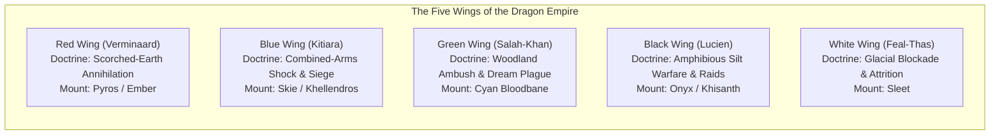

# The Five Dragonarmies and the Highlord Council
*The Chronicles of Krynn: Master Lore Vault — Volume 01: Peoples, Factions & Councils*

---

## 1. Executive Imperial Overview: The War Machine of Takhisis

Assembled in the volcanic caldera of [[Neraka]] beneath the jagged spires of the Khalkist Mountains, the **Dragonarmies of Takhisis** constitute the most formidable combined-arms military machine in the history of Ansalon. Forged under the iron will of [[Emperor Duulket Ariakas]] and consecrated by the Dark Queen herself, the imperial forces synthesize ancient chromatic dragons, magically engineered [[Draconians]], savage goblinoid and ogre hordes, and ruthless human mercenary phalanxes into a terrifying continental conqueror.

```
                            [ QUEEN TAKHISIS ]
                         (The Dark Lady of Neraka)
                                    │
                       [ EMPEROR DUULKET ARIAKAS ]
                  (Supreme Commander & Bearer of the Crown)
                                    │
       ┌──────────────┬─────────────┴─────────────┬──────────────┐
       │              │                           │              │
   [RED WING]    [BLUE WING]                 [GREEN WING]   [BLACK WING]   [WHITE WING]
   Highlord      Highlord                    Highlord       Highlord       Highlord
   Verminaard    Kitiara                     Salah-Khan     Lucien         Feal-Thas
   (Abanasinia)  (Palanthas & Solamnia)      (Silvanesti)   (Goodlund)     (Icewall)
```

```
               [DRAGONARMY EMPIRE COMPETING VALUES MATRIX]
           FLEXIBILITY & DISCRETION (Organic / Responsive)
                               │
               CLAN            │          ADHOCRACY
         (Collaborative)       │         (Opportunistic)
    • Khur Desert Nomads       │  • Goblin Scavenger Foragers
      (Salah-Khan's Tribes)    │    (Fewmaster Toede)
      [S: 2, E: 3, C: 2]       │    [S: 1, E: 2, C: 1]
                               │  • Ogre Shock Warbands
                               │    [S: 2, E: 4, C: 1]
───────────────────────────────┼───────────────────────────────
          HIERARCHY            │            MARKET
         (Control-Driven)      │          (Transactional / Predatory)
    • Imperial Neraka Garrison │  • The Highlord Grand Council
      [S: 1, E: 4, C: 4]       │    [S: 1, E: 4, C: 1]
    • The Dark Clerisy of      │  • Blue Dragonarmy Command
      Luerkhisis & Sanction    │    (Kitiara & Bakaris)
      [S: 1, E: 4, C: 4]       │    [S: 1, E: 4, C: 2]
    • Red Wing Shock Legion    │  • Human Mercenary Contingents
      [S: 1, E: 3, C: 4]       │    [S: 1, E: 3, C: 3]
                               │
             STABILITY & CONTROL (Mechanistic / Codified)
```

---

## 2. The Five Dragon Wings: Dossiers & Orders of Battle



---

### 2.1 The Red Dragonarmy (The Red Wing)
- **High Command:** [[Highlord Verminaard]] (Autumn 351 AC; slain at Pax Tharkas); command assumed directly by [[Emperor Ariakas]].
- **War Mounts:** [[Pyros]] (Ember, ancient red dragon) and [[Flamestrike]] (ancient female red dragon, warden of the Pax Tharkas nurseries).
- **Primary Theater:** [[Abanasinia]], the plains of Que-Shu, and the mountain fortress of [[Pax Tharkas]].
- **Sociological Calibration:** `[S: 1, E: 3, C: 4]` | **CVF Quadrant:** `Hierarchy / Market`
- **Doctrine & Ethos:** Total annihilation, psychological terror, and scorched-earth conquest. The Red Wing operates as the heavy armored fist of the empire, utilizing dragon-fire to reduce enemy castles to molten glass before deploying fanatical infantry to round up survivors for slave labor.
- **Order of Battle:**
  - *Draconian Iron Scale Brigades:* 1,200 Baaz line infantry, 300 Kapak infiltrators, 100 Bozak battle-mages.
  - *Auxiliary Levies:* 800 goblin scouts mounted on dire wolves (commanded by [[Fewmaster Toede]]), 400 hobgoblin mine overseers, 200 ogre shock troops.
  - *Human Traitors & Mercenaries:* Sellsword units coordinated by informants like [[Eben Shatterstone]].
  - *Slave Labor Reserve:* 800+ human refugees (300 miners, 250 women, 250 child hostages in subterranean nursery pens).

---

### 2.2 The Blue Dragonarmy (The Blue Wing)
- **High Command:** [[Dragon Highlord Kitiara uth Matar]] (The Blue Lady); Field Lieutenant: [[Bakaris of Estwilde]].
- **War Mount:** [[Skie]] ([[Khellendros]], ancient male blue dragon).
- **Primary Theater:** Northern Solamnia, [[Tarsis the Beautiful]], the [[High Clerist's Tower]], and [[Palanthas]].
- **Sociological Calibration:** `[S: 1, E: 4, C: 2]` | **CVF Quadrant:** `Market / Hierarchy`
- **Doctrine & Ethos:** Deep-penetration operational maneuver, combined-arms aerial coordination, and psychological subversion. Unlike the chaotic brutality of the Red Wing, Kitiara enforces ironclad military discipline, rewarding merit over aristocratic birth and coordinating ground maneuvers with precision aerial lightning strikes.
- **Order of Battle:**
  - *Aerial Strike Wing:* 12 mature Blue Dragons flying in three-dragon wedge formations; riders equipped with grounded copper-sleeved lances to avoid lightning back-arcs.
  - *Terrestrial Shock Corps:* 3,000 Sivak and Bozak Draconians trained in night infiltration and assassination.
  - *Heavy Phalanxes:* 8,000 disciplined hobgoblin heavy infantry in bronze plate, supported by 2,000 elite human heavy cavalry from Estwilde and Nordmaar.
  - *Siege Artillery Train:* 15 heavy ballista towers, stone-throwers, and iron-mantleted battering rams.

---

### 2.3 The Green Dragonarmy (The Green Wing)
- **High Command:** [[Highlord Salah-Khan]] (Khur warlord); briefly contested by [[Lord Toede]].
- **War Mount:** [[Cyan Bloodbane]] (ancient green dragon, master of phantasms).
- **Primary Theater:** Eastern Ansalon, the [[Khur]] desert borders, and the ancient elven kingdom of [[Silvanesti]].
- **Sociological Calibration:** `[S: 2, E: 3, C: 2]` | **CVF Quadrant:** `Clan / Market`
- **Doctrine & Ethos:** Wilderness ambushes, biological poison warfare, cavalry encirclement, and psychological dream-corruption. In Silvanesti, the Green Wing weaponized Cyan Bloodbane's telepathic enslavement of King [[Lorac Caladon]], mutating the primeval forest into an impassable living charnel house.
- **Order of Battle:**
  - *Air Wing:* 8 adult Green Dragons specializing in chlorine poison-gas strafing.
  - *Desert Cavalry:* 6,000 nomadic Khur light horsemen armed with scimitars and composite recurve bows.
  - *Assassination Cadres:* 1,500 Kapak Draconians equipped with venom-coated blades for jungle and defile warfare.
  - *Ogre Irregulars:* 1,000 Khalkist ogres utilized for heavy mountain breakthroughs.

---

### 2.4 The Black Dragonarmy (The Black Wing)
- **High Command:** [[Highlord Lucien of Takar]].
- **War Mounts:** [[Khisanth]] (Onyx; adult black dragon, slain in Xak Tsaroth) and five supporting black wyrms.
- **Primary Theater:** The swamps of [[Goodlund]], the shores of the Newsea, and the ruins of [[Xak Tsaroth]].
- **Sociological Calibration:** `[S: 1, E: 3, C: 1]` | **CVF Quadrant:** `Market` (Predatory Opportunism)
- **Doctrine & Ethos:** Amphibious shock strikes, night ambushes, river sabotage, and biological poisoning of municipal water reservoirs. The Black Wing operates in murky, diseased swamps and drowned ruins where other armies cannot maintain cavalry formations.
- **Order of Battle:**
  - *Aquatic Draconic Wing:* 6 adult Black Dragons capable of submerged hunting and 60-foot acid-line strikes.
  - *Amphibious Infantry:* 2,500 Baaz and Kapak Draconians trained in marsh wading and submerged stealth.
  - *Lizardfolk Auxiliaries:* 3,000 indigenous marsh-dwellers serving as trackers, scouts, and swamp ambushers.

---

### 2.5 The White Dragonarmy (The White Wing)
- **High Command:** [[Highlord Feal-Thas]] (Dark Elf Renegade Mage; slain at Icewall); succeeded briefly by [[Highlord Toede]] prior to his death in the Flotsam hinterlands.
- **War Mount:** [[Sleet]] (ancient white dragon wyrm).
- **Primary Theater:** [[Icewall Glacier]], the Southern Ice wastes, and maritime blockade of the Southern Straits.
- **Sociological Calibration:** `[S: 1, E: 2, C: 3]` | **CVF Quadrant:** `Hierarchy / Adhocracy`
- **Doctrine & Ethos:** Arctic attrition, glacial fortress defense, and naval pack-ice blockades. Exploiting sub-zero temperatures, the White Wing deploys cold-adapted monstrosities to annihilate southern resistance and secure ancient relics (including the [[Dragon Orb of Icewall Castle]]).
- **Order of Battle:**
  - *Arctic Flight:* 5 adult White Dragons equipped with blizzard breath and ice-walking talons.
  - *Thanoi Assault Legions:* 1,800 walrus-folk warriors armed with barbed bone harpoons and blubber armor.
  - *Ice-Wolf & Minotaur Auxiliaries:* 600 trained winter wolves and 400 rogue minotaur mercenaries.

---

## 3. Emperor Ariakas & The Highlord Grand Council at Neraka

At the dark spiritual apex of the empire stands the **Temple of Darkness in Neraka**, an enormous cathedral of black granite whose five crooked spires twist into the heavens like the talons of Takhisis. Within the Grand Council Hall, the Highlords assemble around a ring of obsidian thrones under the burning gaze of [[Emperor Duulket Ariakas]].

```
+---------------------------------------------------------------------------------------+
| THE NERAKA HIGHLORD POWER TOPOLOGY                                                    |
|                                                                                       |
|                          [ EMPEROR DUULKET ARIAKAS ]                                  |
|                          • Crown of Power on Brow                                     |
|                          • Five-Fold Elemental Shield                                 |
|                                     │                                                 |
|          ┌──────────────────────────┼──────────────────────────┐                      |
|          │                          │                          │                      |
|   [HIGHLORD KITIARA]        [HIGHLORD SALAH-KHAN]      [THE DARK CLERISY]             |
|   • Blue Wing Commander     • Green Wing Nomad Lord    • High Priest Wyrllish         |
|   • Backed by Lord Soth     • Hoards Khur Legions      • Seeks Takhisis's Egress      |
|   • Schemes to Slay Ariakas • Resents Northern Lords   • Rivals Black Robe Mages      |
|          │                          │                          │                      |
|          └──────────────────────────┴──────────────────────────┘                      |
|                                     │                                                 |
|                        [THE PERPETUAL BLOOD PURGE]                                    |
|             "Whoever Wears the Crown of Power Rules the Empire"                       |
+---------------------------------------------------------------------------------------+
```

### 3.1 The Crown of Power & The Five-Fold Elemental Shield
- **The Imperial Law:** The governance of the Dragon Empire is defined by a brutal, Darwinian maxim: *"Whoever wears the Crown of Power, rules."* Any Highlord who successfully slays the Emperor in personal combat or through assassination may claim the Crown and the fealty of the five wings.
- **The Elemental Shield:** Ariakas is protected by the **Five-Fold Shield of Takhisis**, a dark planar barrier gifted by the Queen. The shield renders him entirely immune to physical weapons, natural elements, and mortal magic up to the 9th circle.
- **The Vulnerability:** The shield can be breached only if the Dark Queen's favor is revoked, or if an allied champion strikes with the coordinated assistance of a master of High Sorcery who understands the shield's harmonic inversion—as demonstrated when [[Tanis Half-Elven]] pierced Ariakas's heart with the assistance of [[Raistlin Majere]]'s counter-magic.

### 3.2 Internal Rivalries & Factional Cannibalism
The Dragon Empire is not a stable political monolith; it is a pit of vipers held together solely by terror of Takhisis and the overwhelming physical might of Ariakas:
1. **Kitiara vs. Ariakas:** Kitiara recognizes that Ariakas views her as a dangerous rival. She secretly allies with [[Lord Soth]] (The Knight of the Black Rose), intending to eliminate Ariakas, seize the Crown of Power, and rule Krynn with Tanis Half-Elven as her consort.
2. **Clergy vs. Mages:** The dark priesthood under [[Wyrllish]] in Sanction deeply resents the Black Robes of High Sorcery. The clerics view mages as arrogant blasphemers, while the Black Robes view the clerics as groveling sycophants serving a goddess who will eventually devour them all.
3. **Draconian Caste Resentment:** Sivaks look down upon Bozaks as pedantic bookworms; Bozaks treat Kapaks as crude thugs; Kapaks view Baaz as expendable ditch-fodder; and all four castes seethe with quiet hatred toward their human and goblin officers.

---

## 4. Master Highlord Council Parley Matrix

When characters infiltrate or parley within the [[Temple of Darkness at Neraka]], negotiations are extraordinarily perilous. Every Highlord is calculating how to exploit the PCs to humiliate or murder their rivals.

```
+--------------------------------------------------------------------------------------------------------------------+
| HIGHLORD GRAND COUNCIL PARLEY MATRIX                                                                               |
+-------------------+----------------------------+-----------------------------------+-------------------------------+
| Councilor / Seat  | Core Agenda / Motivation   | Effective Bribes & Leverages      | Fatal Taboos & Auto-Fails     |
+-------------------+----------------------------+-----------------------------------+-------------------------------+
| Emperor Ariakas   | Continental conquest;      | The captured [[Everman]] (Berem); | Speaking above a whisper;     |
| (Red Wing /       | crushing the Whitestone    | heads of Solamnic commanders;     | meeting his gaze directly;    |
| Imperial Center)  | Alliance; pleasing Queen.  | total groveling submission.       | questioning his dark shield.  |
+-------------------+----------------------------+-----------------------------------+-------------------------------+
| Highlord Kitiara  | Usurping Ariakas; securing | Secret military intelligence on   | Challenging her martial rank; |
| (Blue Wing /      | the Crown; capturing       | Whitestone defenses; delivering   | patronizing her as a woman;   |
| Solamnia)         | [[Tanis]] and [[Laurana]]. | personal leverage over Ariakas.   | touching her dragon [[Skie]]. |
+-------------------+----------------------------+-----------------------------------+-------------------------------+
| Highlord          | Expanding Khur desert      | Sacks of minted steel; rare blood | Insulting Khur tribal honor;  |
| Salah-Khan        | autonomy; looting coastal  | stallions; treaties granting Khur | attempting to dictate desert  |
| (Green Wing /     | trade networks.            | absolute post-war sovereignty.    | logistics from Neraka.        |
| Khur)             |                            |                                   |                               |
+-------------------+----------------------------+-----------------------------------+-------------------------------+
| The Dark Clerisy  | Tearing open the planar    | Living sacrificial captives of    | Blasphemy against Takhisis;   |
| (High Priest      | rift; physical egress of   | high spiritual purity; uncorrup-  | permitting clerics of true    |
| Wyrllish)         | Queen Takhisis to Krynn.   | ted metallic dragon egg clutches. | gods (Paladine) to speak.     |
+-------------------+----------------------------+-----------------------------------+-------------------------------+
| Lord Soth         | Claiming the soul of       | Guaranteeing Laurana's delivery;  | Mentioning his murdered wife  |
| (Knight of the    | Princess Laurana; exacting | offering knightly duels to the    | or dead child; displaying     |
| Black Rose)       | vengeance on Solamnia.     | death; total stoic fearlessness.  | cowardice or begging for life.|
+-------------------+----------------------------+-----------------------------------+-------------------------------+
```

---

## 5. Logistical Supply Lines & The Neraka Crucible

```
+---------------------------------------------------------------------------------------+
| DRAGONARMY LOGISTICAL SUPPLY CHAINS                                                   |
|                                                                                       |
|   [Pax Tharkas Iron Mines] ===== Weapons Shipments =====> [Red Wing Mobilization]     |
|            |                                                       |                  |
|       Raw Ore / Slaves                                        Food Requisitions       |
|            v                                                       v                  |
|   [Sanction Volcanic Foundries] === Draconian Eggs ===> [Central Imperial Reserve]   |
|            |                                                       |                  |
|     Egg Corruption Rites                                     March to Neraka          |
|            v                                                       v                  |
|   [Khur Camel Caravans] ===== Desert Grain & Horses =====> [Temple of Darkness]       |
|            |                                                       |                  |
|     Smuggled Steel                                           The Final Siege          |
|            v                                                       v                  |
|   [Flotsam & Southern Ports] <===== Sea Blockade ===== [White & Blue Dragon Wings]    |
+---------------------------------------------------------------------------------------+
```

1. **The Sanction Industrial Nexus:** Sanction is the logistical beating heart of the empire. Volcanic vents heat colossal blast furnaces that forge thousands of bronze armor suits and iron weapons daily. More critically, the subterranean temple vaults house the dark alchemical incubators where stolen metallic eggs are transformed into Draconians.
2. **The Pax Tharkas Iron Veins:** Prior to its liberation in Autumn 351 AC, Pax Tharkas supplied over 60% of the raw iron ore used to equip the Red and Blue Wings. The destruction of Verminaard's command created severe steel shortages across the western front, forcing Ariakas to accelerate the eastern campaign into Silvanesti.
3. **The Fragility of the Center:** Because the Dragon Empire relies upon ruthless plunder rather than sustainable agrarian infrastructure, its armies cannot remain static. An army of 50,000 soldiers and 120 dragons rapidly exhausts local water and game within a 50-mile radius. When the Whitestone Army stalled their advance at the High Clerist's Tower and Kalaman, the imperial supply lines began to starve, forcing Ariakas to withdraw his command to Neraka for the fateful final assembly.
