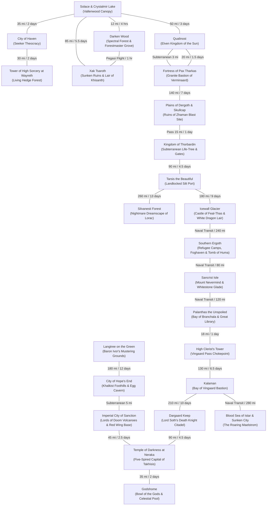
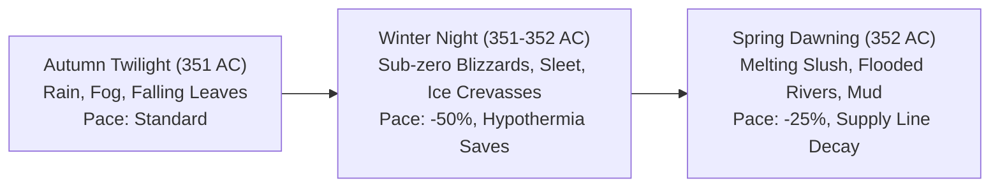

# 01: Ansalon Continental Pointcrawl and Transit Corridors
*The Master Strategic Macro-Topology, Transit Hazard Matrix & Regional Corridors of Krynn (346–352 AC)*

---

## 1. Executive Overview & Continental Macro-Topology

During the **War of the Lance** (348–352 AC), the continent of [[Ansalon]] transformed from a fractured patchwork of insular post-Cataclysm city-states and isolated wilderness into a continent-spanning operational theater. The cataclysmic fall of the fiery mountain three centuries prior shattered the ancient empire of [[Istar]], flooded the center of the continent with the [[New Sea]], drained the southern oceans to leave [[Tarsis]] stranded in miles of dust, and broke the western landmass into fragmented archipelagos including [[Southern Ergoth]] and [[Sancrist Isle]].

For travelers, armies, and covert operative cells such as the [[Heroes of the Lance]], movement across Ansalon is governed by a **Pointcrawl Graph Network**: spatial choke-points, mountain corridors, naval choke-lanes, and subterranean bypasses flanked by lethal environmental barriers.

### Master Continental Pointcrawl Graph



### Strategic Continental Topology Cutaway

```
+===================================================================================================+
| ANSALON CONTINENTAL STRATEGIC ELEVATIONS & WATERSHEDS                                             |
+===================================================================================================+
|                                                                                                   |
|  [NORTHWEST OCEAN]      [VINGAARD BASIN]       [KHALKIST MOUNTAINS]         [BLOOD SEA OF ISTAR]  |
|  Sancrist / Ergoth    Palanthas & High Tower     Godshome / Neraka         Maelstrom Vortex       |
|       ~ ~ ~                  /\                         /\                         ~ ~ ~          |
|      ~ ~ ~ ~                /  \                       /  \                       ~ ~ ~ ~         |
|     ~ ~ ~ ~ ~              /    \                     /    \                     ~ ~ ~ ~ ~        |
|  -------------------------/      \-------------------/      \-------------------/         \----   |
|  Sea Level               Vingaard Pass             Caldera Floor               Continental Shelf  |
|                                                                                                   |
|  [CENTRAL PLAINS]      [KHAROLIS RANGE]         [PLAINS OF DUST]          [SOUTHERN ICE REACHES]  |
|  Solace & Vallenwoods  Pax Tharkas / Thorbardin   Tarsis the Dry Silt      Icewall Glacier Shelf  |
|         |                   /\                          |                         ******          |
|       /|||\                /  \                      [========]                  ********         |
|      //|||\\              /    \                     | Rotting|                 **********        |
|     ///|||\\\            /      \                    | Ships  |                ************       |
|  -----------------------/        \-------------------[========]----------------/            \--   |
|  Abanasinia Basin       Mountain Spine               Elevated Desert Basin     Glacial Shelf      |
+===================================================================================================+
```

---

## 2. Master Transit Corridor & Hazard Matrix

The following authoritative transit matrix catalogs every primary and secondary transit route across Ansalon, synthesized from field extractions across all five campaign chronicles and AD&D tabletop modules [[DL1_Dragons_of_Despair]] through [[DL14_Dragons_of_Triumph]].

| # | Corridor / Route | Distance & Pace | Terrain & Environmental Hazards | Dragonarmy & Patrol Risk | Key Chokepoints, Outposts & Havens |
| :--- | :--- | :--- | :--- | :--- | :--- |
| **C-01** | **Solace to Crystalmir Lake** | 4 miles (1.5 hrs foot / 45 min mount) | Autumn leaf-fall over clay mud; thick twilight fog off lake; slippery wet shale shores. | **High:** [[Fewmaster Toede]]'s goblin scouts; Seeker municipal constables. | Reed thickets along eastern bank; hidden rowboats; [[Inn of the Last Home]]. |
| **C-02** | **Solace to Theobald's Academy** | 5 miles west (2 hrs foot) | Tangled black scrub-oak copse; thorny briers; lightless canopy; damp peat mud. | **Low:** Occasional stray goblin cutthroats or wild dire boars. | Abandoned charcoal-burner huts; stone limestone bridge over creek. |
| **C-03** | **Solace to City of Haven** | 35 miles southwest (2 days foot / 1 day horse) | Rolling cultivated farmsteads, plague-cleared hamlets, packed limestone cart tracks. | **Moderate:** Seeker inquisitor patrols; church tithe-collectors; refugee mobs. | Southbound Toll Bridge; Lemuel's herbal cottage; Haven Bargate. |
| **C-04** | **Haven to Forest of Wayreth** | 30 miles southwest (2 days foot / 12 hrs horse) | Damp lowlands, dense scrubland transitioning into topological spatial distortion. | **Extreme (Arcane):** Shifting living trees; compass failure; illusory trail loops. | Perimeter stone cairns; [[Forest of Wayreth]] tree line; Outer Gatehouse. |
| **C-05** | **Crystalmir to Darken Wood Edge** | 12 miles southeast (4 hrs foot) | Rugged foothills, rising pine forests, deadfall timber, unnatural total silence. | **Moderate:** [[Baaz Draconians]] in heavy traveler cloaks; tracking hounds. | Narrow ravines; dried shale creekbeds; boundary markers carved with stags. |
| **C-06** | **Crossing Darken Wood** | 8 miles traverse (3 hrs foot) | Shifting game paths; mossy bogs; sleep mist (DC 13 Con save or 1 hr unconscious). | **Special (Allied/Hostile):** Spectral Minion Solamnic knights; Centaur sentinels. | The Whispering Glade; Sunlit Clearing; [[Forestmaster]]'s ancient heart grove. |
| **C-07** | **Darken Wood to Xak Tsaroth (Sky)** | 110 miles northeast (1 hr pegasus flight) | Severe mountain updrafts over [[Eastwall Mountains]]; freezing air; zero oxygen peaks. | **Low (Aerial):** Rare distant sightings of Red Dragonarmy sky patrols. | Cloud breaks over Eastwall; thermal updrafts; descent through swamp steam. |
| **C-08** | **Que-Shu Plains to Xak Tsaroth** | 85 miles east (5.5 days foot / 3 days horse) | Scorched grasslands, alkali flats, burned nomad tents, waist-deep sulfur swamp. | **Extreme:** Mounted goblin worg-riders; [[Kapak Draconians]] in swamp trees. | Burned circle of Que-Shu; Eastwall mountain pass; Great Iron Lift of Xak Tsaroth. |
| **C-09** | **Solace to Qualinesti Border** | 50 miles south (3 days foot / 1.5 days horse) | Dense temperate woodlands, winding deer tracks, rocky stream crossings. | **High:** Red Dragonarmy outposts, Baaz checkpoints, goblin hunt-packs. | Burned bridge at Silverwood; border waymarker stones; elven archery posts. |
| **C-10** | **Qualinesti Border to Qualinost** | 15 miles south (1 day foot) | Enchanted golden aspen groves, sound-dampening moss ways, aromatic pine scents. | **Controlled:** Elven Border Wardens; warning longbow snipers in the canopy. | Spun-silver footbridges; waterfall ravines; Tower of the Sun terraces. |
| **C-11** | **Qualinost to the Sla-Mori** | 20 miles south (1.5 days foot) | Barren granite boulder screes, freezing winds in high Kharolis gorges, sheer cliffs. | **Extreme:** Sky patrols of [[Pyros]] (Ember); Kapak scouts sealing canyon mouths. | Narrow box canyon entrance; concealed drainage culvert; Tomb of Kith-Kanan. |
| **C-12** | **Sla-Mori Subterranean Crawl** | 3 miles underground (4 hrs crawl) | Pitch darkness; unstable masonry; dripping ceiling acid; volcanic steam geysers. | **Lethal:** [[Giant Slug]]; Undead crypt wardens; mechanical stone-crushing traps. | Secret pivot door into Pax Tharkas sub-cellars; shaft of sulfurous steam. |
| **C-13** | **Pax Tharkas to Plains of Dergoth** | 140 miles southeast (7 days foot / 4 days horse) | Blasted volcanic wasteland, razor obsidian shards, alkaline dust, unexploded magic. | **High:** Skeletal dwarven legions; rogue bozak patrols; bone scavenger drakes. | South Gate of Pax Tharkas; The Great Chasm; [[Skullcap]] (Ruins of Zhaman). |
| **C-14** | **Dergoth to Thorbardin Northgate** | 15 miles south (1 day climb) | Jagged limestone ravines, steep switchback stairways chiseled into cliffs. | **Extreme:** Dwarven crossbow emplacements; falling rock traps; Klar patrols. | Valley of the Thanes; The Northgate Barbican; North Gate Grand Plaza. |
| **C-15** | **Thorbardin Subterranean Highway** | 25 miles underground (2 days foot) | Colossal caverns, underground rivers, 28-tiered stalactite bridges, sulfur vents. | **Internal Clan Friction:** Theiwar poisoners, Daergar ruffians, Aghar beggars. | The Great Life-Tree; Sea of Urkhan ferry; South Gate Redoubt. |
| **C-16** | **Thorbardin Southgate to Tarsis** | 90 miles southeast (4.5 days foot / 2.5 days mount) | Plains of Dust; fine windblown red silt; baking day heat, freezing night desert winds. | **Moderate:** Nomad dust-raiders; desert hyenas; Dragonarmy reconnaissance wings. | Ancient dry stone watchtowers; salt springs; [[Tarsis]] harbor breakwater. |
| **C-17** | **Tarsis to Silvanesti Border** | 260 miles east (13 days foot / 6 days horse) | Endless alkaline plains, shifting dust dunes, zero potable water, blinding salt-glare. | **High:** Green Dragonarmy marauders under [[Salah-Khan]]; desert manticores. | Dry River Thon-Thalas crossing; weeping willow perimeter; Bleeding Forest. |
| **C-18** | **Through Silvanesti to Tower of Stars** | 45 miles inward (4 days hallucinatory crawl) | Writhing trees oozing blood; rivers of black bile; spectral undead hanging from vines. | **Nightmare Hazards:** Cyan Bloodbane's psychic miasma (DC 15 Wis save / dream wounds). | The Weeping Crystal Grove; Gardens of Living Marble; [[Tower of the Stars]]. |
| **C-19** | **Tarsis to Icewall Glacier** | 180 miles south (9 days ice-trek) | Crevasse-split glacial ice, sub-zero blizzard gales, blinding ice fog, hypothermia. | **Lethal:** [[Thanoi]] walrus-folk hunting pods; white wolves; Ice Bear ambushes. | Ice-shelf perimeter camp; Glacial Chasm Bridge; [[Icewall Castle]]. |
| **C-20** | **Icewall Coast to Southern Ergoth** | 240 miles sea transit (3–5 days ship) | Freezing gale squalls, rogue icebergs, treacherous coastal reefs, shipwreck surf. | **Moderate:** White Dragon patrols ([[Sleet]]); dragonarmy coastal galleys. | Shipwreck Cove; Southern Ergoth refugee encampments; Foghaven entrance. |
| **C-21** | **Southern Ergoth to Sancrist Isle** | 80 miles sea transit (1.5 days ship) | Choppy straits, heavy fog banks, rocky archipelagos, shifting coastal shallows. | **Low:** Occasional pirate cutters or gnomish experimental submersible craft. | Gunthar Bay; Mount Nevermind coastal funnels; [[Castle Gunthar]]. |
| **C-22** | **Sancrist Isle to Palanthas** | 120 miles sea transit (2 days packet ship) | Open calm waters of Bay of Branchala; clean northern sea winds; clear horizons. | **Low to Moderate:** Blue Dragonarmy long-range aerial scouts. | Bay of Branchala lighthouse; Palanthas Harbor Boom; Grand Quay. |
| **C-23** | **Palanthas to High Clerist's Tower** | 18 miles south (1 day foot / 4 hrs horse) | Paved imperial highway through rolling agricultural valleys of Solamnia. | **War Chokepoint:** Advancing Blue Wing Dragonarmy under [[Kitiara Uth Matar]]. | Vingaard Pass entrance; foothills redoubt; [[High Clerist's Tower]]. |
| **C-24** | **High Clerist's Tower to Kalaman** | 130 miles east (6.5 days foot / 3 days horse) | Vingaard River valley, rolling Solamnic meadows, abandoned manors, muddy tracks. | **High:** Blue & Red Wing skirmishers; draconian saboteurs; flying citadels. | Vingaard River Ford; Castle di Caergoth; Kalaman East Gatehouse. |
| **C-25** | **Kalaman to Blood Sea of Istar** | 280 miles sea transit (4–6 days ship) | Blood-red churning waters, boiling sulfur vents, catastrophic vortex currents. | **Extreme:** The Maelstrom whirlpool; sea drakes; Blood Sea Silt Kraken. | Sea-edge shallows; [[Sunken Istar]] air-bubble perimeter; Zebulah's Haven. |
| **C-26** | **Kalaman to Dargaard Keep** | 210 miles southeast (10 days foot / 5 days horse) | Jagged foothills of Nightlund, perpetual overcast sky, dead blackened vegetation. | **Supernatural Dread:** Skeletal cavalry patrols; [[Lord Soth]]'s 13 elven banshees. | River of Shadows; Moat of Cinders; Dargaard Keep Gatehouse. |
| **C-27** | **Langtree to Hope's End Corridor** | 180 miles overland (12 days infantry march) | Rolling sheep pastures, burned farmsteads, steep limestone canyons of Blödehelm. | **High:** Royalist shock cavalry; dragonarmy auxiliary regiments; wild wyverns. | Langtree Parade Grounds; Hope River Island Ford; [[Hope's End]] West Wall. |
| **C-28** | **Sanction to Neraka Pass** | 45 miles northeast (2.5 days foot / 1.5 days horse) | Active volcanic slopes, choking sulfur geysers, lava lakes, obsidian defiles. | **Extreme:** Dragonarmy heartland; Baaz, Bozak, Sivak, and Aurak garrison pickets. | Lords of Doom (Huerzyd, Duerghast, Luerkhisis); Neraka Caldera Gate. |
| **C-29** | **Neraka to Godshome Highland Trail** | 35 miles northwest (2 days mountain climb) | Razor-sharp switchbacks, thinning air, absolute stillness, windless rock bridges. | **Spiritual Ward:** Dragonarmies cannot locate the pass unless guided by divine fate. | Golden Rock Span; Basalt Monolith Ring; Pool of Black Obsidian. |

---

## 3. Seasonal Weather, March Mechanics & Environmental Attrition

Movement across the continental pointcrawl is heavily modified by the seasonal turn of the war across the three great volumes of the Chronicles:



### 3.1 The Autumn Rains & Fog (Dragons of Autumn Twilight)
- **Visibility:** Heavy early morning and twilight mists reduce line-of-sight to 30 feet in low-lying basins ([[Crystalmir Lake]], Xak Tsaroth marshes).
- **Movement Penalties:** Dirt roads degenerate into 4-inch-deep clay muck after daylong rains. Wheeled wagon transport pace reduced by $33\%$.
- **Stealth Dynamics:** Damp foliage muffles footfalls (+2 to Dexterity (Stealth) checks in woodlands). Smoke from campfires hangs low in stagnant air, easily detected up to 2 miles away by scent (DC 12 Wisdom (Perception)).

### 3.2 The Deep Winter Freeze (Dragons of Winter Night)
- **Extreme Cold Mechanics:** When traversing the [[Plains of Dergoth]], [[Plains of Dust]], or the [[Icewall Glacier]], characters without cold weather gear must make a DC 10 Constitution saving throw at the end of each hour or gain one level of Exhaustion.
- **Black Ice & Glacial Rifts:** Crossing ice bridges (Icewall Castle, Vingaard mountain passes) requires DC 12 to 14 Dexterity (Acrobatics) checks. Failing by 5 or more indicates slipping over a chasm ledge.
- **Dragon Flight in Winter:** Blue and Red dragons suffer -10 ft flying speed in severe sub-zero headwinds; White dragons gain advantage on stealth and perception checks in blizzards.

### 3.3 The Spring Thaw & Flooding (Dragons of Spring Dawning)
- **River Crossings:** Melting snowpacks from the Khalkist and Vingaard ranges cause mountain rivers to swell into raging torrents. Fording points become impassable without boats, pegasi, or flight magic.
- **Disease & Infection:** War-torn areas with unburied dead and stagnant floodwaters pose cholera and swamp fever risks (DC 13 Constitution save after wading in flooded trenches or ruins).

---

## 4. Cross-Vault Entity & Topic Links

- **Peoples, Factions & Strategic Command:**
  - [[01_Peoples_Factions_and_Councils/01_Human_Realms_Seekers_and_Mercenaries|Human Realms, Seekers & Mercenary Armies]]
  - [[01_Peoples_Factions_and_Councils/02_Elven_Kingdoms_and_Dwarven_Clans|Elven Kingdoms & Dwarven Clans of Thorbardin]]
  - [[01_Peoples_Factions_and_Councils/03_Knights_of_Solamnia_and_Orders_of_High_Sorcery|Knights of Solamnia & Orders of High Sorcery]]
  - [[01_Peoples_Factions_and_Councils/04_The_Five_Dragonarmies_and_Highlord_Council|The Five Dragonarmies & Highlord Council]]
- **Tactical Submaps & Regional Architecture:**
  - [[03_Atlas_Corridors_and_Tactical_Submaps/02_Abanasinia_Solace_Haven_and_Tower_of_Wayreth|02: Abanasinia, Solace, Haven & Tower of Wayreth]]
  - [[03_Atlas_Corridors_and_Tactical_Submaps/03_Langtree_and_The_Siege_of_Hopes_End|03: Langtree & The Siege of Hope's End]]
  - [[03_Atlas_Corridors_and_Tactical_Submaps/04_Darken_Wood_Xak_Tsaroth_Qualinost_and_Pax_Tharkas|04: Darken Wood, Xak Tsaroth, Qualinost & Pax Tharkas]]
  - [[03_Atlas_Corridors_and_Tactical_Submaps/05_Skullcap_Thorbardin_Tarsis_Silvanesti_and_Icewall|05: Skullcap, Thorbardin, Tarsis, Silvanesti & Icewall]]
  - [[03_Atlas_Corridors_and_Tactical_Submaps/06_Ergoth_High_Clerists_Tower_Istar_and_Temple_of_Neraka|06: Ergoth, High Clerist's Tower, Istar & Temple of Neraka]]
- **Bestiary, Combat & Encounter Tables:**
  - [[04_Bestiary_and_Encounter_Ecology/01_Draconians_Corruption_and_Death_Throes|Draconians, Corruption & Death Throes]]
  - [[04_Bestiary_and_Encounter_Ecology/02_Dragons_of_Krynn_and_Aerial_Combat|Dragons of Krynn & Aerial Combat]]
  - [[04_Bestiary_and_Encounter_Ecology/03_Undead_Monstrosities_and_Regional_Encounter_Tables|Undead Threats & Regional Encounter Tables]]
- **Economy, Relics & Timelines:**
  - [[05_Relics_Economy_and_Magic_Systems/03_Legendary_Relics_Steel_Economy_and_Supply_Chains|Legendary Relics & Steel Supply Chains]]
  - [[07_Timelines_Clocks_and_Branching_Crucibles/01_Master_Chronology_3000PC_to_352AC|Master Chronology of Krynn]]
