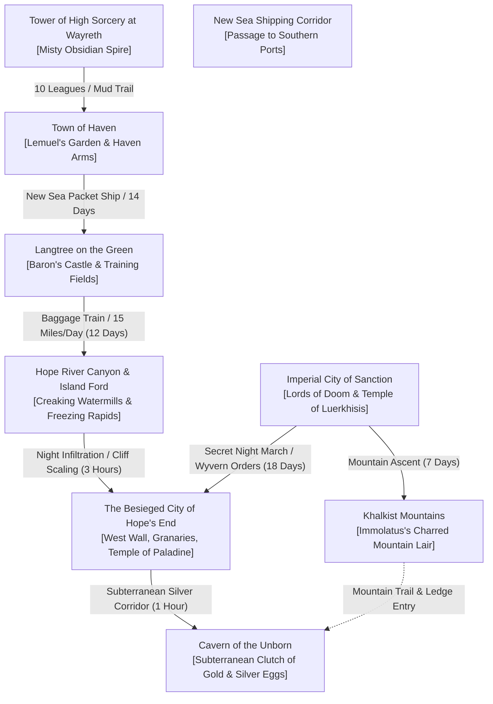

# 03: Langtree and The Siege of Hope's End
*Tactical Siege Architecture, Subterranean Relic Sanctuaries & The Cavern of the Unborn (346–347 AC)*

---

## 1. Operational Overview & Regional Topology

Set during the **Mercenary Wars** of 346–347 AC as chronicled in *Brothers in Arms*, this theater documents the operational march of **Baron Ivor's Free Mercenary Army** from their muster at [[Langtree on the Green]] through the contested corridors of Blödehelm to the desperate siege of **Hope's End**.

Unknown to the warring mercenary captains or the despotic King Wilhelm, Hope's End concealed the most closely guarded secret of the early War of the Lance: the **Caverns of the Unborn**, a subterranean sanctuary sheltering hundreds of viable metallic dragon eggs stolen from the ancestral hatching grounds by the conspirators of the [[Temple of Neraka]] and guarded by the ancient Red Dragon [[Immolatus]].



### Strategic Transit Corridors & Environmental Hazards

1. **The Wayreth–Haven Road:** 10 leagues through dripping temperate woodland and waterlogged peasant farmsteads.
   - *Hazards:* Shifting perimeter trees of the Living Hedge; pneumonia-inducing autumn crossings of the Elfstream; Qualinesti elven border pickets firing warning broadheads at trespassers.
2. **The New Sea Shipping Run:** Commercial packet schooners sailing from southern Abanasinian ports across the stormy New Sea to Langtree inlet.
   - *Hazards:* Treacherous late-autumn squalls; coastal goblin raiders; predatory toll tariffs forcing recruits to sell their mounts (such as Caramon selling his warhorse *Nightsky* to pay ship passage).
3. **The Langtree–Blödehelm Marching Corridor:** A 180-mile overland route traversed at a disciplined military pace of 15 miles per day.
   - *Terrain:* Rolling limestone hills, abandoned sheep meadows, burned tenant cottages.
   - *Security:* Screened by Company C skirmishers; risk of ambushes by King Wilhelm’s royalist outriders.
4. **Hope River Canyon & The Island Rock Ford:** Glacial torrent slicing through a vertical limestone canyon flanked by abandoned, creaking watermills.
   - *The Crossing:* Fording occurs where the river splits around an island of rock, creating two icy, waist-deep channels followed by a jagged rock bridge.
   - *Hazards:* Slick algae-coated boulders; freezing water inducing hypothermia (DC 12 Constitution save or gain one level of Exhaustion); ruined scroll cases and dampened spell components if submerged.

---

## 2. Urban Macro-Map: Langtree on the Green

```
+===================================================================================================+
| URBAN MACRO-MAP: LANGTREE ON THE GREEN                                                            |
+===================================================================================================+
|                                                                                                   |
|      [Castle Langtree]                                                                            |
|      +-- Inner Courtyard (Cobblestones, Knucklebones, Grooms)                                      |
|      +-- Great Hall (Solamnic Tapestries, Kiri-Jolith Bison Banner)                                |
|      +-- Subterranean Warmage Lab (Stone cellar, battered tomes, cot)                              |
|      +-- Barracks (Scrubbed stone, fresh straw, slop buckets)                                      |
|                                                                                                   |
|      [The City Walls & Gate]                                                                      |
|      +-- Street of Swords (Smithies, armorers, leatherworkers)                                     |
|      +-- The Swelling Ham Tavern (Pig sign, boiled beans, cheap ale)                               |
|                                                                                                   |
|      [The Mustering & Drill Grounds]                                                              |
|      +-- Enlistment Table (One-eyed veteran sergeant, quill & ink)                                  |
|      +-- Parade Field (Thrust-and-recover infantry drills)                                          |
|      +-- The Quintain Field (Swivel arm, shield, counterweight sandbag)                            |
+===================================================================================================+
```

### 5D Sensory Pentagon: Langtree Mustering Grounds & Castle
- **Physical Environment:** Pungent aroma of hot forge iron, horse manure, damp straw, and wood-ash lye from barracks scrub-downs. Sun baking down upon chalk-white limestone ramparts; dust rising in blinding clouds from hundreds of marching boots; a swiveling wooden quintain groaning as its counterweighted sandbag whips around to flatten an off-balance jouster; spilled bitter ale and boiled ham broth at [[The Swelling Ham]].
- **Behaviors:** Veteran sellswords in notched, rusted ringmail lounging against timber fences, betting copper bits on how long green recruits will survive; drill sergeants dumping slop buckets over clean flagstones to teach humble obedience; blacksmiths hammering hot rivets into dented iron breastplates; recruit officers drilling spear thrusts until shoulders tremble.
- **Relationships:** Fierce, boisterous fraternity among veteran mercenaries; condescending mockery directed toward naive farm boys; tense mutual wariness between the bald veteran warmage [[Master Horkin]] and the arrogant, gold-skinned Tower graduate [[Raistlin Majere]].
- **Attitudes:** Pragmatic, fatalistic professional soldiers: every mercenary knows a crossbow bolt has his name chiseled on it, so coin is spent freely on dice and women; fierce loyalty to [[Baron Ivor]], whom they revere as a daft but lucky commander.
- **Values:** Practical competence over aristocratic lineage; unwavering physical courage in the face of sudden cavalry charges; unwritten mercenary codes: never leave a comrade's corpse to the crows, never whine over moldy hardtack, and keep weapons razor-sharp.

---

## 3. Tactical Submap: The Besieged City of Hope's End

```
===================================================================================================
                      CITY OF HOPE'S END — TACTICAL SIEGE ARCHITECTURE
===================================================================================================
                                       [Khalkist Mountain Ridge]
                                                   |
 [West Wall Breach Point]                          |
       |                                           v
       v                                   [High Pine Ledge]
  +---------+   [Warehouse District]               |
  | West    |   +--------------------+      (Secret Cave Entry)
  | Bastion |   | Empty Granary      |             |
  |         |   | (Company C Hideout)|             v
  +---------+   +--------------------+    [Temple of Paladine]
       |                  |               +-- Broken Courtyard (Roses)
       | (Old Streets)    |               +-- Golden Doors & Sanctuary
       v                  v               +-- The Silver Door
  [Tavern Row]     [Merchant Square]               |
  +-- Gibbous Moon +-- Closed Stalls               v
  |   (Corpse sign)+-- Boarded Guild      [Subterranean Corridors]
  +----------------+   Hall                        |
                          |                        v
                          v               [Mausoleum of Sir Nigel]
                   [Mayor's Manor]                 |
                   +-- Stork's Nest on Chimney     v
                   +-- Servant Stairs      [Cavern of the Unborn]
                   +-- Master Bedchamber   (Clutch of Dragon Eggs)
                          |
                          v
                   [The Great North Gates]
                   +-- Heavy Oak Doors & Iron Bars
                   +-- Timber Barricades & Overturned Carts
                   +-- Wall Catapults & Arrow Murder-Holes
===================================================================================================
                KILLING FIELD (1/2 Mile) — SMOLDERING ASH & TRENCHES
===================================================================================================
  [Dragonarmy Picket Lines] <-------------> [Allied Mercenary Lines]
  +-- Trenches & Spikes                     +-- Baggage Wagons
  +-- Whip-Sergeants                        +-- Medical Tents (Horkin)
  +-- Punishment Posts (Plate)              +-- Donkey Lines (Jenny & Lillie)
  +-- Gallows (Hanged looters)
  +-- Command Tent (Commander Kholos)
===================================================================================================
```

### 5D Sensory Pentagon: Hope's End Under Siege
- **Physical Environment:** Acrid, eye-watering smoke from burning peat fields and torch-lit outbuildings drifting over 30-foot granite battlements. In the West District, hollow silence hangs over empty, echoing timber warehouses smelling of dried chaff and rat droppings. Sunken leaded bay windows overlook streets littered with shattered clay roof tiles. Near the north gate, the metallic stench of dried blood, horse lather, and smashed oak timbers mingling with the sickening odor of scorched corpses outside the walls.
- **Behaviors:** Starving shopkeepers peering through shutter slats with loaded crossbows; exhausted city militia archers sleeping standing up against parapets; desperate mothers soothing infants with boiled water; mercenaries of Company C creeping through granary shadows in grease-blackened leather armor, checking daggers without speaking.
- **Relationships:** Growing class resentment between ruined guild artisans and the panicked, indecisive Revolutionary Council; desperate, suspicious parleys between the besieged Lord Mayor and the unexpected mercenary liberator Baron Ivor.
- **Attitudes:** Hopeless siege despair transitioning to wild, unhinged fury when it is revealed King Wilhelm's forces are executing ambassadors and taking women as slaves.
- **Values:** Municipal independence; the sacred reputation of Hope's End craftsmanship; preserving the lives of children against royal butcher armies.

---

## 4. Wall-by-Wall Tactical Submap: The Temple of Paladine & Caverns of the Unborn

```
+===================================================================================================+
| THE TEMPLE OF PALADINE & SUBTERRANEAN DRAGON VAULTS                                               |
+===================================================================================================+
|                                                                                                   |
|  [ZONE 1: The Crumbling Outer Courtyard]                                                          |
|  - Dimensions: 40 paces wide x 30 paces deep. Broken flagstones overgrown with chickweed.         |
|  - Features: Sprawling white climbing roses filling the air with spicy, celestial fragrance;     |
|    6 slender granite columns scarred by ancient hammer blows; defaced friezes.                    |
|  - Entryway: Three broad marble steps leading to battered Golden Doors standing ajar.            |
|                                                                                                   |
|  [ZONE 2: The Inner Sanctuary of Paladine]                                                        |
|  - Dimensions: 30 paces x 20 paces rectangular nave.                                              |
|  - Atmosphere: Absolute, profound stillness; diffuse silver radiance emanating from bare stone.   |
|  - Features: Stripped bare of altars, chairs, or idols. Zero shadows cast by torches.             |
|  - Obstacle: The Barrier of Righteous Intent (invisible spiritual web repelling drawn steel).    |
|  - The Portal: The Massive Silver Door set into the eastern bedrock.                             |
|                                                                                                   |
|  [ZONE 3: The White Marble Passage & Subterranean Stream]                                         |
|  - Length: 200 yards sloping downward into mountain bedrock.                                      |
|  - Terrain: Smooth white marble transitions into natural cavern path; crystal stalactites;       |
|    rushing ice-cold stream. Luminescence reflecting off shed gold and silver dragon scales.       |
|                                                                                                   |
|  [ZONE 4: The Mausoleum of Sir Nigel of Dinsmoor]                                                 |
|  - Architecture: Circular domed crypt of white marble, 25 paces across.                           |
|  - Central Feature: Open white marble sarcophagus; carved effigy of Sir Nigel in solid plate.     |
|  - The Trial: Paladine's Mirror of Mortality (psychic projection of seeker's own future death;    |
|    Kitiara sees herself dying of bloody gashes, whispering her confession of love for Tanis).     |
|                                                                                                   |
|  [ZONE 5: The Cavern of the Unborn (The Egg Chamber)]                                             |
|  - Dimensions: Colossal natural dome, 80 paces across, 60 feet high.                              |
|  - The Treasure: Large alcoves holding hundreds of massive metallic dragon eggs (glowing with     |
|    living silver and gold radiance; living spirits of unborn metallic wyrms).                     |
|  - Secret Mountain Exit: Wide, dragon-sized tunnel leading 100 yards to a steep cliff ledge       |
|    screened by three tall pine trees overlooking the southern valley.                             |
|                                                                                                   |
|  [ZONE 6: The Collapsed Chokepoint & Dragon Tomb]                                                 |
|  - Location: The narrow corridor connecting Zone 4 and Zone 5.                                    |
|  - Current State: Blocked by collapsed granite, shattered timbers, and the fused corpse of       |
|    Immolatus the Red Dragon, sealed forever by the Staff of Magius and Kitiara's strike.         |
+===================================================================================================+
```

### Detailed Tactical Zone Key

#### Zone 1: The Crumbling Outer Courtyard
- **Dimensions:** 40 paces wide by 30 paces deep; cracked flagstones thrust upward by creeping ivy and chickweed.
- **Floral Ward:** Sprawling thickets of wild white climbing roses cover the southern portico. Their spicy, honeyed fragrance neutralizes the stench of battlefield sulfur and rotting siege carcasses.
- **Architectural Ruins:** Six fluted granite columns scarred by antique maces and axes during the Cataclysmic riots. Three broad marble steps ascend to the battered **Golden Doors**, which hang six inches ajar.

#### Zone 2: The Inner Sanctuary of Paladine
- **Dimensions:** 30 paces long by 20 paces wide rectangular nave.
- **Planar Radiance:** The sanctuary is illuminated by a sourceless, diffuse silver radiance emanating from the white stone walls. Torches brought into the chamber cast no shadows.
- **The Barrier of Righteous Intent:** An invisible, spiritual ward screens the nave. Any creature bearing drawn weapons or possessing hostile, murderous intent feels an immovable wall of dense pressure.
  - *Mechanics:* Approaching the eastern wall with weapons drawn requires a DC 16 Wisdom saving throw. On a failure, the creature is pushed backward 10 feet and drops their weapon. Unarmed seekers seeking sanctuary pass through unimpeded.
- **The Portal:** The **Massive Silver Door**, a solid slab of tarnished silver bearing the relief of the Platinum Dragon, opens silently inward when touched by an unarmed hand.

#### Zone 3: The White Marble Passage & Subterranean Stream
- **Dimensions:** 200 yards in length, descending at a 15-degree incline into the mountain roots.
- **Environment:** Architectural white marble paving gradually gives way to smooth, water-worn natural limestone bedrock. A rushing subterranean stream of freezing snowmelt cuts across the trail.
- **Luminescence:** Faint bioluminescence glints off ancient discarded gold and silver dragon scales embedded in the silt. Whispering echoes of ancient Solamnic chants resound through the stone whenever an intruder pauses.

#### Zone 4: The Mausoleum of Sir Nigel of Dinsmoor
- **Dimensions:** Circular domed crypt, 25 paces across, carved from white veined marble.
- **The Sarcophagus:** At the chamber's center rests an unsealed white marble tomb. The lid bears the life-sized relief effigy of **Sir Nigel of Dinsmoor**, an ancient Knight of the Crown, dressed in antique solid-visor field plate.
- **The Mirror of Mortality:** Any selfish, deceitful, or power-hungry creature entering the mausoleum triggers a psychic projection within their own mind:
  - *The Vision:* The seeker witnesses their own inevitable death.
  - *Historical Vision:* When [[Kitiara Uth Matar]] steps into the crypt, she sees her own future corpse: mortally wounded by a dragonlance, bleeding out on a cold stone floor, desperately whispering her love for [[Tanis Half-Elven]]. Kitiara recoils in furious denial, screaming at the phantom.
- **Exit:** A heavy wrought-iron gate embossed with the Solamnic Rose and Crown, requiring a DC 15 Dexterity (Thieves' Tools) check or a DC 18 Strength (Athletics) check to force.

#### Zone 5: The Cavern of the Unborn (The Egg Chamber)
- **Dimensions:** A titanic natural cathedral dome 80 paces wide and 60 feet high, large enough for multiple adult dragons to maneuver in flight.
- **The Clutch of Metallic Eggs:**
  - Recessed shelves and sandy floor alcoves hold over 300 massive dragon eggs, each standing nearly five feet tall.
  - The eggs pulse with a soft, warm internal glow: some radiating pale silver light, others gleaming with deep metallic gold.
  - *Living Psychic Pulse:* Mages and clerics within 30 feet feel the telepathic warmth of hundreds of unborn draconic consciousnesses sleeping peacefully in divine stasis.
- **The Dragon Sconces:** Ancient bronze brazier platforms line the upper ledge where dragon mothers once rested while incubating their clutches.
- **The Secret Mountain Exit:** A wide, smooth 15-foot-wide tunnel slopes upward 100 yards to a high exterior ledge. Three towering pine trees conceal the cave mouth from observers in the valley below.

#### Zone 6: The Collapsed Chokepoint & Dragon Tomb
- **Location:** The narrow limestone throat connecting Sir Nigel’s Mausoleum (Zone 4) to the Egg Cavern (Zone 5).
- **The Cataclysmic Climax:**
  - In 347 AC, the ancient red dragon [[Immolatus]] breaches the chokepoint to slaughter the recruits and claim the eggs.
  - Raistlin Majere unleashes the full magical ward of the [[Staff of Magius]], detonating a blinding flare of white magnesium radiance that blinds the dragon.
  - Kitiara strikes from above, driving her shortsword between the dragon's neck vertebrae.
  - The dying dragon's death convulsions trigger a massive ceiling collapse, burying Immolatus under 80 tons of shattered granite boulders and sealing the passage forever.

---

## 5. Tactical Submap: Immolatus's Mountain Lair (Khalkist Foothills)

```
===================================================================================================
                   IMMOLATUS'S MOUNTAIN LAIR — TACTICAL CUTAWAY
===================================================================================================
                                [Split-Peak Summit]
                                         |
                                         v
                                 [Hook-Nose Crag]
                                         |
                                         v
                         [The Desolate Scorched Zone]
                         +-- Blackened, melted granite boulders
                         +-- Charred corpse of Dragonarmy scout
                         +-- Melted steel breastplate fused to rock
                                         |
                                         v
                         [Cavern Mouth of Immolatus]
                         +-- Massive sulfur vents & bubbling steam
                         +-- Empty stone hoard floor (Lost Treasures)
                         +-- Upper smoke shaft venting to mountain face
                         +-- Narrow trail descending to Sanction road
===================================================================================================
```

### 5D Sensory Pentagon: Immolatus's Mountain Lair
- **Physical Environment:** Blistering, sulfur-laden updrafts rising through fissures in glassy, vitrified granite. Absolute absence of wildlife above the timberline: no vultures, flies, or mountain goats. Silence broken only by the deep, rhythmic subterranean rumbling of the distant Lords of Doom; charred human skeletons fused into rock like ribs in an oven.
- **Behaviors:** Immolatus in dragon form restlessly tossing upon bare stone slabs, obsessively daydreaming of crushing Solamnic knights in half and hoarding mountains of gold; suddenly snapping at his own flank when a human intruder stings like a gnat; pacing in human disguise with a dragging, clumsy gait, cursing the soft frailty of mortal flesh.
- **Relationships:** Mistrustful, transactional exploitation between Supreme Commander [[Duulket Ariakas]] and the ancient red wyrm; Kitiara walking a razor's edge between deferential obedience (*"My Lord"*) and calculating leverage, ready to sever the wyrm's wing tendon at the first sign of betrayal.
- **Attitudes:** Monstrous megalomania, ancient grievance over past humiliations during the Third Dragon War, and smoldering contempt for Queen Takhisis for failing to protect his ancestral hoard.
- **Values:** Stolen gold; terror and incineration; the absolute supremacy of chromatic dragonkind over mortal vermin.

---

## 6. Cross-Vault Entity & Topic Links

- **Factions, Mercenaries & Armies:**
  - [[01_Peoples_Factions_and_Councils/01_Human_Realms_Seekers_and_Mercenaries|Baron Ivor's Mercenary Army & Hope's End Council]]
  - [[01_Peoples_Factions_and_Councils/04_The_Five_Dragonarmies_and_Highlord_Council|The Dragonarmies & Emperor Ariakas]]
- **Dramatis Personae & Commanders:**
  - [[02_Dramatis_Personae_and_Companions/01_Heroes_of_the_Lance_Core_Eight|Raistlin Majere & Caramon Majere]]
  - [[02_Dramatis_Personae_and_Companions/03_Dragon_Highlords_and_Dark_Commanders|Kitiara Uth Matar & Commander Kholos]]
  - [[02_Dramatis_Personae_and_Companions/04_Archmages_Monarchs_and_Council_Leaders|Master Horkin & Baron Ivor]]
- **Bestiary & Dragons:**
  - [[04_Bestiary_and_Encounter_Ecology/01_Draconians_Corruption_and_Death_Throes|Draconian Corruption of Metallic Eggs]]
  - [[04_Bestiary_and_Encounter_Ecology/02_Dragons_of_Krynn_and_Aerial_Combat|Immolatus the Red Wyrm]]
- **Next Tactical Submap:**
  - [[03_Atlas_Corridors_and_Tactical_Submaps/04_Darken_Wood_Xak_Tsaroth_Qualinost_and_Pax_Tharkas|04: Darken Wood, Xak Tsaroth, Qualinost & Pax Tharkas]]
