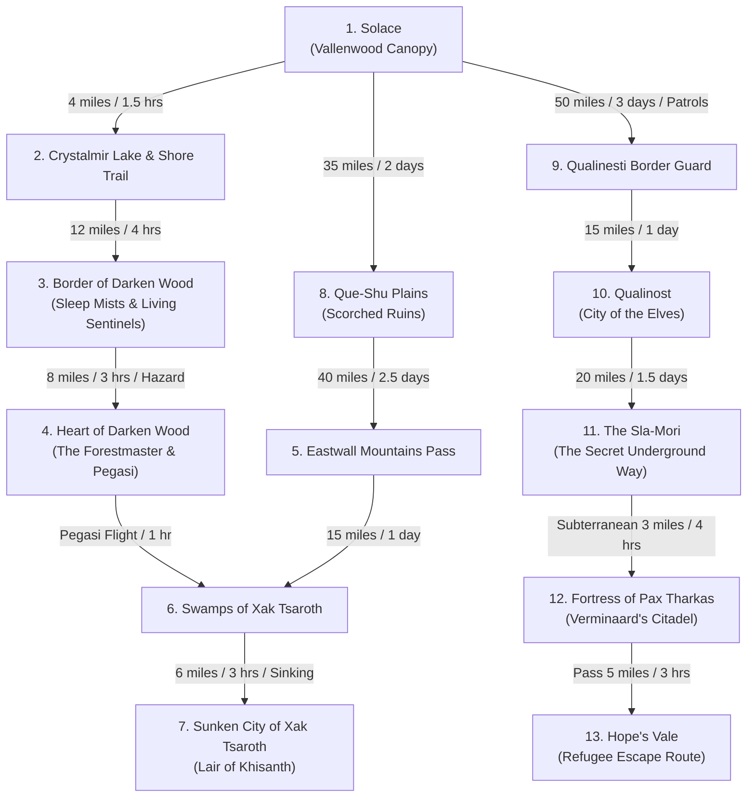
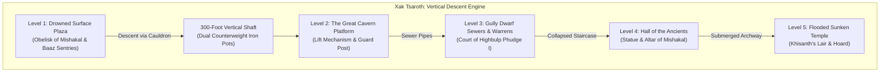
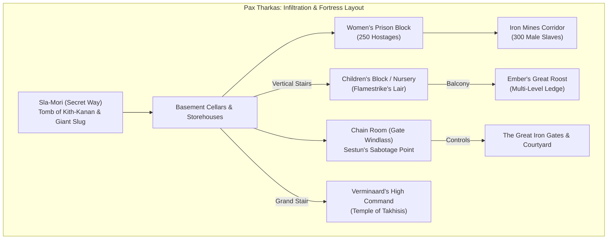

# 04: Darken Wood, Xak Tsaroth, Qualinost and Pax Tharkas
*Tactical Dungeon Submaps, Vertical Shaft Mechanics & The Liberation of the Kharolis Refugees (Autumn 351 AC)*

---

## 1. Operational Overview & Module Lineage

This theater documents the opening operational arc of the **War of the Lance** (Autumn 351 AC) across Abanasinia and the northern threshold of the [[Kharolis Mountains]], synthesizing the narrative of *Dragons of Autumn Twilight* with the foundational AD&D 1st Edition tournament modules:
- **[[DL1_Dragons_of_Despair]] (Tracy Hickman, 1984):** The overland flight from [[Solace]], the supernatural barrier of [[Darken Wood]], and the descent into the vertical drowned ruins of [[Xak Tsaroth]] to recover the [[Disks of Mishakal]].
- **[[DL2_Dragons_of_Flame]] (Douglas Niles, 1984):** The elven exodus from [[Qualinost]], the subterranean stealth infiltration of the **Sla-Mori**, and the assault on the cyclopean slave fortress of **Pax Tharkas** to liberate 800 human hostages.

---

## 2. Iconic Macro-Locales & 5D Sensory Pentagons

### 2.1 The Enchanted Perimeter of Darken Wood
- **Macro Coordinates:** 16 miles southeast of Solace; an ancient virgin forest steeped in pre-Cataclysmic fey wards and guarded by spectral undead.
- **Topological & Sensory Dynamics:**
  - *Sleep Mist:* Thick banks of fragrant, silver-white ground mist roll through the trees at dusk. Any non-elven creature entering must make a DC 13 Constitution saving throw or fall into an enchanted slumber lasting 1 hour.
  - *The Spectral Minions:* Apparitions of ancient Solamnic warriors cursed to haunt the glades until they fulfill their uncompleted oaths. They observe travelers from behind mossy boles, only attacking those displaying cowardice or malice.
  - *The Heart Grove:* A sun-drenched clearing of white lilies where the **Forestmaster** (an ancient, immortal Unicorn) grants council and summons pegasi mounts to transport worthy heroes across the Eastwall range.

#### 5D Sensory Pentagon: Darken Wood
- **Physical Environment:** Immense, moss-carpeted white pines and weeping willows; dense silver fog clinging to the chest; absolute, eerie silence unbroken by birdsong, wind, or insects; the scent of wild vanilla lilies and damp ancient earth.
- **Behaviors:** Companions walking back-to-back with drawn steel; horses shaking manes and snorting in terrified confusion as trail ruts vanish beneath rolling fog; spectral warriors raising pale, translucent lances in salute.
- **Relationships:** Reverence and ancient duty; the Forestmaster perceives the moral purity of the [[Blue Crystal Staff]] carried by [[Goldmoon]], recognizing the return of the True Gods before mortals understand it.
- **Attitudes:** Ancient, sorrowful neutrality; an inviolable sanctuary willing to aid the cause of Light while remaining detached from mortal wars.
- **Values:** Sanctity of living nature, preservation of innocence, and fidelity to sacred oaths.

---

### 2.2 The Sunlit Groves of Qualinost
- **Macro Coordinates:** Southwestern Abanasinia, nestled within the sun-dappled northern foothills of the Kharolis range.
- **Architecture & Ecosystem:** Unlike the gloomy stone cities of men, Qualinost is an architectural wonder crafted from living boughs, golden aspens, and white sunstone. Arched bridges of spun silver filigree leap across fern-filled mountain gorges. Buildings spiral upward like growing flowers, catching the autumn sunlight in polished crystal prisms.

#### 5D Sensory Pentagon: Qualinost
- **Physical Environment:** Towering golden aspen trees filtering sunlight into a warm, shimmering amber mist; sweeping bridges of white marble and spun silver arching across roaring, crystal-clear glacial streams; sweet scents of cedar, crushed pine needles, and ripe *quith-pa* fruit.
- **Behaviors:** Silver-robed elven border wardens gliding across dead leaves without snapping a single twig; aristocrats standing motionless on balconies gazing southward toward the sea with sorrowful eyes; servants wrapping fragile blown-glass heirlooms in velvet for the coming exodus.
- **Relationships:** Aristocratic aloofness and centuries-old isolationism; royal courtiers treating [[Tanis Half-Elven]] with polite, condescending pity; younger hotheads like [[Gilthanas]] and [[Laurana]] chafing against the passive pacifism of the Council.
- **Attitudes:** Haughty cultural superiority coupled with paralyzing existential grief; an ancient race convinced the world of men is doomed to self-immolation.
- **Values:** Purity of bloodline traced back to [[Kith-Kanan]]; harmony between architecture and living flora; preserving elven lives above all foreign entanglements.

---

### 2.3 The Drowned Spires of Xak Tsaroth

#### 5D Sensory Pentagon: Xak Tsaroth
- **Physical Environment:** Fluted pre-Cataclysm marble columns jutting at drunken angles from black, bubbling swamp water; the suffocating stench of decaying lilies, sulfuric marsh gas, and the lung-searing vinegar tang of black dragon acid; long veils of dripping gray Spanish moss; the deafening, rhythmic *clank-screech-groan* of the Great Lift chain echoing up from the dark 300-foot abyss.
- **Behaviors:** Gully dwarves scrambling on all fours over slick, submerged pediments, stuffing slimy watercress into their rags; [[Baaz Draconians]] cracking barbed bullwhips over the lip of the cauldron shaft; leeches swelling upon calves as boots sink into greasy black silt.
- **Relationships:** Brutal despotic subjugation; draconians treat the Aghar as vermin to be kicked down shafts or fed to [[Khisanth]]; gully dwarves grovel, weep, and pilfer brass buttons from sleeping guards.
- **Attitudes:** Bleak, claustrophobic fatalism; the terrifying historical realization that an imperial metropolitan center was shattered and submerged in a single hour of divine wrath.
- **Values:** Dry footing; edible marsh moss; shiny scrap brass; staying off Khisanth's feeding roster.

---

### 2.4 The Iron Bastion of Pax Tharkas

#### 5D Sensory Pentagon: Pax Tharkas
- **Physical Environment:** Monstrous, cyclopean fortress walls of dark charcoal-gray granite wedged tightly between two sheer mountain crags; deafening roar of underground blast furnaces; billowing clouds of choking soot-black sulfur smoke venting from iron grates; the terrifying, oven-hot reptilian musk of red dragons drifting down from high battlements, smelling of burnt copper, sulfur, and roasted meat.
- **Behaviors:** Emaciated human prisoners stumbling under crude wooden baskets of raw iron ore, backs crisscrossed with weeping whip lashes; hobgoblin taskmasters slamming heavy iron portcullises shut with deafening mechanical crashes; draconians sharpening curved scythe-swords on foot-treadle grindstones, throwing yellow sparks into the soot-stained corridors.
- **Relationships:** Totalitarian martial terror; Verminaard’s commands enforced through religious fanatical zealotry and hostage leverage; human fathers slaving in the mines knowing their children will be butchered in the nursery if daily ore quotas fail.
- **Attitudes:** Smothering, desperate despair among the captives, contrasted with arrogant, bloodthirsty triumphalism among the Dragonarmy cohorts.
- **Values:** High-grade iron ore; intact hostage quotas; the favor of Takhisis; cold mountain water to soothe parched, soot-cracked lips.

---

## 3. Tactical Submap: The Sunken City of Xak Tsaroth (5-Level Vertical Lift)

Xak Tsaroth was an imperial city of the Age of Might built on the edge of the Eastwall cliffs. During the Cataclysm, the ground split open, and the entire city dropped 300 feet into a subterranean cavern basin, submerged in black swamp mire.

### Level-by-Level Tactical Breakdown

#### Level 1: The Drowned Plaza & Surface Ruins
- **101. The Shattered Plaza of the Weeping Obelisk:**
  - *Dimensions:* 120-foot-wide circular courtyard, flooded under 2 to 4 feet of stagnant black water.
  - *Features:* A cracked black obsidian obelisk stands at the center, inscribed with ancient holy prayers to Mishakal (DC 14 Intelligence (Religion) to decipher). Overturned marble colonnades provide half and three-quarters cover.
  - *Garrison:* 4 Baaz Draconians huddled beneath a crumbling portico, gambling with dried human finger-bones.
  - *Hazards:* Submerged sinkholes (DC 13 Wisdom (Perception) to spot; DC 14 Dexterity save or plunge into a 15-foot drowned well).
- **102. The Broken Bridge of the Abyss:**
  - *Dimensions:* 80-foot span across a jagged chasm dropping 300 feet into pitch-black subterranean depths.
  - *Features:* Replaced by a rickety suspension bridge of frayed hemp ropes and waterlogged timber planks. Movement requires a DC 10 Dexterity (Acrobatics) check. Taking 15 or more bludgeoning damage while on the bridge forces a DC 13 Dexterity save to avoid falling.

#### Level 2: The Great Lift & Mechanical Shaft
- **201. The Upper Lift Machinery Chamber:**
  - *Dimensions:* 60x50 foot cavern carved from mountain bedrock, swathed in swirling sulfuric mist.
  - *The Windlass Mechanism:* A massive 15-foot-diameter wooden-and-iron windlass axle mounted between two granite pylons. Wrapped around it is an immense forged iron chain whose links are as thick as a man's forearm.
  - *The Counterweight Cauldrons:* Suspended from each end of the chain is a gigantic black iron pot (10 feet wide, 6 feet deep) capable of carrying 10 humanoids or 2,500 lbs. As one pot descends into the lower city, the counterweight pot ascends.
  - *Garrison Details:* 6 Baaz Draconians armed with barbed whips and shortswords, driving 12 terrified gully dwarves who manually grease the axle gears with animal tallow.
  - *Tactical Sabotage:* Jamming the windlass requires wedging an iron bar or the *Staff of Magius* into the cog gears (DC 18 Strength (Athletics) check). Severing the chain requires dealing 60 points of damage (AC 19, immune to poison and psychic).

#### Level 3: The Aghar Warrens (The Court of the Highbulp)
- **301. The Refuse Vestibule & Rat Run:**
  - *Dimensions:* Labyrinth of 5-foot-high crawlspaces and cracked storm drainage conduits.
  - *Terrain:* Knee-deep in rotting swamp vegetation, picked bones, and discarded rusted armor. Medium creatures must squeeze (disadvantage on attack rolls and Dexterity saves).
  - *Traps:* Tripwires made of rotting marsh vines tied to deadfall bundles of heavy bricks (DC 11 Wisdom (Perception) to spot; 2d6 bludgeoning damage).
- **302. The Throne Room of Highbulp Phudge I:**
  - *Dimensions:* 50x40 foot former municipal public bath, now piled with trash mounds.
  - *The Highbulp’s Throne:* Constructed from an overturned cast-iron clawfoot bathtub, cracked beer casks, and gilded pre-Cataclysm church chairs. Highbulp Phudge I sits here wearing a dented copper colander as a royal crown.
  - *Inhabitants:* Phudge I, 20 bickering gully dwarf courtiers, and [[Bupu Bulp]] clutching her dead rat and medicine sack.
  - *Secret Ingress:* A corroded iron grate beneath Phudge’s bathtub leads into the ancient storm sewer conduit—the only bypass leading directly into the Temple of Mishakal.

#### Level 4: The Hall of the Ancients (Temple of Mishakal)
- **401. The Colonnade of Divine Sorrow:**
  - *Dimensions:* 80-foot vaulted nave supported by twelve fluted alabaster columns (four collapsed).
  - *The Murals:* Intact, mold-resistant pre-Cataclysm frescoes depicting the healing miracles of the True Gods line the walls.
  - *The Statue of Mishakal:* A serene, 15-foot-tall statue of Mishakal carved from white marble stands at the apse. Her stone hands are cupped and empty—awaiting the return of the [[Disks of Mishakal]].
  - *Holy Sanctuary Aura:* Evil creatures entering the hall suffer a -2 penalty to saving throws. Undead cannot cross the marble threshold.
  - *Secret Stairway:* A concealed flagstone behind the altar (DC 15 Intelligence (Investigation)) reveals a flooded downward ramp descending into the dragon’s lair.

#### Level 5: The Flooded Sunken Temple (Khisanth's Sunken Lair)
- **501. The Cavern of the Drowned Dome:**
  - *Dimensions:* 150-foot-diameter subterranean dome with a 60-foot ceiling hung with dripping stalactites.
  - *Environment:* The entire floor is flooded under 3 to 8 feet of murky, acidic swamp water. Creatures without acid resistance take 1d4 acid damage per round spent fully submerged. Three shattered stone temple platforms rise 5 feet above the waterline.
  - *The Dragon's Perch:* The adult black dragon **Khisanth (Onyx)** coils around the central altar platform, surrounded by a mountain of ancient coins, platinum chalices, and half-dissolved skeletal remains.
  - *The Sacred Relics:*
    - **The Disks of Mishakal:** 160 platinum plates bound on a silver ring, resting directly between Khisanth's front talons.
    - **The Spellbook of Fistandantilus:** A black dragonhide chest trapped with a poisoned needle (DC 16 Dexterity (Thieves' Tools); DC 15 Constitution save or 4d6 poison damage) hidden in an alcove 20 feet behind the hoard.
  - *Combat Dynamics:* Khisanth begins combat submerged in the dark water, using blindsight to track vibrations before surfacing to exhale a 60-foot line of corrosive acid (DC 16 Dexterity save for 11d8 acid damage).

---

## 4. Tactical Submap: The Sla-Mori (The Secret Way) & Pax Tharkas

### The Infiltration Path: The Sla-Mori

#### S-101. The Crypt of Kith-Kanan
- **Dimensions:** 40-foot octagonal tomb chamber carved from rose-tinted granite.
- **The Stone Bier:** At the room's center rests the marble sarcophagus of the legendary elven monarch **Kith-Kanan**. Upon the lid rests his intact skeletal effigy holding the magnificent broadsword [[Wyrmslayer]].
- **The Guardian of the Blade:** A spectral elven knight (CR 4) materializes when Wyrmslayer is touched, challenging the intruder's moral lineage. Only a creature of elven blood (such as Tanis or Gilthanas) displaying pure moral conviction can claim the blade without triggering a lethal curse (3d10 necrotic damage and disadvantage on attack rolls for 24 hours).

#### S-102. The Chamber of the Great Slug
- **Dimensions:** 70x50 foot arched drainage cistern where mountain waters seep through ceiling fissures.
- **The Monster:** A colossal **Giant Slug** (CR 5; rubbery hide immune to blunt weapons; spits a 30-foot line of flesh-dissolving acid dealing 4d8 acid damage and melting non-magical steel armor).
- **The Portal:** Two massive bronze double doors seal the northern exit, embossed with a raised relief map of Pax Tharkas.

#### S-103. The Shaft of Steam & Secret Sconce
- **Dimensions:** A 100-foot vertical chimney venting volcanic steam from deep fissures.
- **The Mechanism:** Pulling a disguised iron torch sconce on the east wall causes a 10-ton granite block to pivot soundlessly on hidden bronze rollers, opening directly into the lower sub-cellars of Pax Tharkas.

---

### The Fortress of Pax Tharkas (6-Level Tactical Key)

#### P-201. The Lower Sub-Cellars & Iron Mine Ingress
- **Dimensions:** Cavernous vaulted storehouses filled with salt-pork barrels, hardtack sacks, and piles of iron mining picks.
- **Access:** A heavy oak door banded in iron opens into the southern mining galleries, where 300 human male slaves labor under the whips of hobgoblin taskmasters.

#### P-202. The Master Chain Room (The Gate Mechanism)
- **Dimensions:** 40x40 foot mechanical chamber located directly above the inner fortress gates.
- **The Machinery:** Dominated by four gigantic interlocking bronze gear assemblies and counterweight chains that raise and lower the dual 12-inch-thick iron portcullises of Pax Tharkas.
- **Key NPC:** [[Sestun]] the Gully Dwarf cowered behind an oil barrel. If offered food or treated with kindness, Sestun pulls the master emergency release pin, causing the heavy chains to snap off their spools and permanently jamming the fortress gates open.

#### P-203. The Women's Hostage Cellblock
- **Dimensions:** Ten damp, iron-barred holding pens carved into the eastern bedrock.
- **Inhabitants:** 250 human women refugees guarded by 8 Baaz Draconians and 2 Kapak squad leaders.
- **Daily Routine:** Every evening, a detail of 12 women is escorted under armed guard to carry water and bread to the men in the iron mines, maintaining the psychological hostage leverage.

#### P-204. The Children's Nursery & Flamestrike's Roost
- **Dimensions:** A colossal vaulted hall (100x80 feet, 40-foot ceiling) lined with straw sleeping mats where 250 human children are held captive.
- **The Guardian Wyrm:** **Flamestrike**, an ancient, half-blind, senile female red dragon. She curls protectively around the perimeter of the room, hallucinating that the human children are her own slaughtered draconic offspring.
- **Tactical Dilemma:** Attacking Flamestrike causes her to lash out with fire breath, potentially incinerating the children. Heroes must use social leverage (soothing words, protecting the children from draconian guards) or provoke her motherly rage against Dragonarmy forces.

#### P-205. The Highlord's Spire & Ember's Lair
- **Dimensions:** The uppermost red granite tower of Pax Tharkas, opening onto an expansive open-air landing balcony overlooking the mountain pass.
- **Features:** Verminaard's command throne carved in the likeness of a five-headed dragon; the dark altar of Takhisis stained with sacrificial blood; a direct vertical shaft leading down into the fortress depths.
- **Encounter:** **Highlord Verminaard** in full plate armor wielding the cursed mace *Nightbringer*, accompanied by the ferocious red war dragon **Pyros (Ember)** perched on the outer battlements.

#### P-206. The Great Gates & Outer Courtyard
- **Dimensions:** 200-foot-wide stone killing ground flanked by twin 100-foot defensive towers.
- **Defenses:** Overhead murder holes, boiling pitch chutes, catapult parapets, and double iron portcullises. The battle here decides the fate of the 800 escaping refugees fleeing into the southern wilderness.

---

## 5. Cross-Vault Entity & Topic Links

- **Dramatis Personae & Highlords:**
  - [[02_Dramatis_Personae_and_Companions/01_Heroes_of_the_Lance_Core_Eight|The Heroes of the Lance Core Eight]]
  - [[02_Dramatis_Personae_and_Companions/02_Secondary_Companions_and_Allies|Laurana, Gilthanas, Bupu Bulp & Sestun]]
  - [[02_Dramatis_Personae_and_Companions/03_Dragon_Highlords_and_Dark_Commanders|Highlord Verminaard & Fewmaster Toede]]
- **Named Dragons & Bestiary:**
  - [[04_Bestiary_and_Encounter_Ecology/01_Draconians_Corruption_and_Death_Throes|Baaz & Kapak Draconians]]
  - [[04_Bestiary_and_Encounter_Ecology/02_Dragons_of_Krynn_and_Aerial_Combat|Khisanth, Pyros (Ember) & Flamestrike]]
- **Legendary Relics:**
  - [[05_Relics_Economy_and_Magic_Systems/03_Legendary_Relics_Steel_Economy_and_Supply_Chains|The Disks of Mishakal & Wyrmslayer]]
- **Next Tactical Submap:**
  - [[03_Atlas_Corridors_and_Tactical_Submaps/05_Skullcap_Thorbardin_Tarsis_Silvanesti_and_Icewall|05: Skullcap, Thorbardin, Tarsis, Silvanesti & Icewall]]
