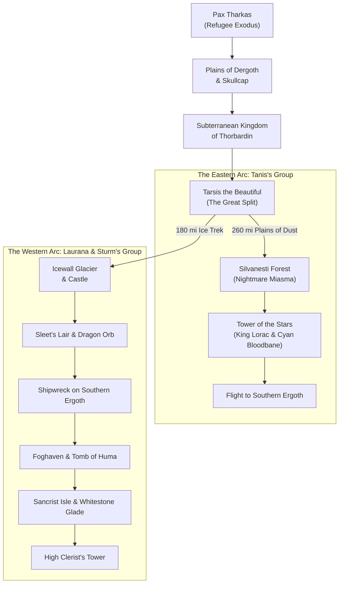

# 05: Skullcap, Thorbardin, Tarsis, Silvanesti and Icewall
*Subterranean Megastructures, The Stranded Port, The Nightmare Dreamscape & The Glacial Keep (Winter 351–352 AC)*

---

## 1. Operational Overview & The Great Party Split

Following the liberation of the refugees at Pax Tharkas, the narrative and tabletop campaigns of *Dragons of Winter Night* expand across the southern half of Ansalon. Here the party undergoes the historic **Tarsis Split** (Book 1, Chapter 8 / p. 574), dividing into two operational groups to address the "over-large party problem" of AD&D tournament play:



---

## 2. Plains of Dergoth & Skullcap (Ruins of Zhaman)

### Strategic Transit
- **Distance:** 140 miles south-southeast from Pax Tharkas across windswept volcanic badlands.
- **Environmental Hazards:** Choking ash-drifts, razor-sharp obsidian ridges, acidic sulfur springs, unexploded wild magic fallout from the Dwarfgate War (214 AC).
- **Encounter Threats:** Skeletal dwarven legions, rogue bozak draconian scouts, carrion crawler swarms.

### Tactical Cutaway: Skullcap (Ruins of the Fortress of Zhaman)
The shattered fortress of the dark arch-mage [[Fistandantilus]], blasted into the grotesque shape of a melted human skull during the magical cataclysm that ended the Dwarfgate War.

```
+===================================================================================================+
| SKULLCAP TACTICAL CUTAWAY (RUINS OF FORTRESS ZHAMAN)                                             |
+===================================================================================================+
|                                                                                                   |
|                                 [CRACKED CRANIUM DOME]                                            |
|                                           |                                                       |
|                    +----------------------+----------------------+                                |
|                    |                                             |                                |
|                    v                                             v                                |
|            [LEFT EYE SOCKET]                             [RIGHT EYE SOCKET]                       |
|          (Observation Balcony)                         (Shattered Watchpost)                      |
|                    |                                             |                                |
|                    +----------------------+----------------------+                                |
|                                           |                                                       |
|                                           v                                                       |
|                                   [JAWBONE ENTRANCE]                                              |
|                             (Drawbridge over Molten Pit)                                          |
|                                           |                                                       |
|                                           v                                                       |
|                              [LEVEL 1: SHATTERED PILLARS]                                         |
|                                   (Skeletal Guardians)                                            |
|                                           |                                                       |
|                                           v                                                       |
|                              [LEVEL 2: COLLAPSED ARCHIVES]                                        |
|                              (Fistandantilus's Spell-Safe)                                        |
|                                           |                                                       |
|                                           v                                                       |
|                              [LEVEL 3: THE BLAST FOCUS]                                           |
|                            (Pool of Solidified Black Glass)                                       |
+===================================================================================================+
```

#### 5D Sensory Pentagon: Skullcap
- **Physical Environment:** The air tastes of raw copper and burnt marrow; freezing wind howls through hollow eye-socket apertures like screaming damned souls; footing is treacherous, coated in greasy ash over brittle volcanic glass crust.
- **Behaviors:** Parties move in low crouches; cloaks pulled tight across faces to filter sulfur dust; eyes darting nervously toward the jagged obsidian teeth hanging overhead.
- **Relationships:** Deep, visceral dread among dwarves (who remember the ancestral fratricidal slaughter of Dergoth); nervous silence between Raistlin and Caramon as Raistlin touches the black stone with reverent, predatory intimacy.
- **Attitudes:** Fatalism; the suffocating dread that Fistandantilus's lingering spirit still haunts the stone, waiting to incinerate intruders.
- **Values:** Survival over plunder; avoiding any physical contact with the melted black glass.

#### Tactical Key
- **A1. The Jawbone Bridge:** A narrow spine of melted black granite spanning a 100-foot chasm filled with bubbling green mud. Crossing requires a DC 12 Dexterity (Acrobatics) check. Failing by 5 or more forces a DC 13 Strength saving throw to catch the ledge lip before plunging.
- **A2. The Hall of Shattered Pillars:** Once the grand audience hall of Zhaman. Cracked columns sculpted in the likeness of screaming dwarves support the sagging ceiling. Disturbed rubble triggers a ceiling collapse (3d6 bludgeoning damage, DC 14 Dexterity save for half) and awakens 8 Skeletal Dwarven Warriors.
- **A3. The Blast Focus:** Ground zero of Fistandantilus's magical cataclysm. A 40-foot circular basin of mirror-smooth black glass radiating necromantic evocation magic. Any arcane caster touching the glass must make a DC 15 Wisdom saving throw or experience a traumatic psychic vision of the arch-mage's final incantation.

---

## 3. Thorbardin Subterranean Pointcrawl & The Life-Tree

The subterranean realm of **Thorbardin** is an empire within a mountain, carved from the volcanic roots of the Kharolis peaks and sustaining over one hundred thousand dwarves across seven segregated clans: the noble [[Hylar]], pious [[Daewar]], paranoid [[Klar]], sinister [[Theiwar]], brooding [[Daergar]], mountain [[Neidar]], and wretched [[Aghar]] (gully dwarves).

```
+===================================================================================================+
| THORBARDIN SUBTERRANEAN POINTCRAWL NETWORK                                                        |
+===================================================================================================+
|                                                                                                   |
|                                   [NORTH GATE PLAZA]                                              |
|                                           |                                                       |
|                                           v                                                       |
|                               [HYLAR UPPER BOULEVARDS]                                            |
|                                           |                                                       |
|                  +------------------------+------------------------+                              |
|                  |                                                 |                              |
|                  v                                                 v                              |
|          [THE LIFE-TREE]                                 [COUNCIL OF THE THANES]                  |
|         (28-Tier Stalactite)                             (The Great Throne Hall)                  |
|                  |                                                 |                              |
|                  +------------------------+------------------------+                              |
|                  |                        |                        |                              |
|                  v                        v                        v                              |
|          [THEIWAR SLUM-MINES]      [SEA OF URKHAN]          [VALLEY OF THE THANES]                |
|          (Sulfur Deep-Shafts)     (Subterranean Lake)       (Tombs of Ancient Kings)              |
|                  |                                                 |                              |
|                  +------------------------+------------------------+                              |
|                                           |                                                       |
|                                           v                                                       |
|                                  [SOUTH GATE REDOUBT]                                             |
+===================================================================================================+
```

### 5D Sensory Pentagon: Thorbardin Life-Tree
- **Physical Environment:** The deafening, rhythmic clatter of ten thousand forge hammers echoing through a two-mile-high subterranean vault; air warm and humid with forge-steam, roasted cave-mushrooms, coal smoke, and sulfur slag; illumination provided by luminescent green moss beds and polished brass oil reflectors.
- **Behaviors:** Bustling multi-tiered vertical traffic along spiraling bridges; cage elevators rattling on thick iron cables; suspicious, scowling glares directed at any surface "tallfolk" walking without clan escort.
- **Relationships:** Severe clan segregation; Hylar aristocrats look down from upper balconies upon Daewar merchants; Theiwar dark dwarves skulk through lower alleys; Aghar scurry in floor-grate drainage gutters.
- **Attitudes:** Deep-seated xenophobia masking profound terror that even their ancestral mountain redoubt cannot withstand the Dragonarmies.
- **Values:** Ancestral craftsmanship, gold purity, bloodline oaths, and the sacred legend of the [[Hammer of Kharas]].

---

## 4. Tarsis the Beautiful: The Landlocked Port

Prior to the Cataclysm, **Tarsis** was the glorious mercantile jewel of the Southern Sea. When the fiery mountain struck, the ocean bed surged upward, draining the sea forty miles to the south and stranding the city's harbor in a vast, arid desert of blowing red silt.

```
+===================================================================================================+
| TARSIS URBAN TACTICAL SCHEMATIC                                                                   |
+===================================================================================================+
|                                                                                                   |
|                                    [THE DRY HARBOR]                                               |
|                       (Rotting Three-Masted Galleons Mired in Silt)                               |
|                                           ^                                                       |
|                                           |                                                       |
|                                   [HARBOR SEA-WALL]                                               |
|                             (Now an Inland Fortress Wall)                                         |
|                                           |                                                       |
|             +-----------------------------+-----------------------------+                         |
|             |                             |                             |                         |
|             v                             v                             v                         |
|      [OLD CITY RUINS]            [THE CENTRAL BAZAAR]          [GOVERNOR'S PALACE]                |
|     (Broken Colonnades)          (Spices & Draconians)         (Hall of the Guilds)               |
|             |                             |                             |                         |
|             +-----------------------------+-----------------------------+                         |
|                                           |                                                       |
|                                           v                                                       |
|                                 [THE RED DRAGON INN]                                              |
|                              (Site of the Great Collapse)                                         |
+===================================================================================================+
```

### 5D Sensory Pentagon: Tarsis the Beautiful
- **Physical Environment:** Fine, powdery red dust that settles on lips, eyelids, and velvet cloaks; the surreal sight of three-masted wooden caravels sitting upright in dried mud basins; crumbling white marble colonnades stained with desert sand; hot winds rattling dry palm fronds.
- **Behaviors:** Merchant clerks clutching leather ledger books while scurrying between shaded archways; city watchmen accepting steel coin bribes from hooded strangers; kender wandering through stranded ship hulls; draconian officers walking bazaars with arrogant impunity.
- **Relationships:** Universal paranoia; citizens whisper behind lace veils; merchants snub Solamnic knights as "troublemakers"; the corrupt Governor negotiates secret non-aggression treaties with the Dragonarmies.
- **Attitudes:** Decadent denial; the pathetic belief that if the city ignores the war and maintains commerce, the dragons will leave them in peace.
- **Values:** Cold commerce, antique maritime relics, and preserving the facade of imperial elegance.

#### Tactical Key: The Red Dragon Inn
- **B1. The Common Room:** A three-story timber-and-plaster tavern built against an ancient harbor warehouse. Massive stone hearth; dry-rotted pine support timbers.
- **B2. The Dragon Strike Trigger:** When red dragons strafe the street outside during the assault, incendiary breath sets the upper floors ablaze. The roof collapses in 3 rounds (DC 14 Dexterity save or take 4d6 fire and bludgeoning damage, trapped under burning timbers).
- **B3. The Cellar Secret Drain:** Beneath the wine casks in the south cellar lies an ancient water culvert leading into the dry harbor sewers—the escape route used by Laurana, Sturm, and the knights.

---

## 5. Silvanesti: The Nightmare Forest & Tower of the Stars

When the Dragonarmies invaded the ancient elven kingdom of **Silvanesti**, [[King Lorac Caladon]] attempted to save his people by invoking the **Dragon Orb of Silvanesti**. The potent artifact overpowered the King’s will. The green dragon [[Cyan Bloodbane]] perched behind the throne, whispering horrific hallucinations into Lorac’s mind, warping the entire forest into a living, physical nightmare.

```
+===================================================================================================+
| SILVANESTI NIGHTMARE TACTICAL TREE                                                                |
+===================================================================================================+
|                                                                                                   |
|                               [RIVER THON-THALAS BORDER]                                          |
|                         (Water Running Thick with Black Bile)                                     |
|                                           |                                                       |
|                                           v                                                       |
|                              [THE WEEPING CRYSTAL GROVE]                                          |
|                       (Trees Oozing Blood & Mocking Voices)                                       |
|                                           |                                                       |
|                                           v                                                       |
|                              [THE CHOKING ASPEN VALLEY]                                           |
|                        (Spectral Undead Elves Hanging from Vines)                                 |
|                                           |                                                       |
|                                           v                                                       |
|                              [GARDENS OF LIVING MARBLE]                                           |
|                           (Statues Clawing Out of the Mud)                                        |
|                                           |                                                       |
|                                           v                                                       |
|                              [THE TOWER OF THE STARS]                                             |
|                            (Emerald Dome & Star-Chamber)                                          |
|                                           |                                                       |
|                                           v                                                       |
|                             [THRONE OF THE SPEAKER]                                               |
|                 (Lorac Bound by Vines; Cyan Bloodbane Coiled Behind)                              |
+===================================================================================================+
```

### 5D Sensory Pentagon: Silvanesti
- **Physical Environment:** Living trees that moan and bleed thick arterial blood when touched; bark that resembles bruised, rotting human skin; soil spongy, hot, and pulsating like gangrenous flesh; the River Thon-Thalas running viscous and pitch-black; unnatural emerald twilight with no sun, moon, or stars visible.
- **Behaviors:** Companions walking with drawn weapons; holding perfumed rags over noses to avoid inhaling hallucinatory fungal spores; shielding eyes from writhing shadow-tentacles.
- **Relationships:** Total psychic alienation; dream-whispers turn comrades against one another; characters witness horrific phantasms of their friends dying or committing atrocities.
- **Attitudes:** Paralyzing existential despair; the conviction that beauty and goodness have been eradicated from Krynn.
- **Values:** Clinging to waking consciousness; preserving personal memories against dream-distortion.

#### Tactical Key: The Tower of the Stars
- **C1. The Shimmering Gateway:** Fluted marble columns wrapped in barbed briars that lash out at intruders (Attack +6, 1d8+2 piercing plus DC 13 Constitution save or poisoned).
- **C2. The Hall of the Ancients:** Mirrored walls that project the viewer's deepest guilt. Characters must succeed on a DC 14 Wisdom saving throw or suffer the effects of a *Phantasmal Killer* spell.
- **C3. The Emerald Throne:** King Lorac sits upon a dais of twisted beryl, his hands physically fused to the pulsing green Dragon Orb. Coiled behind him in the shadows is **Cyan Bloodbane**, whose breath fills the dome with toxic hallucination clouds.

---

## 6. Icewall Castle Submap

Located in the desolate Southern Ice Reaches, **Icewall Castle** is a crystalline fortress carved directly out of an ancient glacier. Commanded by the White Dragon Highlord [[Feal-Thas]], the castle guards the second recovered **Dragon Orb**.

```
+===================================================================================================+
| ICEWALL CASTLE TACTICAL PROFILE                                                                   |
+===================================================================================================+
|                                                                                                   |
|                               [GLACIAL ABYSS & CHASM BRIDGE]                                      |
|                                (Slick Ice Span over 300-ft Drop)                                  |
|                                               |                                                   |
|                                               v                                                   |
|                                [OUTER COURTYARD OF BLUE ICE]                                      |
|                                  (Ice Bears & Thanoi Guards)                                      |
|                                               |                                                   |
|                      +------------------------+------------------------+                          |
|                      |                                                 |                          |
|                      v                                                 v                          |
|             [FEAL-THAS'S SANCTUM]                             [MINARETS OF FROST]                 |
|           (Throne of White Fur & Magic)                     (White Dragon Watchposts)             |
|                      |                                                 |                          |
|                      +------------------------+------------------------+                          |
|                                               |                                                   |
|                                               v                                                   |
|                                      [THE GLACIAL CHUTE]                                          |
|                                 (Vertical Shaft to Dragon Cave)                                   |
|                                               |                                                   |
|                                               v                                                   |
|                                    [SLEET'S DRAGON CAVERN]                                        |
|                               (Vault of the Icewall Dragon Orb)                                   |
+===================================================================================================+
```

### 5D Sensory Pentagon: Icewall Castle
- **Physical Environment:** Translucent blue-green walls of solid glacial ice reflecting torchlight like faceted diamonds; sub-zero howling gales threatening to tear climbers from parapets; air reeking of seal blubber, wolf musk, and ozone.
- **Behaviors:** Shivering uncontrollably; breath pluming in thick white clouds; crampons scraping into hard blue ice; testing handholds on sub-zero stone.
- **Relationships:** Predatory dominion; Feal-Thas rules through magical dominance over the brutish walrus-folk ([[Thanoi]]); winter wolves obey his telepathic thoughts.
- **Attitudes:** Ruthless arctic survivalism; cold contempt for northern invaders.
- **Values:** Raw physical endurance; mastery over winter beasts; safeguarding the Dragon Orb.

#### Tactical Key
- **D1. The Ice Span:** A 60-foot natural ice bridge over a glacial crevasse. Coated in black ice (DC 13 Dexterity (Acrobatics) check at half speed). Crosswinds force a DC 12 Strength saving throw every 20 feet or be knocked prone.
- **D2. The Wolf Sanctum:** Feal-Thas's private audience chamber lined with white bear pelts. A magical brazier burns with heatless blue flame. Four Winter Wolves guard the Highlord.
- **D3. Sleet's Dragon Cavern:** Located 100 feet beneath the keep in a natural ice cave. Home to [[Sleet]], the ancient white dragon. Detonating sonic spells (*Shatter*) triggers ceiling icicle drops dealing 3d6 piercing damage in a 20-foot radius.

---

## 7. Cross-Vault Entity & Topic Links

- **Dramatis Personae & Highlords:**
  - [[02_Dramatis_Personae_and_Companions/01_Heroes_of_the_Lance_Core_Eight|Tanis, Laurana, Sturm & Raistlin]]
  - [[02_Dramatis_Personae_and_Companions/03_Dragon_Highlords_and_Dark_Commanders|Highlord Feal-Thas & Emperor Ariakas]]
  - [[02_Dramatis_Personae_and_Companions/04_Archmages_Monarchs_and_Council_Leaders|King Lorac Caladon & Arman Kharas]]
- **Named Dragons & Bestiary:**
  - [[04_Bestiary_and_Encounter_Ecology/02_Dragons_of_Krynn_and_Aerial_Combat|Cyan Bloodbane & Sleet]]
  - [[04_Bestiary_and_Encounter_Ecology/03_Undead_Monstrosities_and_Regional_Encounter_Tables|Thanoi Walrus-Folk & Skeletal Dwarves]]
- **Artifacts & Relics:**
  - [[05_Relics_Economy_and_Magic_Systems/03_Legendary_Relics_Steel_Economy_and_Supply_Chains|The Dragon Orbs & Hammer of Kharas]]
- **Next Tactical Submap:**
  - [[03_Atlas_Corridors_and_Tactical_Submaps/06_Ergoth_High_Clerists_Tower_Istar_and_Temple_of_Neraka|06: Ergoth, High Clerist's Tower, Istar & Temple of Neraka]]
