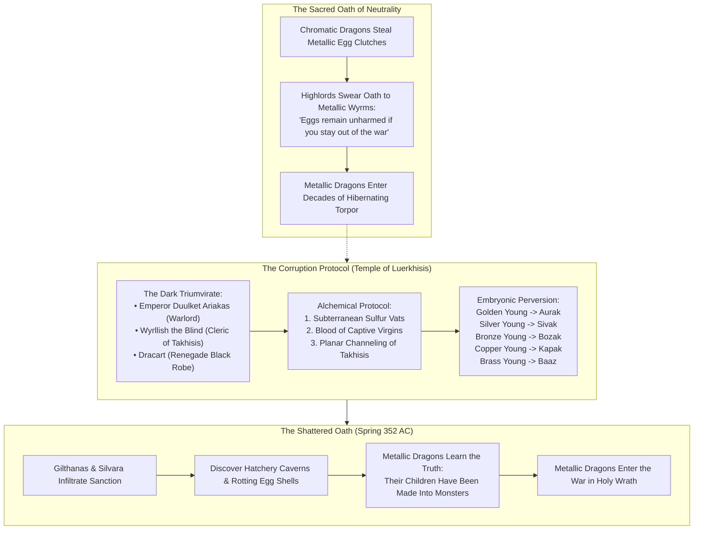

# Draconians of Krynn: Corruption Lore, Tactical Profiles & Death-Throes
*The Chronicles of Krynn: Master Lore Vault — Volume 04: Bestiary & Encounter Ecology*

---

## 1. Executive Summary: The Ultimate Abomination of the War

Draconians represent the monstrous biological cornerstone of the [[Dragonarmies of Takhisis]]. Created through dark alchemical and necromantic corruption inflicted upon the stolen eggs of good metallic dragons, draconians bridge the gap between humanoids and dragons. They possess reptilian snouts, leathery vestigial or functional wings, three-toed taloned feet, and absolute biological loyalty to the Dragon Highlords.

Their most terrifying feature is their **Death-Throe Reaction**: when a draconian's physical hit points reach zero, the unstable magical enchantments sustaining its life violently collapse, turning the dying creature into a lethal posthumous hazard.

```
                    [THE DRACONIAN CORRUPTION TAXONOMY]
┌─────────┬──────────────┬────────────┬──────┬──────────────────────────────────────────────────┐
│ BREED   │ PROGENITOR   │ ROLE       │ CR   │ DEATH-THROE MECHANISM                            │
├─────────┼──────────────┼────────────┼──────┼──────────────────────────────────────────────────┤
│ Baaz    │ Brass Dragon │ Line Foot  │ 1    │ Turns to solid stone; traps killing weapon;      │
│         │              │ Chaff      │      │ crumbles to harmless dust in 1d4 rounds.         │
├─────────┼──────────────┼────────────┼──────┼──────────────────────────────────────────────────┤
│ Kapak   │ Copper       │ Assassin & │ 2    │ Paralyzing venom saliva; body dissolves into a   │
│         │ Dragon       │ Skirmisher │      │ 10-ft pool of 3d6 caustic acid; corrodes steel.  │
├─────────┼──────────────┼────────────┼──────┼──────────────────────────────────────────────────┤
│ Bozak   │ Bronze       │ Spellcaster│ 4    │ Flesh burns away leaving skeleton for 1 round;   │
│         │ Dragon       │ & Officer  │      │ detonates in 10-ft radius bone-shrapnel blast.   │
├─────────┼──────────────┼────────────┼──────┼──────────────────────────────────────────────────┤
│ Sivak   │ Silver       │ Infiltrator│ 5    │ True flight; doppelgänger mimicry of slayer for  │
│         │ Dragon       │ & Elite    │      │ 3 days, or explodes in white flame if large foe. │
├─────────┼──────────────┼────────────┼──────┼──────────────────────────────────────────────────┤
│ Aurak   │ Gold Dragon  │ Sorcerer   │ 8    │ Two-phase death: 1d4 rounds berserk energy form, │
│         │              │ Inquisitor │      │ followed by a 20-ft sulfurous 8d6 fireball blast.│
└─────────┴──────────────┴────────────┴──────┴──────────────────────────────────────────────────┘
```

---

## 2. The Sanction Corruption Protocol & The Broken Oath



### The Alchemical Mechanics of Perversion
In the volcanic bowels beneath the **Temple of Luerkhisis** in [[Sanction]], the dark triumvirate—[[Emperor Ariakas]], the blind dark cleric [[Wyrllish]], and the renegade archmage [[Dracart]]—developed the foul ritual:
1. **The Stolen Clutches:** During the Age of Despair, chromatic dragons infiltrated the remote nesting peaks of the Dragon Isles, carrying off thousands of dormant metallic dragon eggs.
2. **The Incubation Vats:** Eggs were suspended in geothermal sulfur pools infused with necrotic salts, unholy water, and dragon-blood harvested from slaughtered metallic wyrms.
3. **The Divine Curse:** Clerics of Takhisis chanted continuous unholy litanies to smother the celestial spirits within the embryos, corrupting the noble metallic essence into twisted, bipedal humanoid mockeries.
4. **The Broken Oath of Neutrality:** To prevent the Good Dragons from defending Ansalon, the Dark Queen swore that the eggs would be returned unharmed if the metallic dragons refrained from entering the conflict. When [[Gilthanas]] and the silver dragon [[Silvara]] infiltrated Sanction in *Dragons of Spring Dawning* and uncovered the butchered eggshells, the Oath was shattered, unleashing the metallic dragons upon the Dragonarmies in incandescent fury.

---

## 3. Comprehensive Tactical Combat Profiles & Death-Throes

---

### 3.1 Baaz Draconian (Common Line Infantry)
*Origin: Corrupted Brass Dragon Eggs*  
*Medium Humanoid (Draconian), Lawful Evil*

```
Armor Class: 16 (Natural Armor + Bronze Breastplate)
Hit Points: 26 (3d10 + 9)
Speed: 30 ft., glide 60 ft. (cannot ascend)
STR: 15 (+2) | DEX: 12 (+1) | CON: 16 (+3) | INT: 9 (-1) | WIS: 10 (+0) | CHA: 8 (-1)
Saving Throws: Con +5
Damage Resistances: Poison, Cold
Condition Immunities: Paralyzed, Poisoned
Senses: Darkvision 60 ft., Passive Perception 10
Languages: Common, Draconic, Nerakan
Challenge: 1 (200 XP) | Proficiency Bonus: +2
```

- **Gliding Wings:** When falling from any height, a Baaz can spread its leathery wings to glide 60 feet for every 10 feet of descent, taking zero falling damage. It cannot achieve sustained upward flight.
- **Urban Disguise:** Standing between 5'4" and 5'8", Baaz frequently wear heavy woolen travelers' cloaks and deep hoods to conceal their snouts, clawed fingers, and tucked wings, passing as stocky humans in frontier towns like Solace.
- **Actions:**
  - *Multiattack:* The Baaz makes two melee attacks: one with its curved shortsword and one with its bite or claws.
  - *Curved Shortsword:* Melee Weapon Attack: +4 to hit, reach 5 ft., one target. Hit: 6 (1d6 + 3) slashing damage.
  - *Bite / Claw:* Melee Weapon Attack: +4 to hit, reach 5 ft., one target. Hit: 4 (1d4 + 2) piercing or slashing damage.
- **Death-Throe Reaction (Stone Calcification & Weapon Trap):**
  - When reduced to 0 Hit Points, a Baaz does not drop unconscious. Its scaly flesh instantly petrifies into solid granite in the exact position it was struck.
  - If the killing blow was dealt with a piercing or slashing melee weapon, the attacker must succeed on a **DC 13 Dexterity saving throw** or the weapon becomes hopelessly wedged within the stony corpse. A wedged weapon cannot be extracted while the stone persists; attempting to pry it free requires a DC 15 Strength check or the weapon snaps.
  - The stone corpse remains impervious to all damage for **1d4 rounds**, after which it crumbles into a harmless pile of dry gray ash, releasing any trapped weapons.

---

### 3.2 Kapak Draconian (Assassin & Ambush Skirmisher)
*Origin: Corrupted Copper Dragon Eggs*  
*Medium Humanoid (Draconian), Lawful Evil*

```
Armor Class: 15 (Natural Armor + Studded Leather)
Hit Points: 38 (5d10 + 10)
Speed: 30 ft., glide 60 ft.
STR: 14 (+2) | DEX: 16 (+3) | CON: 14 (+2) | INT: 11 (+0) | WIS: 12 (+1) | CHA: 9 (-1)
Saving Throws: Dex +5
Skills: Stealth +5, Perception +3, Acrobatics +5
Damage Resistances: Acid, Poison
Condition Immunities: Paralyzed, Poisoned
Senses: Darkvision 60 ft., Passive Perception 13
Languages: Common, Draconic, Goblin
Challenge: 2 (450 XP) | Proficiency Bonus: +2
```

- **Paralyzing Saliva:** Glands in a Kapak's throat secrete virulent, viscous saliva. As a bonus action, a Kapak can lick its blade or arrowheads, coating them in venom. The venom remains active for 1 minute or until an attack hits.
  - *Paralyzing Strike:* A creature struck by a venom-coated attack must succeed on a **DC 13 Constitution saving throw** or become **Paralyzed** for 1 minute. The target may repeat the saving throw at the end of each of its turns, ending the paralysis on a success.
- **Actions:**
  - *Multiattack:* The Kapak makes two attacks: two with its shortsword, or two with its recurve shortbow.
  - *Venomous Shortsword:* Melee Weapon Attack: +5 to hit, reach 5 ft., one target. Hit: 6 (1d6 + 3) piercing damage plus Paralyzing Saliva.
  - *Recurve Shortbow:* Ranged Weapon Attack: +5 to hit, range 80/320 ft., one target. Hit: 6 (1d6 + 3) piercing damage plus Paralyzing Saliva.
- **Death-Throe Reaction (Caustic Acid Pool):**
  - Upon reaching 0 Hit Points, the Kapak's flesh instantly liquifies into an expanding 10-foot radius puddle of boiling green acid centered on its corpse.
  - Any creature standing in the puddle or entering it before the end of the next round takes **10 (3d6) acid damage** (DC 13 Dexterity save for half).
  - Non-magical metal armor and weapons caught in the acid suffer a permanent -1 penalty to AC or damage rolls; mundane boots and wooden gear dissolve completely. The acid evaporates into foul yellow sulfur steam after 1 minute.

---

### 3.3 Bozak Draconian (Spellcaster Officer & Combat Mage)
*Origin: Corrupted Bronze Dragon Eggs*  
*Medium Humanoid (Draconian), Lawful Evil*

```
Armor Class: 16 (Natural Armor)
Hit Points: 52 (8d8 + 16)
Speed: 30 ft., glide 60 ft.
STR: 14 (+2) | DEX: 14 (+2) | CON: 14 (+2) | INT: 15 (+2) | WIS: 13 (+1) | CHA: 12 (+1)
Saving Throws: Int +4, Wis +3, Con +4
Skills: Arcana +4, Perception +3, Intimidation +3
Damage Resistances: Lightning, Poison
Condition Immunities: Charmed, Poisoned
Senses: Darkvision 60 ft., Passive Perception 13
Languages: Common, Draconic, Nerakan, Magius-Runes
Challenge: 4 (1,100 XP) | Proficiency Bonus: +2
```

- **Arcane Spellcasting:** 4th-level caster (Spell Save DC 13, +5 to hit with spell attacks). Known spells:
  - *Cantrips (at will):* *Shocking Grasp*, *Ray of Frost*, *Blade Ward*.
  - *1st Level (4 slots):* *Magic Missile*, *Shield*, *Thunderwave*, *Burning Hands*.
  - *2nd Level (3 slots):* *Web*, *Scorching Ray*, *Hold Person*.
- **Actions:**
  - *Multiattack:* The Bozak makes two melee attacks: one with its scimitar and one with its bite.
  - *Scimitar:* Melee Weapon Attack: +4 to hit, reach 5 ft., one target. Hit: 5 (1d6 + 2) slashing damage.
  - *Bite:* Melee Weapon Attack: +4 to hit, reach 5 ft., one target. Hit: 4 (1d4 + 2) piercing damage.
- **Death-Throe Reaction (Concussive Bone Shrapnel Detonation):**
  - When reduced to 0 Hit Points, the Bozak's scaly flesh withers and burns away in a flash of electric blue flame, leaving only its bare skeleton.
  - The skeleton stands motionless (often continuing to laugh silently) for **1 round**.
  - At the start of its next initiative count, the skeleton **violently detonates** in a shockwave of razor-sharp bone fragments. Every creature within a **10-foot radius** must make a **DC 14 Dexterity saving throw**, taking **14 (4d6) piercing and force damage** on a failure, or half on a success.

---

### 3.4 Sivak Draconian (Elite Infiltrator & Heavy Airborne Shock)
*Origin: Corrupted Silver Dragon Eggs*  
*Large Humanoid (Draconian), Lawful Evil*

```
Armor Class: 17 (Natural Armor, Heavy Scale)
Hit Points: 68 (8d10 + 24)
Speed: 30 ft., fly 60 ft. (muscular wings capable of true flight)
STR: 18 (+4) | DEX: 15 (+2) | CON: 16 (+3) | INT: 12 (+1) | WIS: 11 (+0) | CHA: 13 (+1)
Saving Throws: Str +7, Con +6, Wis +3
Skills: Stealth +6, Deception +5, Athletics +7
Damage Immunities: Cold
Damage Resistances: Poison
Condition Immunities: Paralyzed, Poisoned
Senses: Darkvision 60 ft., Passive Perception 12
Languages: Common, Draconic, Solamnic, Elven
Challenge: 5 (1,800 XP) | Proficiency Bonus: +3
```

- **True Flight:** Unlike lower draconians, Sivaks possess muscular bat-wings allowing sustained aerial ascent, diving maneuvers, and aerial dogfighting.
- **Infiltration Shapechange:** A Sivak can magically assume the physical form and voice of any Medium humanoid it has personally slain within the last 24 hours, gaining surface memories and deceiving intimate comrades.
- **Actions:**
  - *Multiattack:* The Sivak makes three attacks: two with its greatsword and one with its barbed tail, or two claws and one bite.
  - *Greatsword:* Melee Weapon Attack: +7 to hit, reach 5 ft., one target. Hit: 11 (2d6 + 4) slashing damage.
  - *Barbed Tail:* Melee Weapon Attack: +7 to hit, reach 10 ft., one target. Hit: 8 (1d8 + 4) piercing damage, and the target must succeed on a DC 15 Strength save or be knocked prone.
- **Death-Throe Reaction (Doppelgänger Mimicry vs. Fire Burst):**
  - *If slain by a creature of equal or smaller size:* The Sivak's dying corpse instantly polymorphs into the exact physical likeness of its slayer. It remains in this form for **3 days**, inflicting psychological grief and confusion upon allies, before decomposing into a heap of black soot.
  - *If slain by a larger creature or by area magic:* The corpse instantly bursts into blinding white heat, dealing **7 (2d6) fire damage** to all creatures within 5 feet before vanishing into ash.

---

### 3.5 Aurak Draconian (Sorcerer-Inquisitor & Royal Overlord)
*Origin: Corrupted Gold Dragon Eggs*  
*Medium Humanoid (Draconian), Lawful Evil*

```
Armor Class: 19 (Natural Armor + Mystic Shroud)
Hit Points: 85 (10d8 + 40)
Speed: 30 ft. (Wingless; possesses at-will Dimension Door)
STR: 14 (+2) | DEX: 16 (+3) | CON: 18 (+4) | INT: 18 (+4) | WIS: 16 (+3) | CHA: 17 (+3)
Saving Throws: Dex +6, Int +7, Wis +6, Cha +6
Skills: Arcana +7, Perception +6, Insight +6, Deception +6
Damage Resistances: Fire, Cold, Lightning; Bludgeoning, Piercing, and Slashing from Non-Magical Attacks
Condition Immunities: Charmed, Frightened, Paralyzed, Poisoned
Senses: True Seeing 60 ft., Darkvision 120 ft., Passive Perception 16
Languages: Common, Draconic, Nerakan, Solamnic, Magius-Runes
Challenge: 8 (3,900 XP) | Proficiency Bonus: +3
```

- **Innate Sorcery:** Spell Save DC 15, +7 to hit with spell attacks.
  - *At Will:* *Disguise Self*, *Detect Magic*, *Invisibility*, *Dimension Door*.
  - *3/Day Each:* *Lightning Bolt* (8d6), *Suggestion*, *Hold Person*.
  - *1/Day Each:* *Dominate Person*, *Wall of Fire*, *Mind Blank*.
- **Actions:**
  - *Energy Blast:* Ranged Spell Attack: +7 to hit, range 90 ft., one target. Hit: 13 (2d8 + 4) force damage.
  - *Noxious Gas Breath (Recharge 5–6):* Exhales a 20-foot cloud of blinding sulfur gas. DC 15 Con save or blinded and poisoned for 1 minute.
- **Death-Throe Reaction (Two-Phase Berserk Immolation & Blast):**
  - **Phase 1 (The Berserk Energy Frenzy):** Upon reaching 0 Hit Points, the Aurak does NOT die. Its golden scales turn blinding white-hot. For **1d4 rounds**, it enters an invincible berserk frenzy: its speed increases to 40 ft., it gains advantage on all attacks (2 claws at +7, 1d8+2 slashing + 2d6 fire), and it is **completely immune to all physical damage and spells below 4th level**.
  - **Phase 2 (The Cataclysmic Detonation):** At the end of the final berserk round, the Aurak's body implodes into its chest and **explodes in a 20-foot radius sphere of unholy fire**. All creatures in the area must make a **DC 16 Dexterity saving throw**, taking **28 (8d6) fire damage** on a failure, or half on a success. All non-magical items in the blast radius are vaporized, leaving a circle of blackened, smoking volcanic glass.

---

## 4. Tabletop Encounter Architecture: Combined-Arms Draconian Formations

When deploying Draconians in D&D campaign encounters, game masters should avoid fielding monolithic units of a single breed. The Dragonarmies achieve victory through **layered tactical synergy**:

```
                              [AURAK INQUISITOR]
                         (Overlord / Arcane Artillery)
                                      │
              ┌───────────────────────┴───────────────────────┐
              ▼                                               ▼
       [BOZAK SQUAD]                                   [SIVAK CADRE]
    (Mid-Line Fire Support)                       (Airborne Flank / Snatch)
              │                                               │
              └───────────────────────┬───────────────────────┘
                                      ▼
                               [BAAZ PHALANX]
                       (Frontline Interlocking Shields)
                                      ▲
                                      │ (Concealed Infiltration)
                               [KAPAK AMBUSH]
```

1. **The Shield Trap (Baaz + Bozak):** Baaz form a heavy bronze shield wall to pin adventurers. When an adventurer strikes down a Baaz and has their sword trapped in stone, a Bozak immediately targets the disarmed fighter with *Scorching Ray* or *Web*.
2. **The Venom Funnel (Kapak + Sivak):** Kapaks coat arrows with paralyzing saliva, firing from dense brush to incapacitate the party's barbarian or fighter. Airborne Sivaks dive from tree canopies to snatch the paralyzed victim into the air.
3. **The Suicide Room (Aurak Detonation):** In tight dungeon corridors, an Aurak at 0 HP does not flee; it sprints toward the center of the party, using its berserk immunity rounds to grapple spellcasters and hold them within its upcoming 20-foot detonation radius.
