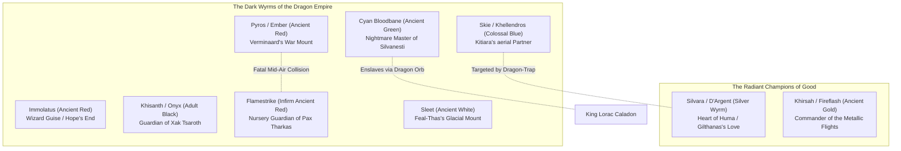

# Dragons of Krynn: Named Dossiers, Dogfight Rules & Dragon-Traps
*The Chronicles of Krynn: Master Lore Vault — Volume 04: Bestiary & Encounter Ecology*

---

## 1. Executive Summary: The Re-Awakening of the Wyrms

For more than a thousand years following the Third Dragon War and the sacrifice of [[Huma Dragonbane]], the dragons of Krynn were believed to be mythical nursery tales. Their return in 351 AC shattered continental civilizations, transforming warfare from ground-based feudal skirmishes into high-velocity three-dimensional aerial destruction.

```
                    [THE COSMIC DRACONIC BALANCE]
┌──────────────┬──────────────┬────────────────────────┬────────────────────────┐
│ FACTION      │ BREEDS       │ PATRON DIETY           │ PRIMARY WAR WEAPONS    │
├──────────────┼──────────────┼────────────────────────┼────────────────────────┤
│ Chromatic    │ Red, Blue,   │ Takhisis               │ Elemental Breath       │
│ Dragons      │ Green, Black,│ (Queen of Darkness)    │ Weapons, Dragonfear,   │
│              │ White        │                        │ Aerial Terror Strafing │
├──────────────┼──────────────┼────────────────────────┼────────────────────────┤
│ Metallic     │ Gold, Silver,│ Paladine               │ Dual Breath Weapons,   │
│ Dragons      │ Bronze,      │ (The Platinum Dragon)  │ True Dragonlances,     │
│              │ Copper, Brass│                        │ Radiant Wrath          │
└──────────────┴──────────────┴────────────────────────┴────────────────────────┘
```

---

## 2. Dossiers of the Legendary Named Dragons



---

### 2.1 Immolatus (The Cunning Wyrm of Hope's End)
- **Species:** Ancient Male Red Dragon | **Alignment:** Chaotic Evil
- **Armor Class:** 22 (Natural) / 15 (*Mage Armor* in Human Form) | **Hit Points:** 350
- **The Wizard Polymorph:** Immolatus operates covertly under the guise of an emaciated, red-robed human warmage. In human form, his skin displays an orange-red sheen, his pupils are fiery vertical slits, and his features appear blurred to magical sight (such as Raistlin's hourglass eyes). Expanding to true Gargantuan dragon size in confined tunnels deals $4d10$ bludgeoning damage to surrounding stone, risking cave-ins.
- **The Magius Scar:** Wounded during the Third Dragon War by the archmage [[Magius]], when Immolatus takes radiant or force damage from the [[Staff of Magius]] or a [[Dragonlance]], his flying speed is halved and he cannot take legendary actions until the end of his next turn.
- **Tactical Role:** Infiltrated [[Commander Kholos]]'s camp outside Hope's End to locate and incinerate the hidden clutch of metallic dragon eggs before they could be corrupted into Draconians.

---

### 2.2 Khisanth (Onyx of Sunken Xak Tsaroth)
- **Species:** Adult Female Black Dragon | **Alignment:** Chaotic Evil
- **Armor Class:** 19 | **Hit Points:** 195 | **Speed:** 40 ft., fly 80 ft., swim 40 ft.
- **Habitat & Tactics:** Dwells in the submerged, flooded throne room of [[Xak Tsaroth]], guarding the [[Disks of Mishakal]]. Khisanth never engages in fair dry-land combat; she submerges in pitch-black acidic water, utilizing Blindsight (60 ft) to track adventurers before surfacing suddenly to loose a **60-foot line of corrosive acid (12d8 damage)**.
- **Fatal Vulnerability:** Intense draconic arrogance and vanity regarding her treasure hoard. Direct radiant power channeled through ancient divine artifacts (the [[Blue Crystal Staff]]) overloads her draconic resistance, triggering explosive internal combustion that topples the subterranean temple.

---

### 2.3 Pyros (Ember — The Crimson Terror of Abanasinia)
- **Species:** Ancient Male Red Dragon | **Alignment:** Chaotic Evil
- **Armor Class:** 22 | **Hit Points:** 444 | **Challenge:** 20 (25,000 XP)
- **War Mount of Verminaard:** Serves as the aerial command platform and executioner for [[Highlord Verminaard]]. Communicates telepathically with his rider, coordinating high-altitude bombing runs with ground-level Draconian phalanxes.
- **Fire Breath:** Exhales a devastating **90-foot cone of fire (22d6 damage)**, capable of incinerating wooden bridges, siege engines, and stone parapets into molten slag in a single pass.

---

### 2.4 Flamestrike (The Mad Mother of Pax Tharkas)
- **Species:** Infirm Ancient Female Red Dragon | **Alignment:** Chaotic Evil (Maternally Insane)
- **Armor Class:** 18 (Cataract-filmed eyes, weathered scales) | **Hit Points:** 210
- **The Nursery Psychosis:** Tasked with guarding the 250 captive human children in the lower vaults of [[Pax Tharkas]], Flamestrike's senile mind broke: she genuinely believes the human children are her own unhatched wyrmlings.
- **The Suicidal Interception:** When Verminaard orders Pyros to firebomb the escaping refugee columns in the fortress courtyard, Flamestrike's maternal instinct snaps. She hurls herself into the sky, blinds Pyros with her talons, and locks jaws with the greater wyrm. Both ancient dragons tumble from the clouds into the courtyard stones in a fatal double-immolation that secures the escape of the refugees.

---

### 2.5 Cyan Bloodbane (The Nightmare Wyrm of Silvanesti)
- **Species:** Ancient Male Green Dragon | **Alignment:** Neutral Evil
- **Armor Class:** 21 | **Hit Points:** 297 | **Challenge:** 18 (20,000 XP)
- **The Dream Engine:** Dwells coiled around the crystal spire of the Tower of the Stars in [[Silvanesti]]. Cyan does not rule by physical force alone; he captured the mind of King [[Lorac Caladon]] through a corrupted [[Dragon Orb]].
- **Phantasmal Master:** In Silvanesti, Cyan’s illusions possess deadly biological reality. His breath weapon is a **90-foot cone of chlorine poison gas (16d6 damage)**, complemented by lair actions that force all creatures within 60 feet into their worst personal nightmares ($4d10$ psychic damage and stun).

---

### 2.6 Sleet (The White Terror of Icewall)
- **Species:** Ancient Female White Dragon | **Alignment:** Chaotic Evil
- **Armor Class:** 19 | **Hit Points:** 210 | **Speed:** 40 ft., burrow 30 ft., fly 80 ft.
- **Glacial Dominance:** War mount of the dark elf [[Highlord Feal-Thas]] at [[Icewall Castle]]. Master of sub-zero aerial combat; uses blinding blizzard whiteouts to disorient foes before diving with a **60-foot cone of freezing cold (12d8 damage)**.

---

### 2.7 Skie (Khellendros — The Colossal Blue)
- **Species:** Ancient Male Blue Dragon | **Alignment:** Lawful Evil
- **Armor Class:** 22 | **Hit Points:** 332 | **Challenge:** 21 (33,000 XP)
- **The Highlord's Partner:** The devoted mount and strategic partner of [[Dragon Highlord Kitiara uth Matar]]. Skie possesses genius-level intellect and tactical discipline.
- **Lightning Trajectory:** Discharges a **120-foot line of concentrated lightning (16d10 damage)**. When flying in three-dragon wedge formations, three blue dragons release simultaneous overlapping bolts to disintegrate fortress stone.

---

### 2.8 Silvara (D'Argent — The Silver Dragon of the Secret Heart)
- **Species:** Adult Female Silver Dragon | **Alignment:** Lawful Good
- **Guise of the Wild Elf:** Appears as a slender, silver-haired [[Kagonesti]] maiden living in the enchanted vale of [[Foghaven]] on Southern Ergoth.
- **The Legacy of Huma:** Sister to [[Gwynevere]], the legendary silver dragon who loved Huma Dragonbane. Silvara falls in love with [[Gilthanas]], guiding him into the depths of Sanction to reveal the dark secret of Draconian egg-corruption.
- **Combat Prowess:** Combines a **90-foot cone of cold (15d6 damage)** with a **90-foot cone of paralyzing gas (DC 18 Con save)**, fighting with selfless devotion to protect mortal riders.

---

### 2.9 Khirsah (Fireflash — Sovereign of the Golden Flight)
- **Species:** Ancient Male Gold Dragon | **Alignment:** Lawful Good
- **Supreme Commander:** The chosen champion of [[Paladine]] who leads the metallic flight when the Oath of Neutrality is broken.
- **Breath Weapons:** A blistering **90-foot cone of radiant fire (18d6 damage)** and a **90-foot cone of weakening gas** (DC 20 Strength save or target's Strength score is halved for 1 minute). Khirsah coordinates high-altitude metallic squadrons armed with true [[Dragonlances]].

---

## 3. 3D Aerial Dogfight Mechanics & Dragonlance Dogfights

Aerial combat during the War of the Lance takes place across four discrete **Altitude Bands**, each imposing distinct tactical opportunities and environmental hazards:

```
                          [ HIGH ALTITUDE: SKY CEILING ]
                           (Above Cloud Cover / 5,000+ ft)
                           • Dive Attacks gain Advantage
                           • Breath Weapons gain +10-ft range
                                         │
                                         ▼
                         [ MID ALTITUDE: DOGFIGHT ZONE ]
                            (1,000 ft to 5,000 ft)
                           • Standard Engagement Band
                           • Dragonlance Mounted Charges
                           • Squadron Wing-Formations
                                         │
                                         ▼
                         [ LOW ALTITUDE: ROOFTOP BAND ]
                             (50 ft to 1,000 ft)
                           • Ground-Strafing & Defilade
                           • Ballista & Archer Threat Zone
                           • Building Collision Hazards
                                         │
                                         ▼
                         [ SUB-SURFACE / CRASH ZONE ]
                           • 1d6 Bludgeoning per 10-ft fall
                           • Wing-Snapping Impact
```

### 3.1 The Mounted Dragonlance Charge Engine
- **Weapon Classification:**
  - *Footman’s Dragonlance:* 8 feet long, usable on foot; deals $1d10 + 3$ piercing damage ($3d10$ against dragons).
  - *Mounted Dragonlance:* 16 to 20 feet long, locked into a specialized swivel saddle-socket; deals $3d12 + \text{Strength}$ piercing damage.
- **The 60-Foot Velocity Multiplier:** When a rider on dragonback charges at least 60 feet in a straight line before impacting an enemy dragon, the lance deals **triple damage ($9d12 + \text{Strength}$)**.
- **Wing-Pinning Strike:** A dragon struck by a mounted charge must make a **DC 18 Constitution saving throw** or have its wing membrane torn or pinned, causing it to stall and immediately plunge 300 feet toward the ground.
- **Saddle-Throw Hazard:** If a dragon-rider takes more than 30 points of damage in a single round from dragon breath or claw rakes, they must succeed on a **DC 16 Dexterity (Acrobatics) check** or be unhorsed from the saddle, tumbling into free fall.

---

## 4. The High Clerist's Dragon-Trap Physics Engine

Engineered during the Age of Might by Solamnic architectural savants, the subterranean funnels beneath the [[High Clerist's Tower]] represent an ingenious, non-magical kinetic meat-grinder designed to destroy chromatic dragons with mathematical certainty.

```
                      [THE DRAGON-TRAP KINETIC MATRIX]

                         [CHUTE APERTURE: 25-FT BORE]
                       (Dragon Orb Compels Violent Dive)
                                     │
                                     ▼
                        [ACCELERATION FUNNEL CHUTE]
                       (60-Degree Slope / Polished Stone)
                       • Wings forced shut against flanks
                       • Frictionless momentum buildup
                       • Exit speed: 120 ft / round
                                     │
                                     ▼
                         [THE IMPACT TERMINUS ROOM]
                        (Reinforced Granite Sockets)
                       • 6 Braced Footman's Dragonlances
                       • Kinetic Mass Multiplier: x3
                       • Total Terminal Damage: 270+ HP
```

### Mechanical Sequence of the Funnel Trap
1. **The Telepathic Lure:** When the [[Dragon Orb of the High Clerist's Tower]] is activated within the central sanctuary, chromatic dragons within a 20-mile radius must make a **DC 18 Wisdom saving throw** or succumb to uncontrollable draconic madness, compelling them to dive into the fortress interior.
2. **Aerodynamic Constriction:** A mature dragon possesses a wingspan of 60 to 80 feet. The entrance chutes are exactly 25 feet wide. To enter, the dragon must fold its wings completely flat against its body.
3. **The Frictionless Chute:** The chute is paved with polished, oiled granite sloped at a continuous 60-degree decline. Once a dragon enters, it cannot brake with claws or tail. Terminal velocity reaches 120 feet per round.
4. **The Impact Terminus:** At the bottom of the chute, heavy **Footman's Dragonlances** are anchored into reinforced bedrock sockets angled directly upward into the tunnel mouth:
   - *Attack Roll:* Automatic hit against any falling wyrm.
   - *Damage Formula:* Standard lance damage ($3d10 + 6$) multiplied by the dragon's falling velocity ($\times 3$) yields **$9d10 + 18$ piercing damage per braced lance**. With four to six lances braced in the socket, total damage exceeds **270 hit points**, instantly impaling and killing even ancient blue dragons like Skie's squadron mates.
