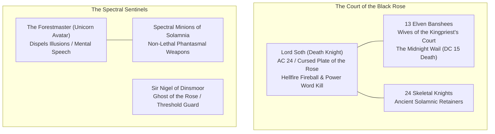

# Undead Monstrosities, Guardians & Regional Encounter Tables
*The Chronicles of Krynn: Master Lore Vault — Volume 04: Bestiary & Encounter Ecology*

---

## 1. Executive Summary: The Supernatural Underworld of Krynn

The three centuries following the [[Cataclysm]] did not merely breed mortal despair and tyrannical armies; they ripped open the metaphysical skin of Krynn. From the cursed ruins of [[Dargaard Keep]] to the enchanted shadows of [[Darken Wood]], the subterranean crypts of the [[Sla-Mori]], and the abyssal red trenches of the [[Blood Sea of Istar]], ancient curses and supernatural entities haunt the landscape.

```
                    [SUPERNATURAL THREAT CLASSIFICATION]
┌───────────────────┬──────────────────────┬──────┬─────────────────────────────┐
│ MONSTROSITY       │ THEATER / REGION     │ CR   │ NATURE & PRIMARY DANGER     │
├───────────────────┼──────────────────────┼──────┼─────────────────────────────┤
│ Lord Soth         │ Dargaard Keep / Night│ 19   │ Death Knight; Hellfire      │
│                   │ March across Solamnia│      │ Fireball; Power Word Kill   │
├───────────────────┼──────────────────────┼──────┼─────────────────────────────┤
│ 13 Elven Banshees │ Dargaard Keep Escort │ 4    │ The Midnight Wail           │
│                   │                      │      │ (DC 15 Con save or 0 HP)    │
├───────────────────┼──────────────────────┼──────┼─────────────────────────────┤
│ Spectral Minions  │ Darken Wood /        │ 3    │ Incorporeal; non-lethal     │
│                   │ Ancient Battlefields │      │ Phantasmal Torment damage   │
├───────────────────┼──────────────────────┼──────┼─────────────────────────────┤
│ Sir Nigel of      │ Caverns of the       │ 5    │ Incorporeal Paladine Knight;│
│ Dinsmoor          │ Unborn (Hope's End)  │      │ Weapon-superheating curse   │
├───────────────────┼──────────────────────┼──────┼─────────────────────────────┤
│ Giant Cave Slug   │ Sla-Mori Secret Way  │ 5    │ 30-ft acid line; rubbery    │
│                   │ (Pax Tharkas)        │      │ blunt weapon resistance     │
├───────────────────┼──────────────────────┼──────┼─────────────────────────────┤
│ Thanoi (Walrus-   │ Icewall Glacier /    │ 3    │ Barbed ice harpoons; thick  │
│ Folk)             │ Southern Ice         │      │ blubber armor; tusk gore    │
├───────────────────┼──────────────────────┼──────┼─────────────────────────────┤
│ Blood Sea Silt    │ Maelstrom of Sunken  │ 12   │ Multi-tentacle drag; red    │
│ Kraken            │ Istar                │      │ silt choking necrotic cloud │
├───────────────────┼──────────────────────┼──────┼─────────────────────────────┤
│ Fistandantilus's  │ Subterranean Vaults  │ 9    │ Soul-Leech; Entropic Aura;  │
│ Manifestation     │ of Wayreth (The Test)│      │ Dark Soulforge Crucible Pact│
└───────────────────┴──────────────────────┴──────┴─────────────────────────────┘
```

---

## 2. Legendary Undead Champions of Ansalon



---

### 2.1 Lord Soth (The Knight of the Black Rose)
*Medium Undead (Death Knight), Lawful Evil*  
*Lord of Dargaard Keep, Master of Nightfall*

```
Armor Class: 24 (+5 Cursed Solamnic Plate of the Rose)
Hit Points: 185 (20d8 + 80)
Speed: 30 ft. (Mounted atop a Nightmare: 60 ft., fly 90 ft.)
STR: 20 (+5) | DEX: 14 (+2) | CON: 18 (+4) | INT: 16 (+3) | WIS: 16 (+3) | CHA: 19 (+4)
Saving Throws: Str +11, Con +10, Wis +9, Cha +10
Damage Immunities: Necrotic, Poison; Bludgeoning, Piercing, Slashing from Nonmagical Attacks
Condition Immunities: Charmed, Exhaustion, Frightened, Paralyzed, Poisoned, Stunned
Senses: Darkvision 120 ft., Passive Perception 19
Languages: Common, Solamnic, Ancient Istarian
Challenge: 19 (22,000 XP) | Proficiency Bonus: +6
```

- **Aura of Despair:** Any living creature starting its turn within 100 feet of Lord Soth must make a **DC 18 Wisdom saving throw** or become **Frightened** for 1 minute. While frightened, the creature's speed is halved and it has disadvantage on all saving throws.
- **Magic Resistance:** Advantage on saving throws against spells and magical effects; mortal spells of 4th level or lower cannot affect him unless cast with an artifact.
- **Actions:**
  - *Multiattack:* Lord Soth makes two attacks with his *Unholy Greatsword of Wounding* (+11 to hit, 2d6+5 slashing plus 4d8 necrotic damage). A creature struck cannot regain hit points until the end of its next turn.
  - *Hellfire Fireball (1/Day):* Lord Soth points his gauntleted finger at a point up to 150 feet away. A 20-foot radius sphere of blackened unholy flame explodes. All creatures must make a **DC 19 Dexterity saving throw**, taking **70 (20d6) fire and necrotic damage** (half on success). This hellfire bypasses natural fire resistance and shatters magical barriers.
  - *Power Word Kill (1/Day):* Soth utters a dread word of doom to a creature within 60 feet. If the target has 100 hit points or fewer, it dies instantly.
  - *Words of Agony (At Will):* Soth casts *Power Word Blind* or *Power Word Stun* as a bonus action against any target displaying cowardice or attempting to flee.

---

### 2.2 The Thirteen Elven Banshees of Dargaard Keep
*Medium Undead, Chaotic Evil*

- **Lore & Origin:** Corrupted spirits of the elven handmaidens who accompanied Lady Isolde to Dargaard Keep. Soth butchered them along with his wife and infant child when they warned him of the impending Cataclysm; their eternal curse is to sing of his crimes each night.
- **Armor Class:** 15 | **Hit Points:** 68 (15d8) | **Speed:** 0 ft., fly 50 ft. (hover)
- **Damage Immunities:** Cold, Necrotic, Poison; non-magical weapons
- **The Midnight Wail (Recharge 6):**
  - Releases a mournful, shattering shriek recounting the murder of Soth's infant son.
  - All living creatures within **30 feet** who hear the scream must succeed on a **DC 15 Constitution saving throw**.
  - **On a failure:** The creature **drops to 0 Hit Points instantly**.
  - **On a success:** Takes **18 (4d8) psychic damage** and is deafened for 10 minutes.

---

### 2.3 Spectral Minions & Sir Nigel of Dinsmoor
*Medium Undead, Lawful Good (Sir Nigel) / Chaotic Neutral (Darken Wood)*

- **Aura of the Phantasm:** Spectral Minions are not evil blood-drinkers; they are cursed Solamnic warriors bound to guard ancient battlegrounds or sacred shrines.
- **Non-Lethal Weapons:** Their spectral blades deal psychic damage ($2d6 + 3$). If a target drops to 0 Hit Points from a spectral minion, it is rendered stable and held in mystical slumber for 1 hour.
- **Sir Nigel of Dinsmoor (Caverns of the Unborn):**
  - Standing incorporeal guard over the sleeping metallic dragon eggs beneath Hope's End.
  - *Divine Retribution:* If struck with a metal blade, Sir Nigel causes the weapon to superheat to white forge-temper: the wielder must drop the weapon or take $3d6$ fire damage at the start of each turn.
  - *Mirror of Paladine (1/Day):* Forces a creature to gaze into its own soul; DC 16 Wisdom save or suffer a vivid, terrifying prophetic vision of their own death ($4d10$ psychic damage and stunned for 1 round).

---

## 3. Subterranean & Polar Monstrosities

---

### 3.1 The Giant Slug of the Sla-Mori
*Huge Beast, Unaligned*  
*Encountered in the secret corridors of Kith-Kanan's Tomb beneath Pax Tharkas*

```
Armor Class: 12 (Thick Rubbery Hide)
Hit Points: 115 (10d12 + 50)
Speed: 20 ft., climb 20 ft.
STR: 20 (+5) | DEX: 6 (-2) | CON: 20 (+5) | INT: 2 (-4) | WIS: 10 (+0) | CHA: 3 (-4)
Damage Resistances: Bludgeoning (fat-padded body absorbs concussive trauma)
Damage Immunities: Acid
Condition Immunities: Prone
Senses: Blindsight 60 ft. (blind beyond), Passive Perception 10
Challenge: 5 (1,800 XP)
```

- **Digestive Acid Spit (Recharge 4–6):** Spits a 30-foot line of thick, sizzling digestive bile. All creatures in the line must make a **DC 15 Dexterity saving throw**, taking **22 (5d8) acid damage** on a failure, or half on a success. Non-magical metal weapons and armor struck suffer permanent -1 degradation.

---

### 3.2 Thanoi (Walrus-Folk of Icewall)
*Large Humanoid, Neutral Evil*

- **Armor Class:** 14 (Blubber + Bone Lamellar) | **Hit Points:** 45 ($6d10 + 12$) | **Speed:** 20 ft., swim 40 ft.
- **Attacks:**
  - *Tusk Gore:* Melee Weapon Attack: +6 to hit, reach 5 ft. Hit: $1d10 + 4$ piercing damage.
  - *Barbed Ice Harpoon:* Ranged Weapon Attack: +6 to hit, range 30/90 ft. Hit: $2d6 + 4$ piercing damage, and the target is grappled and pulled 15 feet toward the Thanoi.

---

### 3.3 The Blood Sea Silt Kraken
*Gargantuan Monstrosity, Neutral Evil*  
*Lurks in the abyssal oceanic trenches beneath the Maelstrom of Istar*

```
Armor Class: 16 (Natural Armor)
Hit Points: 195 (14d12 + 84)
Speed: 10 ft., swim 60 ft.
STR: 24 (+7) | DEX: 12 (+1) | CON: 22 (+6) | INT: 12 (+1) | WIS: 14 (+2) | CHA: 10 (+0)
Damage Resistances: Cold; Bludgeoning, Piercing, and Slashing from Nonmagical Attacks
Condition Immunities: Frightened, Paralyzed, Prone
Senses: Blindsight 120 ft., Passive Perception 16
Challenge: 12 (8,400 XP)
```

- **Tentacle Drag:** Makes four tentacle attacks (+11 to hit, reach 30 ft., $2d8 + 7$ bludgeoning damage plus grapple). Up to two grappled targets can be dragged 40 feet deeper into the crushing oceanic trench each round.
- **Red Silt Cloud (1/Day):** Discharges a 60-foot cloud of blinding crimson sediment. Obscures all line of sight and inflicts **9 (2d8) choking necrotic damage** per round to any creature requiring oxygen.

---

## 4. Phantasms of the Test of High Sorcery (Wayreth)

---

### 4.1 Dark Elf Renegade Sorcerer (The Phantasm of Liam)
*Medium Humanoid (Elf), Neutral Evil / Construct Phantasm*
- **AC:** 13 (16 with *Mage Armor*) | **HP:** 45 | **CR:** 4 (1,100 XP)
- **Trauma Manifestation:** Manifests as [[Liam]], Raistlin's childhood tormentor. Any initiate with an unresolved trauma flaw must succeed on a **DC 13 Wisdom saving throw** or suffer disadvantage on concentration checks while this creature is in view.
- **Spellcasting (7th level, DC 14):** Casts *Fireball* (8d6), *Lightning Bolt*, *Counterspell*, *Phantasmal Killer*, and uses bonus-action *Misty Step* to retreat onto elevated stone balconies.

---

### 4.2 Spectral Manifestation of Fistandantilus (The Soul-Leech)
*Medium Undead (Special Entity), Lawful Evil*
- **AC:** 16 | **HP:** 110 | **Speed:** Fly 40 ft. (hover) | **CR:** 9 (5,000 XP)
- **Aura of Entropic Cold:** Creatures starting their turn within 15 feet take $2d6$ cold damage and cannot regain hit points until their next turn.
- **The Soulforge Crucible Bargain:** When an initiate drops to 0 Hit Points, Fistandantilus freezes time and offers the **Crucible Pact**:
  - Restores the mage to half maximum HP and refreshes three spell slots.
  - In exchange, the initiate's Constitution score permanently drops by 2, their skin takes on a golden metallic luster, and the 8-tick Threat Clock (*Fistandantilus's Total Soul Possession*) begins ticking.

---

## 5. Master Regional Encounter Tables Across Ansalon

---

### Table 1: Abanasinia Plains & Solace Environs (d12 Table)

| d12 | Encounter Name | Composition & Stance | Strategic Complication |
| :---: | :--- | :--- | :--- |
| **1–2** | **Fewmaster Toede’s Vanguard** | Fewmaster Toede on a war-pony, 6 goblins riding dire wolves. | Ambushing refugees; Toede flees the moment two goblins fall. |
| **3–4** | **Seeker Inquisitor Patrol** | 1 Theocrat (Acolyte), 6 municipal town guards with halberds. | Enforcing curfew; searching baggage for "witchcraft" or ancient steel. |
| **5–6** | **Disguised Baaz Hunter Cadre** | 4 Baaz Draconians concealed in heavy hooded woolen cloaks. | Hunting for the Blue Crystal Staff; attempt to box party in an alley. |
| **7–8** | **Que-Shu Refugee Family** | 2 wounded hunters, 3 malnourished children with woven baskets. | Desperate for water; report that Que-Shu was burned from the sky. |
| **9** | **Wandering Mad Hedge-Mage** | Fizban the Fabulous poking an ant hill with his crooked staff. | Forgets his name; gives erratic, profound warnings about dragon breath. |
| **10** | **Starving Mountain Lions** | 2 large cougars driven from Kharolis peaks by dragon smoke. | Predatory hunger; stalk pack horses or rear stragglers. |
| **11** | **Goblin Supply Foragers** | 8 goblins ransacking a vallenwood farmstead, fighting over hams. | Disorganized; party can surprise them to seize intelligence on troop paths. |
| **12** | **Theros Ironfeld’s Scouts** | 3 armed Solace townsfolk scouting tree-roads for enemy cordons. | Can guide the party through secret treetop catwalks around barricades. |

---

### Table 2: Darken Wood Encounters (d10 Table)

| d10 | Encounter Name | Composition & Stance | Strategic Complication |
| :---: | :--- | :--- | :--- |
| **1–3** | **Spectral Minion Phalanx** | 6 Spectral Minions stepping from the boles of willow trees. | Encircle party; non-lethally subdue intruders to present to Forestmaster. |
| **4–5** | **Centaur Patrol** | 3 Centaur archers with notched composite recurve bows. | Challenge intruders in the name of the Glade; demand steel be sheathed. |
| **6–7** | **Shadows of the Fallen** | 4 undead Shadows drifting through mist-shrouded moss beds. | Drain Strength; flee if confronted with holy light or the Staff of Magius. |
| **8–9** | **Whispering Willow Trap** | 2 awakened trees with hallucinogenic pollen (DC 13 Con save). | Victims fall into hypnotic sleep, believing they are resting in childhood beds. |
| **10** | **Avatar of the Forestmaster** | The radiant Unicorn Sovereign appearing atop a moonlit knoll. | Telepathic communion; grants *Bless* and guides party to the Xak Tsaroth trail. |

---

### Table 3: Plains of Dust & Dergoth (d10 Table)

| d10 | Encounter Name | Composition & Stance | Strategic Complication |
| :---: | :--- | :--- | :--- |
| **1** | **Dust Swarm & Salt Vipers** | Blinding red silt gale (DC 13 Con save or blind 1 hr); 4 salt vipers. | Vipers strike with venom while party members struggle to see. |
| **2** | **Theiwar Scout Skiff** | 6 Theiwar dark dwarves on a wheeled wind-skiff with light crossbows. | Firing darts coated in drow-venom; scouting for the Red Dragonarmy. |
| **3** | **Wights of the Dwarfgate** | 5 Dwarven Wights in rusted iron mail screaming ancient curses. | Ambush from collapsed stone cairns; drain life energy. |
| **4** | **Bozak Patrol** | 2 Bozak Draconians commanding 8 Baaz shock footmen. | Regular patrol from Pax Tharkas; attempt to capture prisoners for mines. |
| **5** | **Shattered Supply Wagon** | Overturned human refugee wagon; bodies picked clean. | DC 13 Investigation finds 2 healing potions hidden in a false floor. |
| **6** | **Rogue Hill Dwarf Trappers** | 4 Neidar hunters suspicious of all mountain strangers. | Will trade salted venison and water for tempered steel arrowheads. |
| **7** | **Skeletal Chariot** | Ancient bone-chariot driven by a spectral warrior of the Age of Might. | Charges intruders, attacking anyone bearing Solamnic heraldry. |
| **8** | **Sulfur Ash Sinkhole** | Crust of dried volcanic ash collapses into a 30-ft sulfur pit. | DC 14 Dex save or plunge into boiling ash ($3d6$ fire damage). |
| **9** | **Young Red Wyrm Scout** | A juvenile red dragon (*Pyre*) circling high overhead. | Scans for refugee columns; party must make DC 15 Stealth checks to hide. |
| **10** | **Derelict Gnomish Crawler** | Steam-powered tread crawler abandoned during the Dwarfgate War. | Contains 1d6 iron cogs and a locked bronze lockbox holding an ancient map. |

---

### Table 4: Southern Ice & Icewall Glacier (d8 Table)

| d8 | Encounter Name | Composition & Stance | Strategic Complication |
| :---: | :--- | :--- | :--- |
| **1** | **Ice Folk Outrunners** | 3 sail-driven Ice-Boats carrying 9 barbarian hunters. | Challenge party with harpoons before recognizing them as potential allies. |
| **2** | **Thanoi Ambush** | 6 Thanoi walrus-folk bursting from snowdrifts. | Attempt to grapple party members with barbed harpoons and drag into crevasses. |
| **3** | **Glacial Chasm Fracture** | An ice bridge fractures under party weight. | DC 14 Acrobatics check to leap clear; $6d6$ falling damage on failure. |
| **4** | **Winter Wolf Pack** | 5 Winter Wolves scouting for Highlord Feal-Thas. | Coordinate frost breath attacks to encircle and freeze pack beasts. |
| **5** | **Frozen Solamnic Knight** | A knight frozen in clear glacial ice from the Third Dragon War. | Holds an ancient enchanted +1 Solamnic longsword in cold grip. |
| **6** | **White Dragon Patrol** | A juvenile white dragon sweeping across the glacial ridges. | Dives from cloud cover to snatch solitary mounts or pack sleds. |
| **7** | **Blinding Whiteout** | Temperature plunges to -35°F in a howling blizzard. | DC 14 Con save every hour or suffer 1 level of extreme cold exhaustion. |
| **8** | **Remorhaz Larva** | A 20-foot arctic worm erupting through the ice sheet. | Emits blistering body heat that melts non-magical steel weapons on contact. |

---

### Table 5: Southern Ergoth Forests & Foghaven (d8 Table)

| d8 | Encounter Name | Composition & Stance | Strategic Complication |
| :---: | :--- | :--- | :--- |
| **1** | **Kagonesti Pathfinders** | 4 Wild Elf rangers tracking Draconian scouts from the canopy. | Observe party silently; test alignment before speaking. |
| **2** | **Sivak Infiltration Cell** | 2 Sivak Draconians disguised as lost human refugees. | Attempt to join party encampment to assassinate officers in sleep. |
| **3** | **Slig Hunting Band** | 8 Sligs armed with venomous spitting darts and barbed nets. | Attempt to capture live specimens to trade to Dragonarmy encampments. |
| **4** | **Qualinesti Border Guard** | 6 elven longbowmen demanding immediate weapon surrender. | Treat non-elves with haughty contempt; threaten arrest for trespassing. |
| **5** | **Desecrated Elven Shrine** | A mossy woodland shrine burned by Kapak raiders. | 3 Kapaks lingering to loot dead scouts; acid puddles from dead comrades. |
| **6** | **Enchanted Mist of Foghaven** | Shifting silver fog that disorients navigation. | DC 14 Wis save or wander in circles; magical silence falls over the party. |
| **7** | **Giant Forest Spiders** | 3 massive arachnids dropping from redwood canopies. | Poisonous bites induce paralysis; web strands restrain heavy fighters. |
| **8** | **Ancient Dragon Barrow** | Mossy earthen mound where a silver dragon fell in ancient wars. | Radiates divine tranquility; resting here grants the benefits of a *Restoration*. |

---

### Table 6: Solamnia & The High Clerist's Pass (d8 Table)

| d8 | Encounter Name | Composition & Stance | Strategic Complication |
| :---: | :--- | :--- | :--- |
| **1** | **Solamnic Outrider Patrol** | 4 Knights of the Crown in polished chainmail on warhorses. | Demand identification, heraldic credentials, and adherence to the Measure. |
| **2** | **Blue Dragon Recon Flight** | A mature Blue Dragon circling above mountain peaks. | Checks high mountain passes; discharges lightning at stone bridges. |
| **3** | **Hobgoblin Sapper Unit** | 12 hobgoblins carrying pickaxes, black powder, and iron wedges. | Preparing trench lines and tunnel sapping under mountain redoubts. |
| **4** | **Solamnic Deserter Band** | 6 destitute human mercenaries who fled the siege lines. | Warn the party that Kitiara's forces are executing all prisoners. |
| **5** | **Mountain Rockslide** | Loose shale giving way along a narrow mountain defile. | DC 14 Dex save or take $4d10$ bludgeoning damage and tumble 60 feet. |
| **6** | **Sivak Assassin Pair** | 2 Sivaks gliding from high crags onto the rear guard. | Target spellcasters with greatsword charges and tail sweeps. |
| **7** | **Derelict Solamnic Waystation**| Fortified stone tower with arrow slits and heavy oak door. | Provides shelter for a short rest; contains 1d4 barrels of clean rainwater. |
| **8** | **Bakaris's Elite Vanguard** | 6 heavy plate cavalrymen from Estwilde scouting the trail. | Fierce discipline; sound brass horns to summon aerial blue dragon support. |

---

### Table 7: Khalkist Mountains & Neraka Valley (d8 Table)

| d8 | Encounter Name | Composition & Stance | Strategic Complication |
| :---: | :--- | :--- | :--- |
| **1** | **Wyvern Outriders** | 3 Dragonarmy scouts mounted on poison-tailed wyverns. | Patrol cloud cover; carry sealed dispatches in bronze cylinders. |
| **2** | **Sulfur Geothermal Fumarole** | A pressurized vent erupting through fractured volcanic rock. | DC 13 Con save or blinded by noxious sulfur steam for 10 minutes. |
| **3** | **Draconian Punishment Detail** | 2 Whip-Sergeants forcing 4 infracted soldiers to stand at attention. | Brutal discipline; sergeant will attack anyone interfering with punishment. |
| **4** | **Escaped Imperial Slaves** | 4 malnourished human and dwarven miners fleeing Neraka. | Can provide layout sketches of the Temple of Darkness if fed and healed. |
| **5** | **Ogre Shock Warband** | 4 towering Khalkist ogres armed with tree-trunk clubs. | Drunk on fermented dwarf-beer; attack anything in their path. |
| **6** | **Aurak Inquisitor Escort** | 1 Aurak accompanied by 4 Bozak sorcerers in imperial robes. | Inspecting mountain perimeter checkpoints; detect magic and see through disguise. |
| **7** | **Volcanic Ash Avalanche** | Slag heaps from Sanction foundries sliding down the ravine. | DC 15 Dex save or buried in scalding ash ($3d8$ fire damage, suffocating). |
| **8** | **Shadow of the Dark Queen** | A sudden eclipse of the sun accompanied by deafening draconic roars.| All creatures must make a DC 14 Wis save or become frightened for 10 minutes. |

---

### Table 8: Blood Sea of Istar & The Silt Maelstrom (d6 Table)

| d6 | Encounter Name | Composition & Stance | Strategic Complication |
| :---: | :--- | :--- | :--- |
| **1** | **Ghost Galley of Istar** | Spectral Istarian warship sailing against the crimson current. | Crewed by weeping phantoms who challenge travelers to repent sins. |
| **2** | **Silt Kraken Tentacle Attack** | 2 massive rubbery tentacles breaching the foaming surface. | Attempt to seize ship rudders or drag passengers overboard into the whirlpool. |
| **3** | **Red Silt Squall** | Sudden oceanic tempest whipping choking crimson foam into the air. | Reduces visibility to zero; helmsman must make DC 15 Sea Vehicle check. |
| **4** | **Drowning Survivor Raft** | 3 sailor survivors clinging to a shattered wooden spar. | If rescued, warn that monstrous fish-tailed humanoids dwell in the deep. |
| **5** | **Dimernesti Rescue Pod** | 4 Sea Elf scouts riding war-dolphins observing from beneath waves. | Intercept sinking vessels; offer air-breathers the Draught of Forgetting. |
| **6** | **The Maelstrom's Lip** | Ship pulled dangerously close to the colossal central vortex. | All hands must row or trim sails (DC 16 group Athletics check or ship capsizes). |
