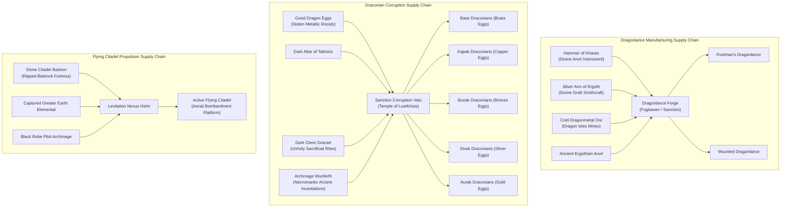

# Legendary Relics, Steel Economy & Tier 3 Supply Chains

*Authoritative Artifact Compendium, Post-Cataclysm Steel Economy & Workstation 2.6 Supply Chain Matrix*  
**Setting Horizon:** War of the Lance Era (351–352 AC)  
**Cross-References:** [[00_MASTER_INDEX]], [[01_Cosmology_Gods_of_the_Balance_and_Divine_Restoration]], [[02_Arcane_Magic_Three_Moons_and_The_Test_of_High_Sorcery]], [[01_Heroes_of_the_Lance_Core_Eight]], [[02_Secondary_Companions_and_Allies]], [[03_Dragon_Highlords_and_Dark_Commanders]]

---

## 1. Executive Summary & Metaphysical Architecture

The material culture of Ansalon during the War of the Lance is defined by two interlocking phenomena:
1. **The Post-Cataclysm Scarcity Economy:** Gold is useless soft metal. Survival depends on iron and worked steel, establishing the **Steel Piece Standard** as the universal currency of civilized trade.
2. **The Return of Primal Relics:** Ancient artifacts forged during the Age of Dreams and Age of Might—the *Dragon Orbs*, the *Dragonlances*, the *Hammer of Kharas*, the *Silver Arm of Ergoth*, and the *Staff of Magius*—resurface to shatter the stalemate between the Five Dragonarmies and the fractured mortal nations.

---

## 2. Master Relic & Artifact Dossiers (Complete Mechanical Profiles)

---

### 2.1 The Blue Crystal Staff (Staff of Mishakal)
*Staff / Wondrous Item, Artifact (Requires Attunement by a Devout Follower of Mishakal)*  
**Historical Provenance:** Bestowed by Mishakal upon [[Goldmoon]] of the Que-Shu on the Abanasinian plains (Autumn 351 AC) to herald the return of true gods.

```
+----------------------------------------------------------------------------------------------------+
| THE BLUE CRYSTAL STAFF                                                                             |
| Material: Translucent, iridescent sky-blue crystal tipped with a carved ornament of Mishakal       |
| Inherent Aura: Brilliant divine radiance; humming with the warmth of celestial mercy              |
+----------------------------------------------------------------------------------------------------+
```

#### Mechanical Statistics & Powers
- **Charges:** The staff contains a maximum of **20 charges**. It regains $1d6 + 4$ expended charges daily at dawn, provided the wielder engages in prayer.
- **Divine Strike:** Functions as a $+2$ magical quarterstaff. When striking an evil-aligned fiend, undead, or draconian, it deals an additional $2d8$ radiant damage.
- **True Healing Spells:** The wielder can expend charges to cast the following spells (Save DC 18, Spell Attack $+10$):
  - *Cure Wounds* (1 charge per spell level, up to 4th)
  - *Lesser Restoration* (2 charges)
  - *Revivify* (5 charges)
  - *Greater Restoration* (6 charges)
  - *Heal* (8 charges)
  - *Raise Dead* (10 charges)
- **Defensive Teleportation (Panic Safeguard):** When the wielder or an adjacent companion is reduced to 0 Hit Points or surrounded by overwhelming lethal force, the staff automatically detonates a blinding flash of silver light and casts *Word of Recall* or *Teleport*, transporting the party to a pre-consecrated haven (e.g., the safety of Darken Wood).
- **The Self-Sacrifice Detonation:** If struck directly against a chromatic dragon's breath weapon (as performed by Goldmoon against [[Khisanth]] in Xak Tsaroth), the staff discharges its entire charge reservoir in a blinding column of pure positive energy: deals $100$ radiant damage to all evil creatures within 30 feet, instantly vaporizing the wielder's physical body, which is pulled into Mishakal's planar sanctuary for resurrection.

---

### 2.2 The Disks of Mishakal
*Wondrous Item, Artifact (Divine Scripture)*  
**Historical Provenance:** Scribed by the hand of Mishakal following the First Dragon War; retrieved from the sunken ruins of Xak Tsaroth by Goldmoon and [[Riverwind]].

```
+----------------------------------------------------------------------------------------------------+
| THE DISKS OF MISHAKAL                                                                              |
| Material: 160 round plates of beaten platinum, 18 inches in diameter, bound with woven silver wire |
| Weight: 85 lbs. Completely immune to physical damage, acid, dragon fire, and arcane dissolution   |
+----------------------------------------------------------------------------------------------------+
```

#### Mechanical Statistics & Powers
- **The Apostolic Library:** Any creature proficient in Religion who studies the Disks for 40 hours gains complete knowledge of the rites, prayers, and taboos of all 7 Gods of Good.
- **Ordination of High Clerics:** Studying the Disks allows a non-cleric with high moral conviction (such as [[Elistan]]) to immediately undergo apostolic conversion, gaining the spellcasting capabilities of a 7th-to-10th level Cleric of the Light.
- **Communion with the Gods:** Once per lunar month, a cleric in possession of the Disks can perform a 1-hour ritual to cast *Commune* without expending a spell slot, receiving direct, uncorrupted guidance from Paladine or Mishakal.

---

### 2.3 The Staff of Magius
*Staff / Wondrous Item, Artifact (Requires Attunement by a Wizard of High Sorcery)*  
**Historical Provenance:** Crafted during the Age of Might and wielded by Magius, companion to Huma Dragonbane. Bestowed upon [[Raistlin Majere]] by [[Par-Salian]] following his Test.

```
+----------------------------------------------------------------------------------------------------+
| THE STAFF OF MAGIUS                                                                                |
| Material: Petrified golden ironwood topped with a carved dragon's claw clutching an amber crystal  |
| Trigger Words: "Shirak" (Light) / "Dulak" (Darkness)                                               |
+----------------------------------------------------------------------------------------------------+
```

#### Mechanical Statistics & Powers
- **Staff Strike:** Functions as a magical $+2$ quarterstaff ($1d8$ bludgeoning $+ 1d6$ force damage).
- **Luminescence (Command Word: *"Shirak"*):** At will, the crystal orb blazes with pure white light equivalent to a *Daylight* spell in a 60-foot radius. Speaking *"Dulak"* instantly extinguishes the light.
- **Inherent Feather Fall:** If the wielder falls more than 10 feet, the staff automatically casts *Feather Fall* on the wielder without consuming a reaction or spell slot.
- **Arcane Spell Absorption:** Once per long rest, when targeted by a spell that deals damage, the wielder can use their reaction to absorb the spell energy into the staff, negating the effect and recovering an expended spell slot of 1st through 3rd level.
- **Striking of Magius:** Once per day, the wielder can strike the staff upon stone to cast *Thunderwave* (5th-level, DC 16 Constitution save).

---

### 2.4 The Five Dragon Orbs (Orbs of Dragonkind)
*Wondrous Item, Artifact (Requires Attunement by an Arcane Spellcaster)*  
**Historical Provenance:** Forged during the Third Dragon War by mages of all three robes within the Towers of High Sorcery to break the chromatic dragon swarms. Five orbs were created: *Silvanesti*, *Icewall*, *Palanthas (High Clerist's)*, *Istar (Neraka)*, and *Losarcum (Destroyed)*.

```
+----------------------------------------------------------------------------------------------------+
| THE DRAGON ORBS                                                                                    |
| Material: Hollow crystal sphere, 20 inches in diameter, filled with swirling, smoky vapors         |
| Physical Property: Immune to ALL magic; CANNOT be harmed except by non-magical kinetic bludgeoning |
+----------------------------------------------------------------------------------------------------+
```

#### Mechanical Statistics & Powers
- **The Contest of Will:** When a mortal touches the orb, the trapped chromatic wyrm-spirit inside initiates an immediate telepathic assault:
  - *The Will Save:* The user must make a **DC 18 Charisma saving throw**. 
  - *Failure:* The user’s mind is shattered: they fall into catatonic madness or become an autonomous thrall of the Dragon Queen (as suffered by King [[Lorac Caladon]] of Silvanesti, unleashing the nightmare that destroyed his kingdom).
  - *Success:* The user masters the orb for 24 hours.
- **The Dragon Call (The Great Summons):** Once mastered, the user can activate the orb to emit a hypnotic psychic screech across a **200-mile radius**:
  - Every evil dragon in range must make a **DC 20 Wisdom saving throw** or be driven into an uncontrollable homicidal frenzy, flying at maximum speed toward the orb's exact location.
  - Used tactically at the [[High Clerist's Tower]] to lure Blue Dragons into the ground-level Dragon-Trap funnels where lancers waited.
- **Kinetic Fragility (The Tasslehoff Rule):** Magic cannot scratch an Orb. However, a character striking the orb with a heavy, non-magical weapon (such as a mundane dwarven sledgehammer) against an AC of 10 and dealing at least 15 bludgeoning damage will shatter the glass, freeing the imprisoned dragon spirit in a localized force-blast ($6d6$ force damage in a 20-foot radius).

---

### 2.5 The Hammer of Kharas
*Weapon (Warhammer), Artifact (Requires Attunement by a Dwarf of Noble Blood or Paladin of Reorx)*  
**Historical Provenance:** Wielded by the dwarven hero Kharas during the Dwarfgate War (39 PC); hidden in the subterranean tombs of Thorbardin.

```
+----------------------------------------------------------------------------------------------------+
| THE HAMMER OF KHARAS                                                                               |
| Material: Solid dwarven steel and star-metal chased with runic platinum inlays                     |
| Size: Massive two-handed forging warhammer; weight: 12 lbs                                         |
+----------------------------------------------------------------------------------------------------+
```

#### Mechanical Statistics & Powers
- **Weapon Statistics:** Functions as a $+3$ warhammer ($1d10$ / $1d12$ bludgeoning damage). Deals an additional $2d10$ radiant damage against evil dragons and fiends.
- **Aura of Dwarven Majesty:** Dwarves within 60 feet of the Hammer have advantage on all saving throws against fear and charm, and gain $+2$ to their Morale and Attack rolls.
- **The Forging Requirement:** The Hammer of Kharas is the *only* instrument capable of working true cold silver ore upon an ancient anvil to forge the **Dragonlances**. Without this hammer, dragonmetal shatters into brittle slag under ordinary smithcraft.

---

### 2.6 The Silver Arm of Ergoth
*Wondrous Item, Artifact (Cybernetic / Divine Graft)*  
**Historical Provenance:** Forged by ancient Ergothian smiths and blessed by Paladine during the Age of Dreams; recovered from the Tomb of Huma.

```
+----------------------------------------------------------------------------------------------------+
| THE SILVER ARM OF ERGOTH                                                                           |
| Material: Articulated silver plates shaped like a human arm from shoulder to fingertips            |
| Graft Mechanics: Attunes by permanently fusing onto the severed shoulder stump of a worthy smith   |
+----------------------------------------------------------------------------------------------------+
```

#### Mechanical Statistics & Powers
- **The Graft of Theros Ironfeld:** When placed against the severed right shoulder of blacksmith [[Theros Ironfeld]], the silver arm magically bonded with his nervous system and flesh, restoring full mobility with superhuman strength.
- **Superhuman Might:** The bearer's Strength score increases to 22 ($+6$).
- **The Divine Anvil Grip:** The hand of the Silver Arm can hold white-hot dragonmetal ore directly without feeling pain or suffering burns. When paired with the Hammer of Kharas, the bearer can forge a functional Dragonlance in 8 hours of labor.

---

### 2.7 Footman's & Mounted Dragonlances
*Weapon (Lance or Pike), Legendary*  
**Historical Provenance:** Forged using the *Silver Arm of Ergoth*, the *Hammer of Kharas*, and pure cold silver ore drawn from the Dragon Isles or Solamnic mountain veins.

```
+----------------------------------------------------------------------------------------------------+
| DRAGONLANCE SPECIFICATION MATRIX                                                                   |
+----------------------+-----------------------------+-----------------------------------------------+
| Specification        | Footman's Dragonlance       | Mounted Dragonlance                           |
+----------------------+-----------------------------+-----------------------------------------------+
| Weapon Classification| Pike / Two-Handed Spear     | Heavy Lance (Requires Mount / Saddle Harness) |
| Length & Weight      | 8 to 10 feet / 9 lbs        | 16 to 18 feet / 18 lbs                        |
| Combat Bonus         | +2 to Attack & Damage       | +3 to Attack & Damage                         |
| Dragon Piercing Aura | Bypasses Dragon Scale Armor | Bypasses Dragon Scale Armor                   |
| Critical Dragon Burst| Deals wielder's Max HP dmg  | Deals wielder's + mount's Max HP dmg          |
+----------------------+-----------------------------+-----------------------------------------------+
```

#### Mechanical Combat Mechanics
- **Anti-Dragon Aura:** Any chromatic dragon struck by a Dragonlance cannot regenerate Hit Points for 1 hour, and its flight speed is reduced by half until the end of its next turn.
- **The Lethal Dive:** When wielded by a rider mounted upon a diving Good Dragon (such as a Gold or Silver dragon) dropping 50+ feet, a hit deals an automatic **critical hit** dealing $4d12 + 6$ piercing damage plus additional damage equal to the combined Hit Dice of rider and mount, capable of impaling an ancient Red Dragon in a single strike.

---

### 2.8 Wyrmslayer
*Weapon (Two-Handed Greatsword), Artifact (Requires Attunement)*  
**Historical Provenance:** Ancient elven blade forged for Speaker of the Suns [[Kith-Kanan]] during the Second Dragon War; retrieved from Kith-Kanan's tomb in the Sla-Mori beneath Pax Tharkas by [[Tanis Half-Elven]].

```
+----------------------------------------------------------------------------------------------------+
| WYRMSLAYER                                                                                         |
| Appearance: Slender two-handed elven blade engraved with swirling runic vine patterns              |
| Property: Emits a low, angry buzzing hum whenever a true dragon comes within 300 feet             |
+----------------------------------------------------------------------------------------------------+
```

#### Mechanical Statistics & Powers
- **Sword Statistics:** $+3$ greatsword ($2d6 + 3$ slashing). Deals an additional $3d6$ damage against creatures with the Dragon type.
- **Entanglement Immunity:** The wielder cannot be paralyzed, restrained by magical webs, or trapped by plant growth. The blade slices through magical webbing (such as the *Web* spell) as if it were mundane air.
- **Draconian Death-Throe Ward:** When Wyrmslayer delivers the killing blow to a Baaz Draconian, the blade does *not* become trapped in petrifying stone; the elven runes discharge a pulse of white light that instantly cracks the petrified corpse into harmless gravel.
- **Cyan Bloodbane's Dream Bane:** Wyrmslayer’s telepathic resonance disrupts mental illusions and psychic nightmares within 30 feet, granting $+4$ to saving throws against dragon fear and mental domination.

---

### 2.9 Brightblade (The Sword of Sturm)
*Weapon (Longsword or Bastard Sword), Rare / Legacy*  
**Historical Provenance:** Ancient ancestral blade of House Brightblade, passed from Lord Angriff Brightblade to his son [[Sturm Brightblade]].

```
+----------------------------------------------------------------------------------------------------+
| BRIGHTBLADE                                                                                        |
| Forging: Hand-forged by dwarven smiths during the early Solamnic era; etched with Kingfisher runes |
| Property: Completely unbreakable; immune to acid, crushing, and sunder effects                    |
+----------------------------------------------------------------------------------------------------+
```

#### Mechanical Statistics & Powers
- **Sword Statistics:** $+2$ longsword ($1d8$ / $1d10$ slashing damage).
- **The Unbreakable Invariant:** The blade has an Armor Class of 25 and cannot be broken by mundane weapons, draconian petrification, or dragon claws.
- **Solamnic Honor Shield:** While drawn, Brightblade grants the wielder advantage on all saving throws against Fear and Charm effects. Once per day, the wielder can challenge an enemy leader to a formal duel (*Compelled Duel*, DC 15).

---

### 2.10 The Starjewel of Alhana Starbreeze
*Wondrous Item, Rare (Soul-Bonded Talisman)*  
**Historical Provenance:** An ancient heirloom of the royal Silvanesti dynasty, given by Princess [[Alhana Starbreeze]] to Sturm Brightblade in Tarsis (Winter 351 AC) as a token of noble affection.

```
+----------------------------------------------------------------------------------------------------+
| THE STARJEWEL                                                                                      |
| Appearance: Delicate tear-shaped crystal pendant glowing with soft, pale silver starlight           |
| Property: Psychically linked to the vital heartbeat and soul-state of the giver                   |
+----------------------------------------------------------------------------------------------------+
```

#### Mechanical Statistics & Powers
- **The Soul-Tether:** As long as Alhana Starbreeze lives, the Starjewel radiates comforting warmth and soft starlight (10-foot radius).
- **Life Status Indicator:** 
  - *Healthy:* Steady silver glow.
  - *Poisoned / Diseased:* Flickering, dull gray light.
  - *Mortal Peril / Dying:* Rapid, feverish red pulse.
  - *Dead:* The crystal turns cold, dull leaden-gray, cracking down the center.
- **Mental Ward:** While worn around the neck, the Starjewel provides $+2$ to saving throws against psychic damage and enchantment spells.

---

### 2.11 The Bloodstone of Fistandantilus
*Wondrous Item, Artifact (Necromantic Conduit)*  
**Historical Provenance:** The ancient soul-anchor of the dark archmage Fistandantilus; preserved through centuries to sustain his ethereal consciousness.

```
+----------------------------------------------------------------------------------------------------+
| THE BLOODSTONE                                                                                     |
| Appearance: Polished emerald the size of a pigeon's egg, glowing with internal sickly green fire   |
| Property: Drains living vitality to power forbidden high-tier arcane magic                         |
+----------------------------------------------------------------------------------------------------+
```

#### Mechanical Statistics & Powers
- **Vitality Tap:** The wearer can sacrifice their own Hit Points to cast wizard spells without expending spell slots. For every 10 HP sacrificed, the caster recovers or casts a spell of 1st through 3rd tier.
- **Soul Preservation:** If the bearer's physical body dies while wearing the Bloodstone, their soul is absorbed into the gem rather than passing into the afterlife. The spirit can communicate telepathically with anyone who subsequently wears the stone, attempting to possess the new host via a contested DC 17 Charisma contest.

---

### 2.12 The Crown of Power
*Wondrous Item, Artifact (Requires Attunement)*  
**Historical Provenance:** Forged in the fires of the Abyss and gifted by Takhisis to [[Emperor Ariakas]] to crown him Supreme Commander of the Five Dragonarmies.

```
+----------------------------------------------------------------------------------------------------+
| THE CROWN OF POWER                                                                                 |
| Appearance: Jagged circlet of black iron and obsidian spikes set with five fiery dragon eyes       |
| Property: Emits an aura of overwhelming dread and absolute dominion                                |
+----------------------------------------------------------------------------------------------------+
```

#### Mechanical Statistics & Powers
- **Aura of Absolute Command:** All friendly Dragonarmy officers and draconians within 120 feet of the Crown are completely immune to Fear, Charm, and Morale checks.
- **The Dark Shield of Takhisis:** Ariakas is protected by an impenetrable divine barrier granted by the Crown: all incoming attacks, spells, and damage have their damage values reduced to **0**, unless the barrier is lowered or bypassed by a god-tier betrayal (as executed by Raistlin Majere in the Neraka temple).
- **Domination Pulse:** Once per day, the wearer can cast *Dominate Monster* (DC 19) against any creature with the Dragon type.

---

### 2.13 The Foundation Stone & The Green Gemstone
*Wondrous Item, Artifact (Planar Keystones)*  
**Historical Provenance:** The altar keystone of the Temple of Istar, corrupted by Takhisis and transported to Neraka. Excavated by the miner [[Berem]] and his sister Jasla (332 AC).

```
+----------------------------------------------------------------------------------------------------+
| THE FOUNDATION STONE & GREEN GEMSTONE                                                              |
| The Altar: Black marble foundation block set in the lowest subterranean vault of Neraka            |
| The Gemstone: Radiant emerald pry-chunk embedded directly into the living flesh of Berem's chest   |
+----------------------------------------------------------------------------------------------------+
```

#### Mechanical Statistics & Powers
- **The Immortal Flesh of Berem:** Because a piece of the foundation altar was embedded into his chest, Berem the Everman cannot physically die:
  - If stabbed, decapitated, drowned, or burned, his body rapidly knits and regenerates at 20 HP per round, reviving fully within minutes.
- **The Planar Lock:** The portal connecting the Abyss to Krynn in the Temple of Neraka cannot fully open as long as the Green Gemstone is missing from the Foundation Stone.
- **The Final Sealing:** If Berem hurls his body onto the Foundation Stone, the gemstone fuses back into the marble, permanently sealing the planar gateway and ejecting Takhisis back into the void.

---

### 2.14 The Glasses of True Seeing
*Wondrous Item, Very Rare*  
**Historical Provenance:** Crafted by gnomish artifice in Mount Nevermind; recovered and carried by [[Tasslehoff Burrfoot]].

```
+----------------------------------------------------------------------------------------------------+
| THE GLASSES OF TRUE SEEING                                                                         |
| Appearance: Brass goggles with multiple rotating multi-colored crystal lenses on fine gear arms    |
+----------------------------------------------------------------------------------------------------+
```

#### Mechanical Statistics & Powers
- **True Sight:** When looking through the aligned lenses, the wearer gains *Truesight* out to a range of 60 feet:
  - Detects invisible creatures, secret doors, and magical traps.
  - Sees through all mundane and magical illusions.
  - Reveals the true form of polymorphed or shape-shifted creatures (used by Tas to see that Silvara is a Silver Dragon and that Fizban is Paladine).

---

### 2.15 Flying Citadel Helms (Arcane Levitation Engines)
*Wondrous Structure / Vehicle Engine, Artifact*  
**Historical Provenance:** Created by Black Robe archmages and Dark Clerics during the winter of 351 AC by ripping mountain fortresses from bedrock using raw planar earth magic.

```
+----------------------------------------------------------------------------------------------------+
| FLYING CITADEL CONTROL HELM                                                                        |
| Architecture: A central stone control chair surrounded by channeled mana conduits and crystal orbs|
| Mass Lifted: Entire stone castles, bastions, and mountain peaks (up to 500,000 tons of rock)       |
+----------------------------------------------------------------------------------------------------+
```

#### Mechanical Statistics & Powers
- **Flight Mechanics:** The Citadel flies at a speed of 20 feet per round (approx. 2 miles per hour) with clumsy maneuverability.
- **The Power Core:** Powered by a captured Greater Earth Elemental or a Bound Primordial Nexus channeled into the helm. 
- **The Vulnerability:** If the control helm is dispelled, shattered, or the pilot slain, the levitation field instantly collapses, causing the massive stone fortress to crash to earth, obliterating everything beneath it in a 500-foot radius ($20d6$ bludgeoning damage to all creatures).

---

## 3. The Post-Cataclysm Steel Economy & Currency Logistics

### 3.1 The Utility Value of Steel
Following the Cataclysm, the continental economy suffered total collapse. The destruction of major mining vaults, blast furnaces, and trade networks caused iron and steel to become exceedingly scarce.
- **Why Gold Lost Its Value:** You cannot forge an axe from soft gold to chop firewood; you cannot plow a frozen field with a gold share; you cannot parry a goblin’s spear with a gold blade. Gold became a decorative novelty.
- **The Steel Standard:** The **Steel Piece (stl)** became the gold standard of Ansalon. A steel piece is a heavy, stamped coin of high-carbon weapon-grade steel that can literally be melted down and forged into arrowheads or dagger tips in an emergency.

```
+----------------------------------------------------------------------------------------------------+
|                                    CURRENCY CONVERSION PROTOCOL                                    |
+----------------------+-----------------------------+-----------------------------------------------+
| Coin Type            | Equivalent Value in Steel   | Material Utility                              |
+----------------------+-----------------------------+-----------------------------------------------+
| 1 Steel Piece (stl)  | 1.0 stl (Baseline Standard) | Weapon-grade carbon steel; universal trade    |
| 1 Gold Piece (gp)    | 0.1 stl (10 gp = 1 stl)     | Soft decorative metal; rejected by smiths     |
| 1 Silver Piece (sp)  | 0.01 stl (100 sp = 1 stl)   | Common barter coin; used for daily groceries  |
| 1 Copper Piece (cp)  | 0.001 stl (1,000 cp = 1 stl)| Smallest fractional coin; bread and ale       |
| 1 Iron Piece (ip)    | 0.5 stl (2 ip = 1 stl)      | Unrefined raw iron ingot; favored in dwarfland|
+----------------------+-----------------------------+-----------------------------------------------+
```

### 3.2 Wartime Market Price Index (351–352 AC)

```
+----------------------------------------------------------------------------------------------------+
|                                  WARTIME COMMODITIES & SERVICES PRICE INDEX                         |
+---------------------------------+---------------------+--------------------------------------------+
| Item / Service                  | Price in Steel (stl)| Scarcity & Availability Notes              |
+---------------------------------+---------------------+--------------------------------------------+
| Otik's Spiced Potatoes & Ale    | 2 sp (0.02 stl)     | Available exclusively at Inn of Last Home  |
| Standard Tavern Night & Stabling| 5 sp (0.05 stl)     | Common roadside inn                        |
| Trail Rations (1 Week)          | 1 stl               | High demand due to Dragonarmy foraging     |
| Longsword / Broadsword          | 15 stl              | Requires high-carbon steel                 |
| Solamnic Field Plate Armor      | 150 stl             | Rare; heirloom smithcraft only             |
| Heavy Warhorse (Stirruped)      | 75 stl              | Scarce in Abanasinia; common in Solamnia   |
| Composite Shortbow & 20 Arrows  | 12 stl              | Standard plainsman hunting gear            |
| Vellum & Scribe's Ink (1 Vial)  | 5 stl               | Extremely scarce; libraries burned         |
| Minor Healing Poultice (Herbal) | 2 stl               | Non-magical; restores 1d4 HP over 1 hour   |
| Pure Cold Silver Ore (1 lb.)    | 50 stl              | Required for Dragonlance metallurgical work|
+---------------------------------+---------------------+--------------------------------------------+
```

---

## 4. Workstation 2.6 Tier 3 Supply Chain Dependencies

Under the Workstation 2.6 architectural framework, economic and logistical subsystems are modeled as modular supply networks using typed `provides` and `requires` relationships.



### 4.1 Typed Dependency Schema Declarations

#### 1. Dragonlance Forging Network
- **Module ID:** `chain-dragonlance-forge`
- **Requires:**
  - `relic:hammer_of_kharas`
  - `relic:silver_arm_of_ergoth`
  - `resource:cold_dragonmetal_ore`
  - `facility:foghaven_ancient_forge`
- **Provides:**
  - `weapon:dragonlance_footman`
  - `weapon:dragonlance_mounted`
  - `tactical_advantage:anti_chromatic_piercing`

#### 2. Draconian Bio-Corruption Network
- **Module ID:** `chain-draconian-sanction-vats`
- **Requires:**
  - `resource:metallic_dragon_eggs` (Hostage stock from Lords of Doom)
  - `person:dark_cleric_dracart`
  - `person:archmage_wunferth`
  - `facility:temple_of_luerkhisis_vats`
- **Provides:**
  - `military_unit:baaz_infantry`
  - `military_unit:kapak_assassins`
  - `military_unit:bozak_spell_officers`
  - `military_unit:sivak_infiltrators`
  - `military_unit:aurak_commanders`

#### 3. Flying Citadel Propulsion Network
- **Module ID:** `chain-flying-citadel-helm`
- **Requires:**
  - `structure:hewn_stone_keep`
  - `relic:citadel_control_helm`
  - `entity:bound_earth_primordial`
  - `pilot:wizard_of_the_black_robes`
- **Provides:**
  - `siege_platform:aerial_dreadnought`
  - `tactical_advantage:bypasses_ground_fortifications`
