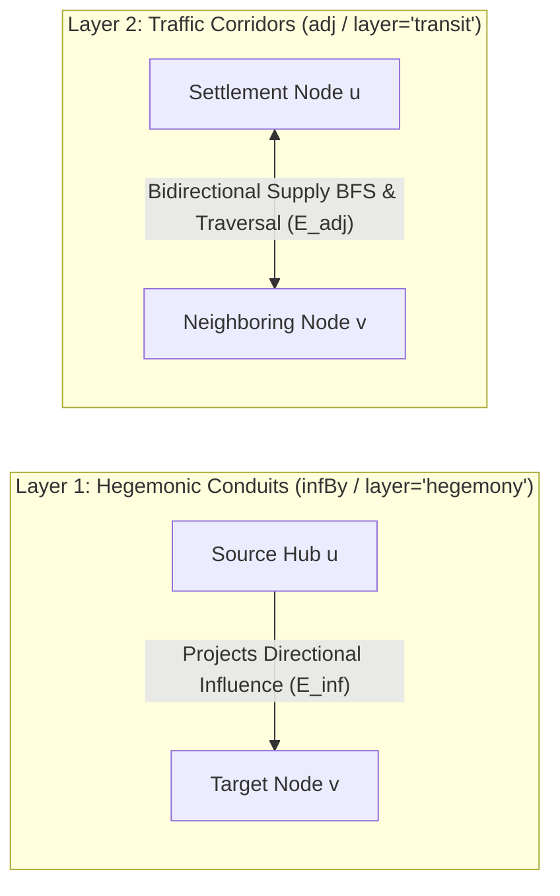

# Series A: Pointcrawl Topological Mathematics & Network Centrality

## 1. Architectural Purpose & Scale-Fluid Graph Model
Series A defines the deterministic graph mathematics governing how Creator Studio models multi-scale pointcrawl topologies, directional hegemonic influence, supply-chain reachability, and ideological contradiction tension across `[[File:start.html]]`, `[[File:docs/srd/authoring_engine_srd.md]]`, and `[[File:src/workstation/scripts/stage_5_slotting.js]]`.

Every map $m$ in a campaign package is formalized as a hybrid graph:
$$G_m = (V_m, E_{\text{adj}}, E_{\text{inf}})$$
where $V_m = \{v_1, \dots, v_N\}$ is a finite set of spatial nodes of arbitrary cardinality $N \ge 1$, $E_{\text{adj}}$ is the set of undirected physical transit corridors, and $E_{\text{inf}}$ is the set of directed hegemonic influence links.

---

## 2. Dual Decoupled Topology: Hegemonic Conduits vs. Traffic Corridors
To prevent ideological influence projection from conflating with physical logistics, the pointcrawl topology decouples edges into two distinct mathematical layers operating over the same node set:

| Topological Layer | Preset Key | Studio Link Property | Helper Function in `stage_5_slotting.js` | Mathematical Role |
| :--- | :--- | :--- | :--- | :--- |
| **Hegemonic Conduits** | `node.infBy` | `link.layer === "hegemony"` or `link.layer === "both"` | `getNodeIncomingSources(nid)` | Models asymmetric political, economic, or religious pressure across nodes. |
| **Traffic Corridors** | `node.adj` | `link.layer !== "hegemony"` (`"transit"` or `"both"`) | `getNodeAdjacents(nid)` | Carries physical player movement and **Supply-Chain BFS Reachability** in `[[File:src/workstation/scripts/stage_5_slotting.js]]`. |

---

## 3. Supply-Chain BFS Reachability & Corridor Severance
Material resource tags (`Power:`, `Chem:`, `Mat:`, `Water:`, `Fuel:`, etc.) propagate across unblocked physical corridors $(u, v) \in E_{\text{adj}}$.

For any node $v \in V_m$, the available supply pool $\text{Supplied}(v)$ computed by `checkNodeAdHocSupplyLine(nid)` and `auditAllSupplyLines()` in `[[File:src/workstation/scripts/stage_5_slotting.js]]` is:
$$\text{Supplied}(v) = \text{LocalYields}(v) \cup \text{EdgeFlows}(v) \cup \bigcup_{u \in \text{Reachable}(v)} \text{LocalYields}(u)$$
where:
- $\text{LocalYields}(u)$ combines intrinsic `u.provides` with `m.provides` for all slotted modules on $u$.
- $\text{EdgeFlows}(v)$ unions `dedicatedFlows` across intact edges incident to $v$.
- $\text{Reachable}(v)$ is the connected component of nodes reachable from $v$ via edges where `condition !== "severed"`.

When a corridor's condition is set to `"severed"`, any downstream node or slotted module whose material `requires` contract is no longer satisfied enters **Severed Supply Status** and degrades to its `standalone_fallback` behavior.

---

## 4. Corridor Contradiction & Sociological Tension Math
Every node $v$ carries a 3-dimensional Organizational Disposition Vector $\text{ODV}(v) = [S_v, E_v, C_v] \in \{1, 2, 3, 4\}^3$ (documented in `[[Series:series_c_sociology_and_tarot_hermeneutics]]`).

Across any edge $(u, v)$, structural tension is quantified by the Manhattan distance between endpoint dispositions (visualized in `[[File:network/contradiction_matrix_dashboard.html]]`):
$$\Delta_{\text{ODV}}(u, v) = |S_u - S_v| + |E_u - E_v| + |C_u - C_v| \in [0, 9]$$
Corridors with high $\Delta_{\text{ODV}}$ represent sharp institutional contradictions where opposing CVF quadrants (e.g., `Hierarchy` vs. `Adhocracy`) collide, providing natural anchors for Tier 4 conflict sparks and border hazards.

---

## 5. Historical Note: Legacy 22-Node Archetype Protocol
In early versions of Creator Studio (retired in `[[File:docs/adr/0011-retirement-of-vestigial-tarot-balancing-engine.md]]`), pointcrawl balancing used a fixed 22-node network paired with a 7-wave Major Arcana draw, amalgamation scoring, and adjacency smothering. That historical protocol is archived in Appendix A of `[[File:docs/srd/authoring_engine_srd.md]]`.
