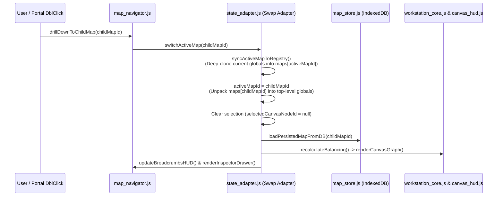

# Series B: Scale-Fluid Nested Cartography & IndexedDB Persistence

## 1. Architectural Purpose & ADR-0003 Foundation
Series B documents the **Scale-Fluid Nested Cartography** architecture introduced in `[[File:docs/adr/0003-bidirectional-wiki-and-scale-fluid-nested-maps.md]]`. Rather than restricting a campaign to a single fixed-scale overland pointcrawl, Creator Studio treats every map as a self-contained pointcrawl graph at one of **7 descriptive scale tiers** (`cosmic` down to `floorplan`), where any node on a parent map can act as a **Portal Node** (`node.childMapId`) drilling down into an entire child map.

Crucially, this multi-map architecture is achieved **without rewriting the single-map simulation engines** (`[[File:mods/tarot_balancing/mod.js]]`, `[[File:src/workstation/scripts/stage_5_slotting.js]]`) by employing a **Global State Swap Adapter** pattern in `[[File:src/workstation/scripts/state_adapter.js]]`, paired with zero-CORS binary image persistence in browser `IndexedDB` via `[[File:src/workstation/scripts/map_store.js]]`.

---

## 2. The 7 Descriptive Scale Tiers (`SCALE_TIERS`)
Defined in `[[File:src/workstation/scripts/state_adapter.js]]`, the `SCALE_TIERS` registry provides visual iconography, topological ordering (`order: 1..7`), and default node nomenclature across seven orders of magnitude:

| Scale ID | Order | Icon | Label | Default Node Term | Typical Authoring Use Case |
| :--- | :---: | :---: | :--- | :--- | :--- |
| `cosmic` | 1 | 🌌 | Cosmic / Planar | Plane / Sphere | Planar cosmology, crystal spheres, astral conduits |
| `continent` | 2 | 🗺️ | Continent / World | Region / Realm | Macro world maps, multi-empire geopolitical theatres |
| `region` | 3 | 🌲 | Region / Island | Settlement / Landmark | **Default Root Scale** (`map_root`); island/province pointcrawls |
| `settlement` | 4 | 🏰 | Settlement / City | District / Ward | City pointcrawls, faction wards, urban power struggles |
| `district` | 5 | 🏘️ | District / Sector | Building / Site | Neighborhood blocks, industrial complexes, dockyards |
| `building` | 6 | 🏛️ | Building / Complex | Room / Chamber | Citadel wings, megadungeon levels, temple complexes |
| `floorplan` | 7 | ⚔️ | Dungeon / Floorplan | Zone / Encounter | Tactical room-by-room dungeon graphs and encounter zones |

When a user clicks **Create Sub-Map** inside the Node Inspector (`promptCreateChildMapForNode(nid)` in `[[File:src/workstation/scripts/map_navigator.js]]`), the engine automatically suggests the next logical child scale (`cosmic/continent -> region -> settlement -> district -> floorplan`, or `building -> floorplan`).

---

## 3. Global State Swap Adapter (`state_adapter.js`)
Because workstation controllers and the SVG renderer operate on top-level mutable globals (`nodes`, `links`, `waves`, `drawnCards`, `sovereignHubs`, `sovereignHubTarget`, `smotheredNodes`, `nodeSlottedModules`, `edgeSlottedModules`, `revealedNodes`, `activeMapMetadata`), `[[File:src/workstation/scripts/state_adapter.js]]` maintains a master `maps` dictionary keyed by `mapId` (initialized with `activeMapId = "map_root"`).

### Core Registry Lifecycle Functions in `[[File:src/workstation/scripts/state_adapter.js]]`
- `createDefaultMapEntry(id, name, scale, parentMapId, parentNodeId)`: Instantiates a clean map record with empty `nodes`, `links`, `waves` (`1..4`), `drawnCards`, `sovereignHubs`, `smotheredNodes`, `nodeSlottedModules`, and `edgeSlottedModules`.
- `syncActiveMapToRegistry()`: Serializes the live top-level globals (`JSON.parse(JSON.stringify(...))`) into `maps[activeMapId]` so no mutations are lost before switching or exporting.
- `switchActiveMap(targetMapId)`:
  1. Calls `syncActiveMapToRegistry()` to snapshot the outgoing map.
  2. Sets `activeMapId = targetMapId` and unpacks `maps[targetMapId]` into the top-level globals.
  3. Resets `selectedCanvasNodeId` and `selectedCanvasEdgeIndex`.
  4. Invokes `loadPersistedMapFromDB(targetMapId)` to swap the SVG `<image id="canvas-map-image">` background layer.
  5. Re-runs `recalculateBalancing()`, `renderCanvasGraph()`, `updateBreadcrumbsHUD()`, `renderInspectorDrawer()`, and `buildWikiIndex()`.
- `attachChildMapToNode(parentMapId, nodeId, childMapId)`: Sets `node.childMapId = childMapId` on the parent node and sets `childMap.parentMapId = parentMapId` and `childMap.parentNodeId = nodeId`.
- `getBreadcrumbPath(mapId)`: Walks `parentMapId` pointers upward with a `visited` set guard (preventing infinite loops if a circular reference ever occurs) and returns the ordered lineage array `[rootMap, ..., activeMap]`.

---

## 4. Portal Node Rendering & Navigation (`canvas_hud.js` & `map_navigator.js`)
### Visual Portal Indicators (`[[File:src/workstation/scripts/canvas_hud.js]]`)
During `renderCanvasGraph()`, any node `n` with a truthy `n.childMapId` pointing to an existing entry in `maps[n.childMapId]` is decorated as a **Portal Node**:
1. **Dashed Cyan Outer Halo**: An SVG `<circle class="portal-outer-ring">` with radius `r = isHub ? 27 : 21`, `stroke="#38bdf8"`, and `stroke-dasharray="4 2"` surrounds the node.
2. **Interactive Scale Badge**: An SVG `<g class="portal-badge">` is rendered at offset `(14, 14)` displaying a dark pill (`#0284c7` border) and the child map's `SCALE_TIERS` icon (`🏰`, `🏘️`, `⚔️`, etc.).
3. **Drill-Down Triggers**:
   - **Single-clicking** the `.portal-badge` stops event propagation and immediately calls `drillDownToChildMap(n.childMapId)`.
   - **Double-clicking (`dblclick`)** anywhere on a Portal Node invokes `drillDownToChildMap(n.childMapId)`.

### Breadcrumb HUD & Keyboard Ascent (`[[File:src/workstation/scripts/map_navigator.js]]`)
- **Top-Left Breadcrumb Bar (`#canvas-breadcrumbs-hud`)**: `updateBreadcrumbsHUD()` renders clickable ancestor links (`🗺️ Opal Island › 🏰 Port Sump`), the active scale badge, an **Up (`↑ Up`)** button (visible whenever `parentMapId` is non-null), and the **Maps (`🗂️ Maps (N)`)** modal button.
- **Escape Key Ascent**: Pressing `Escape` on the canvas (`initCanvasEngine()` in `[[File:src/workstation/scripts/workstation_core.js]]`) first clears any active node/edge selection (`selectedCanvasNodeId` / `selectedCanvasEdgeIndex`); if nothing is selected and the active map has a `parentMapId`, pressing `Escape` ascends directly to the parent map via `ascendToParentMap()`.
- **Map Hierarchy Modal (`#map-navigator-modal`)**: `renderMapNavigatorList()` builds a recursive tree of all maps in `maps`, displaying each map's scale icon, node count, background image indicator (`🖼️`), parent node link, and quick actions (**Open**, **+ Child**, **Delete**).

---

## 5. Multi-Map IndexedDB Binary Storage (`map_store.js`)
Because high-resolution cartographic images (PNG, JPG, WEBP, SVG) routinely exceed the 5 MB quota of `localStorage` and Creator Studio must run offline via `file:///` with zero CORS dependencies, `[[File:src/workstation/scripts/map_store.js]]` persists map artwork inside browser `IndexedDB`:

- **Database Schema**:
  - Database Name: `CreatorStudioMapDB` (`DB_VERSION = 2`)
  - Object Store: `active_map` with `{ keyPath: "id" }`
- **Per-Map Keying & Legacy Compatibility**:
  - Every map stores its binary DataURL record under `id: mapId` (e.g., `"map_root"`, `"map_m9x8a_k2p"`).
  - For backward compatibility with single-map tools, saving `"map_root"` also writes a mirror record under `id: "active_map"`.
  - If `"map_root"` is queried on startup and no `"map_root"` record exists yet, `loadPersistedMapFromDB("map_root")` automatically falls back to reading `"active_map"`.
- **Lightweight Metadata Mirror (`localStorage`)**:
  - `saveMapImageToDB()` caches non-binary metadata (`name`, `width`, `height`, `opacity`, `timestamp`) in `localStorage["cs_maps_meta_catalog"]` (keyed by `mapId`) and `localStorage["cs_active_map_meta"]` for instant synchronous inspection without awaiting an IndexedDB transaction.
- **SVG Coordinate Auto-Projection**:
  - When `applyMapImageToCanvas(dataUrl, width, height, opacity, name)` mounts a background image into `<image id="canvas-map-image">`, it fits the image proportionally inside the `960 × 750` SVG coordinate space (`preserveAspectRatio="xMidYMid meet"`). If the current map's nodes are still in their default circular layout, it gently rescales node coordinates around `(480, 375)` to remain framed within the uploaded map bounds.

---

## 6. Cross-Map Wiki Citations & Nested Export (`wiki_engine.js` & `stage_6_export.js`)
- **Cross-Map Bidirectional Wiki Links (`[[File:src/workstation/scripts/wiki_engine.js]]`)**:
  - `buildWikiIndex()` iterates across **all** maps in `maps` (`Object.keys(maps)`), indexing every node, corridor, and slotted module across the entire nested hierarchy.
  - Authors can cite nodes on other maps using explicit cross-map syntax `[[Node:mapId/nodeId]]` or map links `[[Map:mapId]]`. Clicking a cross-map link automatically calls `switchActiveMap(targetMapId)` before centering the camera (`centerCanvasOnNode(nodeId)`) and opening the Node Inspector.
- **Full Nested Serialization (`[[File:src/workstation/scripts/stage_6_export.js]]`)**:
  - `generateCampaignJSON()` calls `syncActiveMapToRegistry()` and exports `version: "2.0.0-nested"` containing both the complete `maps` registry (`maps[mapId]`) and the root-level snapshot fields for backward compatibility.
  - `importCampaignData(data)` restores `maps` and calls `switchActiveMap(targetMapId)` to rehydrate the entire multi-scale hierarchy cleanly.

---

## 7. Cross-References & Participating Surfaces
- **Authoritative Specifications**: `[[File:docs/adr/0003-bidirectional-wiki-and-scale-fluid-nested-maps.md]]`, `[[File:docs/srd/authoring_engine_srd.md]]`, `[[File:CONTEXT.md]]`
- **Core Implementation Files**: `[[File:src/workstation/scripts/state_adapter.js]]`, `[[File:src/workstation/scripts/map_store.js]]`, `[[File:src/workstation/scripts/map_navigator.js]]`, `[[File:src/workstation/scripts/canvas_hud.js]]`, `[[File:src/workstation/scripts/workstation_core.js]]`, `[[File:src/workstation/scripts/wiki_engine.js]]`, `[[File:src/workstation/scripts/stage_6_export.js]]`
- **Compiled Target**: `[[File:start.html]]`
- **Related Series**: `[[Series:series_a_balancing_and_smothering_math]]`
