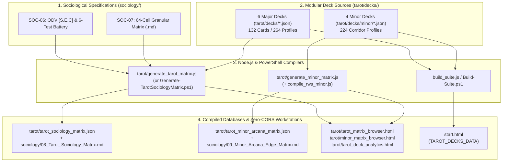

# Series C: The 64-Cell [S, E, C] Disposition Algebra, CVF Quadrants & Tarot Compilers

> **Cross-Cutting Analytical Series**: Complete mapping between organizational sociology (Structure, Energy, Cohesion), the 4 Competing Values Framework (CVF) Cultural Quadrants, Operational Profiles, the 6-Step Deterministic Diagnostic Battery, and the Major/Minor Arcana compiler pipelines.

## 1. Architectural Seam Overview

The **Sociology & Tarot Hermeneutics Engine** translates academic organizational sociology—specifically Cameron & Quinn's Competing Values Framework (CVF), Porter & Groysberg's Strategic Operations Alignment, Richard Daft's Organizational Design, Robert Duncan's Environmental Uncertainty Matrix, and Boris Groysberg's 5-Dimension Culture Radar—into a deterministic, system-agnostic behavioral algebra. Rather than leaving settlement behavior, faction politics, and esoteric Tarot interpretations to subjective improvisation, this subsystem binds every pointcrawl node and transit corridor to reproducible mathematical coordinates.

This series slices across physical directory boundaries (`sociology/`, `tarot/`, `src/workstation/`, `mods/`, and `network/`) to document how the following authoritative specifications, databases, compilers, and interactive surfaces collaborate:

- **Sociological Specifications (`sociology/`)**:
  - [[File:sociology/01_Core_Cultural_Quadrants.md]] — Macro 4-quadrant behavioral engine (Clan, Adhocracy, Market, Hierarchy).
  - [[File:sociology/02_Operational_Profiles_and_Power.md]] — Strategic labor, power flow, and operational trade-offs (Design, Service, Produce, Deliver).
  - [[File:sociology/03_Environmental_Uncertainty_and_Crisis.md]] — Duncan's environmental uncertainty matrix and 4-tick Crisis Metamorphism Clocks.
  - [[File:sociology/04_Sensory_Pentagon_Generator.md]] — Groysberg 5-dimension (`1d6`) procedural sensory settlement generator (Behaviors, Relationships, Attitudes, Values, Environment).
  - [[File:sociology/05_Pointcrawl_Graph_and_Faction_Alignment.md]] — Graph-to-sociology mapping across ideological colors and topological functions (superseding the legacy archive [[File:sociology/05_Node_and_Faction_Mapping.md]] per [[Ticket:SYS-AUDIT-01]]).
  - [[File:sociology/06_Disposition_Matrix_and_Tarot_Decision_Framework.md]] — Formal specification of the 3-dial Organizational Disposition Vector (`[S, E, C]`), the 6-Step Diagnostic Battery, and multi-deck Tarot calibration.
  - [[File:sociology/07_Granular_64_Disposition_Matrix.md]] — The complete 64-cell archetypal taxonomy with Core Boons, Core Burdens, Micro/Macro Passives, and Exemplar NPCs.
  - `sociology/08_Tarot_Sociology_Matrix.md` & `09_Minor_Arcana_Edge_Matrix.md` — Legacy Tarot compendiums retired from the core workstation to optional modular extensions (see [[File:docs/adr/0011-retirement-of-vestigial-tarot-balancing-engine.md]] and [[File:docs/adr/0016-workstation-2-5-zero-install-loopback-and-legacy-framework-retirement.md]]).
  - [[File:sociology/SOCIOLOGY_MASTER_COMPENDIUM.md]] — Consolidated single-file reference uniting `SOC-01` through `SOC-05`.
- **Downstream Workstation & Surface Integration**:
  - [[File:src/workstation/scripts/sociology_data.js]] — Inlined into [[File:start.html]] and referenced by [[File:network/odv_archetype_matrix.html]] to provide the 64-cell `[S, E, C]` disposition lookup, CVF quadrants, and operational profiles.
  - Core math relies on native mathematical baseline `[2, 2, 2]` ("The Deliberative Concord") with dynamic mod hooks (`window.CreatorStudio.registerOdvFallbackResolver`) for future deck extensions.

---

## 2. The 3D Granular Disposition Vector `[S, E, C]`

At the core of [[File:sociology/06_Disposition_Matrix_and_Tarot_Decision_Framework.md]] and [[File:sociology/07_Granular_64_Disposition_Matrix.md]] is the **Organizational Disposition Vector (ODV)**. Every entity—whether a sovereign settlement, splinter faction, NPC leader, or Tarot card orientation—is parameterized as a 3-tuple of integer dials ranging from `1` to `4`:

```text
ODV = [S, E, C]   where   S, E, C in {1, 2, 3, 4}   (4 x 4 x 4 = 64 Discrete Archetypes)
```

### Parameter Definitions & Scale Gradations

| Dial | Sociological Dimension | Rating `1` (Extreme Low) | Rating `2` (Moderate Low) | Rating `3` (Moderate High) | Rating `4` (Extreme High) |
| :--- | :--- | :--- | :--- | :--- | :--- |
| **`S`** | **Structure / Stability vs. Entropy** *(Rate of internal reconfiguration, error tolerance, authority rigidity)* | **Immutable Order / Clockwork**: Totalitarian stasis; stone-carved protocol; zero procedural variance; deviation treated as capital treason. | **Codified Protocol**: Written charters, standardized operating procedures (SOPs), formal hierarchy; bounded legislative review. | **Adaptive Heuristics**: Decentralized problem-solving; policies treated as rough heuristics; situational task-force rotation. | **Hyper-Entropy / Fluid Flux**: Radical ad-hocracy, feral nomadism, or continuous metamorphosis; hourly role reinvention. |
| **`E`** | **Energy / Boundary Focus** *(Locus of purpose, success metric, posture toward outsiders)* | **Hermetic Autarky**: Hyper-internal centripetal focus; outsiders treated as contagion; victory defined by sacred/kin preservation. | **Protective Cohesion**: Community-first mutualism; guarded perimeters; defensive reciprocity and vouched hospitality. | **Transactional Exchange**: Centrifugal mercantile engagement; contract-driven trade volume, tariffs, and competitive leverage. | **Predatory Conquest**: Hyper-external zero-sum expansion; territorial annexation, debt peonage, or biomass/resource extraction. |
| **`C`** | **Cohesion / Systemic Coupling** *(Topological interdependence, logistics, decapitation resilience)* | **Atomized Silo**: Fully self-contained lone workshops or solo agents; indefinite local autarky; leader death disperses cells without killing individuals. | **Loose Confederation**: Decoupled guilds or autonomous skiffs with voluntary treaties; seasonal stockpiled independence (3–6 months). | **Integrated Network**: Federated regional mesh sharing water, fuel, or defense; orderly council succession; 2–4 week logistical horizon. | **Monolithic Matrix / Hive**: Hardwired continental grid or cyber-somatic symbiosis; instant matrix succession upon leader loss, but shuts down in 48–72h if supply lines are severed. |

> [!IMPORTANT]
> **Polarity Convention Note (`S` Dial)**: In `SOC-06` and `SOC-07`, `S = 1` represents maximum **Structural Rigidity / Stability** (Low Entropy), whereas `S = 4` represents maximum **Flexibility / Fluid Entropy**. All downstream derivations (`getCvfQuadrant`, `getOperationalProfile`, `getDuncanUncertainty`, and `getGroysberg5D` in [[File:tarot/generate_tarot_matrix.js]]) strictly follow `S <= 2` = Stable/Ordered and `S >= 3` = Flexible/Entropic.

---

## 3. Deterministic Sociological Derivations

From the primitive `[S, E, C]` coordinate vector, the engine deterministically derives six secondary sociological and mechanical attributes without human guesswork. These pure functions are implemented in [[File:tarot/generate_tarot_matrix.js]] (lines 48–98) and specified in [[File:sociology/06_Disposition_Matrix_and_Tarot_Decision_Framework.md]] (Section 3).

```text
                        +------------------------+
                        |     ODV: [S, E, C]     |
                        +-----------+------------+
                                    |
        +---------------------------+---------------------------+
        |                           |                           |
        v                           v                           v
+-------+---------------+   +-------+---------------+   +-------+---------------+
| CVF Cultural Quadrant |   |  Operational Profile  |   |  Groysberg 5D Radar   |
|   f(S, E) -> SOC-01   |   |   f(S, C) -> SOC-02   |   | f(S, E, C) -> SOC-04  |
| • Clan      (S>=3,E<=2|   | • Design   (S>=3,C<=2)|   | • Behaviors     (1-6) |
| • Adhocracy (S>=3,E>=3|   | • Service  (S>=3,C>=3)|   | • Relationships (1-6) |
| • Hierarchy (S<=2,E<=2|   | • Produce  (S<=2,C<=2)|   | • Attitudes     (1-6) |
| • Market    (S<=2,E>=3|   | • Deliver  (S<=2,C>=3)|   | • Values        (1-6) |
+-----------------------+   +-----------------------+   | • Environment   (1-6) |
                                                        +-----------------------+
```

### 3.1 Competing Values Framework (CVF) Cultural Quadrants: $f(S, E)$

Crossing **Stability/Entropy (`S`)** with **Boundary Focus (`E`)** yields the four macro cultural archetypes from Cameron & Quinn (1999), documented in [[File:sociology/01_Core_Cultural_Quadrants.md]]:

| Stability (`S`) | Boundary Focus (`E`) | CVF Quadrant | Institutional Motto & Leader Type | Daft Strategic Focus | Fatal Structural Flaw |
| :---: | :---: | :--- | :--- | :--- | :--- |
| **`S >= 3`** *(Flexible)* | **`E <= 2`** *(Internal)* | **Clan** *(Collaborate)* | *"We stand together, or we drown together."*<br>Facilitator / Mentor / Patriarch | Internal Maintenance & Flexibility (Collaborative / Human Relations) | **Consensus Paralysis**: Marathon council debates delay rapid crisis response. |
| **`S >= 3`** *(Flexible)* | **`E >= 3`** *(External)* | **Adhocracy** *(Create)* | *"First to invent, last to surrender."*<br>Visionary / Artificer / Maverick | External Positioning & Flexibility (Open Systems / Creative Innovation) | **Exhaustion & Anarchy**: Constant pivoting burns through personnel and capital. |
| **`S <= 2`** *(Stable)* | **`E <= 2`** *(Internal)* | **Hierarchy** *(Control)* | *"Protocol is life; deviation is extinction."*<br>Coordinator / Monitor / High Arbiter | Internal Maintenance & Stability (Internal Process / Bureaucratic Control) | **Brittle Rigidity**: Paralyzed by out-of-manual anomalies; guards await dead superiors' orders. |
| **`S <= 2`** *(Stable)* | **`E >= 3`** *(External)* | **Market** *(Compete)* | *"Results justify the balance sheet."*<br>Hard-Driver / Producer / Cartel Boss | External Positioning & Stability (Rational Goal / Competitive Productivity) | **Moral Attrition & Sabotage**: Cutthroat quotas breed internal paranoia and backstabbing. |

### 3.2 Strategic Operational Profiles: $f(S, C)$

Crossing **Stability/Entropy (`S`)** with **Systemic Coupling (`C`)** yields the four operational machinery profiles from Porter, Groysberg, and Daft, documented in [[File:sociology/02_Operational_Profiles_and_Power.md]]:

| Stability (`S`) | Coupling (`C`) | Operational Profile | Organizational Structure & Execution | Basis of Power | Inherent Strategic Sacrifice |
| :---: | :---: | :--- | :--- | :--- | :--- |
| **`S >= 3`** *(Flexible)* | **`C <= 2`** *(Independent)* | **Design** *(Specialist Enclave)* | Autonomous master-apprentice cells $\to$ *Enable & Support* | Monopoly on technical insight & esoteric craft | Sacrifices defensive unity and mass scalability for bespoke breakthroughs. |
| **`S >= 3`** *(Flexible)* | **`C >= 3`** *(Interdependent)* | **Service** *(Mutualist League)* | Flat rotating committees $\to$ *Experience & Accountability* | Reputational debt & moral authority | Sacrifices command speed and centralized force for distributed resilience. |
| **`S <= 2`** *(Stable)* | **`C <= 2`** *(Independent)* | **Produce** *(Extractive Mill)* | Rigid foreman-overseer pyramid $\to$ *Enforce & Control* | Physical coercion & resource monopolies | Sacrifices worker morale and adaptive thinking for brute production volume. |
| **`S <= 2`** *(Stable)* | **`C >= 3`** *(Interdependent)* | **Deliver** *(Matrix Bastion)* | Cross-functional matrix councils $\to$ *Enroll & Responsibility* | Institutional legitimacy & systemic redundancy | Sacrifices individual liberty and improvisation for bulletproof survivability. |

### 3.3 The 8 Octants & 64-Cell Dual-Horizon Matrix

When all three binary splits (`Low 1–2` vs. `High 3–4` across `S`, `E`, `C`) are combined, they form the **8 Macro Octants** defined in [[File:sociology/06_Disposition_Matrix_and_Tarot_Decision_Framework.md]] (Section 7):
- **Octant #1 `[Low, Low, Low]`**: *The Hermetic Vault* (`Hierarchy` / `Produce` — Passive: *Hermetic Seal*)
- **Octant #2 `[Low, Low, High]`**: *The Fortress Bastion* (`Hierarchy` / `Deliver` — Passive: *Phalanx Redundancy*)
- **Octant #3 `[Low, High, Low]`**: *The Extractive Slag-Mill* (`Market` / `Produce` — Passive: *Grim Quota*)
- **Octant #4 `[Low, High, High]`**: *The Predatory Syndicate* (`Market` / `Deliver` — Passive: *Monopolistic Stranglehold*)
- **Octant #5 `[High, Low, Low]`**: *The Artisan Enclave* (`Clan` / `Design` — Passive: *Esoteric Crucible*)
- **Octant #6 `[High, Low, High]`**: *The Mutualist Hearth* (`Clan` / `Service` — Passive: *Communal Hearth*)
- **Octant #7 `[High, High, Low]`**: *The Rogue Corsair* (`Adhocracy` / `Design` — Passive: *Ghost Trade*)
- **Octant #8 `[High, High, High]`**: *The Swarm Armada* (`Adhocracy` / `Service` — Passive: *Swarm Momentum*)

In [[File:sociology/07_Granular_64_Disposition_Matrix.md]], each of the 8 Octants is subdivided into 8 specific integer coordinates ($8 \times 8 = 64$ cells, from `[1, 1, 1]` *The Sealed Monolith* to `[4, 4, 4]` *The Entropic Vortex*). Every cell defines:
- **Core Boon** & **Core Burden**: The structural superpower and its inescapable organizational blind spot.
- **Micro Passive (Internal Mechanics)**: Governs interior damage sharing, morale, research speed, and deviance handling inside the node perimeter.
- **Macro Passive (Influence Sphere)**: Projects outward across connected pointcrawl edges (e.g., quarantine null-zones, tariff liens, assimilation creep, or boomtown liquidity).
- **Exemplar NPC & Interaction Hook**: A concrete voice line and immediate tabletop dilemma.

### 3.4 Secondary Algebraic Formulas (Uncertainty, Radar, Friction & Affinity)

[[File:tarot/generate_tarot_matrix.js]] and [[File:sociology/06_Disposition_Matrix_and_Tarot_Decision_Framework.md]] compute four additional metrics from `[S, E, C]`:

- **Groysberg 5D Pentagon Radar (`1` to `6` scale per dimension, matching [[File:sociology/04_Sensory_Pentagon_Generator.md]])**:
  ```javascript
  const behaviors     = s === 4 ? 6 : s === 3 ? 4 : s === 2 ? 2 : 1;
  const relationships = Math.min(6, Math.max(1, Math.round((5 - s + c) * 0.75)));
  const attitudes     = Math.min(6, Math.max(1, Math.round((s + e) * 0.75)));
  const values        = Math.min(6, Math.max(1, Math.round((5 - e + s) * 0.75)));
  const environment   = Math.min(6, Math.max(1, Math.round((5 - s + c * 1.2) * 0.65)));
  ```
- **Baseline & Party Social Friction Dial ($F_p \in \{1, 2, 3, 4\}$)**:
  - *Card Baseline Friction* (relative to a pragmatic adventurer party at `[S=3, E=3]`):
    $$F_{\text{base}} = \text{clamp}\left(1, 4, 1 + \left\lfloor \frac{|3 - S| + |3 - E|}{2} \right\rfloor \right)$$
  - *Dynamic Party-to-Target Friction*:
    $$F_p = \text{clamp}\left(1, 4, 1 + \left\lfloor \frac{|S_{\text{party}} - S_{\text{target}}| + |E_{\text{party}} - E_{\text{target}}|}{2} \right\rfloor \right)$$
    Where $F_p = 1$ grants social advantage (Harmonic Resonance) and $F_p = 4$ makes verbal negotiation impossible without radical concession (Existential Incompatibility).
- **Topological Network Influence Affinity ($\text{Affinity}(A, B) \in [0, 1]$)**:
  $$\text{Affinity}(A, B) = 1.0 - \left(\frac{|S_A - S_B| + |E_A - E_B| + |C_A - C_B|}{9}\right)$$
  When $\text{Affinity} \ge 0.75$, cultural influence propagates smoothly across the edge; when $\text{Affinity} \le 0.35$, severe ideological rejection triggers border skirmishes and Conflation Rumors.
- **Dial Intensity Scaling**:
  $$\text{Intensity} = |S - 2.5| + |E - 2.5| + |C - 2.5|$$
  Moderate coordinates (`2` or `3` on all dials, $\text{Intensity} = 1.5$) yield `d6/d8` resource dice and `1-tick` clock progression; extreme corner coordinates (`1` or `4` on all dials, $\text{Intensity} = 4.5$) yield `d10/d12` supercharged boons alongside `2-tick` catastrophic vulnerability clocks.

---

## 4. The 6-Step Deterministic Diagnostic Battery (`SOC-06`)

To guarantee high **inter-rater reliability** when scoring a faction or Tarot card, authors never assign `[S, E, C]` numbers by intuition. Instead, [[File:sociology/06_Disposition_Matrix_and_Tarot_Decision_Framework.md]] (Section 4) and [[File:tarot/decks/_deck_template.json]] enforce a **6-question diagnostic battery** (two empirical tests per dial, each scored `1` to `4`):

| Dial | Test ID | Diagnostic Inquiry | Score `1` Anchor | Score `2` Anchor | Score `3` Anchor | Score `4` Anchor | Formula |
| :---: | :---: | :--- | :--- | :--- | :--- | :--- | :---: |
| **`E`** | **`tE1`** | **The Metric of Triumph**: *How does leadership calculate a successful cycle?* | Zero internal losses; sacred purity preserved. | Local stockpiles full; defensive border equilibrium. | Trade surplus expanded; rivals indebted. | New territory annexed; external resources stripped. | $E = \text{round}\left(\frac{\text{tE1} + \text{tE2}}{2}\right)$ |
| **`E`** | **`tE2`** | **The Stranger Encounter**: *How is an unaccompanied outsider processed at the gate?* | Immediate quarantine, blinding, or execution as contaminant. | Barred unless vouched by a member under shared penalty. | Escorted to customs bazaar; taxed and appraised for trade. | Stripped of gear, conscripted, or harvested as feedstock. | *(Computed in `generate_tarot_matrix.js`)* |
| **`S`** | **`tS1`** | **The Deviance / Error Threshold**: *How is an unapproved procedural shortcut treated?* | Capital treason or sacrilege; immediate trial/purge. | Bureaucratic reprimand, demotion, or docked rations. | Quietly adopted as local heuristic if it solved a problem. | Celebrated breakthrough; rulebook discarded immediately. | $S = \text{round}\left(\frac{\text{tS1} + \text{tS2}}{2}\right)$ |
| **`S`** | **`tS2`** | **Reconfiguration Cadence**: *How rapidly do command roles and laws shift?* | Millennial granite; ancestral castes unchanged for eras. | Codified legislative review and stamped charters. | Situational committee rotation among veteran peers. | Hourly ad-hocracy; command belongs to whoever seizes the wheel. | *(Computed in `generate_tarot_matrix.js`)* |
| **`C`** | **`tC1`** | **Decapitation Vulnerability**: *What happens 24 hours after the leader is assassinated?* | Immediate cell dispersal into solo wilderness survival. | Autonomous sub-guilds lock doors and compete for assets. | Orderly council succession via designated deputy. | Seamless matrix absorption without missing a shift. | $C = \text{round}\left(\frac{\text{tC1} + \text{tC2}}{2}\right)$ |
| **`C`** | **`tC2`** | **Logistical Autarky Horizon**: *How long can an outpost survive if all edges are severed?* | Indefinite autarky (own water, seed vault, repair forge). | Seasonal independence (3–6 months on local caches). | Fragile interdependence (2–4 weeks before fuel/food dry). | Critical grid-lock (shuts down in 48–72h without feed). | *(Computed in `generate_tarot_matrix.js`)* |

---

## 5. Major Arcana Node Hermeneutics (6 Decks, 264 Profiles)

In the pointcrawl graph $G = (V, E_{\text{adj}}, E_{\text{inf}})$, the **22 Major Arcana (Keys `0` to `XXI`)** govern the **22 Regional Nodes ($V$)**. Because different esoteric and artistic traditions interpret the same card through radically different ontological lenses, Creator Studio decouples Major Arcana sociology into **6 modular deck databases** in `tarot/decks/` ($6 \text{ decks} \times 22 \text{ cards} \times 2 \text{ orientations} = 264 \text{ evaluated profiles}$):

| Deck ID & File | Tradition Name | Author / Source Canon | Ontological Lens | Reversal / Ill-Dignified Hermeneutic Rule |
| :--- | :--- | :--- | :--- | :--- |
| `crowley_thoth`<br>[[File:tarot/decks/crowley_thoth.json]] | **Crowley Thoth** | Aleister Crowley & Lady Frieda Harris (*Book of Thoth*; Akron & Banzhaf) | Esoteric Alchemical-Thelemic | Represents intellectual hubris, cold solipsism, *"The Ape of Thoth"* (mockery of wisdom), or detached arcane megalomania. |
| `rider_waite_smith`<br>[[File:tarot/decks/rider_waite_smith.json]] | **Rider-Waite-Smith** | Arthur Edward Waite & Pamela Colman Smith (*Pictorial Key to the Tarot*) | Exoteric Moral-Humanist | Represents human ethical failure, street con-artistry, broken civic covenants, weakness, or pettiness. |
| `hr_giger`<br>[[File:tarot/decks/hr_giger.json]] | **H.R. Giger (Baphomet)** | H.R. Giger & Akron (*Baphomet: Tarot der Unterwelt*) | Biomechanical Alienist | Represents catastrophic reactor breaches, necrotic tissue rejection, and predatory flesh-machine hive assimilation. |
| `salvador_dali`<br>[[File:tarot/decks/salvador_dali.json]] | **Salvador Dalí Universal Tarot** | Salvador & Gala Dalí (Rachel Pollack; Johannes Fiebig) | Surrealist Paranoiac-Critical & Alchemical-Mystic | Represents paranoiac delirium, temporal disintegration (melting watches), narcissistic grandiosity, or collapse of crutches. |
| `qabalistic_wang`<br>[[File:tarot/decks/qabalistic_wang.json]] | **The Qabalistic Tarot** | Dr. Robert Wang & Israel Regardie (Golden Dawn *Book 'T'*) | Hermetic-Qabalistic (32 Paths of Wisdom) | Represents energetic obstruction on the Tree of Life, astral friction, unbalanced elemental forces, or dogmatic blindness in Assiah. |
| `paul_foster_case`<br>[[File:tarot/decks/paul_foster_case.json]] | **Paul Foster Case (B.O.T.A.)** | Dr. Paul Foster Case & Jessie Burns Parke (*Wisdom of the Ages*) | Ageless Wisdom, Sound-Color Qabalah & Esoteric Psychology | Represents inverted suggestion, subconscious friction, servitude to external appearances, or scattered conscious attention. |

### Comparative Calibration Proof: Key I (The Magician — Reversed)

Section 5.2 of [[File:sociology/06_Disposition_Matrix_and_Tarot_Decision_Framework.md]] demonstrates why deck ontology matters by running **The Reversed Magician (Key I)** through the 6-Step Diagnostic Battery across three traditions:

- **Rider-Waite-Smith (`[4, 4, 1]` — *The Lone Apex Predator / Stage Prestidigitator*)**:
  - *Diagnostics*: Fleeces marks (`tE1=4`, `tE2=4` $\to E=4$), pivots aliases hourly (`tS1=4`, `tS2=4` $\to S=4$), operates out of a solo carpetbag (`tC1=1`, `tC2=1` $\to C=1$).
  - *Sociology*: **Adhocracy / Design** (`Red / Black`). Injects false lore and black-market arbitrage into the host node.
- **Crowley Thoth (`[2, 1, 1]` — *The Hermetic Academy / Ape of Thoth*)**:
  - *Diagnostics*: Obsessed with solitary esoteric gnosis and indifferent to commoners (`tE1=1`, `tE2=1` $\to E=1$), bound to strict astrological formulas (`tS1=2`, `tS2=2` $\to S=2`), isolated in a lone tower (`tC1=1`, `tC2=1` $\to C=1$).
  - *Sociology*: **Hierarchy / Produce** (`White / Blue`). Hoards arcane schematics and imposes high social friction.
- **H.R. Giger (`[1, 4, 4]` — *The Biomechanical Hive / Conduit*)**:
  - *Diagnostics*: Harvests external biomass and electrical wattage (`tE1=4`, `tE2=4` $\to E=4$), enforces zero-tolerance biological-industrial cycles (`tS1=1`, `tS2=1` $\to S=1$), hardwired into a cybernetic neural matrix (`tC1=4`, `tC2=4` $\to C=4$).
  - *Sociology*: **Market / Deliver** (`Black / White`). Radiates *Assimilation Creep* across adjacent edges and forces neighboring nodes into Crisis Metamorphism.

---

## 6. Minor Arcana Edge & Corridor Topology (4 Decks, 224 Profiles)

While Major Arcana cards govern **Nodes ($V$)**, `sociology/09_Minor_Arcana_Edge_Matrix.md` and [[File:tarot/generate_minor_matrix.js]] map the **56 Minor Arcana** across 4 canonical traditions ($4 \times 56 = 224 \text{ profiles}$) to the **52 Directed Edges ($E_{\text{adj}}$ / 26 Transit Corridors)** connecting the pointcrawl graph.

### 6.1 Suit Domains & Elemental Conduits

| Suit | Element | Kabbalistic World | Corridor Domain & Topological Pressure | Typical Sensory Atmosphere |
| :--- | :--- | :--- | :--- | :--- |
| **Wands** (`wands_01`..`14`) | Fire | *Atziluth* (Archetypal) | Thermal energy, volcanic/industrial conduits, aggressive military vectors, swift initiative pushes. | Scorching dry winds, sulfur vents, glowing furnace ash, static electricity along ridge lines. |
| **Cups** (`cups_01`..`14`) | Water | *Briah* (Creative) | Hydrological drainage, maritime trade, estuarine navigation, psionic and emotional currents. | Dense sea fog, tidal surges, bioluminescent currents, subterranean mist, siren echoes. |
| **Swords** (`swords_01`..`14`) | Air | *Yetzirah* (Formative) | High-altitude gales, alpine chokepoints, contested border skirmishes, intellectual espionage. | Biting frost winds, razor-thin mountain ledges, whistling canyon drafts, squall fronts. |
| **Disks / Pentacles** (`disks_01`..`14`) | Earth | *Assiah* (Material) | Telluric conduits, deep mining tramways, heavy cargo haulage, mercantile checkpoints. | Deep subterranean rumbles, grinding tectonic plates, rich mineral dust, damp stone vaults. |

### 6.2 Corridor Friction Dials & Edge Schema

Each Minor Arcana card profile in `tarot/decks/minor/*.json` defines a `corridorTopologicalProfile` and `tabletopRuntime` block:
- **`transitFriction` (`0` to `4`)**:
  - `Friction 0–1 (Root / Highway)`: Unobstructed conduits (`Ace`, `Six`, `Eight of Wands`); high flow rate, `+2` to `+4` upstream force push, `0` attrition drain.
  - `Friction 2 (Established Route)`: Regulated highways and maintained roads; predictable customs tolls, steady flow.
  - `Friction 3 (Contested Chokepoint)`: Active skirmish zones, ambush ravines, heavy weather hazards, `-1` to `-2` leech drain.
  - `Friction 4 (Extreme Impasse)`: Blockaded gauntlets (`Three`, `Five`, `Nine`, `Ten of Swords`, `Ten of Wands`); crushing labor corridors, `-3` to `-4` severe attrition drain.
- **`flowDirectionBias`**, **`upstreamPressure`**, and **`downstreamDrain`**: Govern directional influence modifiers along directed graph links.
- **`tabletopRuntime`**: Provides an immediate `patrolEncounter`, a 4-tick `travelHazardClock`, an `effectiveTravelLever`, a `fatalTravelError`, a hidden `smugglersVector` bypass, and a `scenarioPrompt`.

> [!WARNING]
> **Duplicate Minor Arcana Mirror Notice ([[Ticket:SYS-AUDIT-01]])**: The authoritative Minor Arcana JSON files reside in `tarot/decks/minor/` ([[File:tarot/decks/minor/crowley_thoth_minor.json]], [[File:tarot/decks/minor/qabalistic_wang_minor.json]], [[File:tarot/decks/minor/rider_waite_smith_minor.json]], [[File:tarot/decks/minor/salvador_dali_minor.json]]). Note that [[File:tarot/generate_minor_matrix.js]] writes duplicate mirrors of `minor_deck_manifest.json` and `minor_decks_registry.js` to both `tarot/decks/minor/` and `tarot/decks/`, and root copies of `*_minor.json` exist in `tarot/decks/`. Always edit the canonical files in `tarot/decks/minor/` (see [[Series:series_g_duplicate_and_orphan_audit]]).

---

## 7. End-to-End Compiler & Data Flow Pipeline



1. **Matrix Parsing**: [[File:tarot/generate_tarot_matrix.js]] parses the 64 Markdown table rows directly out of [[File:sociology/07_Granular_64_Disposition_Matrix.md]] using regex extraction and indexes them by `[S, E, C]` coordinate tag.
2. **Major Deck Compilation**: For every deck in `tarot/decks/*.json`, `generate_tarot_matrix.js` evaluates `diagnosticScores` (`tE1..tC2`), computes `odv = [s, e, c]`, derives CVF quadrant, Operational Profile, Daft focus, Duncan uncertainty, MTG color, Friction Base, and Groysberg 5D radar, links the matching `SOC-07` row, and emits [[File:tarot/tarot_sociology_matrix.json]], [[File:tarot/decks/deck_manifest.json]], [[File:tarot/decks/decks_registry.js]], `sociology/08_Tarot_Sociology_Matrix.md`, and the unified Major+Minor workstation [[File:tarot/tarot_matrix_browser.html]].
3. **Minor Deck Compilation**: [[File:tarot/generate_minor_matrix.js]] scans `tarot/decks/minor/*.json`, compiles [[File:tarot/tarot_minor_arcana_matrix.json]], [[File:tarot/decks/minor/minor_deck_manifest.json]], [[File:tarot/decks/minor/minor_decks_registry.js]], `sociology/09_Minor_Arcana_Edge_Matrix.md`, and [[File:tarot/minor_matrix_browser.html]].
4. **Master Suite Bundling**: [[File:build_suite.js]] (invoked via [[File:Build-Suite.ps1]]) compiles all Major and Minor decks into `TAROT_DECKS_DATA` inlined into [[File:start.html]] for offline `file:///` execution (see [[Series:series_e_zero_cors_compiler_and_agent_router]]).
